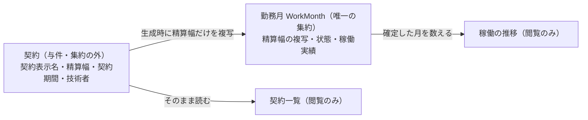

# 0021. MVP スコープに閲覧系の画面を加え、フォントと祝日データを同梱する

- **ステータス**: 提案中
- **日付**: 2026-10-09（2026-10-10・2026-10-13 の人間決定を含めて起草）
- **決定者**: 人間（プロジェクトオーナー）

> ステータスを「提案中」で起票したのは、決定の中身は人間が 2026-10-09・2026-10-10・2026-10-13 に下したものの、この ADR の文面は **AI（仕様工程）が起草した**ためである。AI は ADR を単独で「承認済み」にしない（ADR 0001 運用ルール5）。人間が文面を承認した時点で「承認済み」へ改める。

## コンテキスト

画面デザインの刷新（テーマ B）にあたり、Claude Design から画面一式のハンドオフを受け取った（`design/handoff/2026-10-theme-b/`。記録であって正ではない。`design/handoff/README.md`）。ハンドオフには、既存の MVP スコープに無い画面と、既存の仕様が禁じている依存と、いまのデータに無い項目が含まれていた。

1. **スコープ外の画面** — `docs/rules/scope.md` は「MVP のユースケースは3つに限定し、これ以外を実装しない」と定めている。ハンドオフにはヘルプ・一覧の絞り込み・契約一覧・稼働の推移・承認担当者一覧が含まれ、いずれも3ユースケースのどれにも直接は当たらない。デザインを採るなら、スコープを改めるか、画面を落とすかを決める必要があった
2. **いまのデータに無いもの** — 契約一覧は契約期間を表示するが、契約のデータに期間は無い（`docs/specs/workmonth-implementation-design.md` AC-6-3 の `Contract` は識別子・契約表示名・技術者識別子・精算幅だけを持つ）。稼働の推移は「確定した月」の平均を示すが、どの状態の勤務月を確定とみなすかの定義が無かった
3. **外部フォント配信** — ハンドオフは本文に Zen Kaku Gothic New、数字に Space Grotesk を使い、どちらも Google Fonts から読み込む前提で作られている。一方 `docs/specs/design-system.md` AC-4-3 は外部フォント配信への依存を持たないと定めている（`globals.css` に `@import url(` を書かず、`next/font/google` を使わない）。理由は実行時・ビルド時の外向き依存を増やさないためである（`docs/rules/cost-guardrails.md`）
4. **祝日の表示** — ハンドオフのカレンダーは祝日を表示する。祝日の判定には暦のデータが要り、外部の API から取得すれば、フォントと同じく実行時の外向き依存が生まれる

同じ刷新では、ほかに次の点も人間が決定した。いずれも**本 ADR の決定ではない**が、同じ契機で決まったため背景として記す。正解はそれぞれの仕様が持つ（ADR 0004）。

- 見た目はテーマ B とし、明色を基本に暗色も残し、利用者がトグルで切り替え、選択を保存する（`docs/specs/design-system.md` と UI 仕様）
- 稼働実績の入力方式を、稼働時間の直接入力から「開始・終了・休憩の時刻から算出する」方式へ改め、時刻を稼働実績に保存する。業務ルールの変更であり、正解は `docs/specs/daily-record-entry.md`（D-2・D-3・D-7・D-10〜D-17）が持つ
- 承認・差戻しの前に確認ダイアログを出す。差戻しに理由の入力欄は設けない（`docs/specs/approval-ui.md` AC-2 を維持する）
- 一覧の1ページあたりの件数は固定しない（`docs/specs/work-month-listing-ui.md` AC-4-2、`docs/specs/design-system.md` AC-6-10 を維持する）
- フォーカスの表示は `focus-visible:` のリング方式のままとする（`docs/specs/design-system.md` AC-4-5・AC-4-6 を維持する）

## 決定

### 1. MVP スコープに閲覧系の画面を4つ加える

業務ユースケースは**3つのまま変えない**ものとする（稼働実績の入力・編集／月次締め／承認申請・承認）。そのうえで、3ユースケースを支える**閲覧系の画面**として次の4つをスコープに加える。

| 画面 | 範囲 |
|---|---|
| ヘルプ | 勤務月の流れ・稼働実績の入力・精算幅と超過／不足を説明する。全ロール（ゲストを含む）が閲覧する |
| 一覧の絞り込み | 自分の勤務月の一覧（契約・対象年月・状態）と、承認待ちの一覧（契約・対象年月）に絞り込みを加える |
| 契約一覧 | 技術者が**自分の**契約を閲覧する |
| 稼働の推移 | 技術者が**自分の**勤務月について、契約ごとに月々の総稼働時間と精算幅を見比べる |

4つはいずれも**状態を変える操作を持たない**ものとする。勤務月の状態を変えられるのは、引き続き3ユースケースの操作（入力・編集・削除／締め／承認・差戻し）だけである。

採らないもの（非スコープのまま）は次のとおり。

- 承認担当者一覧（ハンドオフの `Engineers.dc.html`）。承認者が技術者ごとの勤務月を横断して見る画面であり、**技術者の横断ビュー**に当たる（`docs/domain/ubiquitous-language.md`「MVP スコープ外」）。また、承認者と技術者の対応づけを前提とするため、**承認者の割り当て**を作らないという `docs/rules/scope.md` の非スコープとも衝突する
- 契約の管理（CRUD）。契約一覧は**閲覧のみ**であり、契約の作成・変更・削除の画面も操作も作らない
- ユーザー・ロール管理画面、請求・支払・ファイル添付

### 2. 契約一覧・稼働の推移の元データ

集約は **`WorkMonth` の1つのまま**変えない。契約は与件であり、勤務月の集約の外にある。契約一覧と稼働の推移は、勤務月の集約をまたいで読む**参照系の関心事**として扱う（ユビキタス言語「勤務月の同一性」の帰結）。

契約一覧は次のとおりとする。

- 契約が持つデータ、すなわち契約表示名・精算幅・契約期間・技術者を、一覧は加工せずに**そのまま読む**ものとする。技術者は自分の契約だけを見る
- 契約期間は、いまの契約のデータに無いため**項目として足す**ものとする。契約期間は**年月の範囲**で表し、開始の年月と終了の年月を持つ。終了の年月が定まらない契約を許す（例: 2025年4月〜）
- 契約期間は**表示にだけ使う**ものとする。勤務月へ複写しない。対象年月が契約期間の外にあるかを検査しないという既存の人間決定（`docs/specs/workmonth-implementation-design.md` AC-13-9、`docs/specs/domain-api-http-contract.md` AC-11-5）を、本 ADR は変えない。契約期間と対象年月の整合の検査は、今回は足さず、**将来の検討事項**として残す（下の「将来の検討事項」）
- 契約の管理（CRUD）は**作らない**ものとする。契約のデータはデモデータとして投入する。投入の手段は実装工程が決める

稼働の推移は次のとおりとする。

- 締め済（`PendingApproval`）と承認済（`Approved`）の勤務月を、「確定した月」として**数える**ものとする。締めは「その月の入力を確定させる」操作であり（ユビキタス言語「状態と操作」）、その後の状態にある月を確定とみなす
- 下書き（`Draft`）の勤務月は、「入力中」として確定した月と**区別して示す**ものとする。入力中の月は、平均と「精算幅に収まった月」の数から**外す**ものとする
- 「精算幅に収まった月」は、確定した月のうち超過も不足も生じていない月とする（超過・不足はユビキタス言語「精算」の定義どおり）
- 月ごとに比べる精算幅は、**各勤務月が生成時に写し取った精算幅**とし、契約のいまの精算幅を使わない。確定した月の超過・不足は、締め時に勤務月へ保存された値（`docs/specs/monthly-closing.md` AC-3）と一致する。その算出は総稼働時間と勤務月が保持する精算幅だけを入力にし、契約の現在値を参照しないため（`docs/specs/workmonth-implementation-design.md` AC-5-8）、推移と勤務月画面と保存済みの超過・不足が食い違わない
- 平均は、**利用者が選んだ期間**の確定した月の総稼働時間を平均したものとし、時間を単位とする小数で**小数第1位まで**示す（小数第2位を四捨五入する。2026-10-13 に人間が確定）。選んだ期間の外の月と入力中の月は平均に含めない。期間の選び方と表記の細部は稼働の推移の UI 仕様が持つ
- 新しい状態は加えない。「確定した月」「入力中」「精算幅に収まった月」は既存の状態の数え方と呼び分けであり、語は 2026-10-10 に人間が確定した（`docs/domain/ubiquitous-language.md`「稼働の推移で使う語」）

### 3. フォントはリポジトリに同梱し、自前で配信する

Zen Kaku Gothic New と Space Grotesk のフォントファイルを**リポジトリに同梱**し、アプリ自身の配信経路（S3 + CloudFront。ADR 0013）から配信する。Google Fonts などの外部配信には、実行時もビルド時も**依存しない**ものとする。

- `docs/specs/design-system.md` AC-4-3 の趣旨（外部フォント配信への依存を持たない）を保つ。`@import url(` による外部読み込みも `next/font/google` も使わない
- フォントファイルの置き場所・読み込みの手段・同梱するウェイトとサブセットは本 ADR で固定しない。`docs/specs/design-system.md` が持つ
- 両フォントのライセンス条件（再配布時の著作権表示・ライセンス文の同梱）を満たす形で同梱する。条件の確認と同梱の形は実装工程が行い、`docs/specs/design-system.md` に記す

### 4. 祝日のデータはリポジトリに同梱し、表示だけに使う

カレンダーに祝日を表示する。判定には、内閣府が公表する「国民の祝日」のデータを**リポジトリに同梱**して使う。実行時にもビルド時にも外部から取得しない（決定3と同じ理由）。

- 祝日は**表示だけに使い**、業務ルールには影響させない。稼働実績の検証・稼働時間の算出・総稼働時間・締め・承認のいずれも祝日を参照しない。`docs/specs/daily-record-entry.md` D-7・AC-7-5（休日・祝日の区分を持たない）を維持する
- データの置き場所・更新の手順・同梱する対象の年は本 ADR で固定しない。カレンダーを持つ画面の UI 仕様が持つ
- データの利用条件を確認し、求められる出典の表示を満たす形で同梱する。確認は実装工程が行う

## 影響

### 良い影響

- **デザインの採否とスコープの判断が一致する**ようになる。スコープ外の画面を「デザインにあるから」黙って実装する道が塞がれ、何を加え何を採らなかったかが記録に残る
- **業務ユースケースの数も集約の数も変わらない**まま画面を足せる。加えた画面はいずれも状態を変えず、契約は参照系として読むだけであるため、集約の不変条件・状態遷移・締めと承認の規則は影響を受けない
- 「確定した月」を**既存の状態で定義できる**ため、新しい状態も新しい操作も要らない。締めの意味（入力の確定）と画面の数え方が揃う
- **外部配信への依存が生まれない**構成を保てる。フォントも祝日も同梱するため、CDN や外部 API の障害・通信の制限（devcontainer の外向き通信の制限を含む）・第三者へのアクセス送信に左右されない

### 悪い影響 / トレードオフ

- 「3ユースケース以外を実装しない」という**単純な線が崩れる**ことになる。閲覧系であれば足してよい、という読み違いを招きうる。歯止めは `docs/rules/scope.md` が4画面を名指しで列挙することに置き、**列挙に無い画面は閲覧系であっても加えない**
- **契約のデータに項目が増える**が、契約期間は与件のデータとして足すだけで、勤務月の規則とは結び付けない。そのため、契約期間の外にある年月にも勤務月を作れるという既存の帰結（`docs/specs/workmonth-implementation-design.md` AC-13-9）は残り、画面に期間が出るぶん食い違いが目に付きやすくなる。検査を足すかは下の「将来の検討事項」に送る
- **入力中の月は推移の数から外れる**ため、締める前の月は平均に入らない。月の途中で見る推移は、直近の月を含まない
- **配信量が増える**ことになる。日本語フォントはファイルが大きく、同梱するウェイトの数だけ CloudFront の転送量が増える（無料枠 1TB / 月。`docs/rules/cost-guardrails.md`）。サブセット化・ウェイトの絞り込みで抑えるかは `docs/specs/design-system.md` で決める
- **リポジトリにバイナリとデータが増える**ことで、管理する対象が増える。フォントの更新も祝日データの更新も手作業になる。祝日データは公表された年の分しか持てず、同梱していない年の祝日は表示されない
- **`docs/specs/design-system.md` の既存の受け入れ条件と衝突しうる**点が残る。同 AC-4-2（`body` に `font-family` を直接書かず Tailwind 既定の `--font-sans` に従う）は、フォントを指定する前提と両立する形への改定が要る。改定は同仕様の工程が行う

## 将来の検討事項

- **契約期間と対象年月の整合の検査** — 2026-10-10 に人間が、今回は足さないと決めた。契約期間は表示にだけ使い（決定2）、契約期間の外にある年月にも勤務月を作れる既存の帰結（`docs/specs/workmonth-implementation-design.md` AC-13-9、`docs/specs/domain-api-http-contract.md` AC-11-5）を残す。契約期間が年月の範囲として定義されたことで検査の前提は揃ったが、検査を加えることは勤務月の生成・入力の規則を変える業務判断であり、加えるかどうかは人間が決める

## 検討した代替案

却下理由のうち「人間は〜を選んだ」とあるものは、人間の選択の事実に加え、人間のやり取り（2026-10-09・2026-10-10・2026-10-13 の決定）と確定済みの仕様から読める理由を記す。「承認済の勤務月だけを『確定した月』とする」案と「下書きの勤務月も平均・『精算幅に収まった月』の数に含める」案の理由は 2026-10-13 に人間が文面のとおり確定し、「祝日を表示しない」案の理由は同日に人間が与えた。

| 案 | 却下理由 |
|---|---|
| ハンドオフの追加画面をすべて採る（承認担当者一覧を含む） | 承認担当者一覧は技術者の横断ビューに当たり、承認者の割り当てを前提とする。いずれも非スコープであり、採るには集約と認可の設計を改める判断が要る |
| 追加画面を採らず、3ユースケースの画面だけをテーマ B で作り直す | デモとしての見通し（自分の稼働の推移・契約の把握）を失う。自分の稼働の推移と契約の把握は、デモとしての価値が大きい。人間はスコープを広げる側を選んだ |
| 追加画面を「業務ユースケース」として数え、ユースケースを増やす | 加えた画面はいずれも状態を変えない。ユースケースとして数えると、集約が守るべき操作が増えたかのように読める |
| 契約を2つ目の集約としてモデリングする | `docs/rules/scope.md` は集約を `WorkMonth` の1つに限る。閲覧のためだけに集約を増やせば、その制約を崩す |
| 契約の管理画面（CRUD）を作り、契約期間をそこで入力する | 契約の管理は非スコープである（`docs/domain/ubiquitous-language.md`「MVP スコープ外」）。人間はデモデータとして投入する側を選んだ |
| 承認済の勤務月だけを「確定した月」とする | 締めは「その月の入力を確定させる」操作であり（ユビキタス言語「状態と操作」【確定】）、締め済の月は入力がすでに確定している。人間は締め済も含める側を選んだ |
| 下書きの勤務月も平均・「精算幅に収まった月」の数に含める | 下書きの月は締める前であり、入力が確定していない（同上）。超過・不足も締め時まで保存されない（`docs/specs/monthly-closing.md` D-2）ため、保存された値で「精算幅に収まった月」を数える決定2と両立しない。人間は区別して示し、数から外す側を選んだ |
| 稼働の推移で、契約のいまの精算幅と比べる | 契約が変わった後は、締め時に保存された超過・不足や勤務月画面の精算幅と食い違う。「契約変更が過去の勤務月に遡及しない」（ユビキタス言語「契約と精算幅の保持」【確定】）の趣旨と画面の見え方がずれる。人間は勤務月が写し取った精算幅と比べる側を選んだ |
| Google Fonts から読み込む（ハンドオフのまま） | `docs/specs/design-system.md` AC-4-3 に反し、外部配信への依存が生まれる |
| `next/font/google` で取り込む | ビルド時に外部へ取得しに行く。AC-4-3 が明示的に禁じている |
| 指定フォントを使わず、OS 既定のフォントのままにする | テーマ B の見た目（数字の書体を含む）を再現できない。数字の書体を含むテーマ B の印象に、指定のフォントが要る。人間は同梱を選んだ |
| 祝日を外部の API から取得する | 実行時の外向き依存が生まれる。決定3でフォントについて退けたのと同じ理由で退ける |
| 祝日を表示しない | 入力する日を選ぶときに祝日が見えないと、稼働の無い日を見分けにくく、不要な入力欄を開いてしまう。人間は表示する側を選んだ |

## 関連

- ADR 0001: ADR は書き換えず、追記もしない（本 ADR を新規に起こした根拠）
- ADR 0004: Issue と docs のレファレンス型運用（決定の本文は本 ADR が持ち、規約・仕様は参照に留める）
- ADR 0013: AWS ネイティブ・ホスティング（フォントの配信経路）
- ADR 0015: デザインシステムに Claude Design を採用する（ハンドオフの出所）
- ADR 0016: エンドユーザー認証に Amazon Cognito を採用する（ユーザー・ロール管理画面を非スコープに保つ前例）
- `docs/rules/scope.md` — 本 ADR を根拠に、追加した4画面と非スコープを列挙する
- `docs/domain/ubiquitous-language.md`「契約が持つもの（参照系）」「稼働の推移で使う語」 — 本 ADR の決定2を書き表す語（2026-10-10 に人間が確定）
- `docs/specs/monthly-closing.md` D-2・AC-3 — 締め時に保存される超過・不足（稼働の推移が比べる値の出所）
- `docs/specs/design-system.md` AC-4-2・AC-4-3 — フォントの同梱が満たすべき受け入れ条件
- `docs/specs/daily-record-entry.md` D-2・D-3・D-7・D-10〜D-17 — 同じ契機で人間が決定した入力方式の変更と時刻の保存（本 ADR の決定ではない）。D-7・AC-7-5 — 祝日を業務ルールに持ち込まない根拠
- `docs/specs/workmonth-implementation-design.md` AC-5-8 — 超過・不足の算出が契約の現在値を参照しないこと（決定2の精算幅の出所）。AC-6-3・AC-13-9 — 契約のリードモデルの現況と、契約期間の整合検査を行わない既存の人間決定
