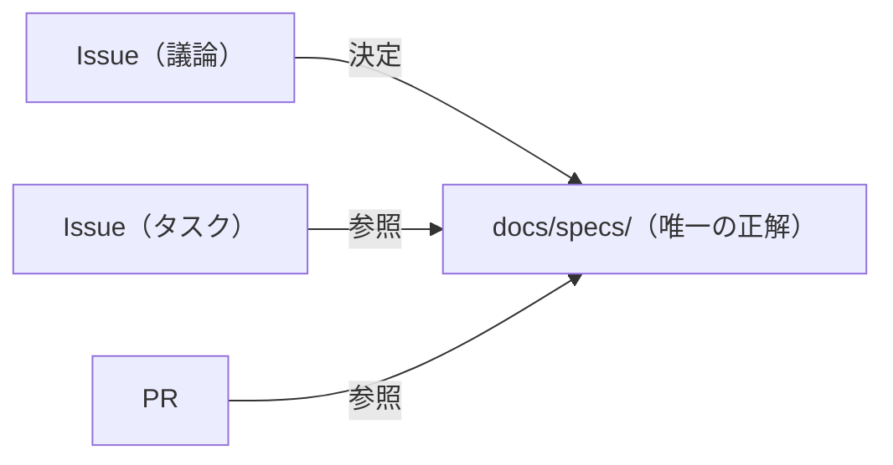

# 0025. Issue と docs のレファレンス型運用を引き継ぎ、プロセス検査の除外軸に infra/ を加える

- **ステータス**: 承認済み
- **日付**: 2026-11-18
- **決定者**: 人間（プロジェクトオーナー）。2026-11-18 に、discussion #167 の2つの論点について明示選択した（オーケストレーター経由で受領）。論点1 は (a)「review-trail の SKIP 除外軸に `infra/` を加える」、論点2 は (a-1)「spec-link もそろえ、両方の除外軸を `services/` `apps/` `infra/` にする」。本文の起草は仕様工程。**2026-11-20、人間は本 ADR を承認した**（AskUserQuestion の明示選択。main セッション経由で受領）

> 本 ADR は ADR 0004（Issue と docs の責務を分け、レファレンス型で運用する）を置き換える。ADR 0004 の決定はすべて引き継ぎ（決定1〜4）、spec-link の範囲だけを改める（決定5）。ADR 0001「ステータスの遷移」は、置き換える側の ADR が提案中のときの扱いを定めていない。そのため、ADR 0004 のステータスを「廃止（0025 により置換）」へ改める時点は人間が決めた（`docs/specs/process-check-exclusion-axis.md` D-3。本 ADR の承認と同じ PR の中で改める）。
>
> 決定の中身のうち、**除外軸に `infra/` を加えること（下の決定5・6）は、人間が 2026-11-18 に明示選択したもの**である。決定1〜4 は ADR 0004 の決定を引き継いだものであり、ADR 0004 の決定者（人間）が 2026-07-16 に決めた内容を変えない。この ADR の文面は **AI（仕様工程）が起草した**。AI は ADR を「承認済み」で起票しないため（ADR 0001 運用ルール5）、ステータスは「提案中」とする。
>
> **2026-11-20 追記**: 人間が本 ADR を承認した（AskUserQuestion の明示選択。main セッション経由で受領）。仕様工程は、ステータスを「提案中」から「承認済み」に改め、同じ PR の中で ADR 0004 のステータスを「廃止（0025 により置換）」に改めた（`docs/specs/process-check-exclusion-axis.md` D-3）。遷移は ADR 0001「ステータスの遷移」（提案中 → 承認済み）に従い、承認したのは人間である。**承認済みとなった以後、本 ADR は書き換えず、追記もしない**（ADR 0001 運用ルール3）。決定が覆るときは新しい ADR を起こす。
>
> 受け入れ条件（変更ファイルの集合ごとに、検査するか SKIP するかの期待値）は `docs/specs/process-check-exclusion-axis.md` が持つ。本 ADR へ書き写さない（決定3）。

## コンテキスト

1. **ADR 0004 は spec-link の範囲を `services/` と `apps/` に限っていた** — ADR 0004「規約は CI で担保する」は、`services/` または `apps/` を変更する PR に `docs/` 配下への参照を求めた。実装（`.github/workflows/spec-link.yml`）も、変更ファイルのいずれかが `services/` か `apps/` で始まるときだけ検査し、それ以外は SKIP する
2. **review-trail は同じ除外軸を持つ** — `.github/workflows/review-trail.yml` は、spec-link と同じ判定（`services/` か `apps/` で始まる変更が無ければ SKIP）を持つ。加えて、チェッカ自身（`.github/scripts/` と `review-trail.yml`）の変更を含む PR では SKIP しない分岐を持つ（`docs/harness/verification-loop.md`「例外: プロセス検査」）
3. **`infra/` だけを変える PR は、2つの検査をどちらも通らない** — 上の判定には `infra/` が無い。したがって `infra/` だけを変える PR では、spec-link も review-trail も SKIP し、PR 本文の `docs/` 参照も、実装↔レビューの往復証跡も機械では求められない。`infra/` は Terraform の構成を持ち、その中には Lambda の予約同時実行数・AWS Budgets・デプロイロールの IAM 権限など、コストとセキュリティのガードレールが入る（`docs/rules/cost-guardrails.md`）。プロジェクトはこのガードレールを機能要件と同格に置いている（`CLAUDE.md`）
4. **この扱いを discussion #167 で論点に上げた** — 人間は 2026-11-18 に、上の決定者欄に書いた2つの選択をした。**選択の理由は、受け取った決定に含まれていない。** 上の1〜3 は、仕様工程が実装と docs から事実として並べたものである
5. **ADR 0004 は書き換えられない** — spec-link の範囲は ADR 0004 の決定の一部である。ADR は書き換えず、追記もしない（ADR 0001 運用ルール3）。範囲を変えるには、ADR 0004 を置き換える ADR が要る
6. **ADR 0004 の字面には、現況と違う記述が1つある** — ADR 0004 は spec-link を「`.github/workflows/ci.yml` の `spec-link` ジョブ」と書いている。現況では、spec-link は独立したワークフロー `.github/workflows/spec-link.yml` であり、ci.yml には無い（ci.yml と分ける理由は `docs/harness/verification-loop.md`「例外: プロセス検査」）。本 ADR は決定4 で現況の置き場所を書く

## 決定

### 1. レファレンス型で運用する（ADR 0004 から引き継ぐ）

Issue と docs の責務を排他的に分ける。

| 置き場所 | 持つもの | 持たないもの |
|---|---|---|
| **GitHub Issue** | 実装の**タスク**、仕様を決めるための**議論** | 決定した仕様そのもの |
| **`docs/`** | 決定した**最新の**設計・仕様のみ | 議論の過程、タスクの進捗 |

**「正解のデータは常に docs にある」を唯一の原則とする。** Issue 本文と PR には `docs/` 配下へのリンクを貼り、参照させる。Issue に仕様を書き写さない。

### 2. 議論は Issue で行い、結論が出た時点で docs へ反映する（ADR 0004 から引き継ぐ）

結論が出た時点で docs に反映し、Issue には docs へのリンクを残す。Issue のコメントに結論を書いて終わらせない。

### 3. 置き場所は `docs/specs/` に集約する（ADR 0004 から引き継ぐ）

`docs/design/` は作らない。用途ごとの置き場所は次のとおりとする。

| 内容 | 置き場所 |
|---|---|
| 機能の仕様・受け入れ条件・実装設計 | `docs/specs/` |
| アーキテクチャ上の決定 | `docs/adr/` |
| 用語 | `docs/domain/ubiquitous-language.md` |

### 4. 規約は CI で担保し、例外には `no-spec` ラベルを求める（ADR 0004 から引き継ぎ、範囲を決定5 で改める）

- 「PR に docs へのリンクを貼る」を人間の記憶に委ねない。**決定5 の範囲を変更する PR は、本文に `docs/` 配下への参照を含むことを CI で必須とする**（`.github/workflows/spec-link.yml`）
- 仕様を要さない変更には `no-spec` ラベルで例外を認める。例外に**ラベルという明示的な操作**を求めるのは、例外を使ったこと自体を記録に残すためである

### 5. spec-link の範囲に `infra/` を加える（2026-11-18 人間が決定。#167 論点2 = (a-1)）

spec-link が検査する PR は、**`services/` `apps/` `infra/` のいずれかを変更する PR** とする。ADR 0004 の範囲（`services/` `apps/`）に `infra/` を加える。

### 6. review-trail の除外軸もそろえる（2026-11-18 人間が決定。#167 論点1 = (a)・論点2 = (a-1)）

review-trail が「変更なし」として SKIP する判定の範囲も、**`services/` `apps/` `infra/`** とする。spec-link と review-trail の除外軸は同じ範囲を持つ。review-trail がチェッカ自身の変更を含む PR で SKIP しない分岐は、本 ADR で変えない。

### 本 ADR が決めないこと

- **`infra/` だけを変える PR で、実装↔レビューの往復を回さない場合の扱い**は、本 ADR では決めない。2026-11-18 に人間が `no-spec` ラベルで足り、新しい手段を設けないと明示選択した。その記録は `docs/specs/process-check-exclusion-axis.md` の決定（D）節 D-1 が持つ
- `infra/` 以外のディレクトリを除外軸に加えるかは、本 ADR の決定に含めない

## 影響

### 良い影響

- ADR 0004 の良い影響（読む場所が1つに定まる・Issue が肥大化しない・docs の更新漏れが PR の時点で検知される）を引き継ぐ
- **`infra/` を変える PR でも、`docs/` への参照と往復証跡が機械で求められる。** コストとセキュリティのガードレールを変える PR が、2つのプロセス検査を素通りしなくなる
- 2つのプロセス検査の除外軸が同じ範囲になり、一方だけが SKIP するずれが生じない

### 悪い影響 / コスト

- ADR 0004 の悪い影響（docs へ反映する手間・リンクを辿る手間・`no-spec` の形骸化のリスク・CI はリンクの有無しか見られないこと）を引き継ぐ
- **`infra/` を変える PR に、本文の `docs/` 参照（または `no-spec` ラベル）と往復証跡が要るようになる。** Terraform の小さな修正でも、どちらかの手間が毎回かかる
- **`no-spec` ラベルは、spec-link と review-trail の両方を SKIP させる。** 仕様は要するが往復を省きたい、またはその逆の `infra/` の変更を、このラベル1つでは区別できない。区別する新しい手段は設けない（上の「本 ADR が決めないこと」。仕様の D-1）
- **除外軸はパスの字面で書かれている。** `infra/` を改名・移動すると、除外軸は黙って外れ、`infra/` だけを変える PR が再び SKIP する。範囲のディレクトリが実在するかは、本 ADR では検査を求めない（`docs/specs/process-check-exclusion-axis.md`「機械検査の限界」）

## 検討した代替案

下の2案は、#167 の2つの論点から仕様工程が導いた帰結である。人間はいずれも採らなかった。採らなかった理由は、受け取った決定に含まれていない。

| 案 | 帰結 |
|---|---|
| `infra/` を加えない（現状を保つ） | `infra/` だけを変える PR は、2つの検査をどちらも通らないままになる |
| review-trail にだけ `infra/` を加え、spec-link は `services/` `apps/` のままにする | 2つの検査の除外軸が分かれる。`infra/` だけを変える PR では、往復証跡は求められるが `docs/` 参照は求められない。ADR 0004 を置き換える必要はない |

## 関連

- ADR 0001: アーキテクチャ決定を記録する（運用ルール3・5、ステータスの遷移）
- ADR 0004: 本 ADR が置き換える ADR
- `docs/specs/process-check-exclusion-axis.md`: 除外軸の受け入れ条件と、人間の決定（D）
- `docs/harness/verification-loop.md`「例外: プロセス検査」: 2つのプロセス検査の位置づけ
- `docs/ai-collaboration.md`: 決定の記録先の一覧
