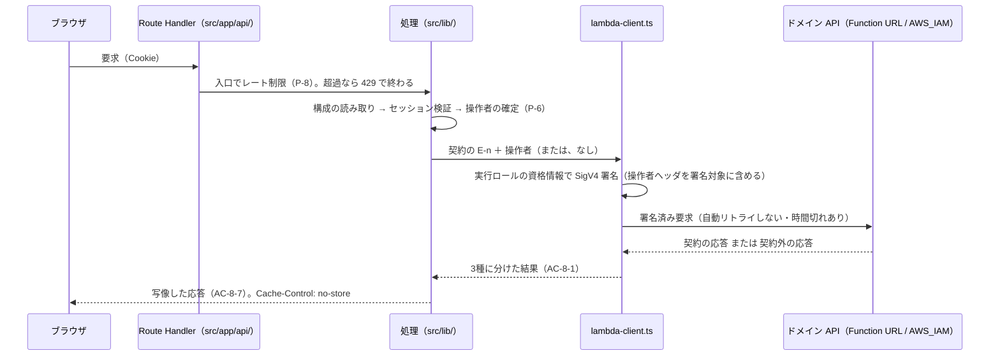

# BFF の配線 — `lambda-client.ts`（実行ロールの SigV4）と業務の Route Handler

Issue #54 の仕様。**ブラウザ → Next.js Route Handler → ドメイン API（Lambda Function URL）** の経路のうち、`apps/web` に載る部分（Route Handler と `src/lib/lambda-client.ts`）の**実装設計と受け入れ条件**を定める。呼び先を BFF へ渡す Terraform 側の要求は `docs/specs/infra-terraform.md` AC-4-9 が持つ（D 節 U-6）。

**本仕様は契約も認証も再定義しない。** エンドポイント・ステータス・エラーコード・JSON の形の正解は `docs/specs/domain-api-http-contract.md`（以下「契約」）が、トークン検証・現在ユーザーとロールの確定・レート制限の値は `docs/specs/bff-auth-termination.md`（以下「終端仕様」）が持つ。本仕様はそれらを**番号で参照し、書き写さない**（ADR 0004）。

- **決定者**: **人間**（プロジェクトオーナー）。**D 節の表に列挙した事項（U-1〜U-7・U-1d・U-5b、終端仕様 P-10 の扱い・契約 AC-6 の申し送りの持ち主・AC-5-3 / 6-4 / 6-6 の確定・解釈の3点・ADR を起こさないこと）は、2026-10-16 に人間が明示選択で決めた。C-1 と #121 は 2026-10-19 に人間が明示選択で決めた。#124・#125 の前半・#129 は 2026-10-20 に人間が明示選択で決めた。#125 の後半は人間の決定ではなく、仕様工程が定めた**（D 節）。それ以外の確定条文は、規約・ADR・契約・終端仕様・D 節の決定から**導いたもの**に限る（各行に出典を添える）。**未決の論点は無い**（U 節）
- **日付**: 2026-10-16（起票・D 節の決定の反映・U-1d / U-5b / U-7 と解釈の3点の決定の反映）／2026-10-19（D 節 C-1・#121 の決定の反映）／2026-10-20（D 節 #124・#125・#129 の決定の反映）
- **前提 ADR**: 0003（Function URL の IAM 認証）／0013（AWS ネイティブのホスティング）／0014（実行ロールの SigV4。Vercel OIDC の廃止）／0016（BFF でのトークン終端）／0007 §5（Web のテストは Vitest）／0010 §A（依存の許可リストは人間の承認事項）／0004（レファレンス型運用）
- **隣接仕様**: 契約（`domain-api-http-contract.md`）／終端仕様（`bff-auth-termination.md`）／`web-app-scaffold.md`（`apps/web` の足場）／`infra-terraform.md`（BFF・SSR Lambda の実行ロールと、呼び先の注入＝AC-4-9）

> **着手条件**: **未決による待ちは無い。全 AC に着手してよい。** 署名の部分（AC-2・AC-3）はハッシュの実装が決まった（D 節 U-1d = (i)）。本番の配線で lambda-client に渡す時間切れの値は実装側が持つ（D 節 U-5b = (a)。AC-8-8）。R-2 のゲストへの応答は 401 と Cookie の破棄に決まった（D 節 U-7 = (a)。AC-6-4）。**依存の追加は AC-10-1 に列挙した2本に限り、それ以外は人間の承認事項のまま**（ADR 0010 §A）

---

## スコープ

- **`apps/web/src/lib/lambda-client.ts`** —— ドメイン API を呼ぶ唯一の集約点。実行ロールの資格情報で SigV4 署名する（ADR 0014）
- **業務の Route Handler** —— 契約のエンドポイント E-1〜E-7 を BFF 経由で呼ぶ経路（AC-6 の R-1〜R-3・R-5〜R-9。R-4 は非スコープ）
- **経路への組み込み** —— 終端仕様の認証（検証済みセッション・ロール）と、レート制限（終端仕様 AC-11）を各 Route Handler の入口に通すこと
- **応答の境界と写像** —— ドメイン API の応答を「契約の応答」と「契約外の応答」に分け（AC-8-1）、ブラウザへ写すこと（AC-8-7）
- **Terraform の変更（呼び先の注入）** —— 要求の持ち主は `infra-terraform.md` AC-4-9。**変更は本 Issue の実装 PR に含める**（D 節 U-6）。本仕様は要求を書き写さない

### 非スコープ

- **画面**（各 UI 仕様。`work-month-screen-ui.md`・`work-month-listing-ui.md` ほか）—— 後続 Issue。本仕様は画面を作らない
- **契約の変更**（エンドポイント・ステータス・`code`・JSON の形）—— 契約が持つ。**本仕様で足りないと分かったら、本仕様を変えずに停止して人間へ上げる**
- **認証の終端そのもの**（トークン検証・ロール Cookie・サインインの3経路）—— 終端仕様が持つ。本仕様はその関数を**呼ぶ側**である
- **契約一覧・稼働の推移のデータ取得** —— 契約にそのためのエンドポイントが無い（契約のエンドポイント一覧は E-1〜E-7 のみ）。**本仕様で Route Handler を発明しない**
- **R-4（ゲスト向けデモ勤務月群）** —— **デモデータの投入を扱う Issue で、技術者識別子の出所とあわせて決める**（D 節 U-4 = (c)）
- **デモデータの投入・日次リセット**（`docs/rules/cost-guardrails.md`。契約 AC-11-8）
- **本番への apply・デプロイ** —— 人間の承認事項

---

## 前提（P）— 確定事項（参照のみ、再定義しない）

| # | 前提 | 出典 |
|---|---|---|
| P-1 | **ブラウザ → Next.js Route Handler → Lambda の一方通行。** Route Handler 以外から Lambda を呼ばない。Lambda 呼び出しは `apps/web/src/lib/lambda-client.ts` に集約する | `docs/rules/architecture.md` |
| P-2 | ドメイン API の Function URL は `authorization_type = "AWS_IAM"`。**呼べるのは SigV4 署名できる主体のみ**で、ブラウザから直接到達する経路は構造的に無い | ADR 0003・契約 P-1・`docs/rules/cost-guardrails.md` |
| P-3 | BFF（Next.js サーバーの Lambda）は**自身の実行ロール**で SigV4 署名する。**Vercel OIDC Federation を使わない**（`@vercel/oidc-*` を使わない）。実行ロールの権限は `lambda:InvokeFunctionUrl` をドメイン API の当該関数のみに限る | ADR 0014・`infra-terraform.md` AC-7-1 |
| P-4 | **長期認証情報を使わない。ランタイムの AWS 認証に外部 IdP との federation を挟まない**（`AWS_ROLE_ARN` 等の環境変数を設けない） | `docs/rules/security.md` |
| P-5 | **操作者は `X-Actor-Id` / `X-Actor-Role` の2ヘッダで伝え、SigV4 の署名対象に含める。** ゲストは両ヘッダを送らない。**その実現は `lambda-client.ts` の責務** | 契約 D-2・AC-1-4〜1-8／終端仕様 AC-6-3 |
| P-6 | `X-Actor-Id` は検証済みトークンの `sub` からのみ、`X-Actor-Role` は BFF が検証したロール Cookie（無ければ `Engineer`）からのみ決める | 終端仕様 AC-5-1・5-2・5-5・5-11 |
| P-7 | **Cognito のトークンをドメイン API へ転送しない。AWS 認証に用いない** | 終端仕様 AC-6-1・6-2 |
| P-8 | **Route Handler はいずれも入口でレート制限を通る。** 値と挙動は終端仕様 AC-11-5〜11-9。**本 Issue 以降に Route Handler を足す Issue もこれを通す** | 終端仕様 AC-11-12・10-7 |
| P-9 | ゲスト（未認証）に状態を変える操作を実行させない。**ドメイン API の 401 に頼って素通しにしない**。状態を変える操作へ至る Route Handler は 401 を返し、検証に失敗したセッション Cookie・ロール Cookie を破棄する | 終端仕様 AC-3-2・3-4 |
| P-10 | `code` が契約であり、利用者向け文言は BFF / UI が `code` から決める。`message` は診断用で、画面にそのまま出すことを前提にしない | 契約 D-8・AC-9-2・9-3 |
| P-11 | **ドメイン API はレート制限・冪等キー・リトライ制御を持たない。** 流量の一次防御は BFF 側 | 契約 AC-11-6 |
| P-12 | **参照系（E-1・`engineerId` 指定の E-2）は API 側で操作者により絞られない。** 他人の勤務月を BFF が取得することは API では防がれず、防御は BFF の導線に依存する | 契約 D-12・AC-11-3 |
| P-13 | **技術者の横断ビュー・承認担当者一覧はスコープ外** | `docs/rules/scope.md` |
| P-14 | `apps/web` のテストは Vitest。**アサーション／モックのライブラリを追加しない。依存の許可リストは人間の承認事項** | ADR 0007 §5・ADR 0020・ADR 0010 §A・終端仕様 P-6・P-8 |

---

## 構成

---

## 決定（D）— 2026-10-16・2026-10-19・2026-10-20、人間の明示選択

**以下は人間が明示選択で決めたものである。C-1 と #121 の行は 2026-10-19、#124・#125・#129 の行は 2026-10-20、それ以外の行は 2026-10-16 に決めた。** 推奨は仕様工程の起案であり、採否を決めたのは人間である。**本表に無い事項を人間の決定として扱わない。行の中で「人間の決定ではない」と明記した部分（#124 の仕様工程の定め・#125 の後半）も、人間の決定として扱わない。**

| 論点 | 採った案（人間の明示選択。C-1・#121・#124・#125・#129 の行を除き 2026-10-16） | 採らなかった案 | 反映先 |
|---|---|---|---|
| **U-1. SigV4 署名の手段** | **(a) AWS SDK for JavaScript v3 の署名部品 `@smithy/signature-v4` を使う。** **(U-1b)(i) 資格情報は依存を足さず、Lambda ランタイムが実行ロールから与える環境変数から読む。** **(U-1c) セッショントークンを欠く資格情報は拒否する。** **テストに AWS 公式の SigV4 テストベクタとの一致を含める** | (b) `aws4fetch`／(c) `aws4`（いずれも第三者保守）／(d) `node:crypto` での自前実装（誤りが apply 後の IAM の 403 でしか露見しない）／(U-1b)(ii) SDK の資格情報プロバイダを足す／(U-1c) 拒否しない（静的キーで署名する経路が規律だけで閉じる） | AC-2-1・2-i・2-j／AC-3-3・3-6・3-7／AC-10-1／ハッシュの実装は U-1d |
| **U-1d. SHA-256 のハッシュの実装**（U-1 = (a) の残り。`@smithy/signature-v4` はハッシュの実装を呼ぶ側から受け取り、案 (a) の字面は「`@smithy/signature-v4` とハッシュの実装 `@aws-crypto/sha256-js` 等」で具体が「等」で開いていた） | **(i) `@aws-crypto/sha256-js` を足す**（2026-10-16、人間の明示選択）。直接の依存は `@smithy/signature-v4` と合わせて計2本 | (ii) `@smithy/hash-node` を足す（案 (a) の字面に現れない）／(iii) 依存を足さず `node:crypto` の上に最小の適合層を置く（自前のコードが署名値に関与する） | AC-2-1／AC-10-1 |
| **U-2. Route Handler の公開面** | **(b) 個別の勤務月（E-1・E-3〜E-7）は契約どおりのパス、一覧は役割ごとに別のパス。** **応答（とリクエスト本文）はそのまま中継する**（(i)） | (a) 契約のパスを写し一覧を1本にして `engineerId` を上書きする（正しさが `engineerId` を捨てる処理に依存する）／(c) 動詞的なパス（契約との対応が名前から読めない）／(ii) BFF が JSON を組み替える | AC-6-7・6-h／AC-6-i／AC-8-7 |
| **U-3. ブラウザへの写像** | **推奨一式** —— (i) **契約のエラーはステータスと `code` だけを渡す**（`message` を落とす）、(ii) **契約外の応答は 5xx・本文空**、(iii) **ドメイン API 側の 429 は 429 として中継する**（`Retry-After` は上流が返せば中継し、無ければ付けない）、(iv) **401 と 5xx の本文は終端仕様に揃える**、(v) **`Cache-Control: no-store` を付ける** | (i)(a) `message` を含めて中継／(i)(c) BFF が文言へ写す／(ii)(b) BFF が `INTERNAL_ERROR` を生成する／(iii)(b) 429 を契約外の 5xx に含める／(iv)(b) 契約の形に揃える／(v) 付けない | AC-5-7・AC-8-7 |
| **U-4. R-4 の技術者識別子の出所** | **(c) #54 の範囲から外し、デモデータの投入を扱う Issue で決める**（R-4 は本 Issue の非スコープ） | (a) BFF の環境変数で受け取る／(b) コード内の定数 | 非スコープ・AC-6 の R-4・AC-12 |
| **U-5. 時間切れとリトライ** | **(a) 自動リトライしない。時間切れは設ける** | (b) 参照系だけ1回リトライ（課金と同時実行の増幅）／(c) 時間切れを設けない（BFF の同時実行を占有し続ける） | AC-8-6・8-8／値は U-5b |
| **U-5b. 時間切れの値**（U-5 = (a) は値を決めていなかった。BFF・SSR Lambda 自身の時間切れの設定は、`infra-terraform.md` を含めどの仕様にも要求が無い） | **(a) 値は実装側が持つ。本仕様は趣旨（時間切れがあり、差し替えて検査できること。BFF・SSR Lambda 自身の時間切れより先に来ること）だけを持つ。** **BFF・SSR Lambda 自身の時間切れより先に来ることが検査できない点は、限界 13-8 として受け入れる**（2026-10-16、人間の明示選択） | (b) 値を本仕様で固定する（あわせて BFF・SSR Lambda の時間切れとの関係を `infra-terraform.md` へ要求として足す） | AC-8-8／AC-13-8 |
| **U-6. 呼び先の注入の持ち主** | **(a) `infra-terraform.md` に要求を足し、Terraform の変更は #54 の PR に含める** | (b) 別 Issue で扱う（本 Issue の完了時点で業務の Route Handler が構成欠落の 5xx を返す） | スコープ・AC-3-1・`infra-terraform.md` AC-4-9 / 10-4-z / 12-38 |
| **U-7. R-2（本人の勤務月の一覧）のゲストへの応答**（AC-6-4 は「ドメイン API を呼ばない」までを確定させ、ブラウザへの応答は U-3 (iv) の対象〔更新系のゲストの 401 と構成欠落の 5xx〕に含まれていなかった） | **(a) 401 を返し、セッション Cookie とロール Cookie を破棄する**（5-2 と同じ扱い。本文は 5-7）（2026-10-16、人間の明示選択） | (b) 200 で空の一覧を返す（本人一覧はゲストの導線ではない＝`work-month-listing-ui.md` AC-3-3 のに、成功として見える） | AC-5 の順3・5-7／AC-6-4・6-d・6-j／AC-8-7 (v)・8-s |
| **解釈の確認 8-6**（契約 AC-9-4 の「BFF は 409 を受けて再取得する」の満たし方） | **画面が R-1 を再要求することで満たす。BFF は自動で再取得しない**（2026-10-16、人間の明示選択で、本仕様の解釈をそのまま採った） | —— | AC-8-6 |
| **解釈の確認 5-3**（R-3 にゲストが来たとき） | **ドメイン API を操作者なしで呼び、契約の 401 `UNAUTHENTICATED` を AC-8-7 に従って返す**（2026-10-16、人間の明示選択で、本仕様の解釈をそのまま採った） | —— | AC-5-3・8-l |
| **解釈の確認 8-7 (iii)**（ドメイン API 側の 429 を中継するときの本文） | **本文は空**（2026-10-16、人間の明示選択で、本仕様の解釈をそのまま採った） | —— | AC-8-7 (iii)・8-m・8-n |
| **ADR の要否**（U-1・U-1d で依存を足した判断の記録先） | **ADR は起こさない。依存を足した判断の記録は本節（D 節）だけで足りる**（2026-10-16、人間の明示選択） | —— | AC-10-1 |
| 終端仕様 P-10 | **現況へ書き直す**（`docs/rules/development-process.md` の規定に従う） | —— | 終端仕様 P-10 |
| 契約 AC-6 の申し送り（未生成の月に締めボタンを出さない） | **画面側だけが担う。BFF は中継に徹する** | —— | AC-6-5・AC-12 |
| AC-5-3・AC-6-4・AC-6-6 | **確定として扱う** | —— | 各行 |
| **9-4 の検知への対処**（`make scan-secrets` が、`lambda-client.test.ts` の **2-j の期待値の Signature**〔AWS が公開する SigV4 のテストスイートの当該ケースから写した値＝2-i・2-j の扱い (i)〕を gitleaks の `generic-api-key` として1件検知した。9-4 に従い停止して人間へ上げた） | **`.gitleaks.toml` に allowlist を1件足し、パスを `apps/web/src/lib/lambda-client.test.ts` に限って、検知された 2-j の期待値の Signature の値だけを除外する**（2026-10-16、人間の明示選択）。**2-i の期待値の Signature も検知される場合は同じ扱いとする**（現状の検知は 2-j の1件のみ）。**値そのものを本仕様に書き写さない** —— 値の持ち主はテストの字面と `.gitleaks.toml` である（ADR 0004）。**許す形・置き方と限界の全体は `web-app-scaffold.md` AC-11-11・AC-12（12-2-k・12-L8）が持つ**（2026-10-16、人間の明示選択）。**限界**: (i) **同じファイルの同じ値は、今後も検知されない**。(ii) **値の一致で除外するので、この値を部分に含まない別の値は引き続き検知される**（同じファイルの中で、この値を部分に含む検知も除外される。範囲は `web-app-scaffold.md` 12-L8 (4)） | (a) 行番号に依存する fingerprint で除外する／(b) ファイル全体を除外する／(c) ルールを無効化する | AC-9-4・2-i・2-j の扱い (iv)・終端仕様 AC-4-5 |
| **テスト工程が固定した名前と設計**（2026-10-16、人間の明示選択で、テスト工程が固定したものをそのまま採った） | **(i) 呼び先の環境変数の名は、テスト工程が固定した名とし、Terraform の注入もその名に揃える**（**名の実体は AC-3-1 のとおり構成側と実装側の字面が持ち、本仕様に書かない**。両者が揃っていることは機械検査されない＝`infra-terraform.md` 12-38）。**(ii) 署名のリージョン（2-1・2-7 の「構成の値」）は `AWS_REGION` から読む**（名前の持ち主は Lambda ランタイム）。**(iii) 関数名を `createLambdaClient`・`signRequest`・`loadCredentials`・`handle*`、型名を `DomainApiRequest`・`LambdaClientResult` とする**。**(iv) レート制限（P-8・AC-5 の順1）は処理側（`work-month-handlers.ts`）の入口で通す** | —— | AC-2-1・2-7／AC-3-1・3-5／AC-5・P-8 |
| **C-1. 値が `.`・`..` のパスのセグメント**（PR #120 往復1 の reviewer の Critical。値 `.`・`..` を `%2E`・`%2E%2E` に変えて送っても、WHATWG URL は `%2E`・`%2e`・`.%2e` 等もドットセグメントとして畳むため、7-1「値に含まれる `..` でパスの構造が変わらない」が破れていた） | **(a) lambda-client がこの値を送らず、契約外として返す（ブラウザへは 5xx で本文は空）。構成の欠落のとき（3-7）と同じ形**（2026-10-19、人間の明示選択。出所: main が AskUserQuestion の明示選択で受け取ったもの） | (b) 送信せず 400 を返す（本文空。AC-8-7 の改訂が要る）／(c) 正規化を通らない送信手段で生のパスを送る（受け側との正規パスの一致が apply 後にしか分からない）／(d) 実害が小さいとして AC-13 の限界として受け入れる（要求を緩める） | AC-7-1・7-3・7-d／AC-8-1 (iii) |
| **#121. 値が空文字のパスのセグメント**（出所: Issue #121。PR #120 往復2 で仕様工程から申し送られた事項。値が空文字〔`""`〕のとき、符号化しても空のセグメントになり、パスに `//` が生じる。受け側が `//` を畳みうるためパスの構造が変わりうるうえ、署名の正規パスの計算が空のセグメントを捨てうるため署名した正規パスと送るパスが食い違いうる） | **(a) C-1 の `.`・`..` と同じく扱う。lambda-client はドメイン API を呼ばず（送信 0 回）、結果を AC-8-1 (iii) 契約外として返す。ブラウザへは AC-8-7 (iv) の 5xx・本文空として現れる。契約の `code` を生成せず、値も拒否の理由も応答に載せない（AC-9）。拒否の対象は `.`・`..`・空文字の3値だけ。根拠はパスの構造を変えさせないためであり、AC-7-3 の書式判定には当たらない。それ以外の値（空白だけの値なども含む）は従来どおり符号化して送る**（2026-10-19、人間の明示選択。出所: main が AskUserQuestion の明示選択で受け取ったもの） | (b) ドメイン API の判定に委ねる（AC-7-3。結果が受け側の正規化次第になり、転送の後の 5xx になるか 400 になるかが apply 後まで決まらない）／(c) 実害が小さいとして AC-13 の限界として受け入れる（要求を緩める） | AC-7-1・7-3・7-d／AC-8-1 (iii) |
| **#124. 7-d (i) の判定 —— 「3-7 と同じ形」の読み方**（出所: Issue #124 項目2。7-d (i) の期待「本文・ヘッダに値と拒否の理由が無い（AC-9）」は、空文字は包含で判定できず、「拒否の理由」に定まった字面も無いため、そのままでは判定できなかった） | **(a) 7-d (i) の Route Handler の応答を、構成が欠けているとき（3-7・5-g）の応答と比べ、ステータス・ヘッダ・本文がすべて同じであることで判定する。7-1 補足の「（3-7 と同じ形）」をステータス・すべてのヘッダの名前と値の組・本文の全一致と読む**（2026-10-20、人間の明示選択。出所: main が AskUserQuestion の明示選択で受け取ったもの）。値や理由が応答に載れば相手と区別できるので、不在を判定できる。**仕様工程の定め（人間の決定ではない。判定に要る最小の字面として仕様工程が定めた細部）**: 比べる相手は、同じ Route Handler・同じセッション・同じ他のパラメータで、当該パラメータだけを妥当な値に替え（拒否の経路を通らず、構成の欠落の経路だけを通すため）、呼び先の環境変数を未設定にした応答とする。構成の欠け方は未設定だけを取る（7-d (i)） | (b) ヘッダを `Cache-Control: no-store` だけに限る（今の条文に無い要求を足す）／(c) 検査範囲にとどめ AC-13 の限界に足す（検査されないことを公式に認める） | AC-7-1・7-d／AC-3-7・5-g／AC-9 |
| **#125. 時間切れの結果の形を lambda-client の段階で比べる行（8-t）**（出所: Issue #125。時間切れの分岐で lambda-client の結果に余分なフィールドを足す変異が、どのテストにも捕まらなかった。時間切れを見る行は 8-q だけで、8-q は Route Handler の応答だけを見るため、lambda-client の結果の形を見る行が AC-8 の検査表に無かった） | **前半（人間の決定）: (a) 仕様に検査行を足す —— AC-8 の検査表に 8-t を足し、送信関数が応答を返さず時間切れに達したときの lambda-client の結果を `{ kind: "unexpected", rateLimited: false }` と `toStrictEqual` で比べる**（2026-10-20、人間の明示選択。出所: main が AskUserQuestion の明示選択で受け取ったもの。PR #128 の本文にも記載があるが、それは二次資料であり出所ではない）。**後半（人間の決定ではない。仕様工程が定めた）: 8-t で、時間切れの後に Fake が 8-a の応答を返し、それを待ったあとでも、結果が同じ値と `toStrictEqual` で一致することを見る（8-8 を lambda-client の段階でも見る）**（前半の明示選択の直後に、main が orchestrator へ「specifier の判断に任せる」として仕様工程へ委ね、仕様工程が定めた。#129 の 8-f の定めと異なり、**人間は採否を選んでいない**） | 前半: (b) テストだけ足す（検査表に対応行が無いまま）／(c) 別 Issue に分ける（Issue #125 の完了条件「各分岐」から時間切れを外すことになる） | AC-8-8・8-t／AC-8-q |
| **#129. 契約外の結果の形の比べ方**（出所: Issue #129・Issue #130。8-t は lambda-client の結果を型 `LambdaClientResult` の形どおり `toStrictEqual` で比べることを期待に書いていたが、3-a・3-c・3-g・3-h・8-c〜8-h の期待は分類〔(iii) 契約外〕までしか書いておらず、余分なフィールドを足す実装を緑にしうる字面だった） | **(b) 3-a・3-c・3-g・3-h・8-c〜8-h の各行の期待に、lambda-client の結果を型 `LambdaClientResult` の形どおりの値と `toStrictEqual` で比べることを、8-t の字面に揃えて個別に書く。値は各行の内容から取る（8-f は `rateLimited: true`、それ以外は `rateLimited: false`）。3-b は「3-a と同じ」で引き継ぎ、書き換えない。8-b（契約のエラー）は本件の範囲外とし、変えない**（2026-10-20、人間の明示選択。出所: main が AskUserQuestion の明示選択で受け取ったもの。範囲に 3-g・3-h を含めることは、レビュー往復1 の指摘を受けて同日に人間が明示選択で決めた）。**8-f の Fake は `Retry-After` を返さないものとし、結果は `retryAfter` のキーを持たない**（「429・本文なし」の行で比べる値を1つに定めるため。2026-10-20、仕様工程が定め、人間が明示選択でそのまま採った） | (a) 検査表の下に共通の注記を1行置く（行ごとに期待値が異なり〔8-f だけ `rateLimited: true`〕、共通の注記では対象の行と例外の値が表の外に出る。検査表は1行がテスト1件に対応し、表の外の注記は期待値の表に対応行を持たない要求となってテストに落ちず、変異が生存しうる。8-t が既に各行に個別に書く形を取っており、それに揃える）／(c) 書かない（テストを `kind` だけの比較に戻しても仕様に反せず、緑のまま通る） | AC-3-a・3-c・3-g・3-h／AC-8-c〜8-h |

**根拠の所在**: U-1 は ADR 0010 §A（許可リスト）・終端仕様 AC-7-1 (iii)・`infra-terraform.md` D-19 / AC-11-21（署名を自作しない先例）・`docs/rules/security.md`。U-2 は契約 D-1・D-9・AC-3-1・3-2・AC-11-3・`docs/rules/scope.md`。U-3 は契約 D-8・AC-9・終端仕様 AC-3-4・AC-7-7・AC-11-8 (iv)・ADR 0013。U-4 は契約 AC-3-10・AC-11-8・`work-month-listing-ui.md` AC-3。U-5 は契約 AC-11-6・AC-9-4・`docs/rules/cost-guardrails.md`。U-6 は終端仕様 AC-7-5。U-1d は U-1 の案 (a) の字面・ADR 0010 §A。U-5b は U-5 の案 (a) の字面（「値は実装側」）。U-7 は終端仕様 AC-3-2・3-4・契約 AC-1-6・AC-3-2・`work-month-listing-ui.md` AC-3-3。C-1 は WHATWG URL Standard のパスの解釈（single-dot / double-dot path segment）。#121 は 7-1「パスの構造を変えさせない」の趣旨と、受け側のルーティングが空のセグメント（`//`）を畳みうること・SigV4 の正規パスの計算が空のセグメントを捨てうること。#124 は 7-1 補足の「（3-7 と同じ形）」の字面と、3-7「欠けているものの名前・値・理由を応答に載せない」（AC-9）。#124 の仕様工程の定め（比べる相手の取り方）は、比べる相手が拒否の経路を通らず構成の欠落の経路（3-7・5-g）だけを通るようにするという判定上の必要。#125 の前半は、時間切れを見る行が 8-q だけで、8-q が Route Handler の応答だけを見るため、lambda-client の結果に余分なフィールドを足す変異がどのテストにも捕まらなかったこと（検査表に対応行の無い要求はテストに落ちない）と、型 `LambdaClientResult` の契約外の形（AC-8-1 (iii)）。#125 の後半（仕様工程の定め。人間の決定ではない）は、8-8「時間切れの後に届いた応答を結果に用いない」を lambda-client の段階で見るという判定上の必要（8-q は Route Handler の応答だけを見るため、結果が後から書き換わる実装を緑にしうる）。#129 は 8-t の字面（「余分なフィールドを足す実装を緑にしない」）と、型 `LambdaClientResult` の契約外の形（AC-8-1 (iii)）。#129 の 8-f の定め（8-f の Fake が `Retry-After` を返さないこと。仕様工程が定め、人間がそのまま採った）は、8-f の行で比べる値を1つに定めるという判定上の必要。

---

## 未決（U）— 人間の判断を待つ論点（現在なし）

**未決なし。** 起票時に未決とした U-1d・U-5b・U-7 は、2026-10-16 に人間が明示選択で決め、D 節の表へ移した（採らなかった案と帰結も D 節に残す）。**以後、本仕様から一意に決まらない論点が見つかったら、推測で埋めずに本節へ「未決」として足し、依存する条文に「未決」と明記して人間へ上げる。**

---

## 受け入れ条件（AC）

| AC | 主題 | 状態 | 主に効く工程 |
|---|---|---|---|
| AC-1 | 一方通行と集約 —— lambda-client 以外から呼ばない | 確定 | tester・implementer・reviewer |
| AC-2 | SigV4 署名 | 確定 | tester・implementer |
| AC-3 | 呼び先と資格情報の構成 | 確定 | tester・implementer |
| AC-4 | 操作者ヘッダの組み立て | 確定 | tester・implementer |
| AC-5 | Route Handler の入口の順序 | 確定 | tester・implementer |
| AC-6 | 契約のエンドポイントとの対応 | 確定 | tester・implementer・reviewer |
| AC-7 | ブラウザ入力の扱い | 確定 | tester・implementer |
| AC-8 | 応答とエラーの境界・ブラウザへの写像 | 確定 | tester・implementer |
| AC-9 | 機密の露出禁止 | 確定 | tester・reviewer |
| AC-10 | 依存と実装形 | 確定 | implementer・reviewer |
| AC-11 | テストの形 | 確定 | tester |
| AC-12 | 本 Issue で作らないもの | 確定 | reviewer |
| AC-13 | 限界 —— 緑が意味しないこと | 確定 | reviewer |

**用語**: 本仕様で「**業務の Route Handler**」は AC-6 の R-1〜R-3・R-5〜R-9 を、「**処理**」は Route Handler から呼ばれる `src/lib/` 側の関数を指す（終端仕様 AC-11-11 の「Route Handler は薄い配線」に倣う）。「**契約の応答**」「**契約外の応答**」は AC-8-1 で定める。

### AC-1. 一方通行と集約

| # | 条件 | 期待 |
|---|---|---|
| 1-1 | 集約点 | **ドメイン API への HTTP 要求を送るのは `apps/web/src/lib/lambda-client.ts` だけ**とする（P-1）。署名・呼び先の URL の読み取り・資格情報の読み取り・送信を他のモジュールへ分散させない |
| 1-2 | import してよい場所 | `lambda-client.ts` を import するのは **`src/app/api/` 配下の Route Handler と、それが呼ぶ `src/lib/` 側の処理**に限る。**`src/app/` のページ・レイアウト・`src/components/` からは import しない**（Route Handler 以外から Lambda を呼ばない＝P-1。SSR のページもこれに含まれる＝限界 13-6） |
| 1-3 | クライアントへ載せない | `lambda-client.ts` と、それを import するモジュールに **`"use client"` を置かない** |
| 1-4 | 呼び先をブラウザへ露出させない | 呼び先の Function URL を読む環境変数の名前を **`NEXT_PUBLIC_` で始めない**（Next.js はこの接頭辞の値をブラウザ向けの成果物へ埋め込む） |
| 1-5 | 呼び先の固定 | lambda-client の公開 API は**呼び先のオリジン（スキーム・ホスト）を引数に取らない**。呼び先は構成の Function URL だけである（AC-3-1）。呼ぶ側が渡せるのは契約のエンドポイント（E-1〜E-7）を表す値と、その識別子・クエリ・本文・操作者に限る |

#### 検査（Vitest）— 下表がそのままテストの入出力になる

**不在の主張には陽性対照を添える。** 走査の対象が空でも緑になる形にしない。**母集団（走査の対象ファイル）は手書きで列挙せず、ファイルの走査で得る。**

| # | 入力 | 期待 |
|---|---|---|
| 1-a | `apps/web/src/` 配下の全 `.ts` / `.tsx`（テストを除く）を走査し、`lambda-client` を import するファイルを集める | **集まったファイルがすべて 1-2 の許可された場所にある**。あわせて**集まった件数が1件以上である**（業務の Route Handler が実際に lambda-client を使っていること。0件の一致を一致とみなさない） |
| 1-b | 1-a の判定を、**許可外の場所（`src/app/` のページ・`src/components/`）に import を持つ合成入力**へ当てる（陽性対照） | **違反として検出される** |
| 1-c | 1-a で集まったファイルと `lambda-client.ts` 自身 | **`"use client"` を含まない**。陽性対照として、`"use client"` を持つ合成入力が違反として検出される |
| 1-d | `lambda-client.ts` が呼び先の URL を読む環境変数の名前 | **`NEXT_PUBLIC_` で始まらない** |

### AC-2. SigV4 署名

| # | 条件 | 期待 |
|---|---|---|
| 2-1 | 方式と手段 | **SigV4** で署名する。**署名は `@smithy/signature-v4` で行い、署名の計算を自前で実装しない**（D 節 U-1 = (a)）。**署名部品へ渡す SHA-256 のハッシュの実装は `@aws-crypto/sha256-js` とし、ハッシュを自前で実装しない**（D 節 U-1d = (i)）。サービス名は Lambda Function URL のもの（`lambda`）、リージョンは構成から決め、**要求から導かない** |
| 2-2 | 署名対象のヘッダ | 少なくとも `host`・`x-amz-date` と、**送る場合の `x-actor-id`・`x-actor-role`** を署名対象（SignedHeaders）に含める（P-5）。**`x-amz-security-token` を付けて署名対象に含める**（資格情報は常にセッショントークンを持つ＝3-6） |
| 2-3 | 本文 | **本文を持つ要求（E-3）は、送る本文そのもののハッシュで署名する。** 本文を署名から外す形（未署名のペイロード）を採らない |
| 2-4 | 署名の後に変えない | **署名した後にヘッダ・本文・パス・クエリを書き換えない**（書き換えれば IAM が拒否し、書き換えが操作者ヘッダなら署名の意味が失われる） |
| 2-5 | 時刻 | 署名に用いる時刻は**呼ぶ側から与えられる形**にする（終端仕様 AC-2-11・AC-11-10 と同型）。現在時刻を暗黙に読む形だけにしない |
| 2-6 | 未署名で送らない | **署名に失敗した・資格情報が得られない要求を、署名なしで送らない**（AC-3-4） |
| 2-7 | 署名を単体で呼べること | 署名は **`lambda-client.ts` の中に、送信を伴わず単体で呼べる関数として置き**、テストから**サービス名・リージョン・資格情報・時刻・要求を与えて**呼べる形にする（2-i・2-j が AWS 公式のテストベクタを当てるため。ベクタはサービス名・リージョンが `lambda` と異なる）。**lambda-client の送信経路では、サービス名を `lambda`、リージョンを構成の値に固定して呼ぶ**（2-1）。**セッショントークンの有無の判定（3-6）は署名の前に資格情報の側で行い、署名の関数には持たせない** |

#### 検査（Vitest）— 下表がそのままテストの入出力になる

**送信は差し替えた送信関数（手書きの Fake）で受け、外部へ通信しない**（AC-11-3）。資格情報はダミー値、時刻は固定値を与える。**「署名対象に含む」は SignedHeaders の文字列を見るだけでなく、値を変えて署名が変わることで確かめる**（文字列だけを見ると、名前を並べて値を署名に入れない実装が緑になる）。

| # | 入力 | 期待 |
|---|---|---|
| 2-a | 同じ要求・同じ資格情報・同じ時刻で2回署名する | **`Authorization` が一致する**（決定的であること） |
| 2-b | `X-Actor-Id` の値**だけ**が異なる2つの要求 | **署名が異なる** |
| 2-c | `X-Actor-Role` の値**だけ**が異なる2つの要求 | **署名が異なる** |
| 2-d | 操作者ありの要求 | `Authorization` の SignedHeaders が **`x-actor-id` と `x-actor-role` を含む** |
| 2-e | 操作者なし（ゲスト）の要求 | 送った要求に **`X-Actor-Id`・`X-Actor-Role` がいずれも無く**、SignedHeaders にも現れない |
| 2-f | E-3 で本文**だけ**が異なる2つの要求 | **署名が異なる** |
| 2-g | 与えた時刻 | 送った要求の `X-Amz-Date` が**与えた時刻を表す** |
| 2-h | セッショントークンを持つ資格情報 | 送った要求に `X-Amz-Security-Token` が付き、SignedHeaders が `x-amz-security-token` を含む。**トークンの値だけが異なる2つの資格情報で署名が異なる** |
| 2-i | **AWS が公開する SigV4 のテストスイートのうち、セッショントークンを含まない GET の基本形のケース**（ケースが定める資格情報・時刻・リージョン・サービス名・要求）を、2-7 の署名の関数へ与える | **`Authorization` が、ケースが定める期待値と一致する** |
| 2-j | **同スイートのうち、セッショントークンを署名の前に付けて署名対象に含めるケース**を、2-7 の署名の関数へ与える | **`Authorization` が、ケースが定める期待値と一致する** |

**2-i・2-j の扱い**: (i) **期待値と入力は出所（AWS が公開する SigV4 のテストスイートの当該ケース）から写し、出所（スイート名・ケース名）をテストの字面に残す。本仕様へ値を書き写さない**（ADR 0004。出所を経ない値は捏造と区別できない）。(ii) **テスト実行時にスイートを取得しない**（AC-11-3）。(iii) **一致しないときに期待値・入力を書き換えて合わせない** —— 署名部品の既定の振る舞い（ヘッダの追加など）が原因であっても、**変える前に停止して人間へ上げる**。(iv) ケースの資格情報は AWS が例示用に公開しているダミー値であり 9-3 と衝突しないが、**`make scan-secrets` が検出した場合は 9-4 に従う**。(v) **2-i・2-j は 2-a〜2-h を置き換えない** —— ベクタは署名値の正しさを、2-a〜2-h は操作者ヘッダ・本文・トークンが署名に入ることを見る。

### AC-3. 呼び先と資格情報の構成

| # | 条件 | 期待 |
|---|---|---|
| 3-1 | 呼び先 | ドメイン API の Function URL は **BFF の環境変数から受け取る**（Terraform が注入する＝`infra-terraform.md` AC-4-9。D 節 U-6）。**要求（ヘッダ・クエリ・本文・Cookie）から導かない**。**環境変数の名前の実体は構成側と実装側が持ち、本仕様に書かない**（終端仕様 AC-7-5 と同型） |
| 3-2 | 呼び先の欠落 | **未設定・空のときは、既定値へ黙って落ちず、推測もせず、失敗として扱う**（終端仕様 AC-7-5 と同型）。**ドメイン API を呼ばない** |
| 3-3 | 資格情報の出所 | **実行ロールの短命の資格情報だけ**を用いる（P-3・P-4）。**Lambda ランタイムが実行ロールの一時資格情報を載せる環境変数（アクセスキー ID・シークレットアクセスキー・セッショントークンの3つ。名前の持ち主は Lambda ランタイム）から読み、資格情報を得るための依存を足さない**（D 節 U-1b = (i)）。**構成（Terraform の変数・環境変数の注入）・コード・テスト・`docs/` に資格情報を置かない**。外部 IdP との federation（`@vercel/oidc-*`・`AWS_ROLE_ARN` を含む）を用いない |
| 3-4 | 資格情報の欠落 | 資格情報が得られないとき（アクセスキー ID・シークレットアクセスキーのいずれかが未設定・空）は**失敗として扱い、ドメイン API を呼ばない**（2-6） |
| 3-5 | 差し替え可能に受ける | 資格情報の取得と送信（`fetch` 相当）は、**呼ぶ側が宣言する最小のインターフェース越しに受ける**（終端仕様 AC-7-2 と同型）。**呼び先と資格情報を環境変数から読む関数は、読む対象（環境変数の集まり）を引数で受け、テストから与えられる形にする**（終端仕様が構成を読む形と揃える）。**ライブラリ固有の型を lambda-client の公開 API の引数・戻り値へ露出させない**。テストは手書きの Fake で書く |
| 3-6 | セッショントークンを欠く資格情報 | **セッショントークンが未設定・空の資格情報で署名しない。失敗として扱い、ドメイン API を呼ばない**（D 節 U-1c）。理由は、短命でない資格情報（IAM ユーザーの静的キー）で署名する経路を構造的に閉じるためである（`docs/rules/security.md`「静的アクセスキーをどこにも置かない」） |
| 3-7 | 失敗の現れ方 | 3-2・3-4・3-6 の失敗は、lambda-client の結果として **AC-8-1 (iii) 契約外**になり、ブラウザへは AC-8-7 の 5xx（本文空）として現れる。**欠けているものの名前・値・理由を応答に載せない**（AC-9） |

#### 検査（Vitest）

| # | 入力 | 期待 |
|---|---|---|
| 3-a | 呼び先の環境変数が**未設定** | **送信関数が1度も呼ばれない**。結果は失敗（AC-8-1 の契約外）。**lambda-client の結果が `{ kind: "unexpected", rateLimited: false }` と `toStrictEqual` で一致する**（余分なフィールドを足す実装を緑にしない。D 節 #129） |
| 3-b | 呼び先の環境変数が**空文字** | 3-a と同じ |
| 3-c | 資格情報の取得が失敗する Fake | **送信関数が1度も呼ばれない**。**lambda-client の結果が `{ kind: "unexpected", rateLimited: false }` と `toStrictEqual` で一致する**（余分なフィールドを足す実装を緑にしない。D 節 #129） |
| 3-d | 3-a〜3-c・3-g・3-h と対になる、構成と資格情報（セッショントークンを含む）がそろった入力 | **送信関数がちょうど1度呼ばれ**、送った要求の宛先のオリジンが構成の Function URL のオリジンに一致する（常に失敗する実装を緑にしない） |
| 3-e | 3-d で送った全要求 | **いずれも SigV4 の `Authorization` を持つ**（未署名の送信が無い） |
| 3-f | 資格情報を読む関数へ、3つの値（アクセスキー ID・シークレットアクセスキー・セッショントークン）がそろった環境変数の集まり（ダミー値）を与える | **与えた3つの値がそのまま資格情報になる** |
| 3-g | 3-f のうちアクセスキー ID・シークレットアクセスキーの**いずれか1つ**を未設定／空にする（4通り） | **資格情報が得られない（失敗）**。これを用いた呼び出しで**送信関数が1度も呼ばれない**。**lambda-client の結果が `{ kind: "unexpected", rateLimited: false }` と `toStrictEqual` で一致する**（余分なフィールドを足す実装を緑にしない。D 節 #129） |
| 3-h | 3-f のうち**セッショントークンだけ**を未設定／空にする（2通り） | **資格情報が得られない（失敗）**。これを用いた呼び出しで**送信関数が1度も呼ばれない**（3-6。**拒否しない実装が緑にならないこと**）。**lambda-client の結果が `{ kind: "unexpected", rateLimited: false }` と `toStrictEqual` で一致する**（余分なフィールドを足す実装を緑にしない。D 節 #129） |

### AC-4. 操作者ヘッダの組み立て

| # | 条件 | 期待 |
|---|---|---|
| 4-1 | `X-Actor-Id` | **検証済みセッションの `sub`** だけから決める（P-6・終端仕様 AC-5-1・5-2） |
| 4-2 | `X-Actor-Role` | 終端仕様 AC-5-5・5-11 が定めるロールの確定（BFF が検証したロール Cookie。正当な Cookie が無ければ `Engineer`）の結果だけから決める。**新しい確定の経路を作らない**（終端仕様 10-16） |
| 4-3 | ゲスト | 検証済みセッションが無いときは**両ヘッダを送らない**（契約 D-2・AC-1-4）。**ゲストに既定として `Engineer` を与えない**（終端仕様 AC-5-11 (v)） |
| 4-4 | 組で受ける | lambda-client の公開 API は操作者を **「識別子とロールの組」または「なし」** で受け、**片方だけを指定できる形にしない**（契約 AC-1-4 の「片方だけは 400」を BFF 側で起こさない） |
| 4-5 | ブラウザの申告を採らない | ブラウザが送った **`X-Actor-Id` / `X-Actor-Role` を読まず、転送しない** |
| 4-6 | 転送しないもの | **Cognito のトークン・ブラウザの `Cookie`・ブラウザの `Authorization` をドメイン API へ転送しない**（P-7）。ドメイン API へ送るヘッダは lambda-client が**一から組み立て**、ブラウザ要求のヘッダを素通しにしない。**E-3 の `Content-Type` も lambda-client が契約の値（契約 AC-1-2）で付け、ブラウザの値を写さない** |

#### 検査（Vitest）— 処理を lambda-client の Fake 越しに呼び、Fake が受け取った操作者を見る

| # | 入力 | 期待 |
|---|---|---|
| 4-a | 検証済みセッションあり・ロール Cookie なし | 操作者は **`sub` と `Engineer`** |
| 4-b | 検証済みセッションあり・正当に署名された `Approver` のロール Cookie | 操作者は **`sub` と `Approver`** |
| 4-c | 検証済みセッションあり・`Approver` を主張する**改竄された**ロール Cookie | 操作者は **`sub` と `Engineer`**（`Approver` にならない） |
| 4-d | セッション Cookie なし（参照系 R-1） | 操作者は **なし** |
| 4-e | セッション Cookie なしで、ブラウザが `X-Actor-Id: 別人` と `X-Actor-Role: Approver` を送る（R-1） | 操作者は **なし**（ブラウザの申告を採らない） |
| 4-f | 検証済みセッションありで、ブラウザが `X-Actor-Id: 別人` を送る | 操作者の識別子は **`sub`**（別人にならない） |
| 4-g | ブラウザが `Cookie` と `Authorization: Bearer ダミー` を送る（lambda-client を送信関数の Fake 越しに呼ぶ） | 送った要求に **`Cookie` が無く**、`Authorization` は **SigV4 の値**であって `Bearer` で始まらない |

### AC-5. Route Handler の入口の順序

業務の Route Handler は、次の順に判定し、**先に当たったところで終える**。

| 順 | 判定 | 当たったとき |
|---:|---|---|
| 1 | レート制限（P-8） | **429 と `Retry-After`**（終端仕様 AC-11-8）。以降を実行しない |
| 2 | 構成（AC-3-1 の呼び先と、終端仕様 AC-7-5 が定める値のうち当該経路が読むもの） | **5xx**。ドメイン API を呼ばない |
| 3 | セッションの検証（終端仕様 AC-2・AC-3） | 更新系（R-5〜R-9）と R-2 は **401**（R-2 は 6-4）。R-1・R-3 はゲストとして続ける（5-3） |
| 4 | ロールの確定（4-2） | 署名鍵が欠けているときは **5xx**（5-5） |
| 5 | ドメイン API の呼び出し（lambda-client） | 結果を AC-8-7 に従って返す |

| # | 条件 | 期待 |
|---|---|---|
| 5-1 | レート制限 | **入口で通し、超過した要求ではドメイン API を呼ばない**（終端仕様 AC-11-8 (i)・11-12） |
| 5-2 | 更新系のゲスト | 検証済みセッションが無い（Cookie が無い・検証に失敗した）要求は **401 を返し、ドメイン API を呼ばない**。**セッション Cookie とロール Cookie を破棄する**（P-9） |
| 5-3 | 参照系のゲスト（**2026-10-16、人間が確定として扱うことを確認。R-3 の扱いは解釈の確認として人間がそのまま採った＝D 節**） | R-1 は、検証済みセッションが無ければ**操作者なしでドメイン API を呼ぶ**（契約 AC-1-6・終端仕様 AC-3-3）。**R-3 も同じく操作者なしで呼び、契約の 401 `UNAUTHENTICATED`（契約 AC-1-6・AC-3-2）を AC-8-7 に従って返す**（順3「参照系はゲストとして続ける」の帰結）。**いずれも、セッション Cookie があって検証に失敗したときは、あわせてセッション Cookie とロール Cookie を破棄する**（終端仕様 AC-3-4 (ii)・5-8 (v)） |
| 5-4 | 構成の欠落 | 順2 で当たったときは**ドメイン API を呼ばず**、ステータスを **5xx** とし、**401・429 と同じ値にしない**（終端仕様 AC-7-7 (i) と同型）。**欠けている変数の名前・値・理由を応答に載せない**（AC-9）。本文は 5-7 |
| 5-5 | 署名鍵の欠落 | 検証済みセッションがあり、ロール Cookie の署名鍵が欠けているときは、**`Engineer` へ落ちずに 5-4 と同じ扱いにする**（終端仕様 AC-5-11 (vi)・AC-7-5） |
| 5-6 | 全経路 | **R-1〜R-3・R-5〜R-9 のすべてが 5-1 を通る。例外の経路を作らない** |
| 5-7 | 応答の本文（D 節 U-3 (iv)・U-7） | **5-2 と 6-4（R-2 のゲスト）の 401 の本文は、終端仕様 AC-3-4 が検証の失敗に返す 401 と同じ本文とする**（終端仕様は文字列を固定していないため、**本文の実体は実装側が持ち、両経路で同じものを用いる**。トークン・失敗の内部的な理由を載せない＝終端仕様 AC-3-4 (iii)）。**5-4・5-5 の 5xx は本文を持たない（空）**（終端仕様 AC-7-7 (iv)） |

#### 検査（Vitest）

| # | 入力 | 期待 |
|---|---|---|
| 5-a | `src/app/api/` 配下の `route.ts` を**ファイル走査で列挙**し、各ファイルがエクスポートする各メソッドを、同一キーの上限を使い切らせた状態で呼ぶ | **すべてが 429** を返す。**列挙したメソッドのうち業務の Route Handler に当たるものの数が 8（R-1〜R-3・R-5〜R-9）以上である**（0件・取りこぼしの一致を一致とみなさない）。**既存の手書き列挙（`src/app/api/auth/route-rate-limit.test.ts`）に業務の経路を書き足す形で代えない** |
| 5-b | 5-a と同じ状態で、処理を lambda-client の Fake 越しに呼ぶ（8つの各1件） | **Fake が1度も呼ばれない** |
| 5-c | 更新系 R-5〜R-9 の各々に、**セッション Cookie なし**の要求 | **401**。Fake が呼ばれない |
| 5-d | 更新系 R-5〜R-9 の各々に、**検証に失敗するセッション Cookie**（署名が合わない）の要求 | **401**。Fake が呼ばれない。応答がセッション Cookie とロール Cookie を**失効させる `Set-Cookie`** を持つ |
| 5-e | 5-c・5-d と対になる、検証済みセッションありの要求（R-5〜R-9 の各々） | **Fake がちょうど1度呼ばれる**（常に 401 を返す実装を緑にしない） |
| 5-f | R-1・R-3 の各々に、検証に失敗するセッション Cookie | **Fake が操作者なしで1度呼ばれ**、応答がセッション Cookie とロール Cookie を失効させる `Set-Cookie` を持つ |
| 5-g | 呼び先の環境変数が未設定・空のそれぞれで、8つの業務の Route Handler を呼ぶ（更新系は検証済みセッションを与える） | **5xx**、401・429 でない。**本文が空**。Fake が呼ばれない |
| 5-h | 検証済みセッションあり・ロール Cookie の署名鍵が未設定・空のそれぞれで、8つの業務の Route Handler を呼ぶ | **5xx**。**本文が空**。Fake が呼ばれない（`Engineer` として呼ばれない） |
| 5-i | 5-c の 401 の本文・6-d の 401 の本文と、終端仕様 AC-11-2 (ii) の戻りで検証に失敗したときの 401 の本文 | **一致する**（5-7。本文の文字列そのものを期待値として本仕様から写さない） |

### AC-6. 契約のエンドポイントとの対応

業務の Route Handler は役割で次のとおりとし、**これ以外にドメイン API を呼ぶ Route Handler を作らない**。

| R | 役割 | 呼ぶ E | BFF の面（メソッドとパス） | 操作者 | `engineerId` / `state` |
|---|---|---|---|---|---|
| R-1 | 勤務月の取得 | E-1 | **E-1 と同じメソッド・`/api` ＋ E-1 のパス**（6-7） | あり／なし（ゲスト） | — |
| R-2 | 本人の勤務月の一覧 | E-2 | `GET`・R-3 と別のパス（6-7） | あり | **`engineerId` は検証済みセッションの `sub`**。`state`・`limit`・`offset` は要求から渡す |
| R-3 | 承認待ち一覧 | E-2 | `GET`・R-2 と別のパス（6-7） | あり／なし（ゲスト。5-3） | **`engineerId` を送らない。`state` は `PendingApproval` に固定**。`limit`・`offset` は要求から渡す |
| R-4 | （欠番）ゲスト向けデモ勤務月群 | —— | **本 Issue で作らない**（D 節 U-4 = (c)・AC-12） | —— | —— |
| R-5 | 稼働実績の入力・編集 | E-3 | E-3 と同じメソッド・`/api` ＋ E-3 のパス | あり | — |
| R-6 | 稼働実績の削除 | E-4 | E-4 と同じメソッド・`/api` ＋ E-4 のパス | あり | — |
| R-7 | 締め | E-5 | E-5 と同じメソッド・`/api` ＋ E-5 のパス | あり | — |
| R-8 | 承認 | E-6 | E-6 と同じメソッド・`/api` ＋ E-6 のパス | あり | — |
| R-9 | 差戻し | E-7 | E-7 と同じメソッド・`/api` ＋ E-7 のパス | あり | — |

| # | 条件 | 期待 |
|---|---|---|
| 6-1 | 1対1 | 各 R は**ちょうど1つ**の E を呼ぶ。E-1・E-3〜E-7 にはそれぞれ**ちょうど1つ**の R が対応する |
| 6-2 | メソッドとパス（ドメイン API 側） | lambda-client が送る要求のメソッドとパスは、**契約のエンドポイント一覧の当該行と一致する**（契約 AC-1-1。プレフィックスを付けない） |
| 6-3 | 発明しない | **契約に無いエンドポイントを呼ばない**（契約一覧・稼働の推移・承認担当者一覧のための呼び出しを作らない＝非スコープ・P-13） |
| 6-4 | 一覧の `engineerId`（**2026-10-16、人間が確定として扱うことを確認**） | **R-2・R-3 で `engineerId` をブラウザの入力から決めない**（P-12・P-13。他人の一覧を BFF 経由で取れる口を作らない）。**R-2 で検証済みセッションが無いときは、ブラウザの入力で代替せずドメイン API を呼ばない**（本人一覧はゲストの導線ではない＝`work-month-listing-ui.md` AC-3-3）。**このとき（Cookie が無い・検証に失敗した）は 401 を返し、セッション Cookie とロール Cookie を破棄する**（5-2 と同じ扱い。本文は 5-7。D 節 U-7 = (a)、2026-10-16、人間の明示選択）。**200 で空の一覧を返さない** |
| 6-5 | 業務ルールを再実装しない | Route Handler と処理は**値域・時刻・当該月・未来日・締め可否・承認可否・自己承認・勤務月の生成の有無を判定しない**（契約冒頭・AC-11-1。判定はドメイン API が持つ）。**未生成の月に締めの導線を出さないこと（契約 AC-6 の申し送り）は画面側だけが担い、BFF は中継に徹する**（D 節。2026-10-16、人間の明示選択）。**ロールを `Approver` に切り替えた利用者の自己承認を、BFF の側で通す迂回路も作らない**（終端仕様 AC-5-6） |
| 6-6 | 更新系のメソッド（**2026-10-16、人間が確定として扱うことを確認**） | **状態を変える R-5〜R-9 を `GET` で受けない**（契約が更新系に `PUT` / `DELETE` / `POST` を用いることと揃える。セッション Cookie の `SameSite` が他サイトからの `GET` の遷移では送られうるため、状態を変える操作をそこへ置かない） |
| 6-7 | BFF の面（D 節 U-2 = (b)） | (i) **R-1・R-5〜R-9 は、契約の当該 E と同じメソッドで、パスは `/api` の後に契約の当該 E のパスを続けたもの**とする（`/api` は Route Handler の置き場所 `src/app/api/` に由来する＝`web-app-scaffold.md` AC-1-2）。**契約のパスの文字列を本仕様へ書き写さない** —— 持ち主は契約のエンドポイント一覧である。(ii) **R-2・R-3 は互いに別のパスの `GET` とし、具体のパス文字列は実装側が持つ**（終端仕様 AC-11-3 と同型）。(iii) **いずれのパスも、ブラウザが `engineerId` を指定する口を持たない**（6-4） |
| 6-8 | 中継（D 節 U-2 (i)） | **R-5 はブラウザから受け取った本文を、組み替えずにそのままドメイン API へ送る**（BFF は本文を解釈・検証しない＝6-5・7-3）。**成功応答の写像は AC-8-7** |

#### 検査（Vitest）— 処理を lambda-client の Fake 越しに呼ぶ（6-h はファイル走査）

| # | 入力 | 期待 |
|---|---|---|
| 6-a | R-1・R-5〜R-9 の各々を、契約形式の識別子（例: `contractId=c-001`・`yearMonth=2026-07`・`date=2026-07-15`）で呼ぶ | Fake が受け取った E が**当該行の E**であり、メソッドとパスが契約の一覧どおり |
| 6-b | R-2 を、**要求に `engineerId=other` を含めて**呼ぶ（検証済みセッションの `sub` は `other` と異なる） | Fake が受け取った `engineerId` は **`sub`** |
| 6-c | R-3 を、**要求に `engineerId=other` と `state=Approved` を含めて**呼ぶ | Fake が受け取ったクエリに **`engineerId` が無く**、`state` は **`PendingApproval`** |
| 6-d | R-2 を、セッション Cookie なし・要求に `engineerId=other` を含めて呼ぶ | **401**（200 でない）。**Fake が呼ばれない** |
| 6-e | R-5 を、業務的に不正な本文（契約 AC-4-5-a に当たる時刻の組）で呼ぶ | **Fake が1度呼ばれる**（BFF が先回りして弾かない） |
| 6-f | R-5〜R-9 の各々に `GET` で要求する | **状態を変える処理に到達しない**（Fake が呼ばれない） |
| 6-g | 6-a〜6-c と対になる、R-2・R-3 の検証済みセッションありの要求 | **R-2 と R-3 が別の `route.ts` から呼ばれ**、それぞれ Fake が**ちょうど1度**呼ばれる |
| 6-h | `src/app/api/` 配下の `route.ts` を**ファイル走査で列挙**し、ディレクトリの位置から得たパス（動的セグメントを位置だけの記号へ正規化したもの）とエクスポートされたメソッドの組を集める | **契約の E-1・E-3〜E-7 の各行について、`/api` ＋ 当該パス（同じ正規化を施したもの）と当該メソッドの組が、ちょうど1つ存在する**。**契約の一覧は契約の当該表から写し、出所をテストの字面に残す** |
| 6-i | R-5 を、**任意のバイト列の本文**（JSON として不正なものを含む）で呼ぶ（lambda-client を送信関数の Fake 越しに呼ぶ） | **送った要求の本文が、ブラウザから受け取った本文とバイト単位で一致する**。`Content-Type` は契約 AC-1-2 の値 |
| 6-j | R-2 を、**検証に失敗するセッション Cookie**（署名が合わない）・要求に `engineerId=other` を含めて呼ぶ | **401**（200 でない）。**Fake が呼ばれない**。応答がセッション Cookie とロール Cookie を**失効させる `Set-Cookie`** を持つ（6-4。対になる受理側は 6-g） |

### AC-7. ブラウザ入力の扱い

| # | 条件 | 期待 |
|---|---|---|
| 7-1 | パスの構造を変えさせない | ブラウザから受け取った `contractId`・`yearMonth`・`date` は、**ドメイン API のパスの1つのセグメントとして符号化して埋め込む**。値に含まれる `/`・`..`・`?`・`#`・`%` でパスやクエリの構造が変わらない。**補足（D 節 C-1 = (a)・#121 = (a)、2026-10-19、人間の明示選択）**: 値そのものが **`.`・`..`・空文字（`""`）** のときは、**lambda-client はドメイン API を呼ばず**（送信 0 回）、結果を **AC-8-1 (iii) 契約外**として返す。ブラウザへは **AC-8-7 (iv) の 5xx・本文空**として現れる（3-7 と同じ形。**ステータス・すべてのヘッダ・本文の全一致と読む** —— D 節 #124・7-d (i)）。**契約の `code` を生成しない**。**値・拒否の理由を応答に載せない**（AC-9）。理由は値ごとに異なる —— **`.`・`..`** は、符号化しても WHATWG URL がドットセグメントとして畳む（`%2E`・`%2e`・`.%2e` 等もドットセグメントに当たる）。**空文字**は、符号化しても空のセグメント（`//`）になり、受け側が空のセグメントを畳みうる（パスの構造が変わりうる）うえ、署名の正規パスの計算が空のセグメントを捨てうるため、署名した正規パスと送るパスが食い違いうる。**この拒否は書式の判定（7-3）ではなく、パスの構造を変えさせないための拒否であり、対象は `.`・`..`・空文字の3値だけとする**。それ以外の値（`.` を含むもの・`%2E` 等の字面を含むもの・空白だけの値を含む）は拒否せず、`%` を含めて符号化して1つのセグメントとして送る |
| 7-2 | クエリの構造を変えさせない | R-2・R-3 が渡す `state`・`limit`・`offset` は**クエリの値として符号化**し、値に含まれる `&`・`=` で別のパラメータを生じさせない |
| 7-3 | 書式の判定を委ねる | 識別子・クエリ・本文の書式の正否は**ドメイン API が判定する**（契約 AC-1-10・AC-2-4・AC-3-6。順2）。BFF が独自の書式判定を足して契約と食い違わせない（7-1 の補足の `.`・`..`・空文字の拒否は書式の判定に当たらない） |

#### 検査（Vitest）

| # | 入力 | 期待 |
|---|---|---|
| 7-a | `contractId` が `a/../../work-months` | 送った要求のパスが**契約の E-1 の形のまま**であり、`contractId` の位置に**符号化された1つのセグメント**が入る（別のエンドポイントへ届かない） |
| 7-b | `yearMonth` が `2026-07?engineerId=x` | 送った要求の**クエリが空**であり、値は符号化されてパスの中に留まる |
| 7-c | R-2 の `state` が `Draft&engineerId=other` | 送った要求の `engineerId` は **`sub` だけ**（1つ）であり、`state` の値は符号化された1つの値 |
| 7-d | (i) `contractId`・`yearMonth`・`date`（`date` は E-3・E-4）の**それぞれ**について、そのパラメータだけを `.`、`..`、空文字（`""`）にし、他のパラメータは妥当な値にして lambda-client を呼ぶ。あわせて同じ値を業務の Route Handler（R-1 と、`date` は R-5・R-6。R-5・R-6 は入口の順1〜4 を通る検証済みセッションで）に与えて呼ぶ（**空文字も Route Handler に与える** —— 決定〔D 節 #121〕は「ブラウザから受け取った値が空文字のとき、ブラウザへ 5xx・本文空として現れる」までを定めており、Route Handler 経由の検査はその応答を見るものである。ブラウザからの経路で空文字が Route Handler に到達しうるか否かを問わず、与えられたときの応答を検査する）。(ii) 同じ各パラメータを、**ドットセグメント・空のセグメントに似るが値そのものは `.`・`..`・空文字でないもの**にして lambda-client を呼ぶ —— 少なくとも `%2E`・`%2e`・`%2E%2E`・`.%2e`・`...`・`a..b`・空白1文字（` `） | (i) **送信関数が1度も呼ばれない**。結果は **AC-8-1 (iii) 契約外**（上流が 429 であった側ではない）。Route Handler の応答は **5xx（401・429 でない）・本文空・`Cache-Control: no-store`** で、本文・ヘッダに値と拒否の理由が無い（AC-9）。**値と拒否の理由が無いことは、構成が欠けているとき（3-7・5-g）の応答との全一致で判定する**（D 節 #124）—— **同じ Route Handler** に、**同じセッション・同じ他のパラメータ**を与え、**当該パラメータだけを妥当な値に替え**（拒否の経路を通らず、構成の欠落の経路だけを通すため）、**呼び先の環境変数を未設定にして**呼んだ応答を比べる相手とし（比べる相手の取り方は D 節 #124 の仕様工程の定め）、(i) の応答と **ステータス・すべてのヘッダの名前と値の組・本文** がいずれも一致する。(ii) **拒否されず、送信関数がちょうど1回呼ばれる**。送った URL を WHATWG URL（`new URL`）で解釈した `pathname` が**契約の当該エンドポイントの形のまま**であり（セグメント数が変わらない）、当該位置のセグメントを復号すると**元の値に戻る**。**大文字小文字（`%2e` / `%2E`）・`.` と `%2e` の混在・前後の位置の違いの網羅はテストが持つ**（本表は判別に要る最小の値だけを挙げる） |

### AC-8. 応答とエラーの境界・ブラウザへの写像

| # | 条件 | 期待 |
|---|---|---|
| 8-1 | 結果の3分類 | lambda-client は結果を次の3つに分けて返す —— (i) **契約の成功**: 2xx で本文が JSON として読める、(ii) **契約のエラー**: 契約 AC-9 のエラー表にあるステータスと、本文が契約 AC-9-1 の形で**その表にある `code`** を持つ組、(iii) **契約外**: それ以外のすべて（通信の失敗・時間切れ・JSON でない本文・表に無い `code`・ステータスと `code` の組が表と食い違うもの・IAM による拒否・同時実行の超過・3-7 の構成と資格情報の失敗・7-1 の補足の `.`・`..`・空文字の拒否を含む）。**(iii) は、上流のステータスが 429 であったか否かを区別して返す**（8-7 の写像に要る） |
| 8-2 | 契約外を契約として扱わない | **契約外の応答を、契約の `code` として扱わない**（例: IAM の 403 を `FORBIDDEN_*` と読まない。同時実行の超過の 429 を契約のエラーと読まない） |
| 8-3 | 例外で壊さない | 通信の失敗・本文の解釈の失敗・時間切れで**例外を Route Handler へ漏らさず**、(iii) として返す |
| 8-4 | 契約外の詳細を渡さない | 契約外の応答の**本文・上流のヘッダ**を、ブラウザへの応答へ**そのまま写さない**（例外は 8-7 (iii) の `Retry-After` だけ） |
| 8-5 | 500 | 契約の `INTERNAL_ERROR` は**原因の詳細を含まない**（契約 AC-9-6）。BFF もそれに詳細を足さない |
| 8-6 | 自動の再試行・再取得をしない（D 節 U-5 = (a)） | **lambda-client も処理も、ドメイン API への要求を自動で再試行しない** —— 409・5xx・429・時間切れ・通信の失敗のいずれでも、**1つのブラウザ要求につきドメイン API への送信はたかだか1回**。**409 を受けたときに BFF が自動で再取得しない**（再取得は画面の責務＝`work-month-screen-ui.md` AC-6-4。契約 AC-9-4 の「BFF は 409 を受けて再取得する」は、本仕様では画面からの R-1 の再要求として満たす。**この解釈は 2026-10-16、人間が明示選択でそのまま採った＝D 節**） |
| 8-7 | ブラウザへの写像（D 節 U-2 (i)・U-3） | (i) **契約の成功** → **上流のステータスと、上流の JSON をそのまま**返す（値を足さず、削らず、組み替えない）。`Content-Type` は契約 AC-1-3 の値。(ii) **契約のエラー** → **上流のステータスと、契約 AC-9-1 の形から `message` を除いたもの**（`error.code` だけを持つ。上流の `code` をそのまま入れ、他のフィールドを足さない）。(iii) **契約外のうち上流のステータスが 429** → **429**。**上流が `Retry-After` を返していればその値を付け、無ければ付けない**。本文は空（8-4。BFF は契約の `code` を生成しない＝(iv) と同じ理由。**本文を空とする解釈は 2026-10-16、人間が明示選択でそのまま採った＝D 節**）。(iv) **契約外のそれ以外** → **5xx・本文空**。**401・429 と同じ値にしない**。**5xx のうちどの値かは実装側が持つ**（終端仕様 AC-7-7 (v) と同型）。BFF は契約の `code`（`INTERNAL_ERROR` を含む）を**生成しない** —— 生成すると、API が返したのか BFF が作ったのかが応答から区別できない。(v) **業務の Route Handler が返すすべての応答に `Cache-Control: no-store` を付ける**（入口の 429・5-2 と 6-4 の 401・5-4 の 5xx を含む） |
| 8-8 | 時間切れ（D 節 U-5 = (a)） | lambda-client は**時間切れを持つ**。時間切れに達したら**それ以上待たず (iii) 契約外として返し**、**時間切れの後に届いた応答を結果に用いない**。**時間切れの値は呼ぶ側から与えられる形にする**（2-5 と同型。テストが決定的であるため）。**本番の配線で与える値の実体は実装側が持ち、本仕様に書かない**（D 節 U-5b = (a)、2026-10-16、人間の明示選択）。**値の趣旨は、BFF・SSR Lambda 自身の時間切れより先に来ること**（来なければ U-5 で採らなかった (c) と同じ帰結になる）。**趣旨を満たすかは機械検査されない（限界 13-8）** |

#### 検査（Vitest）— 分類: 送信関数の Fake が返す応答を変えて、lambda-client の結果の分類を見る

| # | Fake の応答 | 期待する分類 |
|---|---|---|
| 8-a | 200・契約の勤務月の表現（JSON） | (i) 契約の成功 |
| 8-b | 409・`{"error":{"code":"INVALID_STATE_FOR_CLOSE","message":"x"}}` | (ii) 契約のエラー。`code` が取り出せる |
| 8-c | 403・`{"Message":"Forbidden"}`（IAM の拒否の形） | (iii) 契約外。**lambda-client の結果が `{ kind: "unexpected", rateLimited: false }` と `toStrictEqual` で一致する**（余分なフィールドを足す実装を緑にしない。D 節 #129） |
| 8-d | 403・`{"error":{"code":"UNKNOWN_CODE","message":"x"}}` | (iii) 契約外（表に無い `code`）。**lambda-client の結果が `{ kind: "unexpected", rateLimited: false }` と `toStrictEqual` で一致する**（余分なフィールドを足す実装を緑にしない。D 節 #129） |
| 8-e | 409・`{"error":{"code":"FORBIDDEN_NOT_OWNER","message":"x"}}`（ステータスと `code` が表と食い違う） | (iii) 契約外。**lambda-client の結果が `{ kind: "unexpected", rateLimited: false }` と `toStrictEqual` で一致する**（余分なフィールドを足す実装を緑にしない。D 節 #129） |
| 8-f | 429・本文なし | (iii) 契約外。**429 であったことが区別される**。**lambda-client の結果が `{ kind: "unexpected", rateLimited: true }` と `toStrictEqual` で一致する**（余分なフィールドを足す実装を緑にしない。Fake は `Retry-After` を返さないので、結果は `retryAfter` のキーを持たない。D 節 #129） |
| 8-g | 200・JSON でない本文 | (iii) 契約外。**lambda-client の結果が `{ kind: "unexpected", rateLimited: false }` と `toStrictEqual` で一致する**（余分なフィールドを足す実装を緑にしない。D 節 #129） |
| 8-h | 送信関数が例外を投げる | (iii) 契約外。**例外が lambda-client の外へ出ない**。**lambda-client の結果が `{ kind: "unexpected", rateLimited: false }` と `toStrictEqual` で一致する**（余分なフィールドを足す実装を緑にしない。D 節 #129） |
| 8-t | 送信関数が**応答を返さない**（解決しない）。時間切れの値を小さく与える（8-q と同じ条件を lambda-client の段階で見る。この行を足すことは D 節 #125 の前半＝2026-10-20、人間の明示選択） | (iii) 契約外。**lambda-client の結果が `{ kind: "unexpected", rateLimited: false }` と `toStrictEqual` で一致する**（余分なフィールドを足す実装を緑にしない。D 節 #125 の前半）。**時間切れの後に Fake が 8-a の応答を返し、それを待ったあとでも、同じ結果が同じ値と `toStrictEqual` で一致する**（8-8「時間切れの後に届いた応答を結果に用いない」。8-q は Route Handler の応答だけを見るため、結果が後から書き換わる実装を緑にしうる。D 節 #125 の後半＝仕様工程の定めであり、人間の決定ではない） |

**8-b と 8-c〜8-h・8-t を対で検査する**（すべてを契約外にする実装も、すべてを契約にする実装も緑にしない）。

#### 検査（Vitest）— 写像: 処理を、送信関数の Fake を差し込んだ本物の lambda-client 越しに呼び、ブラウザへの応答を見る

| # | Fake の応答（R-1 を検証済みセッションありで呼ぶ。8-l は R-3 をゲストで呼ぶ） | ブラウザへの応答 |
|---|---|---|
| 8-i | 200・JSON の勤務月の表現 | **200**。本文を JSON として読んだ値が、Fake が返した値と**深く等しい** |
| 8-j | 409・`{"error":{"code":"INVALID_STATE_FOR_CLOSE","message":"MESSAGE-MARK"}}` | **409**。本文を JSON として読んだ値が **`{"error":{"code":"INVALID_STATE_FOR_CLOSE"}}` と深く等しい**（`MESSAGE-MARK` が本文に現れない） |
| 8-k | 500・`{"error":{"code":"INTERNAL_ERROR","message":"x"}}` | **500**。本文が **`{"error":{"code":"INTERNAL_ERROR"}}` と深く等しい** |
| 8-l | 401・`{"error":{"code":"UNAUTHENTICATED","message":"x"}}` | **401**。本文が **`{"error":{"code":"UNAUTHENTICATED"}}` と深く等しい** |
| 8-m | 429・`Retry-After: 7`・本文 `RATE-MARK` | **429**。**`Retry-After` が `7`**。**本文が空** |
| 8-n | 429・`Retry-After` なし | **429**。**`Retry-After` が無い**。**本文が空** |
| 8-o | 403・`{"Message":"Forbidden"}` | **5xx**（401・429 でない）。**本文が空** |
| 8-p | 送信関数が例外を投げる | **5xx**。**本文が空** |
| 8-q | 送信関数が**応答を返さない**（解決しない）。時間切れの値を小さく与える | **5xx**。**本文が空**。**時間切れの後に Fake が応答を返しても、ブラウザへの応答は変わらない** |
| 8-r | 8-j・8-k・8-m・8-o・8-p・8-q の各々 | **送信関数がちょうど1度だけ呼ばれる**（自動の再試行が無い＝8-6。**2回目が呼ばれる実装が緑にならないこと**） |
| 8-s | 8-i〜8-q の各応答、および 5-a の 429・5-c の 401・6-d の 401・5-g の 5xx | **`Cache-Control` が `no-store` である** |

**8-i と 8-j〜8-q を対で検査する**（すべてを 5xx にする実装も、すべてを素通しする実装も緑にしない）。

### AC-9. 機密の露出禁止

| # | 条件 | 期待 |
|---|---|---|
| 9-1 | ブラウザへの応答 | **Function URL・資格情報（アクセスキー・シークレット・セッショントークン）・署名（`Authorization` の値）・Cognito のトークン・契約の `message`・契約外の上流本文**を、ブラウザへの応答の本文・ヘッダに載せない |
| 9-2 | ログ | Function URL を除く上記と、**ロール Cookie の署名鍵**をログに出さない（終端仕様 AC-4-1・`docs/rules/security.md`） |
| 9-3 | リポジトリ | **実在の Function URL・アカウント ID・資格情報をコード・テスト・`docs/` に書かない**。テストの値は明らかにダミーと読める固定値にする（`docs/rules/security.md`・終端仕様 AC-4-4）。2-i・2-j のテストベクタの資格情報は AWS が例示用に公開したダミー値であり、これに当たらない |
| 9-4 | シークレット検査 | **`make scan-secrets` が通ること。** 落ちたら gitleaks の除外設定を黙って足さずに停止して人間へ上げる（終端仕様 AC-4-5） |

#### 検査（Vitest）

| # | 入力 | 期待 |
|---|---|---|
| 9-a | 呼び先とダミー資格情報（3つの値）に**識別できる印**（例: `DUMMY-FUNCTION-URL-MARK`・`DUMMY-SECRET-MARK`・`DUMMY-TOKEN-MARK`）を含めて、R-1・R-5 を、Fake の応答 8-a・8-b・8-c・8-h の各々で呼ぶ | ブラウザへの応答の**本文とすべてのヘッダ**に、いずれの印も現れない |
| 9-b | 8-c の上流本文に印（`UPSTREAM-BODY-MARK`）を含めて R-1 を呼ぶ | ブラウザへの応答に印が現れない |

### AC-10. 依存と実装形

| # | 条件 | 期待 |
|---|---|---|
| 10-1 | 依存の追加（D 節 U-1 = (a)・(U-1b)(i)・U-1d = (i)） | **`apps/web/package.json` の依存（`dependencies`）に足してよいのは、`@smithy/signature-v4` と `@aws-crypto/sha256-js` の2本だけ**とする（2026-10-16、人間の明示選択。**判断の記録は D 節が持ち、ADR は起こさない**＝D 節）。**資格情報を得るための依存（SDK の資格情報プロバイダ等）を足さない**（U-1b = (i)）。推移的に入る依存は妨げないが、**上記の外に直接の依存（型だけのためのものを含む）を足す必要が生じたら、足す前に停止して人間へ上げる**（ADR 0010 §A・終端仕様 AC-7-1 (vi) と同型）。**`package-lock.json` をコミットする**（`web-app-scaffold.md` AC-2-3）。**ライブラリの版を本仕様に書かない**（実体は `package.json` が持つ） |
| 10-2 | 置き場所 | 処理は **`apps/web/src/lib/` 配下**に置き、`src/app/api/` の Route Handler は**薄い配線**に留める（終端仕様 AC-1-4・AC-11-11 と同型）。**HTTP の要求・応答を組み立てずに処理を単体で呼べる形にする** |
| 10-3 | lambda-client を差し替え可能に受ける | 処理は lambda-client を**呼ぶ側が宣言する最小のインターフェース越しに受ける**（AC-3-5 と同型）。Route Handler の配線だけが本物の lambda-client を渡す |
| 10-4 | テスト用ライブラリ | **アサーション／モックのライブラリを追加しない**（P-14）。Vitest 標準の `expect` と手書きの Fake で書く。**`@smithy/signature-v4` はテスト用ライブラリではなく、テストの検証手段として用いない**（2-i・2-j の期待値は出所から写す） |
| 10-5 | 層を増やさない | **新しい層・新しいディレクトリ階層の規則を作らない**（`web-app-scaffold.md` AC-1-5・1-6・終端仕様 AC-7-4） |
| 10-6 | 空実装を置かない | **スタブ・TODO だけの lambda-client・素通しの実装を置かない**（`web-app-scaffold.md` AC-8-5 と同じ理由。あるように見えて効いていないものは、無いことより悪い） |
| 10-7 | 契約を書き写さない | 契約の内容を**コードコメント・PR 本文へ書き写さず**、契約へのリンクで参照する（契約冒頭・ADR 0004）。`code` の一覧を実装が持つことは 8-1 の判定に要るため妨げないが、**その出所として契約 AC-9 を参照する** |

### AC-11. テストの形

| # | 条件 | 期待 |
|---|---|---|
| 11-1 | 手段 | **Vitest**（`make test-web` の経路）。新しいテストランナーを導入しない |
| 11-2 | Red を先に踏む | 各検査表の行は**実装より先に書き、落ちることを確認してから実装へ入る**（`docs/rules/development-process.md`） |
| 11-3 | 決定的であること | **外部へ通信しない**（実際の Function URL・Cognito・JWKS・AWS の資格情報エンドポイント・テストスイートの配布元を呼ばない）。**時刻・乱数に依存しない**（2-5・8-8・終端仕様 AC-8-3）。**プロセスの環境変数を書き換えて検査しない**（3-5。環境変数の集まりは引数で与える）。レート制限の状態はテストごとに初期化する（終端仕様 AC-11-7 (iv)） |
| 11-4 | 意味のあるテスト | **拒否側と受理側を対で検査する**（3-d・5-e・6-g・8 節の2つの表の末尾）。不在の主張には**陽性対照**を添え（1-b・1-c）、**母集団はファイル走査で得る**（1-a・5-a・6-h） |

### AC-12. 本 Issue で作らないもの

**以下が無いことは欠落ではなく仕様である。**

| 対象 | いつ / どこで | 根拠 |
|---|---|---|
| 画面（一覧・勤務月画面・入力・締め・承認の UI） | 各 UI 仕様の後続 Issue | 各 UI 仕様 |
| 契約一覧・稼働の推移のためのドメイン API 呼び出し | 契約にエンドポイントが無い。要るなら契約の変更が先 | 契約のエンドポイント一覧・ADR 0021 |
| R-4（ゲスト向けデモ勤務月群）と、その技術者識別子の出所 | **デモデータの投入を扱う Issue**（D 節 U-4 = (c)。2026-10-16、人間の明示選択） | 契約 AC-3-10 |
| 未生成の月に締めの導線を出さないこと | **画面側だけが担う。BFF は中継に徹する**（D 節。2026-10-16、人間の明示選択） | 契約 AC-6・AC-11-4 |
| サインインの3経路の変更 | 終端仕様が持つ。本 Issue は呼ぶだけ | 終端仕様 AC-11-2 |
| サインアウトの経路 | 要求する仕様が無い | 終端仕様 AC-9 |

### AC-13. 限界 —— 緑が意味しないこと

**以下は仕様どおりの限界であり、欠陥ではない。**

| # | 内容 |
|---|---|
| 13-1 | **Vitest の緑は、実際の IAM が署名を受理することを意味しない。** テストはダミーの資格情報と Fake の送信関数で動く。**受理されるかは apply 後にしか分からない**（終端仕様 10-1 と同型）。2-i・2-j は署名値の計算の正しさを見るが、**lambda-client の送信経路が `lambda` とリージョンを正しく与えること**（2-7）・実行ロールの権限（`infra-terraform.md` AC-7-1）までは見られない |
| 13-2 | **呼び先の環境変数の名前が構成側と一致することは検査されない**（終端仕様 10-2・`infra-terraform.md` 12-38 と同じ現れ方）。一致しなければ本番で 5-4 の 5xx が返る |
| 13-3 | **ローカル開発でドメイン API を直接呼べない**（ADR 0003「悪い影響」・ADR 0014「悪い影響」）。本仕様はローカルで署名する手段を定めず、**静的キーを置いて補わない**（P-4）。**セッショントークンを欠く資格情報を拒否する（3-6）ため、静的キーを置いても署名は成立しない** |
| 13-4 | **BFF がドメイン API の参照系で他人の勤務月を取得することは、API では防がれない**（P-12）。本仕様が塞ぐのは**一覧の `engineerId` をブラウザが決める口**（6-4）までであり、**R-1 は任意の `contractId` を受ける**（承認者が他人の勤務月を開くため。契約 D-12） |
| 13-5 | **「経路を作らない」系（1-2・4-6・6-3）は、走査できる範囲（1-a〜1-c・6-h）を超えて機械検査できない。** 動的 import・文字列で組み立てた URL への送信などは走査に掛からず、**担保はレビューと規律**（終端仕様 10-4 と同じ性質） |
| 13-6 | **SSR のページはドメイン API を直接呼べない**（1-2）。画面がデータを得るには Route Handler を経る必要があり、**画面の Issue でこの帰結を受け入れる**。緩める（ページから lambda-client を呼ぶ）には `docs/rules/architecture.md` の改訂が要り、人間の承認事項である |
| 13-7 | **レート制限のカウンタはインメモリの近似である**（終端仕様 10-8）。業務の Route Handler が増えても、実効の上限が最大 5 倍になる性質は変わらない |
| 13-8 | **lambda-client の時間切れが BFF・SSR Lambda 自身の時間切れより先に来ることは、機械検査されない。** BFF・SSR Lambda の時間切れはどの仕様にも要求が無く、lambda-client の値は実装側が持つ（D 節 U-5b = (a)）。8-q が見るのは差し替えた値での振る舞いまでである。**先に来なければ、U-5 で採らなかった (c) と同じ帰結になる。** **この限界は 2026-10-16、人間が明示選択で受け入れた**（D 節 U-5b） |
| 13-9 | **ブラウザへ渡す `code` の一覧が契約の現況と一致することは、契約の改定に追随しているかぎりでしか保たれない。** 契約が `code` を足したのに実装の一覧（10-7）が古ければ、その `code` は 8-1 (iii) 契約外として 5xx になる。**一覧の出所を契約 AC-9 に置くこと（10-7）が担保であり、突き合わせる機械検査は無い** |
