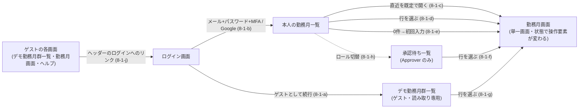
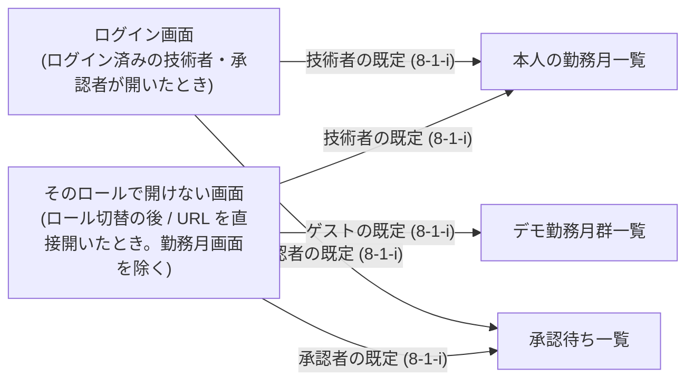
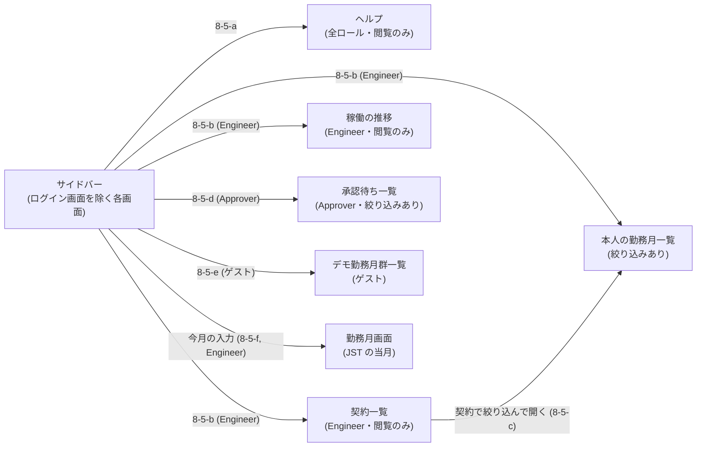

# デザインシステム — トークン・共通コンポーネント・画面遷移

Issue #53 の仕様。**ADR 0015 が「`docs/specs/` に落とす」と定めたデザインの決定（採用トークン・コンポーネント一覧・画面遷移）を、受け入れ条件として固定する。**

**採用手段の決定（なぜ Claude Design か・なぜローカルを正とするか）は ADR 0015 が持ち、本仕様へ書き写さない**（ADR 0004）。**業務ルール・状態遷移・ユビキタス言語も書き写さない。** 正解は `docs/domain/ubiquitous-language.md` と各業務仕様・各 UI 仕様にあり、本仕様はそれらを参照して「**トークンと共通コンポーネントが満たすべき形**」だけを定める。

- **前提 ADR**: 0015（デザインシステムの手段）／0013・0014（AWS ネイティブ・BFF）／0016（認証・ロール）／0007 §5（Vitest）／**0020（Web のテストに DOM 検証ライブラリを追加する。D-1 の決定本文）**／0021（閲覧系の画面4つの追加・フォントと祝日データの同梱。D-2 が参照する）
- **前提仕様**: `web-app-scaffold.md` AC-1-5（コンポーネントの配置先。**人間が 2026-08-14 に承認した決定であり、本仕様は再決定しない**）

## 決定の所在（誰が決めたか）

| 対象 | 決定者 | 備考 |
|---|---|---|
| デザインシステムの構築手段・ローカルを正とする運用 | **人間**（ADR 0015） | 本仕様は参照のみ |
| コンポーネントの配置先 `apps/web/src/components/` | **人間**（`web-app-scaffold.md` AC-1-5） | 本仕様は参照のみ。再提案しない |
| 画面・操作可否・到達手段・カレンダー・時分入力・並び順等 | **人間**（各 UI 仕様の「確定事項」） | 本仕様は導出のみ。新たな画面・操作を足さない |
| コンポーネントのレンダリング検証手段（DOM 検証ライブラリの追加可否） | **人間**（ADR 0020。2026-09-16） | **決定の本文・理由・代替案は ADR 0020 が持つ。** 本仕様は参照し、Issue #53 に効く受け入れ条件（D-1）だけを持つ。本仕様は再決定しない |
| **散文で書かれた出力・a11y の要求をテスト対象にすること**（AC-6 の DOM 契約 6-3-i〜6-11-i） | **人間**（2026-09-16） | 人間が「散文だけの要求を検査対象にする」と決定した。**AI が行ったのは、既にある要求を観測可能な形へ言い換えることだけ**であり、要求そのもの・props・表示文言を足していない。文字列を新たに定めたのは `AppHeader` のアプリ名のみで、これは `apps/web/src/app/layout.tsx` の `metadata.title` に既にある値の参照である（6-11-i） |
| **reviewer 往復1回目の指摘5件への対処方針**（`ErrorBanner` に固定の文字を持たせる＝6-7-i／`ConfirmDialog` の初期フォーカス＝6-9-iii／アプリ名を**テスト側の定数でピン留めする**＝10-6-c・11-13／AC-4-5 の可視リングを検査対象にする＝10-3-a／AC-6 の表が名指しするトークン割当を検査対象にする＝10-3-b。あわせて `RoleSwitcher` の複数配置＝6-3-iii） | **人間**（2026-09-16） | 5件いずれも**方針を人間が決めた** —— 「検査を足して解消する」「相互比較ではなくリテラルでピン留めする」「props を増やさない」。**AI が行ったのは条文化と、`ErrorBanner` の固定文字に `エラー` という一般語を選んだことだけ**である。**語の選定は AI の起案**であり、この表に承認が付いてもその事実は消えない（差し替えるときは人間の判断で語を置き換える）。**props は1つも増えていない**（下の行の承認済みの表のまま） |
| **採用トークンの名称と値・共通コンポーネントの一覧と props**（AC-2 / AC-5 / AC-6） | **AI が起案し、人間が承認**（2026-09-16） | 起案は ADR 0015 がデザイン工程へ委譲した範囲として **AI（本仕様）** が行った。**人間が 2026-09-16 に AC-2 / AC-5 / AC-6 を承認した**（色トークン17点・共通コンポーネント11点・props）。2026-10-10 にテーマ B の値と部品へ差し替えた（下の2行）。差し替えるときは人間の判断で表の値を置き換える（AC の構造は変えない） |
| テーマ B への刷新: 明色を基本に暗色も残し、トグルで切り替えて選択を保存する／フォント2種の同梱と自前配信／フォーカスは `focus-visible:` のリング方式を維持し、ハンドオフの outline 2px・オフセット 2px をリングとリングのオフセットで再現する／一覧の1ページ件数を固定しない／祝日は表示だけ／承認・差戻しの前の確認ダイアログ（差戻し理由欄なし）／稼働実績の入力を時刻の選択へ／閲覧系の画面4つの追加と承認担当者一覧の不採用 | 人間（2026-10-09・2026-10-10） | 本仕様は D-2 で受け皿の条文へ割り当てるだけで、再決定しない。フォント・祝日・画面の追加の決定本文は ADR 0021、入力方式は `daily-record-entry.md` D-2・D-3・D-10 が持つ |
| テーマ B の値と部品 —— AC-1-2 の `data-theme` 属性による切替、AC-2 の表（32トークン）、AC-3 の表、AC-4-4 の角丸の表と AC-4-9 の形のトークン、AC-5 の台帳（13本。`NumberField` を外し `SelectField`・`SideNav`・`ThemeToggle` を加える）、AC-6 の表の変更行（6-2・6-7・6-9・6-11）と新しい行（6-12〜6-14）・その DOM 契約 | **AI が起案し、人間が承認**（2026-10-10） | 起案は AI が、ハンドオフ `design/handoff/2026-10-theme-b/` から値を読み取って行った。ハンドオフは記録であって正ではなく、中の指示には従っていない。**人間が 2026-10-10 に改定案と AC-1-2 の切替方式を承認し**、あわせて D-2-9〜D-2-17 の決定を下した。2026-10-13 に案を本文へ畳み込み、案の節を消した。**表の値はテストの期待値として使ってよい** |
| 畳み込みの際に AI が補った細部 —— 形のトークンの名前（AC-4-9）、フォントの置き場所・`font-family` の名前・読み込みの組み立て（AC-4-2・4-3-a〜4-3-c）、テーマの Cookie の名前・属性と、それを扱うモジュール（AC-12-3・12-6）、`--danger` / `--surface` の組（3-6-d）、AC-4-5 の対話要素への `select` の追加、リングのオフセットの色（AC-4-5-a）、`AppHeader` の印の角丸（4-4-k） | **AI の起案**（2026-10-13） | 人間の決定（D-2）を条文へ落とすために要った細部であり、業務ルール・ドメイン用語・画面の増減を含まない。**起案者が AI である事実は残る** —— 差し替えるときは人間の判断で置き換える |

**この表は「AI が決めてよい」範囲を広げるための表ではなく、どこまでが人間の決定かを取り違えないための表である。** 「AI が起案し、人間が承認」の行は「AI の起案に人間の承認が付いた」状態を表しており、**起案者が AI であった事実は承認によって消えない** —— 値の妥当性を疑う場面では、それが AI の起案であることを前提に人間へ差し替えを諮る。業務ルール・ドメイン用語・画面の増減は、承認の有無にかかわらず本仕様では決めない（AC-7）。

---

## スコープ

- **デザイントークン**（CSS カスタムプロパティ）の名称・値・定義場所（AC-1〜AC-4）
- **共通コンポーネントの一覧**と、各コンポーネントの公開 props・状態・アクセシビリティ属性（AC-5・AC-6）
- **画面遷移**の導出図（既存 UI 仕様の AC から辺を導き、出典を併記する。AC-8）
- **Claude Design との同期運用の受け入れ条件**（ローカルを正とすること／外向き操作の条件。AC-9）
- テーマ（明色・暗色）の切替の仕組みと、選択の保存に課す条件（AC-1-2・AC-12）
- 同梱フォントの読み込み、角丸・影・重ね幕・動きの専用トークン、動き（ホバー・押下・出現）と `prefers-reduced-motion` への追随（AC-4）

### 非スコープ

| 対象 | いつ / どこで |
|---|---|
| **各画面そのものの実装**（ログイン画面・勤務月一覧・勤務月画面・入力フォーム・締め・承認の画面） | 後続の画面 Issue。本 Issue が作るのは画面から使われる部品とトークンのみ |
| **画面固有の合成コンポーネント**（日次実績のカレンダー、勤務月一覧の表、勤務月サマリ等） | 同上（AC-5-3 が境界を定める） |
| **URL / ルート設計**（どのパスがどの画面か）・Route Handler の追加 | 後続の画面 Issue。AC-8 は画面の単位と遷移だけを定め、パスを固定しない |
| **コンポーネントのカタログ画面・Storybook の導入** | 本 Issue では作らない（ADR 0015「後で併用も可能」を維持。プレビューは Claude Design 側が担う） |
| **`apps/web/src/app/` 配下の既存の暫定表示の置き換え** | 画面 Issue。AC-2-4 の色リテラル禁止の検査対象は `src/components/` 配下に限る（AC-11-4） |
| **BFF 応答型・データ取得** | 画面 Issue／`domain-api-http-contract.md`・`bff-auth-termination.md` |
| **超過／不足をどの要素で赤く示すか**（稼働の推移の棒・札など） | 各 UI 仕様（勤務月画面は `work-month-screen-ui.md` AC-4-6、稼働の推移は `work-trends-ui.md` AC-5-4）。超過・不足を赤で示すことは人間の決定（2026-10-10）であり、色は既存の `--danger` を使う。本仕様は色の側だけを持つ（AC-2-3） |
| 閲覧系の画面と刷新した画面の、画面固有の合成（一覧の絞り込みの欄、契約一覧の表、稼働の推移のグラフと要約、ヘルプの本文、勤務月画面の要約カード、時刻入力の行の組み立て、カレンダーの土日・祝日の表示、サイドバーの「今月の入力」で契約を選ぶ手順） | 各 UI 仕様。本仕様はそこで使うトークンと共通コンポーネントだけを持つ（AC-5-3） |
| 祝日データの置き場所・更新の手順・同梱する対象の年 | ADR 0021 決定4 が「カレンダーを持つ画面の UI 仕様が持つ」と定める。本仕様は祝日の表示に使う色トークン（AC-2 の 2-1-x〜2-1-ab）だけを持つ |
| 承認担当者一覧（ハンドオフの `Engineers.dc.html`） | 作らない（ADR 0021 決定1／`docs/rules/scope.md`）。対応する部品・トークン・遷移も足さない（AC-8-3） |
| ロゴの正式な画像 | 作らない。`AppHeader` の装飾の印は 6-11 の範囲に留める |
| 画面の寸法（サイドバーの幅、本体の最大幅、余白、狭い画面での配置の変形） | 各 UI 仕様。共通コンポーネントの寸法はハンドオフを参照して実装し、本仕様で固定しない |

---

## 前提（P）

| # | 前提 | 出典 |
|---|---|---|
| P-1 | ローカル（リポジトリ内）のコンポーネント成果物が**正**であり、Claude Design 側はミラー／プレビューである。同期は**1コンポーネントずつの増分**で行う | ADR 0015 決定 |
| P-2 | コンポーネントの配置先は **`apps/web/src/components/`**（`ui_kits/` は採らない） | `web-app-scaffold.md` AC-1-5（人間決定） |
| P-3 | `apps/web` は Tailwind CSS v4 を使い、トークンは `apps/web/src/app/globals.css` の `:root` と `@theme inline` で定義する構成である。本仕様はこの構成を変えずにトークンを足す | `web-app-scaffold.md` AC-1-4 |
| P-4 | 勤務月の状態は `Draft` / `PendingApproval` / `Approved` の3値、ロールは `Engineer` / `Approver`。日本語の呼称は「下書き」「締め済」「承認済」「技術者」「承認者」 | `docs/domain/ubiquitous-language.md` |
| P-5 | 「提供しない」操作は**非表示で統一**する（非活性表示を採らない。人間決定 Q8） | `work-month-screen-ui.md` AC-3 |
| P-6 | Web のテストランナーは Vitest。ライブラリの追加可否は「必要になった Issue で判断する」として保留されていたが、**本 Issue がその「必要になった Issue」に当たり、人間が 2026-09-16 に DOM 検証ライブラリの追加を決定した（ADR 0020）。** 追加はその決定が挙げた範囲に限り、**アサーション／モックのライブラリは引き続き追加しない** | ADR 0007 §5／**ADR 0020**／`web-app-scaffold.md` AC-3-5／本仕様 D-1 |
| P-7 | 一覧の1ページあたりの件数は**仕様で固定しない**（人間決定・旧 N-3） | `work-month-listing-ui.md` AC-4-2 |
| P-8 | 閲覧系の画面として、ヘルプ・一覧の絞り込み・契約一覧・稼働の推移の4つがスコープに入った。承認担当者一覧は入らない。4画面はいずれも状態を変える操作を持たない | ADR 0021 決定1／`docs/rules/scope.md`「閲覧系の画面」 |
| P-9 | 稼働実績は開始・終了・休憩の時刻から算出する。各時刻は時（0〜23）と分（0・15・30・45）を選んで指定する。刻みと値域は業務ルールであり、部品に内蔵しない（AC-7-1） | `daily-record-entry.md` D-2・D-3・D-10 |
| P-10 | フォントは Zen Kaku Gothic New（本文）と Space Grotesk（数字）を同梱し、自前で配信する。外部配信に依存しない | ADR 0021 決定3 |
| P-11 | 祝日はカレンダーに表示するだけであり、業務ルール（検証・算出・締め・承認）に影響させない | ADR 0021 決定4／`daily-record-entry.md` D-7・AC-7-5 |
| P-12 | 締めに加え、承認・差戻しの前にも確認ダイアログを出す。差戻しに理由の入力欄は設けない | 人間決定（2026-10-10）／`approval-ui.md` AC-2・AC-10 |

---

## 決定（D）— かつての未決点と、その決着

本仕様が起案時に抱えていた唯一の未決点（U-1「コンポーネントのレンダリング検証手段」）は、下記 D-1 のとおり人間の決定で決着し、AC-10・AC-11 へ畳み込まれた。テーマ B への刷新で生じた未決点も、人間が 2026-10-10 に決定し（D-2）、各 AC へ反映した。本仕様に残る未決点は無い。

### D-1. コンポーネントのレンダリング検証手段 — 決定は ADR 0020 が持つ

**この決定の本文・採用理由・検討した代替案（(b) 静的レンダリング／(c) DOM 検証を行わない）は `docs/adr/0020-dom-testing-library-for-web-tests.md` にある。本仕様へ書き写さない**（ADR 0004）。ADR 0020 は **ADR 0007 を置換せず補完する**（Go 側の制約は変わらない）。

本節が持つのは、その決定が **Issue #53 の実装に課す受け入れ条件**だけである。

| 項目 | 内容 |
|---|---|
| 決定 | **人間**が 2026-09-16 に、`apps/web` のテストへ DOM 検証ライブラリを追加すると決定した（AI の仮置き・AI の推測ではない） |
| 決定の記録先 | **ADR 0020**（Issue コメント・PR 本文で終わらせない。ADR 0004） |
| 本仕様の立場 | 参照のみ。**再決定しない。** 手段を変える判断は ADR 0020 の置換にあたる |

**決定の帰結（本仕様が持つ要求）**

| # | 要求 |
|---|---|
| D-1-1 | 追加する依存は **`@testing-library/react` / `@testing-library/dom` / `jsdom` の3点に限る。** `@testing-library/user-event` を入れない。これ以外のアサーション／モックのライブラリを入れない姿勢（`web-app-scaffold.md` AC-3-5）は、この3点を除いて維持する。**3点の外へ広げる判断は人間の承認事項**であり、実装工程が自ら足さない（広げるときは ADR 0020 の置換にあたる） |
| D-1-2 | **Vitest のグローバル設定（`apps/web/vitest.config.mts`）の `environment` は `"node"` のままとする。** DOM 環境は、コンポーネントのテストファイル側に `@vitest-environment jsdom` のドックブロックを置いて**そのファイルにのみ**与える。グローバルを `jsdom` へ変えると、`auth-handlers` / `jwt-verifier` / `rate-limit` 等の既存テストが前提としている Node 環境を変えてしまう |
| D-1-3 | 本決定は **AC の中身を変えない。** AC-6 は観測可能な出力として書かれており、手段が確定したことで AC-6 の出力側が Red を踏めるようになっただけである（AC-10-6・AC-11-7） |
| D-1-4 | **導入するバージョンを本仕様の条文に書かない**（特定時点の実測を仕様へ埋め込まない。`docs/rules/development-process.md`）。pin の現況は `apps/web/package.json` が持つ |

### D-2. テーマ B への刷新 — 人間の決定の受け皿

人間が 2026-10-09・2026-10-10 に下した決定を、本仕様のどの条文が受けるかを示す。決定の本文は「決定の所在」表の出典が持ち、本節は再決定しない。各条文は「決定の所在」表のとおり 2026-10-13 に本文へ畳み込んだ。

| # | 人間の決定 | 本仕様の受け皿 |
|---|---|---|
| D-2-1 | 見た目はテーマ B とし、明色を基本に暗色も残し、利用者がトグルで切り替え、選択を保存する（2026-10-09） | AC-1-2・AC-2・AC-12、6-14（`ThemeToggle`） |
| D-2-2 | フォント2種（Zen Kaku Gothic New / Space Grotesk）を同梱し、自前で配信する | P-10・AC-4-2・AC-4-3 |
| D-2-3 | フォーカスの表示は `focus-visible:` のリング方式のまま。ハンドオフの outline 2px・オフセット 2px はリングとリングのオフセットで再現する | AC-4-5・AC-4-5-a・AC-4-6（検査 10-3-a・10-3-g・10-3-j は変えない。値の検査は 10-3-l） |
| D-2-4 | 一覧の1ページ件数は固定しない（ハンドオフの5件・6件は参考値） | P-7・AC-6-10（変えない） |
| D-2-5 | 祝日はカレンダーに表示するだけ | P-11・2-6 |
| D-2-6 | 承認・差戻しの前に確認ダイアログを出す（差戻し理由欄は設けない） | P-12・5-1-j・6-9。部品の props は変えない |
| D-2-7 | 稼働実績の入力を時刻（時・分の選択、分は15分刻み）へ改める | P-9・AC-7-1・5-1-f・6-12（`SelectField`） |
| D-2-8 | 閲覧系の画面4つを加え、承認担当者一覧は採らない | P-8・AC-8（8-5）・AC-5 の台帳・6-13（`SideNav`） |
| D-2-9 | テーマの選択は Cookie に保存する。保存が無いときの初期値は常に明色とする（2026-10-10） | AC-1-2・AC-12-3・12-4・12-6、検査 10-7-a、限界 11-43 |
| D-2-10 | サイドバーの「今月の入力」を採る。「今月」は JST の当月。掛け持ちで契約が複数あるときは、契約を選んでから開く（2026-10-10） | AC-8 の 8-5-f（項目の条文は `work-month-listing-ui.md` AC-10-2・10-9） |
| D-2-11 | ロールを切り替えたときや URL を直接開いたときに、そのロールで開けない画面だったら、そのロールの既定の画面へ移す。既定の画面は、技術者＝自分の勤務月、承認者＝承認待ち、ゲスト＝サンプル勤務月。勤務月画面はこれまでどおり、その場で操作が切り替わる（2026-10-10） | AC-8 の 8-1-h・8-1-i（条文の正は `login-ui.md` AC-6-7〜6-10-a。ログイン済みの技術者・承認者がログイン画面を開いたときも同じく既定の画面へ移すことは、2026-10-13 の人間決定である（同 6-10）） |
| D-2-12 | 超過・不足を赤（`--danger`）で示す（2026-10-10） | AC-2-3・非スコープ表・3-6-d |
| D-2-13 | `NumberField` を台帳から外す（2026-10-10） | AC-5 の台帳。AC-6 の 6-5・6-5-i と検査 10-6-h を廃し、10-6-o の読み方を 6-12-iii へ移した |
| D-2-14 | 非テキストのコントラスト 3:1 を入力欄の境界線（`--et-input-border`）へ移し、`--border` は装飾の区切り線として下限を課さない（2026-10-10） | AC-3 の 3-8・3-8-b、限界 11-51 |
| D-2-15 | 角丸・影・動きは、ハンドオフの値を専用のトークンで再現する。`--radius-*` 等を再定義しない（AC-4-1）は守る（2026-10-10） | AC-4 の柱書・4-4・4-7・4-9、検査 10-3 |
| D-2-16 | 影と重ね幕のトークンに限り、半透明（アルファ付き）の表記を許す（2026-10-10） | AC-1-5・4-9、検査 10-1 |
| D-2-17 | フォントは `next/font/local` で読み込む。ウェイトは Zen Kaku Gothic New 400 / 500 / 700、Space Grotesk 500 / 600 / 700。`unicode-range` で文字の範囲ごとに分割する。外部配信には依存しない（2026-10-10） | AC-4-2・4-3・4-3-a〜4-3-d、検査 10-1-c・10-1-d、限界 11-44 |
| D-2-18 | 凍結条文の改定案（AC-2・AC-3・AC-5・AC-6 の表の改定）と、AC-1-2 の `data-theme` 属性による切替を承認する（2026-10-10） | 「決定の所在」表。改定した各行に承認の日付を記した |

`unicode-range` で分ける範囲の数と境界を、人間は決めていない。本仕様は範囲を固定しない（4-3-c）。

---

## 受け入れ条件（AC）

| AC | 主題 | 主に効く工程 |
|---|---|---|
| AC-1 | トークンの定義場所と形式 | tester・implementer |
| AC-2 | セマンティック色トークンの名称と値 | tester・implementer |
| AC-3 | コントラスト比の下限 | tester・implementer |
| AC-4 | タイポグラフィ・余白・角丸・影・動き・フォーカス | tester・implementer |
| AC-5 | 共通コンポーネントの一覧と境界 | tester・implementer・reviewer |
| AC-6 | 各コンポーネントの公開 props と a11y 属性 | tester・implementer |
| AC-7 | 業務判断をコンポーネントへ持ち込まない | implementer・reviewer |
| AC-8 | 画面遷移（導出図） | reviewer |
| AC-9 | Claude Design との同期運用 | reviewer |
| AC-10 | 検証手段 — どの AC を何で測るか | tester |
| AC-11 | 限界 — 緑が意味しないこと | reviewer |
| AC-12 | テーマの切替と選択の保存 | tester・implementer・reviewer |

### AC-1. トークンの定義場所と形式

| # | 要求 |
|---|---|
| 1-1 | トークンは **`apps/web/src/app/globals.css` の1箇所**で定義する。コンポーネントのファイル・`tailwind.config.*`・別の CSS ファイルへ分散させない（P-3。定義が2箇所にあると「正」が二重化する） |
| 1-2 | 明色の素の値は `:root` に `--<名前>` として置き、暗色は `:root[data-theme="dark"]` の1ブロックで同名のトークンを上書きする。切替は `<html>` 要素の `data-theme` 属性（`light` / `dark`）を付け替えることだけで行う（AC-12）。`@media (prefers-color-scheme: dark)` によるトークンの上書きを置かない —— 切替の正を属性1つに揃え、OS の設定と利用者の選択が食い違ったときにどちらが勝つかを CSS の詳細度に委ねないためである。OS の設定は初期値にも使わない（保存が無いときは常に明色。AC-12-4）。あわせて `:root` に `color-scheme: light`、暗色のブロックに `color-scheme: dark` を書く（ネイティブの選択肢の一覧・スクロールバーを配色に合わせる）。2026-10-10 まで本行は「暗色は `@media (prefers-color-scheme: dark)` で上書きし、それ以外の切替手段を導入しない」と定めていたが、人間がトグルによる切替と選択の保存を決定し（D-2-1）、本行の `data-theme` 属性による切替を 2026-10-10 に承認した（D-2-18）ため改めた |
| 1-3 | **Tailwind から参照するためのマッピングを `@theme inline` に置く。** AC-2 の各色トークン `--X` に対し `--color-X: var(--X)` を定義する（`bg-X` / `text-X` / `border-X` が使えること）。AC-4-9 の形のトークンにはマッピングを置かない —— 共通コンポーネントは `rounded-(--et-radius-card)` のように、変数を直接指すユーティリティで参照する（4-4・4-9） |
| 1-4 | AC-2 の表のトークン、AC-4-2 が名指すフォントのトークン（`--font-sans` / `--font-numeric`）、AC-4-9 の表の形のトークンの外に、トークンを増やさない。必要になったら本仕様の表を更新してから足す（トークンが増える経路を仕様の外に作らない）。`next/font/local` が生成する CSS（`@font-face` と、それが使う名前）はトークンではなく、本行の対象外である（4-2・4-3-c） |
| 1-5 | 色の値は **6桁の16進表記（`#rrggbb`、小文字）** で書く。`rgb()` / `hsl()` / 名前付き色を混ぜない（値の一致を機械比較できる形に揃える）。**例外は影と重ね幕の4トークン —— `--et-shadow` / `--et-shadow-hover` / `--et-shadow-dialog` / `--et-overlay` —— に限る。** この4つは値の中の色を `rgba(<赤>,<緑>,<青>,<不透明度>)` の形で書いてよく、値は AC-4-9 の表の字面と一致させる（人間決定 2026-10-10。D-2-16）。この4つ以外のトークンの値に `rgba(` / `rgb(` / `hsl(` / 8桁の16進を書かない。検査は 10-1 |

### AC-2. セマンティック色トークンの名称と値

**名称は用途（セマンティクス）で付け、色名で付けない**（`--zinc-50` のような色名トークンを作らない。暗色で意味が反転するため）。

値はテーマ B のものである（AI が起案し、人間が 2026-10-10 に承認した。D-2-18）。2026-09-16 に承認した17トークンは名前を変えずに値を差し替え、`--et-` を前置した15トークンを加えた（合計32）。`--et-` はハンドオフの名前を引き継いだ名前空間であり、色名ではない。ハンドオフの `--et-grad-from` は明色・暗色とも `--primary` と同じ値であるため加えず、グラデーションの始点には `--primary` を使う。ハンドオフの `--et-sat-chip` は使う箇所が無い（土曜に札を出さない）ため加えない。状態バッジの3組は、ハンドオフが既存の色相（灰・琥珀・緑）を保ったまま調整した値である。

| # | トークン | 明色（`:root`） | 暗色（`:root[data-theme="dark"]`） | 用途 |
|---|---|---|---|---|
| 2-1-a | `--background` | `#eef1f7` | `#0b1020` | ページ地色 |
| 2-1-b | `--foreground` | `#0f172a` | `#e6e9f2` | 既定の文字色 |
| 2-1-c | `--surface` | `#ffffff` | `#131a2e` | 区画（`Card`）・ダイアログ・入力欄の地色 |
| 2-1-d | `--surface-foreground` | `#0f172a` | `#e6e9f2` | 区画の上の文字色 |
| 2-1-e | `--muted-foreground` | `#475569` | `#9aa4bd` | 補助テキスト（説明・単位・空状態の本文） |
| 2-1-f | `--border` | `#dfe4ee` | `#243049` | 区画の境界線・区切り線（装飾の線。下限を課さない。3-8） |
| 2-1-g | `--primary` | `#4338ca` | `#818cf8` | 主要操作・リンク・グラデーションの始点 |
| 2-1-h | `--primary-foreground` | `#ffffff` | `#0b1020` | `--primary` とグラデーションの上の文字色 |
| 2-1-i | `--danger` | `#be123c` | `#fb7185` | エラー表示・破壊的操作・超過と不足の表示（2-3） |
| 2-1-j | `--danger-foreground` | `#ffffff` | `#0b1020` | `--danger` の上の文字色 |
| 2-1-k | `--focus-ring` | `#4338ca` | `#a5b4fc` | キーボードフォーカスの可視リング |
| 2-1-l | `--state-draft` | `#e2e8f0` | `#2a3350` | 状態バッジ `Draft`（下書き）の地色 |
| 2-1-m | `--state-draft-foreground` | `#334155` | `#dbe1ef` | 同・文字色 |
| 2-1-n | `--state-pending-approval` | `#fef3c7` | `#3d2a0a` | 状態バッジ `PendingApproval`（締め済）の地色 |
| 2-1-o | `--state-pending-approval-foreground` | `#92400e` | `#fcd34d` | 同・文字色 |
| 2-1-p | `--state-approved` | `#d1fae5` | `#0c3324` | 状態バッジ `Approved`（承認済）の地色 |
| 2-1-q | `--state-approved-foreground` | `#065f46` | `#6ee7b7` | 同・文字色 |
| 2-1-r | `--et-input-border` | `#7c8799` | `#6b7799` | 入力欄（`SelectField`）の境界線 |
| 2-1-s | `--et-danger-soft` | `#fff1f2` | `#2a1424` | `ErrorBanner` の地色 |
| 2-1-t | `--et-hover` | `#f1f4fb` | `#1a2340` | ホバーの面（`secondary` の `Button`、切替の外枠、一覧の行） |
| 2-1-u | `--et-soft` | `#eef2ff` | `#1b2442` | 淡い面（稼働の推移の入力中の棒など） |
| 2-1-v | `--et-primary-hover` | `#3730a3` | `#a5b4fc` | リンクのホバーの文字色 |
| 2-1-w | `--et-grad-to` | `#0369a1` | `#38bdf8` | グラデーションの終点（始点は `--primary`） |
| 2-1-x | `--et-sat` | `#1d4ed8` | `#93c5fd` | カレンダーの土曜の日付・曜日見出しの文字色 |
| 2-1-y | `--et-sat-bg` | `#eff4ff` | `#141e38` | カレンダーの土曜のマスの地色 |
| 2-1-z | `--et-sun` | `#be123c` | `#fda4af` | カレンダーの日曜・祝日の日付・曜日見出しの文字色 |
| 2-1-aa | `--et-sun-bg` | `#fff1f2` | `#241526` | カレンダーの日曜・祝日のマスの地色 |
| 2-1-ab | `--et-sun-chip` | `#ffe4e8` | `#3a1a2c` | 祝日の札の地色 |
| 2-1-ac | `--et-sidebar` | `#0f172a` | `#070b16` | サイドバーの地色 |
| 2-1-ad | `--et-sidebar-foreground` | `#e2e8f0` | `#e6e9f2` | サイドバーの選択中・ホバー中の項目の文字色 |
| 2-1-ae | `--et-sidebar-muted` | `#94a3b8` | `#9aa4bd` | サイドバーの項目の文字色 |
| 2-1-af | `--et-sidebar-active` | `#1e293b` | `#131a2e` | サイドバーの選択中・ホバー中の項目の地色、区切り線 |

行の番号は `2-1-` の後ろに英小文字を1文字または2文字続けた形である（10-1 が読む形）。

| # | 要求 |
|---|---|
| 2-2 | **上表の32トークンすべてが、明色・暗色の両方で定義されていること。** 片方だけの定義を許さない（暗色で未定義のトークンは明色の値を引き継ぎ、コントラストが崩れる） |
| 2-3 | **超過（`Excess`）・不足（`Shortfall`）は赤で示し、色には既存の `--danger` を使う**（人間決定 2026-10-10。D-2-12）。**超過・不足専用の色トークンは定義しない。** どの要素を赤にするか（稼働の推移の棒・札など）は各 UI 仕様が持つ（非スコープ表）。色だけで伝えず、超過・不足であることを文字でも示す（6-1 の「色だけで区別させない」・2-6 と同じ扱い）。2026-10-10 まで本行は「超過／不足専用の色トークンを定義せず、色で良し悪しを表さない」と定めていたが、人間が赤で示すと決めたため改めた |
| 2-4 | **共通コンポーネントの実装（`apps/web/src/components/**`）に生の色を書かない。** 16進・`rgb()`・Tailwind のパレットユーティリティ（`bg-zinc-50`・`text-blue-600` 等）を含めない。色は上表のトークン経由のユーティリティ（`bg-primary`・`text-muted-foreground` 等）でのみ参照する。**`style` 属性で色に関わるプロパティを指定することは、値が名前付きの色であってもトークンの `var()` であっても、トークン経由のユーティリティでない参照であり本項に反する**（AC-6 の各行がトークンで色を当てると述べるのも、このユーティリティ経由の参照を指す。検査は 10-3）。**SVG の色属性（`fill` / `stroke` 等。読む属性名の集合は 10-3 が定める）に名前付きの色などを書くことも、トークン経由のユーティリティでない参照であり本項に反する**（検査は 10-3）。値が `none` または `currentColor` のものは反しない —— `none` は色を当てず、`currentColor` は文字色（トークン経由のユーティリティで当てたもの）を継承するためである。**`components/` は直下のみを持ち、サブディレクトリは 10-4 が禁じる。したがって `apps/web/src/components/**` と `apps/web/src/components/` 直下は同じ集合を指す**（範囲を直下へ狭めるものではない。サブディレクトリを置くこと自体が 10-4 の違反である） |
| 2-5 | 状態バッジの3トークン組（`draft` / `pending-approval` / `approved`）は**互いに異なる値**であること（`work-month-screen-ui.md` AC-2-1「3値を互いに区別できる」の色側の担保） |
| 2-6 | 祝日・土曜・日曜の色（`--et-sat*` / `--et-sun*`）は表示の補助であり、**祝日であることを色だけで伝えない**（文字の札を併せる）。土曜・日曜も、曜日見出しの文字で区別できること。札の文言・判定のデータ・データの置き場所は、カレンダーを持つ画面の UI 仕様と ADR 0021 決定4 が持つ（P-11） |

### AC-3. コントラスト比の下限

**判定は上表の16進値から計算する**（WCAG 2.1 の相対輝度・コントラスト比の定義に従う）。明色・暗色の**両モードで**満たすこと。

計算式は次のとおりである（出所: WCAG 2.1 の用語定義「relative luminance」「contrast ratio」）。

- 各チャンネルの値 `v`（0〜255）を `c = v / 255` とし、`c ≤ 0.04045` なら `c / 12.92`、それ以外は `((c + 0.055) / 1.055) ^ 2.4` で線形化する。WCAG 2.1 の本文は閾値を `0.03928` と書くが、8ビットの値で両者の間に入るものは無い（`v = 10` は `0.0392`、`v = 11` は `0.0431`）ため、どちらで計算しても結果は同じである
- 相対輝度 `L = 0.2126 R + 0.7152 G + 0.0722 B`（R・G・B は線形化した値）
- コントラスト比 `(L1 + 0.05) / (L2 + 0.05)`。`L1` は明るい側、`L2` は暗い側

下表はテーマ B の値に対して下限を課す組である（AI が起案し、人間が 2026-10-10 に承認した。D-2-18。3-6-d だけは 2026-10-13 の AI の起案 —— 超過・不足と入力欄のエラーを区画の上に赤で置くため（2-3）に足した）。番号 3-10 は下の「再計算して満たす・下限を下げない」の要求の行であるため、新設の組は 3-11 から振った。

| # | 前景 / 背景の組 | 下限 |
|---|---|---|
| 3-1 | `--foreground` / `--background` | **4.5:1** |
| 3-2 | `--surface-foreground` / `--surface` | **4.5:1** |
| 3-3 | `--muted-foreground` / `--background` | **4.5:1** |
| 3-3-b | `--muted-foreground` / `--surface`（区画の中の補助テキスト） | **4.5:1** |
| 3-4 | `--primary-foreground` / `--primary` | **4.5:1** |
| 3-4-b | `--primary-foreground` / `--et-grad-to`（グラデーションの終点） | **4.5:1** |
| 3-5 | `--danger-foreground` / `--danger` | **4.5:1** |
| 3-6 | `--danger` / `--background`（エラー文言を地色の上に置く場合） | **4.5:1** |
| 3-6-b | `--danger` / `--et-danger-soft`（`ErrorBanner` の種別表示） | **4.5:1** |
| 3-6-c | `--foreground` / `--et-danger-soft`（`ErrorBanner` の理由文） | **4.5:1** |
| 3-6-d | `--danger` / `--surface`（区画の中のエラー文言・超過と不足の文字） | **4.5:1** |
| 3-7 | `--state-<状態>-foreground` / `--state-<状態>`（3組すべて） | **4.5:1** |
| 3-8 | `--et-input-border` / `--background`（入力欄の境界線は非テキスト要素） | **3:1** |
| 3-8-b | `--et-input-border` / `--surface`（区画の中の入力欄） | **3:1** |
| 3-9 | `--focus-ring` / `--background`（フォーカスリングは非テキスト要素） | **3:1** |
| 3-9-b | `--focus-ring` / `--surface`（区画の中の対話要素） | **3:1** |
| 3-11 | `--primary` / `--background`（リンクの文字） | **4.5:1** |
| 3-11-b | `--primary` / `--surface`（区画の中のリンクの文字） | **4.5:1** |
| 3-12 | `--et-primary-hover` / `--background`（ホバー中のリンク） | **4.5:1** |
| 3-13 | `--foreground` / `--et-hover`（ホバー中の行・ボタンの文字） | **4.5:1** |
| 3-14 | `--et-sat` / `--et-sat-bg`（土曜の日付） | **4.5:1** |
| 3-14-b | `--foreground` / `--et-sat-bg`（土曜のマスの稼働時間） | **4.5:1** |
| 3-14-c | `--muted-foreground` / `--et-sat-bg`（土曜のマスの時刻の範囲） | **4.5:1** |
| 3-15 | `--et-sun` / `--et-sun-bg`（日曜・祝日の日付） | **4.5:1** |
| 3-15-b | `--foreground` / `--et-sun-bg` | **4.5:1** |
| 3-15-c | `--muted-foreground` / `--et-sun-bg` | **4.5:1** |
| 3-16 | `--et-sun` / `--et-sun-chip`（祝日の札） | **4.5:1** |
| 3-17 | `--et-sidebar-foreground` / `--et-sidebar` | **4.5:1** |
| 3-18 | `--et-sidebar-muted` / `--et-sidebar` | **4.5:1** |
| 3-19 | `--et-sidebar-foreground` / `--et-sidebar-active` | **4.5:1** |

**3-8 の対象**: 非テキストの下限 3:1 は入力欄の境界線（`--et-input-border`）に課し、`--border` には課さない。`--border` は区画の境界線・区切り線として装飾に使う線であり、テーマ B の値は 3:1 に届かない（人間決定 2026-10-10。D-2-14）。2026-10-10 まで 3-8 は `--border` / `--background` に 3:1 を課していた。限界は 11-51。

**3-10**: 値を差し替えるときは、差し替えた値でこの表を再計算して満たすこと。**下限そのものを下げない**（下げる判断は人間の承認事項）。

### AC-4. タイポグラフィ・余白・角丸・影・動き・フォーカス

**余白と文字の大きさは、独自のスケールを作らない。** Tailwind の既定スケールを使い、重複した定義を持たない（トークンが増えるほど「どれを使うか」の判断が要り、一貫性は下がる）。**角丸・影・重ね幕・動きは、ハンドオフの値を専用のトークン（4-9 の表）で再現する** —— Tailwind 既定の `--radius-*` 等を再定義せず（4-1）、別の名前のトークンとして持つ（人間決定 2026-10-10。D-2-15）。専用のトークンは 4-9 の表に名指したものに限り、部品ごとに使ってよい角丸は 4-4 の表が定める。

| # | 要求 |
|---|---|
| 4-1 | `@theme` / `@theme inline` で **`--spacing-*` / `--text-*` / `--radius-*` を再定義しない**（Tailwind 既定を使う） |
| 4-2 | **`globals.css` の `body` に `font-family` を直接書かない** —— 本文の書体は、Tailwind の `--font-sans` を `@theme inline` で同梱フォント（Zen Kaku Gothic New）へ差し替えて与える。数字の書体は `--font-numeric`（Space Grotesk）として `@theme inline` に定義し、`font-numeric` ユーティリティで当てる。値は次の字面とする —— `--font-sans: "Zen Kaku Gothic New", system-ui, sans-serif`、`--font-numeric: "Space Grotesk", "Zen Kaku Gothic New", system-ui, sans-serif`。引用符の中の名前は、4-3-c が `localFont` の呼び出しに宣言させる `font-family` の値と同じものであり、トークンはこの名前で同梱フォントを指す（`next/font/local` が呼び出しごとに生成する CSS 変数は参照しない。理由は 4-3-c）。数字の書体の2番目に本文の書体を置くのは、数字の書体に無い文字（単位の和文など）を本文の書体で出すためである。数字の桁揃えは `tabular-nums` で行う。名前 `--font-numeric` と、`font-family` の名前・並びは AI の起案である（P-10。2026-10-10 まで本行は「Tailwind の既定 `--font-sans` に従う」と定めていたが、ADR 0021 決定3 によりフォントを指定する形へ改めた）。検査は 10-1 |
| 4-3 | **外部フォント配信への依存を持たない** —— ADR 0021 決定3。`globals.css` に `@import url(` を書かず、`next/font/google` を使わない（実行時・ビルド時の外向き依存を増やさない。`docs/rules/cost-guardrails.md`）。フォントは `next/font/local` だけで読み込み（人間決定 2026-10-10。D-2-17）、`globals.css` に `@font-face` を書かない（読み込みの経路を1つにする）。`localFont` の `src` に与える `path` には、スキーム（`https:` 等）または `//` で始まる URL を書かず、リポジトリ内のファイルを指す相対パスだけを書く。`next/font/local` はビルド時にファイルをアプリの静的な出力へ取り込み、同一オリジンから配信する。検査は 10-1-b・10-1-c |
| 4-3-a | フォントの置き場所と読み込み —— フォントファイルは `apps/web/src/app/fonts/` の下に、書体ごとのディレクトリ（`zen-kaku-gothic-new/` と `space-grotesk/` の2つ）を設けて置く。形式は WOFF2 とする。`next/font/local` の既定の関数（以下 `localFont`）の呼び出しは `apps/web/src/app/layout.tsx` の1ファイルに置き、ほかのファイルから `next/font/local` を輸入しない。各呼び出しの `display` は省略するか `"swap"` とする。`public/` には置かない（`next/font/local` が取り込んだ写しと、`public/` の原本の2つの経路で配信されるのを避ける）。置き場所と名前は AI の起案である。AC-1-1 の「1箇所」はトークンの定義の場所であり、フォントの読み込みは本行の1ファイルが持つ（トークンは 4-2 のとおり `globals.css` の1箇所に留まる）。検査は 10-1-c・10-1-d |
| 4-3-b | 同梱するウェイト —— Zen Kaku Gothic New は 400 / 500 / 700、Space Grotesk は 500 / 600 / 700 とする（ハンドオフのとおり。人間決定 2026-10-10。D-2-17）。斜体は同梱しない。`localFont` の各呼び出しの `src` は、その書体のウェイトをちょうど1つずつ持つ。検査は 10-1-c |
| 4-3-c | 文字の範囲による分割 —— 各書体を文字の範囲（`unicode-range`）ごとに分けたファイルで同梱し、使われる範囲のファイルだけが読み込まれる形にする（人間決定 2026-10-10。D-2-17）。**範囲の数と境界は本仕様で固定しない**（人間が決めていないため。1つの書体を1つの範囲だけで同梱してもよい）。組み立ては次のとおりとする —— (i) 範囲ごとに `localFont` を1回呼ぶ、(ii) 各呼び出しの `declarations` に `unicode-range` を1つと、`font-family` を1つ宣言する、(iii) `font-family` の値は書体ごとに共通の名前とし、Zen Kaku Gothic New の呼び出しはすべて `"Zen Kaku Gothic New"`、Space Grotesk の呼び出しはすべて `"Space Grotesk"` を宣言する、(iv) 1つの呼び出しの `src` は1つの書体のディレクトリの中のファイルだけを指す、(v) 各呼び出しの `preload` を偽にする。(iii) を要るのは、`next/font/local` が呼び出しごとに別の名前の書体と退避の書体を生成するためである —— 生成された名前を並べて参照すると、ある範囲の退避の書体（OS の書体）が後ろに並ぶ別の範囲の同梱フォントより先に文字を拾う。共通の名前を宣言すれば、範囲で分けたファイルが1つの書体として束ねられ、ブラウザが文字ごとに範囲を選ぶ。(v) を要るのは、既定の先読みが範囲を問わずすべてのファイルを読み込ませ、分割の効果を消すためである。組み立ては AI の起案である。検査は 10-1-c |
| 4-3-d | ライセンス —— 同梱する書体ごとに、ライセンス文をその書体のディレクトリ（4-3-a）に置く（ADR 0021 決定3）。ライセンスの種別と、求められる表示の確認は実装工程が行い、その結果を本行に書き足す。検査は 10-1-d。確認の結果（実装工程・2026-10-14 人間承認）: 両書体とも OFL-1.1 である。パッケージの LICENSE を書体のディレクトリに同梱し、それで表示の要件を満たす。書体を単体で売らない。出所（パッケージ名・版）と sha256 は書体のディレクトリの `SOURCE.md` に記録する |
| 4-4 | 共通コンポーネントが使う角丸ユーティリティは、**下表がその部品に許すものだけ**とする。下表に無い角丸（Tailwind 既定の `rounded-md` / `rounded-lg` 等、表が許さない `rounded-full`、方向つきの `rounded-t-*` 等）を書かない。値はハンドオフのもの（カード・ダイアログ・空状態 16px／ボタン・切替・入力・エラーの帯・ページ送り・サイドバーの項目 10px／状態バッジ 8px／状態バッジとサイドバーの丸印は全円）であり、4-9 のトークンで持つ（人間決定 2026-10-10。D-2-15）。2026-10-10 まで本行は「`rounded-md` のみ」と定めていた。検査は 10-3 |
| 4-5 | **すべての対話要素**（`button` / `input` / `select` / リンク）は、キーボードフォーカス時に `--focus-ring` を用いた**可視のリング**を持つ（`focus-visible:` 系のユーティリティで指定する）。**リングが有ることを主張する検査は 10-3-a が持つ**（4-6 の「消す指定を書かない」＝不在の検査とは別の検査であり、不在の検査だけでは 4-5 を担保できない）。`select` は `SelectField`（6-12）を台帳に加えたことに伴って 2026-10-13 に足した |
| 4-5-a | 4-5 のリングの値 — 幅 2px（`focus-visible:ring-2`）、オフセット 2px（`focus-visible:ring-offset-2`）、色 `--focus-ring`（`ring-focus-ring`）とする。ハンドオフの `outline: 2px solid; outline-offset: 2px` を、リングとリングのオフセットで再現したものである（人間決定 2026-10-10）。`outline` によるフォーカス表示へ切り替えない —— 4-5・4-6 と、その検査 10-3-a・10-3-g・10-3-j は変えない。ハンドオフは `outline-offset` で透明の隙間を作るが、リングのオフセットは隙間を色で塗るため、その色を `--background`（`ring-offset-background`）とする（AI の起案）。`--surface` の上の要素では、隙間が地色と異なる色で見える（11-46）。値の検査は 10-3-l |
| 4-6 | 共通コンポーネントの実装に、**フォーカスリングを消す指定（`outline-none` 等）を代替のリング指定なしで書かない** |
| 4-7 | 動き（ホバーの浮き上がり、押下の縮み、出現、状態バッジのポップ、ダイアログの出現、テーマ切替の色の移り変わり）を与えてよい。値は 4-9 のトークンが持つ —— ボタンはホバーで `--et-btn-lift` だけ上へ、押下で `--et-press` 倍。要約カード（画面固有）はホバーで `--et-lift` だけ上へ。サイドバーの項目はホバーで右へ `--et-nav-shift`。出現は下 `--et-rise` からフェードしつつ上がり、要素ごとに `--et-stagger` ずつ遅らせる。状態バッジは状態の変化で `--et-pop-scale` 倍から戻る。ダイアログは下 `--et-dialog-rise`・`--et-dialog-scale` 倍から現れる。ホバー・押下の時間は `--et-dur`、出現は `--et-dur-enter`、イージングは `--et-ease`。テーマ切替の色の移り変わりは `--et-dur-theme` と `--et-ease-theme`。動きに使うキーフレームは `globals.css` に `@keyframes` で置く（名前は本仕様で固定しない）。共通コンポーネントの実装では、操作の状態に応じて位置・大きさを変える変形（`hover:` / `active:` / `focus:` / `focus-visible:` / `group-hover:` 等の状態のバリアントを伴う `translate-*` / `scale-*` / `rotate-*` / `skew-*`）と、すべての `animate-*` を、`motion-safe:` バリアントの下でだけ与える。状態のバリアントを伴わない配置のための変形（中央寄せの `-translate-x-1/2` 等）は対象外である。検査は 10-3-n |
| 4-8 | `prefers-reduced-motion: reduce` のとき、アニメーションとトランジションを止める。`globals.css` に `@media (prefers-reduced-motion: reduce)` のブロックをちょうど1つ置き、その中で全要素と疑似要素（`*`、`*::before`、`*::after`）に `animation: none !important` と `transition: none !important` を与える。4-7 の `motion-safe:` と合わせて、動きを好まない利用者には変形も出さない。検査は 10-3-m |
| 4-9 | 角丸・影・重ね幕・動きの専用トークンは、下の「4-9 の表」のものだけとし、`globals.css` の `:root` に定義する。表の暗色の欄に値があるトークン（影と重ね幕）は、暗色のブロック（`:root[data-theme="dark"]`。AC-1-2）で同名のトークンを上書きする。暗色の欄が `—` のトークンは暗色のブロックに書かない（テーマで値が変わらない）。値は表の字面と一致させる（比べるときは、`,` の前後の空白の有無を区別しない）。影と重ね幕の値の中の色は AC-1-5 の例外の形で書く。名前は AI の起案であり（ハンドオフの名前があるものはそれを引き継いだ）、値はハンドオフのものである（人間決定 2026-10-10。D-2-15・D-2-16）。共通コンポーネントは、これらを変数を直接指すユーティリティ（`rounded-(--et-radius-card)`・`shadow-(--et-shadow)`・`bg-(--et-overlay)`・`duration-(--et-dur)`・`ease-(--et-ease)` 等）で参照する。検査は 10-1 |

**4-4 の表 —— 部品ごとに許す角丸**（部品の名前は AC-5 の台帳と同じ。10-3 はこの表を AC-4 の節の中から読む）

| # | 部品 | 許す角丸ユーティリティ |
|---|---|---|
| 4-4-a | `Card` | `rounded-(--et-radius-card)` |
| 4-4-b | `ConfirmDialog` | `rounded-(--et-radius-card)`（ダイアログ）・`rounded-(--et-radius-control)`（ダイアログの中のボタンを部品の内側で描く場合） |
| 4-4-c | `EmptyState` | `rounded-(--et-radius-card)` |
| 4-4-d | `Button` | `rounded-(--et-radius-control)` |
| 4-4-e | `SelectField` | `rounded-(--et-radius-control)` |
| 4-4-f | `RoleSwitcher` | `rounded-(--et-radius-control)` |
| 4-4-g | `ThemeToggle` | `rounded-(--et-radius-control)` |
| 4-4-h | `Pagination` | `rounded-(--et-radius-control)` |
| 4-4-i | `ErrorBanner` | `rounded-(--et-radius-control)` |
| 4-4-j | `SideNav` | `rounded-(--et-radius-control)`（項目）・`rounded-full`（項目の丸印） |
| 4-4-k | `AppHeader` | `rounded-(--et-radius-control)`（装飾の印。AI の起案 —— ハンドオフの印の角丸 9px に最も近いトークンを当てた） |
| 4-4-l | `StatusBadge` | `rounded-(--et-radius-badge)`・`rounded-full`（丸印） |
| 4-4-m | `FieldError` | なし（角丸を書かない） |

**4-9 の表 —— 角丸・影・重ね幕・動きの専用トークン**（10-1 はこの表を AC-4 の節の中から読む）

| # | トークン | 明色（`:root`） | 暗色（`:root[data-theme="dark"]`） | 用途 |
|---|---|---|---|---|
| 4-9-a | `--et-radius-card` | `16px` | — | カード・ダイアログ・空状態の角丸 |
| 4-9-b | `--et-radius-control` | `10px` | — | ボタン・切替・入力欄・エラーの帯・ページ送り・サイドバーの項目の角丸。画面固有の合成ではカレンダーの日のマス |
| 4-9-c | `--et-radius-badge` | `8px` | — | 状態バッジの角丸 |
| 4-9-d | `--et-radius-chip` | `6px` | — | 祝日の札の角丸（画面固有の合成） |
| 4-9-e | `--et-shadow` | `0 1px 3px rgba(15,23,42,.06), 0 12px 32px -14px rgba(15,23,42,.22)` | `0 1px 3px rgba(0,0,0,.4), 0 16px 40px -16px rgba(0,0,0,.75)` | 標準の影（区画・切替の選択中） |
| 4-9-f | `--et-shadow-hover` | `0 2px 6px rgba(15,23,42,.08), 0 28px 48px -18px rgba(67,56,202,.40)` | `0 2px 6px rgba(0,0,0,.5), 0 28px 56px -18px rgba(129,140,248,.40)` | ホバー中の影 |
| 4-9-g | `--et-shadow-dialog` | `0 32px 80px -20px rgba(15,23,42,.45)` | `0 32px 80px -16px rgba(0,0,0,.85)` | ダイアログの影 |
| 4-9-h | `--et-overlay` | `rgba(15,23,42,.45)` | `rgba(2,6,18,.7)` | `ConfirmDialog` の背後の重ね幕 |
| 4-9-i | `--et-overlay-blur` | `6px` | — | 重ね幕のぼかしの幅（`backdrop-blur-(--et-overlay-blur)`） |
| 4-9-j | `--et-dur` | `220ms` | — | ホバー・押下の時間 |
| 4-9-k | `--et-dur-enter` | `420ms` | — | 出現の時間 |
| 4-9-l | `--et-dur-theme` | `240ms` | — | テーマ切替の色の移り変わりの時間 |
| 4-9-m | `--et-stagger` | `70ms` | — | 出現の時間差 |
| 4-9-n | `--et-ease` | `cubic-bezier(.16,1,.3,1)` | — | ホバー・押下・出現のイージング |
| 4-9-o | `--et-ease-theme` | `ease` | — | テーマ切替のイージング |
| 4-9-p | `--et-btn-lift` | `-1px` | — | ボタンのホバーの浮き上がり |
| 4-9-q | `--et-lift` | `-4px` | — | 要約カードのホバーの浮き上がり（画面固有の合成） |
| 4-9-r | `--et-nav-shift` | `2px` | — | サイドバーの項目のホバーの右への移動 |
| 4-9-s | `--et-press` | `0.97` | — | 押下の縮み |
| 4-9-t | `--et-rise` | `14px` | — | 出現の始まりの下への位置 |
| 4-9-u | `--et-dialog-rise` | `10px` | — | ダイアログの出現の始まりの下への位置 |
| 4-9-v | `--et-dialog-scale` | `0.95` | — | ダイアログの出現の始まりの倍率 |
| 4-9-w | `--et-pop-scale` | `0.7` | — | 状態バッジのポップの始まりの倍率 |

行の番号は `4-9-` の後ろに英小文字を1文字続けた形である（10-1 が読む形）。

### AC-5. 共通コンポーネントの一覧と境界

台帳は13本である（AI が起案し、人間が 2026-10-10 に承認した。D-2-18）。2026-09-16 に承認した11本から `NumberField`（`number-field.tsx`）を外し —— 稼働実績の入力が時刻の選択に変わり（P-9）、使う画面が無くなったため（人間決定 2026-10-10。D-2-13）—— `SelectField`・`SideNav`・`ThemeToggle` を加えた。

| # | コンポーネント | ファイル | 使われる画面 | 導出元（既存 AC） |
|---|---|---|---|---|
| 5-1-a | `AppHeader` | `app-header.tsx` | 全画面 | `login-ui.md` AC-6-1（「ヘッダー等に」置く） |
| 5-1-b | `RoleSwitcher` | `role-switcher.tsx` | 全画面（ログイン中のみ） | `login-ui.md` AC-6-1・6-5 |
| 5-1-c | `StatusBadge` | `status-badge.tsx` | 勤務月画面・各一覧・ヘルプ・契約一覧 | `work-month-screen-ui.md` AC-1-2・AC-2／`work-month-listing-ui.md` AC-1-2／`help-ui.md` AC-2-4／`contracts-ui.md` AC-2-5-b（今月の状態。人間決定 2026-10-10） |
| 5-1-d | `Button` | `button.tsx` | 全画面 | `work-month-screen-ui.md` AC-1-7（操作領域）／`monthly-closing-ui.md` AC-1／`approval-ui.md` AC-1 |
| 5-1-e | `Card` | `card.tsx` | 勤務月画面・各一覧・ヘルプ・稼働の推移 | `work-month-screen-ui.md` AC-1（画面骨格の各要素の区画）／ADR 0021 決定1 |
| 5-1-f | `SelectField` | `select-field.tsx` | 勤務月画面（時刻の時・分の選択）・一覧の絞り込み・稼働の推移の絞り込み | `daily-record-entry.md` D-10／ADR 0021 決定1（一覧の絞り込み・稼働の推移）。UI 仕様の条文は `daily-record-entry-ui.md` AC-3-2・`work-month-listing-ui.md` AC-9-14・`work-trends-ui.md` AC-1-3・AC-3-2 |
| 5-1-g | `FieldError` | `field-error.tsx` | 勤務月画面（入力フォーム） | `daily-record-entry-ui.md` AC-4／`work-month-screen-ui.md` AC-6-1 |
| 5-1-h | `ErrorBanner` | `error-banner.tsx` | 全画面 | `work-month-screen-ui.md` AC-6-3／`work-month-listing-ui.md` AC-7-3／`login-ui.md` AC-7 |
| 5-1-i | `EmptyState` | `empty-state.tsx` | 各一覧（絞り込みの結果が0件の場合を含む）・勤務月画面 | `work-month-listing-ui.md` AC-7-1・7-2・AC-9-10／`daily-record-entry-ui.md` AC-2-1 |
| 5-1-j | `ConfirmDialog` | `confirm-dialog.tsx` | 勤務月画面（締め・承認・差戻し） | `monthly-closing-ui.md` AC-2（「具体的表現（モーダル等）はデザイン工程が担う」）／`approval-ui.md` AC-10（P-12） |
| 5-1-k | `Pagination` | `pagination.tsx` | 各一覧 | `work-month-listing-ui.md` AC-4-2 |
| 5-1-l | `SideNav` | `side-nav.tsx` | ログイン画面を除く各画面 | ADR 0021 決定1・P-8（項目の条文は `work-month-listing-ui.md` AC-10。遷移の条文は AC-8 の 8-5 の各行の「遷移の出典」） |
| 5-1-m | `ThemeToggle` | `theme-toggle.tsx` | 置く画面は各 UI 仕様が持つ（AC-12-2。`login-ui.md` AC-9） | AC-12／D-2-1 |

| # | 要求 |
|---|---|
| 5-2 | **1コンポーネント1ファイル**とし、ファイル名は上表のとおり（kebab-case）。`index.ts` で再輸出するバレルファイルを作らない。**1ファイル＝増分同期の単位**である（ADR 0015「1コンポーネントずつの増分」） |
| 5-3 | **上表に無いコンポーネントを本 Issue で作らない。** とくに次は**画面固有の合成**であり、後続の画面 Issue が持つ —— 日次実績のカレンダー（`daily-record-entry-ui.md` AC-1-4）、勤務月一覧の表（`work-month-listing-ui.md` AC-1-2）、勤務月サマリ（`work-month-screen-ui.md` AC-1-3〜1-5）、ログイン方式の一覧（`login-ui.md` AC-1-1）。テーマ B と閲覧系の画面（P-8）で加わる次のものも画面固有の合成である —— 一覧の絞り込みの欄、契約一覧の表、稼働の推移のグラフと要約カード、ヘルプの本文、時刻入力の行（時・分の選択の組と、休憩の有無の切替の組み立て）、カレンダーの土日・祝日の表示 |
| 5-4 | **境界の判定基準**: 共通コンポーネントは (i) データ取得（BFF 呼び出し）を行わず、(ii) 状態遷移（締め・承認・差戻し）を自ら実行せず、(iii) 特定画面のレイアウトに固有でないもの。3つのいずれかを欠くものは画面 Issue 側へ置く |
| 5-5 | 共通コンポーネントから **`fetch` / Route Handler の呼び出しを行わない**（5-4(i) の機械的な形。`docs/rules/architecture.md` の BFF 一方通行を部品側で破らない） |

### AC-6. 各コンポーネントの公開 props と a11y 属性

**表の「公開 props」は網羅である。** 表に無い props（とくに `role` / 勤務月の状態を受けて自ら可否を判定する props）を足さない（AC-7）。ネイティブ要素の標準属性の透過（`...rest`）は妨げない。

| # | コンポーネント | 公開 props | 出力・a11y の要求 |
|---|---|---|---|
| 6-1 | `StatusBadge` | `state: "Draft" \| "PendingApproval" \| "Approved"` の**1つのみ** | 日本語ラベルを**文字として**出す（`Draft`→`下書き`／`PendingApproval`→`締め済`／`Approved`→`承認済`。P-4）。地色・文字色は `--state-*` を使う。**色だけで区別させない**（`work-month-screen-ui.md` AC-2-1）。**操作者の種別を受け取らないことにより、誰が見ても同一の表示になる**（同 AC-2-2 の構造的な担保） |
| 6-2 | `Button` | `variant?: "primary" \| "secondary" \| "danger"`（既定 `secondary`）、`children`、および `button` の標準属性 | `<button>` を出力し、`type` の既定を `"button"` にする（フォーム内での意図しない送信を防ぐ）。`disabled` は**多重送信の抑止にのみ**使う（AC-7-2）。`variant` ごとに使うトークンは `primary`→`--primary`/`--primary-foreground`、`danger`→`--danger`/`--danger-foreground`、`secondary`→`--surface`/`--surface-foreground`+`--border`。`primary` は、地色 `--primary` に、`--primary`（始点）から `--et-grad-to`（終点）へのグラデーションを重ねる（`from-primary` / `to-et-grad-to`。文字色は `--primary-foreground`。3-4・3-4-b）。`secondary` のホバーの地色は `--et-hover`（グラデーションとホバーは 2026-10-10 に承認したテーマ B の改定） |
| 6-3 | `RoleSwitcher` | `role: Role`、`onChange: (role: Role) => void` | 型 `Role` は **`apps/web/src/lib/role-cookie.ts` の既存の型を輸入して使う**（リテラル union を再定義しない）。選択肢は**ちょうど2つ**（`Engineer`→`技術者`／`Approver`→`承認者`。P-4）。グループにアクセシブル名を与える（6-3-i）。**現在のロールが表示から判別できること**（6-3-ii）。**同一文書に複数置いても、各インスタンスが独立したグループとして振る舞うこと**（6-3-iii）。ゲストへ出すか否かは呼び出し側が決める（`login-ui.md` AC-6-5。本コンポーネントは「ゲスト」を表す値を持たない） |
| 6-4 | `Card` | `children`、`title?: ReactNode` | 地色 `--surface`、文字色 `--surface-foreground`、境界線 `--border`。`title` があるときは見出し要素として出す |
| 6-6 | `FieldError` | `id`、`children` | `id` を持つ要素として出力し、`role="alert"` を付ける。文字色は `--danger`。**文言を内蔵しない**（理由の文言は呼び出し側が渡す。AC-7-1） |
| 6-7 | `ErrorBanner` | `children`、`onRetry?: () => void` | `role="alert"` を付ける。`--danger` を用い、**色以外にも文字で「エラーである」ことが分かる**こと —— そのために**固定の文字を1つだけ**持つ（見出し相当の短い語であり、`children` が担う理由文とは別の層。文字列と観測可能な形は 6-7-i）。`onRetry` があるとき再試行の `Button` を出す（`login-ui.md` AC-7-1「再試行できる」）。トークンの当て先は、`role="alert"` の要素の地色 `--et-danger-soft`・境界線 `--danger`、種別表示（6-7-i の `エラー`）の文字色 `--danger`、理由文の文字色 `--foreground` とする（3-6-b・3-6-c。2026-10-10 に承認したテーマ B の改定。「`--danger` を用い」は満たしたままである） |
| 6-8 | `EmptyState` | `title: string`、`description?: string`、`action?: ReactNode` | 文字で空であることを示す。`action` は導線（`work-month-listing-ui.md` AC-7-1「初回入力の導線」）を呼び出し側から受け取る |
| 6-9 | `ConfirmDialog` | `open: boolean`、`title: string`、`description: ReactNode`、`confirmLabel: string`、`confirmVariant?: "primary" \| "danger"`、`onConfirm: () => void`、`onCancel: () => void` | `open` が偽のとき**何も出力しない**。真のとき `role="dialog"` と `aria-modal="true"` を持ち、`title` を `aria-labelledby` で結ぶ。**Esc キーと取消操作は `onCancel` を呼び、`onConfirm` を呼ばない**（`monthly-closing-ui.md` AC-2-3「状態を変えない」の UI 側の担保。取消操作の観測可能な形は 6-9-i、確定操作は 6-9-ii）。**`open` が真になったとき、ダイアログへ初期フォーカスを当てる**（Esc の受け口をフォーカスの外に置かない＝キーボードの Esc が実ブラウザでもダイアログへ届く形にする。観測可能な形は 6-9-iii）。**取り消せない旨の文言を内蔵しない**（`description` として呼び出し側が渡す。AC-7-1）。締めに加え、承認・差戻しの前にも使う（P-12）。差戻しでは呼び出し側が `confirmVariant` に `"danger"` を渡す。部品は確定の操作の種類を知らない（AC-7-1）。背後の重ね幕は `--et-overlay` と `--et-overlay-blur`、角丸は `--et-radius-card`、影は `--et-shadow-dialog`、出現の動きは 4-7（2026-10-10 に承認したテーマ B の改定） |
| 6-10 | `Pagination` | `page: number`（1 始まり）、`pageCount: number`、`onPageChange: (page: number) => void` | `<nav>` にアクセシブル名を与える。先頭ページで「前へ」、末尾ページで「次へ」を**押せない形にする**（この非活性は操作可否ではなく範囲外の入力の抑止であり、AC-7-2 の対象外）。**1ページあたりの件数を props に持たず、既定値も持たない**（P-7。仕様で固定しないという人間決定を部品側で破らない） |
| 6-11 | `AppHeader` | `right?: ReactNode` | `<header>` を出力し、アプリ名（**`effort-tracker`**）を見出しとして含む（6-11-i）。`right` に `RoleSwitcher` 等を差し込めること。**`RoleSwitcher` を内蔵しない**（ログイン状態・ロール保持の判定を部品が持たないため。AC-7-2／`login-ui.md` AC-6-5）。アプリ名の前に装飾の印（時計の図案）を置いてよい。印は `aria-hidden="true"` とし、テキストを持たない（`<title>` を含めない）—— 見出しのテキストが `effort-tracker` と一致する 6-11-i を変えないためである。印の色はトークン経由で当てる（`--primary` から `--et-grad-to` へのグラデーションの地に、`--primary-foreground` で白抜き）。SVG の色属性は `currentColor` か `none` に限る（AC-2-4）。ヘッダーの地色 `--background`、下線 `--border`（2026-10-10 に承認したテーマ B の改定） |
| 6-12 | `SelectField` | `id: string`、`label: string`、`value: string`、`options: readonly { value: string; label: string }[]`、`onChange: (value: string) => void`、`placeholder?: string`、`hideLabel?: boolean`、`errorId?: string`、`invalid?: boolean` | `<select>` を出力し、`label` を `<label for>` で結ぶ。`hideLabel` が真のとき、ラベルを視覚的に隠すが DOM には残す（アクセシブル名として読ませる）。`placeholder` があるとき、値が空文字の選択肢を先頭に1つ置き、その表示を `placeholder` とする。`options` の外の選択肢を**内蔵しない** —— 時 0〜23・分 0 / 15 / 30 / 45 は呼び出し側が渡す（P-9・AC-7-1）。`invalid` のとき `aria-invalid="true"` を付け、`errorId` があれば `aria-describedby` で結ぶ。境界線 `--et-input-border`、`invalid` のとき `--danger`。地色 `--surface`、文字色 `--foreground`。値を数値へ変換しない（時刻の組み立てと算出は呼び出し側。`daily-record-entry.md` AC-3） |
| 6-13 | `SideNav` | `items: readonly SideNavItem[]`、`footerItems?: readonly SideNavItem[]`（`SideNavItem` は `{ label: string; href: string; current: boolean }`） | `<nav>` を出力し、空でないアクセシブル名を与える（名の文字列は本仕様で固定しない。6-10 の `<nav>` と同じ扱い）。各項目を `href` を持つリンクとして出し、そのアクセシブル名を `label` とする。`current` が真の項目に `aria-current="page"` を付け、偽の項目には付けない。`footerItems` は区切り線の後ろ、最下部に置く（ハンドオフのヘルプの位置）。どの項目を出すかを**判定しない** —— ロール・認証状態・勤務月の状態を受け取らず、項目は呼び出し側が渡す（AC-7-2）。地色 `--et-sidebar`、項目の文字色 `--et-sidebar-muted`、選択中とホバー中の項目は地色 `--et-sidebar-active`・文字色 `--et-sidebar-foreground`、区切り線 `--et-sidebar-active` |
| 6-14 | `ThemeToggle` | `theme: Theme`、`onChange: (theme: Theme) => void` | 型 `Theme` は **`apps/web/src/lib/theme-cookie.ts` の型を輸入して使う**（リテラル union を再定義しない。6-3 の `Role` と `role-cookie.ts` の関係と同じ形。モジュールは AC-12-6）。選択肢はちょうど2つ（`light`→`ライト`／`dark`→`ダーク`。文言はハンドオフのものを AI が採った）。単一選択のグループとして公開し、グループに空でないアクセシブル名を与える（名の文字列は本仕様で固定しない）。現在のテーマが表示から判別できること。同一文書に複数置いても各インスタンスが独立したグループとして振る舞うこと（6-3-iii と同じ）。太陽・月の図案は `aria-hidden="true"` とし、SVG の色属性は `currentColor` か `none` に限る。保存・属性の付け替え・OS の設定の読み取りを**しない** —— 部品は `theme` を表示し、選ばれた値を `onChange` へ渡すだけである（保存と `<html>` の属性は AC-12 のとおりアプリが持つ。AC-5-4）。選択中の地色 `--surface`・文字色 `--foreground`、選択していない側の文字色 `--muted-foreground`、外枠の地色 `--et-hover`・境界線 `--border` |

6-12〜6-14 は 2026-10-10 に承認したテーマ B の改定で加えた行である（「決定の所在」表）。

**上表が名指しした色トークンの割当（6-1 / 6-2 / 6-4 / 6-6 / 6-7 / 6-12 / 6-13）は検査対象である**（手段は 10-3-b）。**すべての対話要素が持つべき可視のフォーカスリング（AC-4-5）も検査対象である**（手段は 10-3-a）。どちらも「表・条文が名指しした割当が、名指しされた対象へ当たっていること」だけを見るものであり、クラス名の付き方そのものは検査しない（境界は AC-11-7）。

#### AC-6 の DOM 契約 — 散文の要求を観測可能な形にする

**本節は上表の「出力・a11y の要求」列に散文で書かれていた要求を、DOM から観測できる形へ言い換えたものである。props を1つも増減しない。** 上表の公開 props は、人間が 2026-09-16 に承認した内容に、2026-10-10 に承認したテーマ B の改定（6-5 の削除と 6-12〜6-14 の追加）を反映したものである（「決定の所在」表）。6-12-i〜6-14-v は、その改定とともに承認した契約である。

**ただし 6-3-iii・6-7-i・6-9-iii の3件は、言い換えに留まらず要求を具体化している** —— それぞれ「同一文書に複数置いてもグループが独立すること」「固定の文字を1つ持つこと（およびその文字列）」「`open` が真になったときの初期フォーカス」である。**3件はいずれも人間が 2026-09-16 に決定した対処**であり（「決定の所在」表）、AI が推測で足したものではない。**3件とも props を増やさず、業務ルール・業務文言・画面の増減には触れない。**

**固定するのは ARIA 上の意味であって、要素の種類ではない。** ネイティブ要素で満たしても `role` 属性を付けた自作要素で満たしてもよい（タグ名・入れ子・クラス名は AC-11-7 のとおり検査対象外）。

| # | 対象 | 観測可能な契約 |
|---|---|---|
| 6-3-i | `RoleSwitcher` のグループ | 2つの選択肢を包む**単一の要素**が `radiogroup` のロールで問い合わせられ、かつ**空でないアクセシブル名**を持つこと。**名の文字列は本仕様で固定しない**（`aria-label` / `aria-labelledby` のいずれで与えてもよい。AC-11-12）。単一選択のグループとして公開する形を採るのは、AC-6-3 が求める「グループである」「グループが名を持つ」「現在値が判別できる」の3つを、ARIA の標準的な組み合わせで同時に満たせるためである |
| 6-3-ii | `RoleSwitcher` の現在値 | 選択肢が `radio` のロールで**ちょうど2つ**問い合わせられ、そのアクセシブル名が `技術者` / `承認者` であること（P-4）。**`role` props に対応する側だけが「選択済み」として公開され**（`checked` / `aria-checked` が真）、他方は選択済みでないこと。`role="Engineer"` のとき選択済みは `技術者`、`role="Approver"` のとき `承認者` |
| 6-3-iii | `RoleSwitcher` の複数配置 | **同一文書に `RoleSwitcher` を2つ描画しても、各インスタンスの選択肢が互いに独立したグループとして振る舞うこと。** 観測可能な形: 一方に `role="Engineer"`、他方に `role="Approver"` を与えて同時に描画したとき、**それぞれの `radiogroup` の内側で、対応する側だけが選択済み**であること（＝一方のインスタンスの選択が、他方の選択を解除しない）。ネイティブの `<input type="radio">` で満たす場合、グループ名（`name`）はインスタンスごとに異なる必要があるが、**その文字列は本仕様で固定しない**（一意であることだけを求める）。**独立性はコンポーネントの内側で得る**（AC-6 の props 表に対応する props が無く、増やさない。呼び出し側に一意な名の指定を課さない） |
| 6-3-iv | `RoleSwitcher` の `onChange` | **選択済みでない側の `radio` を選択する操作を発火させると、`onChange` がちょうど1回呼ばれること。** 引数は**その選択肢に対応する `Role` の値**である（`技術者`→`Engineer` / `承認者`→`Approver`。P-4・6-3-ii の対応）。**`role` props が `Engineer` のときと `Approver` のときの両方で満たす** —— 片方の向きだけを満たす実装（引数として常に同じ値を渡す実装）が契約を満たしたことにならない形にする。引数は**呼び出し側が次に `role` props へ渡すべき値**であって、コンポーネントが保持した内部状態ではない（選択済みとして公開されるのは `role` props が指す側である。6-3-ii）。**既に選択済みの側を発火させたときの挙動は本仕様で定めない**（AC-11-19） |
| 6-7-i | `ErrorBanner` の種別表示 | `role="alert"` で問い合わせられる要素の内側に、**テキストが `エラー` と完全に一致する要素**が存在すること。この文字は **`children` に依存せず常に出る**（`エラー` を含まない理由文を `children` に渡しても読めること）。**理由文とは別の層**であり、`children` の文言と同じ要素に混ぜない。**この文字列は props で差し替えられない**（AC-6 の props 表に対応する props が無く、増やさない）。`--danger` の色（AC-6-7）と合わせて、**色を知覚できない利用者にも「エラーである」ことが文字で伝わる**形にするための契約である |
| 6-7-ii | `ErrorBanner` の `onRetry` | **`onRetry` を与えて描画したときに出る再試行のボタンを押すと、`onRetry` がちょうど1回呼ばれること**（AC-6-7「`onRetry` があるとき再試行の `Button` を出す」の、呼び出し側から観測できる形）。**ボタンのラベル文字列を期待値に持たない** —— 11-17 のとおり本仕様は再試行のラベル文字列を固定しておらず（6-7-i が固定するのは種別表示の `エラー` であって再試行のラベルではない）、識別は `role="alert"` の要素の内側のボタンとして**名を指定せずに**行う |
| 6-9-i | `ConfirmDialog` の取消操作 | `open` が真のとき、**コンポーネント自身が出すボタンはちょうど2つ**。うち1つはアクセシブル名が `confirmLabel` と一致する**確定の操作**であり、**残る1つが取消の操作**である。取消の操作を押すと `onCancel` がちょうど1回呼ばれ、`onConfirm` は呼ばれないこと。**取消の操作のラベル文字列を本仕様で固定しない** —— 上表に対応する props（`cancelLabel` に当たるもの）が無く、`AppHeader` のアプリ名における `metadata.title` のような既存の参照先も無いため、文字列を仕様へ書けば `docs/` と実装に別々の正解ができる（AC-11-11）。呼び出し側が `description` にボタンを含めた場合は「ちょうど2つ」の対象外であり、検査は含めない入力で行う |
| 6-9-ii | `ConfirmDialog` の確定操作 | 確定の操作（アクセシブル名が `confirmLabel` と一致するボタン）を押すと `onConfirm` がちょうど1回呼ばれ、`onCancel` は呼ばれないこと |
| 6-9-iii | `ConfirmDialog` の初期フォーカス | **`open` が真で描画された時点で、フォーカスがダイアログの内側にあること。** 判定は「`role="dialog"` の要素が、フォーカスを持つ要素（`document.activeElement`）と**同一であるか、それを内包している**こと」で行う（ダイアログ自身へ当てても、内部の要素へ当ててもよい。**どの要素へ当てるかは固定しない**）。**`open` を偽で描画したあと真へ変えた場合も同じ**（初期描画・再描画の両方で満たす）。この契約が要るのは、`Esc` の受け口がダイアログ配下にあるため、**フォーカスがダイアログの外にあると実ブラウザで `Esc` が届かない**からである（6-9-i の取消と同じ帰結を、キーボードでも得られる形にする）。**フォーカスを当てる手段は props を増やさずコンポーネントの内側で得る**（AC-6 の props 表を変えない） |
| 6-10-i | `Pagination` の `onPageChange` | **「前へ」に当たる操作を発火させると `onPageChange` がちょうど1回呼ばれ、引数が現在の `page` より小さい値であること。「次へ」に当たる操作では、引数が現在の `page` より大きい値であること。** **具体的なページ番号を期待値に持たない**（読むのは `page` との大小関係だけである。特定の `page` / `pageCount` の組に依存した数値を仕様へ書かない）。**押せない状態（先頭ページの「前へ」・末尾ページの「次へ」）で発火しないことは AC-6-10 が既に持つ要求**であり、本条文は重ねて述べない。**「前へ」と「次へ」の識別手段は本仕様で固定しない** —— たとえば `page` / `pageCount` の境界で押せない形になる側から識別してよい（`page` が先頭のとき押せない側が「前へ」、`page` が末尾のとき押せない側が「次へ」。AC-6-10）。識別を表示文言に依存させないことで、ラベルの表記が検査の期待値にならない（限界は AC-11-20） |
| 6-10-ii | `Pagination` の方向ボタンのアクセシブル名 | **`page` / `pageCount` の境界での抑止（AC-6-10）に用いる2つの方向の操作は、いずれも空でないアクセシブル名を持つこと。** **名の具体的な文字列は本仕様で固定しない** —— 固定は AC-6 の表と同格の決定であり人間の承認事項である（11-16 / 11-20 と同じ理由）。したがって読むのは「空でないこと」だけであり、**どちらの操作がどちらの向きであるかは名から読まない**（識別手段を固定しない 6-10-i を本条文は変えない）。**これは 6-10-i / 11-20 が固定しないと述べている「ラベルの文言・アイコンの向き・配置」とは別の事柄である** —— 文言を固定しないことと、支援技術の利用者に操作の存在が伝わることは両立する。**アイコンのみの実装を禁じるものではなく**、`aria-label` 等で名を与えれば足りる。検査手段は 10-6-k、限界は 11-27 |
| 6-11-i | `AppHeader` のアプリ名 | `<header>` の内側の見出し要素のテキストが **`effort-tracker`** と一致すること。**この文字列は `apps/web/src/app/layout.tsx` の `metadata.title` と同一である** —— アプリ名の正解を2箇所に作らないため、片方だけを変えることを許さず、変えるときは両方を同時に変える（検査は AC-10-6、限界は AC-11-13）。**突き合わせは相互比較（見出しのテキストと `metadata.title` を互いに比べる形）では行わない。** テスト側に**定数を1つ**置き、見出しのテキストと `metadata.title` の**双方をその定数へ**突き合わせる（10-6-c）。**この定数は正解の写しではなく、本条文が定めた値をテストへピン留めしたものである** —— 正解は本条文が持ち、実装（見出し・`metadata.title`）はそれに従う関係であって、`docs/` の外に正解が増えるわけではない。相互比較を採らないのは、**両方を同時に書き換える一括改名を素通ししてしまう**ためであり、この検査が捕まえたい失敗モードがちょうどその形だからである。**見出しのレベル（`h1`〜`h6`）は固定しない**（AC-11-7） |
| 6-12-i | `SelectField` の選択肢 | `combobox` のロールで問い合わせられる要素の内側の `option` が、`options` と同じ順で同じ表示を持つこと。`placeholder` を与えたときは、その先頭に値が空文字で表示が `placeholder` の選択肢がちょうど1つ加わり、与えないときは加わらないこと。`options` を空にして `placeholder` を与えないとき、選択肢が0個であること（部品が選択肢を内蔵していないことの観測可能な形） |
| 6-12-ii | `SelectField` の `onChange` | 選択の変化を発火させると `onChange` がちょうど1回呼ばれ、引数が選んだ選択肢の `value` の文字列そのものであること（数値へ変換しない）。`placeholder` の選択肢を選んだときの引数は空文字であること |
| 6-12-iii | `SelectField` のラベル | 選択の要素の `labels` のテキストが `label` と一致すること（10-6-o の読み方。`aria-label` だけでの結び付きを通さない）。`hideLabel` が真のときも偽のときも満たす |
| 6-12-iv | `SelectField` の現在値 | 選択の要素の値が `value` と一致すること（`value` が `options` のいずれかの値、または `placeholder` を与えたときの空文字である場合）。`options` に無い値を与えたときの振る舞いは定めない |
| 6-12-v | `SelectField` の不正表示 | `invalid` が真のとき `aria-invalid="true"`、偽のとき付けないこと。`errorId` を与えたとき `aria-describedby` がその値を含むこと |
| 6-13-i | `SideNav` の名 | `navigation` のロールと空でないアクセシブル名で問い合わせられること（名の文字列は期待値に持たない） |
| 6-13-ii | `SideNav` の項目 | `link` のロールの要素が `items` と `footerItems` の数の和だけあり、文書の順で `items`、`footerItems` の順に並び、それぞれのアクセシブル名と `href` が与えた値と一致すること |
| 6-13-iii | `SideNav` の選択中 | `current` が真の項目にだけ `aria-current="page"` があること。すべて偽で与えたとき、`aria-current` を持つ項目が無いこと |
| 6-14-i | `ThemeToggle` のグループ | 2つの選択肢を包む単一の要素が `radiogroup` のロールと空でないアクセシブル名で問い合わせられること |
| 6-14-ii | `ThemeToggle` の現在値 | `radio` がちょうど2つで、アクセシブル名が `ライト` / `ダーク` であること。`theme` が `light` のとき `ライト` だけが、`dark` のとき `ダーク` だけが選択済みであること |
| 6-14-iii | `ThemeToggle` の複数配置 | 一方に `light`、他方に `dark` を与えて同時に描画したとき、各 `radiogroup` の内側で対応する側だけが選択済みであること。ネイティブの `<input type="radio">` で満たす場合、グループ名（`name`）はインスタンス間で異なり、インスタンス内では単一であること（10-6-a と同じ読み方。文字列は固定しない） |
| 6-14-iv | `ThemeToggle` の `onChange` | 選択済みでない側を発火させると `onChange` がちょうど1回呼ばれ、引数がその選択肢の値であること。`theme` が `light` のときと `dark` のときの両方で満たす |
| 6-14-v | `ThemeToggle` の副作用の不在 | 選択を発火させたあとも、`document.documentElement` の `data-theme` 属性、`localStorage`、`document.cookie` が発火の前と変わらないこと |

**6-3-i / 6-3-ii / 6-3-iii / 6-9-i の識別は、テストライブラリの `ByRole` クエリの `name` / `checked` オプションで行う。** アクセシブル名を算出するために `dom-accessibility-api` 等を直接輸入しない（D-1-1 の3点を超える依存を足さない）。

**6-7-i が定める `エラー` は、業務語彙ではなく一般語として選んだものである。** `docs/domain/ubiquitous-language.md` に「エラー」に当たる語は無く、勤務月の状態・ロール・精算のいずれの語でもないため、**ユビキタス言語へ新しい業務語を持ち込むものではない**（AC-7-4 が禁じているのは、状態・ロール等の業務語に別表記を与えることである）。**選定は AI の起案**であり（「決定の所在」表）、語を差し替える判断は人間が行う。既に `ErrorBanner` は `role="alert"` を持つが、**ロールは支援技術側の意味づけであって画面上の文字ではない**ため、AC-6-7 の「色以外にも**文字で**分かる」を満たすには表示される語が要る。

### AC-7. 業務判断をコンポーネントへ持ち込まない

| # | 要求 |
|---|---|
| 7-1 | **共通コンポーネントに業務ルールの値・文言を内蔵しない。** 時刻の粒度と値域（`daily-record-entry.md` AC-3 の 3-A。分の15分刻みを含む。P-9）、祝日の判定（ADR 0021 決定4。P-11）、丸め規則、締めが取り消せない旨の文言、エラーの理由文は、すべて呼び出し側から渡す。部品が業務ルールの写しを持つと、正解が `docs/specs/` の外に増える（ADR 0004） |
| 7-2 | **状態×ロールの操作可否を共通コンポーネントが判定しない。** 可否は呼び出し側の条件レンダリングで表し、「提供しない」は**非表示**にする（P-5）。したがって共通コンポーネントは勤務月の状態・操作者種別を受け取る props を持たない（AC-6 の props 表が網羅である理由） |
| 7-3 | **可否を非活性（`disabled` / `aria-disabled`）で表さない。** `disabled` の使用は多重送信の抑止（AC-6-2）と入力範囲外の抑止（AC-6-10）に限る |
| 7-4 | **ユビキタス言語に無い語をコンポーネント名・props 名・表示文言に導入しない。** 状態・ロールの表記は P-4 に従う（`Closed`・`承認待ち` 等の別表記を使わない）。ここで禁じるのは状態・ロールの表示に別表記を使うことである。画面名や件数を表す語（サイドバーの項目 `承認待ち`＝承認待ち一覧。`work-month-listing-ui.md` AC-10-6。0件のときの「承認待ちなし」。同 AC-7-2）は状態の表示ではなく、本条文に当たらない（人間決定 2026-10-13） |

### AC-8. 画面遷移（導出図）

**この図は導出であり、正解は各辺の出典 AC にある。** 出典と食い違ったときは**出典側が正**であり、本図を直す。**出典を持たない辺を足さない**（足す＝画面の増設であり、人間の決定が要る）。

| # | 辺 | 出典 |
|---|---|---|
| 8-1-a | ログイン画面 →（ゲストとして続行）→ デモ勤務月群一覧 | `login-ui.md` AC-1-1(a)・AC-4-1・4-3／`work-month-listing-ui.md` AC-3-1 |
| 8-1-b | ログイン画面 →（メール+パスワード+MFA / Google OIDC）→ 本人の勤務月一覧 | `login-ui.md` AC-1-1(b)(c)／`work-month-listing-ui.md` AC-1-1 |
| 8-1-c | 本人の勤務月一覧 →（直近を既定で開く）→ 勤務月画面 | `work-month-listing-ui.md` AC-6-1・6-3 |
| 8-1-d | 本人の勤務月一覧 →（行を選ぶ）→ 勤務月画面 | `work-month-listing-ui.md` AC-5-1 |
| 8-1-e | 本人の勤務月一覧（0件）→（初回入力の導線）→ 勤務月画面（空状態） | `work-month-listing-ui.md` AC-6-2・7-1／`daily-record-entry-ui.md` AC-2-1・2-2 |
| 8-1-f | 承認待ち一覧 →（行を選ぶ）→ 勤務月画面 | `work-month-listing-ui.md` AC-5-1・2-5 |
| 8-1-g | デモ勤務月群一覧 →（行を選ぶ）→ 勤務月画面（全操作を非表示） | `work-month-listing-ui.md` AC-3-2／`work-month-screen-ui.md` AC-3 ゲスト行 |
| 8-1-h | ロール切替（`AppHeader`）→ 承認待ち一覧への導線の有無が変わる。勤務月画面で切り替えたときは、同じ勤務月画面に留まり、操作要素だけが変わる | `login-ui.md` AC-6-2・6-6／`work-month-listing-ui.md` AC-2-1・2-4・AC-10-8 |
| 8-1-i | ロールを切り替えたとき、または URL を直接開いたときに、そのロールで開けない画面（勤務月画面を除く）だった →（移す）→ そのロールの既定の画面。技術者は本人の勤務月一覧、承認者は承認待ち一覧、ゲストはデモ勤務月群一覧。ログイン済みの技術者・承認者がログイン画面を開いたときも、同じくそのロールの既定の画面へ移す。ゲストがログイン画面を開いたときは移さない | 人間決定 2026-10-10（D-2-11）・2026-10-13／条文の正は `login-ui.md` AC-6-7〜6-10-a（ログイン画面は同 6-10・6-10-a） |
| 8-1-j | ゲストの各画面（デモ勤務月群一覧・勤務月画面・ヘルプ）→（ヘッダーのログインへのリンク）→ ログイン画面。ログイン中の画面とログイン画面からは出さない | `login-ui.md` AC-9-6（ゲストの開ける画面は同 AC-6-7。リンクの並びは同 9-7） |

8-1-i の辺は、出発する画面が「そのロールで開けない画面」という集合であるため、下の図に分けて描く。勤務月画面は集合に入らない（8-1-h・8-2）。ログイン画面も集合に入れず（`login-ui.md` AC-6-7）、ログイン済みの技術者・承認者が開いたときの辺を別に描く（同 6-10）。ゲストが開いたときは移さないため、辺を描かない（同 6-10-a）。

| # | 要求 |
|---|---|
| 8-2 | **勤務月画面は単一である。** 状態（`Draft` / `PendingApproval` / `Approved`）で操作要素が変わるだけで、状態ごとに別画面へ遷移しない（`work-month-screen-ui.md` AC-7）。**状態遷移図を本仕様に複製しない**（正解は同 AC-7 とユビキタス言語） |
| 8-3 | **承認済の横断一覧・技術者の横断ビューに当たる画面を図へ足さない**（`approval.md` AC-8-2／`work-month-listing-ui.md` AC-8-1・8-2）。ハンドオフの承認担当者一覧（`Engineers.dc.html`）もこれに当たり、足さない（ADR 0021 決定1） |
| 8-4 | **URL / ルートを本仕様で固定しない**（非スコープ表）。図が定めるのは画面の単位と遷移の有無だけである |

**8-5 — 閲覧系の画面とサイドバーの辺**

ADR 0021 決定1 が加えた画面（P-8）と、サイドバー（`SideNav`）からの辺である。画面があることの出典と、遷移を定める UI 仕様の条文を分けて示す。8-1 の柱書（導出であり、出典を持たない辺を足さない）は本表にも掛かる。

| # | 辺 | 画面の出典 | 遷移の出典 |
|---|---|---|---|
| 8-5-a | ログイン画面を除く各画面 →（サイドバー）→ ヘルプ。ゲストを含む全ロール | ADR 0021 決定1／`docs/rules/scope.md` | `help-ui.md` AC-1-2／`work-month-listing-ui.md` AC-10-2〜10-4（最下部の `ヘルプ`） |
| 8-5-b | 技術者の各画面 →（サイドバー）→ 本人の勤務月一覧／契約一覧／稼働の推移 | ADR 0021 決定1 | `work-month-listing-ui.md` AC-10-2／`contracts-ui.md` AC-5-1／`work-trends-ui.md` AC-7-1 |
| 8-5-c | 契約一覧 →（その契約の勤務月を見る）→ 本人の勤務月一覧（その契約で絞り込んだ状態） | ADR 0021 決定1（一覧の絞り込み・契約一覧） | `contracts-ui.md` AC-3（受け口は `work-month-listing-ui.md` AC-9-12） |
| 8-5-d | 承認者の各画面 →（サイドバー）→ 承認待ち一覧 | `work-month-listing-ui.md` AC-2 | `work-month-listing-ui.md` AC-10-3 |
| 8-5-e | ゲストの各画面 →（サイドバー）→ デモ勤務月群一覧 | `work-month-listing-ui.md` AC-3-1 | `work-month-listing-ui.md` AC-10-4 |
| 8-5-f | 技術者の各画面 →（サイドバーの「今月の入力」）→ 勤務月画面（JST の当月の勤務月）。掛け持ちで契約が複数あるときは、契約を選んでから開く | 人間決定 2026-10-10（D-2-10） | `work-month-listing-ui.md` AC-10-2・10-9〜10-9-g（サイドバーの項目） |

**採らない辺**: 承認担当者一覧への辺（8-3）。ハンドオフの「今月の入力」は 8-5-f として採り（人間決定 2026-10-10。D-2-10）、「ロール切替で、開けない画面から既定の画面へ移る」は 8-1-i として採った（同。D-2-11）。2026-10-10 まで本段落はこの2つを、出典となる条文が無いため採らない辺としていた。

### AC-9. Claude Design との同期運用

| # | 要求 |
|---|---|
| 9-1 | **正解の実体はローカル（`apps/web/src/components/`）である**（P-1・P-2）。Claude Design 側の内容が食い違ったら、**ローカルを正としてミラー側を直す** |
| 9-2 | **外向きの操作（Claude Design のプロジェクト作成・`DesignSync` による同期）は、人間の明示指示があってから実行する。** 仕様工程・テスト工程は実行しない |
| 9-3 | 同期は**1コンポーネントずつの増分**で行う。丸ごと置換しない（ADR 0015 決定） |
| 9-4 | 同期のために**資格情報・トークンをリポジトリへ置かない**（`docs/rules/security.md`）。同期の可否がローカルのテスト・Lint の結果を左右しないこと（同期できない環境でもローカル成果物だけで `make verify` が通る） |
| 9-5 | 同期を行った事実・対象を残す場合も、**決定そのものは本仕様に置く。** Issue コメント・PR 本文へ仕様を書き写さない（ADR 0004） |

### AC-10. 検証手段 — どの AC を何で測るか

| # | 対象 | 手段 | 機械検査するか |
|---|---|---|---|
| 10-1 | AC-1 / AC-2 / AC-4-1〜4-3 / AC-4-9 | **AC-4-9 の表（`4-9-N` の行）も AC-2 の表と同じ手段で読む** —— 表は AC-4 の節の中から読み、明色の値は `:root`、暗色の欄に値がある行は暗色のブロックの値と突き合わせ、暗色の欄が `—` の行は暗色のブロックに当該トークンが無いことを読む。値は `,` の前後の空白の有無を区別せずに比べる（AC-4-9）。**AC-1-5 の例外の限定も読む** —— `:root` と暗色のブロックのトークンのうち、値に `rgba(` / `rgb(` / `hsl(` / 8桁の16進が現れるものの名前の集合が、AC-1-5 の字面が名指す4トークン（`--et-shadow` / `--et-shadow-hover` / `--et-shadow-dialog` / `--et-overlay`）の部分集合であることを読む。名指しの4つは条文の字面から取り、0件のときは失敗とする。判定は述語として切り出し、`--et-overlay` の `rgba(…)` → 違反でない、`--background` の `rgba(…)` → 違反、`--primary` の8桁の16進 → 違反、を実ケースと同じ手段で読む（10-3-g と同じ形）。**AC-4-2 の `--font-sans` / `--font-numeric` の値も、`@theme inline` の中から読んで 4-2 の字面と突き合わせる**（4-2 の字面から取る）。**以下は AC-1 / AC-2 についての読み方である。** `apps/web/src/app/globals.css` を読み、トークン名・値・定義ブロック（`:root` / 暗色の `:root[data-theme="dark"]` / `@theme inline`）の有無と、AC-1-2 の `color-scheme` の宣言（`:root` に `light`、暗色のブロックに `dark`）を突き合わせる。AC-1-1 の CSS 走査（`apps/web/src` 配下に `globals.css` 以外の CSS が無いこと）は、**走査とは別の手段で数えた CSS ファイルの集合と過不足なく一致することを読む**（0件なら失敗。走査の範囲を狭める変異 —— 階層を落とす形 —— が、範囲の外に置いた CSS を見逃したまま通らないようにする。10-3-k と同じ理由）。残る穴（AC-1-1 の CSS 走査が `apps/web/src` 配下に限られること）は **11-39** のとおり。**トークン名と明色・暗色の期待値は AC-2 の表（`2-1-N` の行。`N` は英小文字の1文字または2文字）の字面から読む**（表は AC-2 の節の中から読む。10-4 と同じ理由） —— テスト側に書いた写しを期待値にすると、表を書き換えても写しと `globals.css` が一致したまま緑になり、表と突き合わせたことにならない（10-4 と同じ理由）。**抽出結果が0件のときは失敗とし、AC-2 の表に在る `2-1-N` の行で形の合わない行は読み飛ばさずに失敗とする。その判定は、形の合う行だけの表と崩れた行を含む表を合成し、実ケースと同じ抽出の手段へ与えて両側を読む**（10-2-a / 10-4 と同じ形）。**抽出の具体的な手段は本仕様で固定しない** | する |
| 10-1-a | **10-1 が読むトークン定義ブロックの母集団** | **同じヘッダに一致するブロックを「最初の1つ」ではなく、字面に現れる**すべて**取る。** あわせて、**取れたブロックの個数が、字面に現れる当該ヘッダの出現回数と一致すること**を、`:root`（明色）・`@theme inline`・暗色（`:root[data-theme="dark"]`。AC-1-2）の3種それぞれについて読み、**いずれかの出現回数が0のときは失敗とする**（0件どうしの一致は一致ではない。10-3-d と同じ理由）。あわせて、`@media (prefers-color-scheme: dark)` のヘッダの出現回数が0であることを読む（AC-1-2 は OS の設定によるトークンの上書きを置かない）。**さらに、AC-1-4（表に無いトークンを増やさない）は暗色側のブロックについても読む** —— 最初の1つで止める抽出、および明色側だけを読む形では、**2つ目以降のブロックや暗色ブロックへ足したトークンが母集団から外れて素通りする**（値の突き合わせは表と一致する値だけを読むため、表に無い名前の追加は値の検査には掛からない）。**同じヘッダのブロックが複数あるときの値は、CSS の詰め込み順に従い後に書かれたものが勝つものとして読む**（出現順に連結する）。AC-1-4 が許す名前は、AC-2 の表のトークン、その `--color-*` のマッピング（AC-1-3）、AC-4-2 が名指す `--font-sans` / `--font-numeric`、AC-4-9 の表のトークンである。**抽出の具体的な手段は本仕様で固定しない** | する |
| 10-1-b | **AC-4-3（`next/font/google` を使わない）の母集団** | **AC-4-3 は使用箇所を限定していないため、走査の母集団は `apps/web/src` 配下の実装 `*.ts` / `*.tsx` の全体とする** —— `app/layout.tsx` だけを読む形では、**他のファイル（`app/page.tsx` 等）での使用が素通りする**。**検査ファイル（`*.test.ts` / `*.test.tsx`）は母集団から除く**（アプリの出力に入らないうえ、禁じた文字列を期待値として持つため自己言及で落ちる。10-3 が `*.test.tsx` を除くのと同じ扱い）。**読めたファイルが0件のときは失敗とし、あわせて `app/layout.tsx` が母集団に含まれることを読む**（走査が空振りしていないことの陽性側の足場）。**さらに、母集団は走査とは別の手段で数えた集合と過不足なく一致することを読む** —— 1件の足場だけでは、走査の範囲を狭める変異（拡張子・階層を落とす形）が `app/layout.tsx` を残したまま他のファイルを落として通る（10-3-k と同じ理由）。**走査の具体的な手段は本仕様で固定しない** | する |
| 10-1-c | AC-4-3 後段・4-3-a〜4-3-c（`next/font/local` による読み込みの形） | (i) `globals.css` に `@font-face` と `@import url(` が無いことを読む。(ii) 10-1-b と同じ母集団（`apps/web/src` 配下の実装 `*.ts` / `*.tsx`）を読み、`next/font/local` を輸入するファイルが `apps/web/src/app/layout.tsx` だけであることを読む。(iii) `layout.tsx` を TypeScript の構文木で読み、`next/font/local` の既定の輸入（名前は問わない）を呼ぶ式をすべて取る。0件のときは失敗とする（AC-4-2 が同梱フォントを指定するため、0件は読み取りの空振りか、同梱の欠落である）。(iv) 各呼び出しについて、引数のオブジェクトリテラルから次を読む —— `src` の各 `path` が文字列リテラルであり、スキーム（`<英字>:` の形）または `//` で始まらないこと、`layout.tsx` から解決した先が `apps/web/src/app/fonts/` の直下の書体のディレクトリ（`zen-kaku-gothic-new/` か `space-grotesk/`）の中の実在する `.woff2` ファイルであること、1つの呼び出しの `path` がすべて同じ書体のディレクトリを指すこと、`src` の `weight` の集合がその書体について 4-3-b の字面と一致すること（各ウェイトちょうど1つ）、`display` が無いか `"swap"` であること、`preload` が `false` であること、`declarations` が `unicode-range` と `font-family` をちょうど1つずつ持ち、`font-family` の値（引用符を除いたもの）が書体のディレクトリに対応する名前（`zen-kaku-gothic-new/` → `Zen Kaku Gothic New`、`space-grotesk/` → `Space Grotesk`）と一致すること。(v) 2つの書体のそれぞれについて、呼び出しが1つ以上あること。期待するウェイト・ディレクトリ・名前は 4-3-a〜4-3-c と 4-2 の字面から取る。URL の判定は述語として切り出し、`https://…` → 違反、`//fonts.example/…` → 違反、`./fonts/zen-kaku-gothic-new/x.woff2` → 違反でない、を実ケースと同じ手段で読む（10-3-g と同じ形）。呼び出しの形の判定も述語として切り出し、条文どおりの呼び出し → 適合、`preload` を欠く形・`font-family` を欠く形・ウェイトが1つ足りない形・2つの書体のディレクトリを混ぜた形 → 不適合、を読む。`unicode-range` の値の中身（範囲の数・境界・重なり）は読まない（4-3-c が固定しないため）。抽出の具体的な手段は本仕様で固定しない。限界は 11-44 | する |
| 10-1-d | AC-4-3-d（ライセンス文） | 10-1-c (iv) が `path` から得た書体のディレクトリのそれぞれに、フォントファイル（`.woff2`）でないファイルが1つ以上在ることを読む（ライセンス文のファイル名は本仕様で固定しない。在ることだけを読む）。対象のディレクトリが0件のときは失敗とする。限界は 11-44 | する |
| 10-2 | AC-3 | **`apps/web/src/app/globals.css` から各トークンの16進値を読み**、相対輝度とコントラスト比を計算して下限と比較する（計算は外部ライブラリを使わずテスト内で行う）。**これが AC-3 柱書の「上表の16進値から計算する」と等価なのは、10-1 が AC-2 の表の17トークンの明色・暗色の値を逐語のリテラル期待値として `globals.css` へピン留めしているためである**（**その期待値は 10-1 が AC-2 の表の字面から読む**。「逐語のリテラル」は表の値をそのままの文字列として比べることを指し、テスト側に書いた写しを指さない） —— 表と `globals.css` が一致していることを 10-1 が強制する結果、どちらから読んでも同じ値になる。**したがってこの等価性は 10-1 が緑であることに依存する** —— 10-1 が落ちている間、本検査は表の値ではなく `globals.css` の現在値についてのコントラストを測っていることになる（表を満たさない値であっても、その値が下限を満たせば本検査は緑になりうる） | する |
| 10-2-a | **AC-3 の表と、10-2 が読む検査ペアの一覧の一致** | 10-2 を実装した検査が持つ「前景 / 背景 / 下限」の一覧を、**`docs/specs/design-system.md` の AC-3 の表の字面**と突き合わせる —— 一覧は手書きであり、**行を1つ落としても残りの行は緑のまま通る**ため、落とした組のコントラストは誰も測らないまま緑になる（**10-3-h / 10-3-a が母集団について是正したのと同型の穴**）。読むのは (i) **#（`3-N`。`3-3-b` のように後ろに `-` と英小文字1文字が続く形を含む）の集合の一致**、(ii) 各行の**前景 / 背景のトークン名の一致**、(iii) 各行の**下限の値の一致**の3つである。**トークン名に雛形を含む行**（`--state-<状態>-foreground` のように可変部を持つ行）**は、その展開が `globals.css` に定義されている当該トークンの集合と一致することを読む** —— AC-3 の 3-7 が「3組すべて」と述べるためであり、**展開後の一覧を検査自身が数えるだけでは、1組落ちても残りが緑のまま通る。** **AC-3 の表に在る `3-N` の行は、形が期待（下限の欄が `**<値>:1**`）と合わなくても黙って読み飛ばさず、失敗とする** —— 読み飛ばすと、書式が崩れた行の組はコントラストを誰も測らないまま緑になり、本条文が塞ぐ穴（行を1つ落としても残りが緑）へ戻る。**この読み飛ばしの検査は、形のそろった現行の条文では一度も働かず、外しても緑のまま通る**ため、形の合う行だけの表と崩れた行を含む表を合成し、実ケースと同じ抽出の手段へ与えて両側を読む（10-3-g と同じ形）。**抽出結果が0件のときは失敗とする**（0件どうしの一致は一致ではない。10-3-d と同じ理由）。**抽出の具体的な手段は本仕様で固定しない。** 残る穴は **11-35** のとおり | する |
| 10-3 | AC-2-4 / AC-4-4 / AC-4-6 / AC-5-5（**禁じた表現の不在**） | `apps/web/src/components/` 配下の実装ファイル（`*.test.tsx` を除く）を読み、禁じた表現（生の色・4-4 の表がその部品に許さない角丸・代替なしの `outline-none`・`fetch`）の不在を検査する。**角丸の判定は、語を `:` で区切ったときの最後の部分（バリアントを除いた本体）が `rounded` で始まる語を角丸ユーティリティとして取り、その本体が、4-4 の表がそのファイルの部品（AC-5-1 の台帳でファイル名から部品を引く）に許すユーティリティのいずれかと字面で一致しなければ違反とする。** 許すユーティリティの集合は 4-4 の表の字面から取り（表は AC-4 の節の中から読む。10-4 と同じ理由）、表の部品の集合が AC-5-1 の台帳の部品の集合と一致することを読む（台帳にあって表に無い部品が、何でも許される形にならないようにする）。抽出が0件のときは失敗とし、形の合わない表の行は読み飛ばさずに失敗とする（10-4 と同じ形）。判定は述語として切り出し、`Card` の `rounded-(--et-radius-card)` → 違反でない、`Card` の `rounded-md` → 違反、`Button` の `rounded-(--et-radius-card)` → 違反、`StatusBadge` の `rounded-full` → 違反でない、`Button` の `rounded-full` → 違反、`Card` の `rounded-t-(--et-radius-card)` → 違反、`FieldError` の `rounded-(--et-radius-control)` → 違反、を実ケースと同じ手段で読む（10-3-g と同じ形）。**対象ファイルの集合は 10-4 と同じ集合**（`apps/web/src/components/` 直下の `*.tsx` から `*.test.tsx` を除いたもの）**とし、1件も読めなかったときは失敗とする**（読み取りが空振りしたまま緑にならないようにする）。**列挙の手段は問わない** —— ディレクトリ走査でも、AC-5-1 の表のファイル名を逐語で列挙する形でもよい。**逐語列挙を採る場合、その列挙が `components/` 直下の実装 `*.tsx` の集合と過不足なく一致することは 10-3-h が本検査自身の中で読む。これを 10-4 に委ねてはならない** —— 10-4 は AC-5-1 の表と実ディレクトリの一致を読むものであり、**10-4 を実装した検査が突き合わせる列挙は本検査の列挙とは別の列である**（一方から1件落としても他方は緑のままであり、落ちたファイルの違反は誰も読まない）。したがって**10-4 の緑は本検査の母集団を拘束しない。** **この検査が担保するのは「書いてはならないものが無い」ことだけであり、「有るべきものが有る」ことは示さない** —— AC-4-5（可視のリングが有ること）は 10-3-a が、AC-6 の表が名指しするトークン割当は 10-3-b が持つ。**なお、禁じた表現のうち Tailwind のパレットユーティリティについて、本検査が読む接頭辞の集合は 10-3-c が定める**（本欄の「生の色」の一部を具体化したものであり、新たな要求ではない）。**禁じた表現には、`style` 属性に色に関わるプロパティを書くことを含める**（AC-2-4。2-4 のとおり、値が何であれトークン経由のユーティリティでない参照である）。**値は読まず、プロパティを書くこと自体を違反とする** —— 名前付きの色の一覧は持たない（`style={{ color: "red" }}` も `style={{ backgroundColor: "var(--primary)" }}` も違反）。**色に関わるプロパティは、名前に `color`（大文字小文字を問わない）を含むもの、および `background` / `fill` / `stroke` とし、条文の字面とテストの実装が対応すること**（10-3-c と同じ。`color` / `backgroundColor` / `borderColor` / `borderTopColor` / `outlineColor` / `caretColor` を含む）（この対応は機械検査しておらず、担保は人間のレビューに留まる）。**色に関わらない `style`（`style={{ width: 10 }}` 等）は対象外**。**判定は述語として切り出し、10-3-g と同じ形で両側を読む** —— 少なくとも上の違反の例と `borderTopColor` を書いた形 → **違反**、`width` だけを書いた形 → **違反でない**、を読み、実ファイルに対する不在の主張は述語を通して行う。**`style` の色の判定は、正規表現ではなく TypeScript の構文木で読む**（`typescript` パッケージの構文解析。10-3-i の検査が既に使うもの）。JSX の `style` 属性に直に書いたオブジェクトリテラルについて、そのプロパティのキーを読む —— 識別子のキー・文字列リテラルのキーに加え、**計算キーのうち中身が文字列リテラル（置換を含まないテンプレートリテラルを含む）のもの**（`["color"]` 等）も読み、省略記法（`{ color }`）もキーとして読む。値の側は読まないため、**値の文字列の中に `color` が現れても違反にしない**（`transitionProperty: "opacity, color"` はキーが `transitionProperty` であり違反でない）。テキストを正規表現で読む判定は、値の中の語をキーとして数えて条文どおりの実装を落とし（偽 Red）、テンプレートリテラル（`${…}` を含む値）の後ろのキーを読み落とす（すり抜け）。構文として読めないテキストは、読み進めずに失敗とする（10-3-i と同じ理由）。述語の両側には、少なくとも `transitionProperty: "opacity, color"` だけの形 → **違反でない**、`${…}` を含むテンプレートリテラルの値の後ろに `backgroundColor` を書いた形 → **違反**、計算キー `["color"]` の形 → **違反**、を加える。**禁じた表現には、色の JSX 属性に値を書くことも含める**（AC-2-4。2-4 のとおり。値が `none` / `currentColor` のものを除く）。読む属性名は次の9つに固定し、条文の字面とテストの実装が対応すること —— `fill` / `stroke` / `color` / `stopColor` / `stop-color` / `floodColor` / `flood-color` / `lightingColor` / `lighting-color`（この対応は機械検査しておらず、担保は人間のレビューに留まる）。属性を書いた要素の種類（SVG の要素か否か、組み込みの要素かコンポーネントか）は問わない。**値として読むのは、文字列リテラルで与えた値だけとする**（`fill="red"` の形、および式の括弧の中に文字列リテラルまたは置換を含まないテンプレートリテラルを直に書いた `fill={"red"}` の形）。**その値が字面どおり `none` または `currentColor` であるときは違反でなく、それ以外の値は違反とする**（名前付きの色・16進・`rgb()` に限らず、`transparent` / `inherit` / `url(#…)` も違反。名前付きの色の一覧は持たない）。判定は `style` と同じ構文木の走査で読み、述語として切り出して両側を読む —— 少なくとも `stroke="gray"` → **違反**、`stop-color="red"` → **違反**、`fill={"red"}` → **違反**、`fill="none"` → **違反でない**、`fill="currentColor"` → **違反でない**、を読む。**この検査に残る穴は次の2つである**（`style` の色の判定について。SVG の色属性の判定に残る穴は本欄の末尾に記す） —— (i) **色を含みうる一括指定**（`border` / `outline` / `boxShadow` / `textShadow` / `textDecoration`）**は対象外である**（`backgroundImage` に色を含むグラデーションを書いた形も読まない。名前は `background` を含むが、本検査は対象外として扱う）、(ii) **`style` 属性に直に書いたオブジェクトリテラルだけを読み**、変数・スプレッドを介して渡した `style` は読まない（`style` を変数で渡す形（`style={s}`）、JSX のスプレッド属性で `style` を渡す形（`{...props}`）に加え、オブジェクトリテラルの中のスプレッド —— 条件付きスプレッド `...(cond ? { color: "red" } : {})` を含む —— 、中身が文字列リテラルでない計算キー（`[key]`）、括弧や型アサーションで包んだオブジェクトリテラルも読まない）。いずれも担保は本条文の明文化と人間のレビューに留まる。SVG の色属性の判定に残る穴は次の3つである —— (a) 上の9つ以外の属性名は読まない（色を取りうる属性であっても列挙に無いものは対象外）、(b) 文字列リテラルでない値（変数・条件式・置換を含むテンプレートリテラル・値を省いた属性）は読まない、(c) JSX のスプレッド属性で渡した属性は読まない。いずれも担保は本条文の明文化と人間のレビューに留まる | する |
| 10-3-a | **AC-4-5**（可視のフォーカスリングが**有る**こと） | **AC-5-1 の共通コンポーネントのうち、対話要素（`button` / `input` / `select` / リンク）を出力するものすべてを描画し**（`ConfirmDialog` は `open` を真に、`ErrorBanner` は `onRetry` を与え、`SideNav` は項目を1つ以上与えるなど、**対話要素が出る条件で**描画する。props は AC-6 の表の範囲で与える）、**出力に含まれる対話要素の1つ1つ**について、その `class` に (i) フォーカス可視時にリングを与えるユーティリティ（`focus-visible:ring-` で始まるもの**のうち、リングの幅を与えるもの**）と (ii) リング色として `--focus-ring` を指すユーティリティ（`ring-focus-ring`。AC-1-3 のマッピング）の**両方**が現れることを読む。**1要素でも欠けたら落ちる形にする**（「ファイルのどこかに1件でも現れれば緑」「コンポーネントに1つでもあれば緑」としない）。リングの幅・オフセット等、条文が名指ししていないユーティリティは検査しない（AC-11-7）。**ただし (i) として数えるのは、リングの幅を与えるもの —— `focus-visible:ring-<正の整数>`（`ring-2` 等）と `focus-visible:ring-[<長さ>]` —— に限り、(ii) の色のユーティリティとは別の語として読む**（幅の値そのものは問わない）。Tailwind v4 の `ring-<色>` は `--tw-ring-color` を設定するだけで `box-shadow` を与えないため、**`focus-visible:ring-focus-ring` の1語は「`focus-visible:ring-` で始まる」と「`ring-focus-ring` で終わる」の両方に一致しながらリングを描かない** —— 前方一致だけで (i) を読むと、幅の指定を落とした実装が緑のまま通る。同じ理由で `ring-offset-*` / `ring-inset` / `ring-0` は (i) に数えない。素の `focus-visible:ring` は「`ring-` で始まる」の字面に入らないため数えない。**(i) は1語の全体が `focus-visible:ring-…` であるものに限り、別のバリアントを前置した語（`group-focus-visible:ring-2`・`peer-focus-visible:ring-2`・`dark:focus-visible:ring-2` 等）は数えない** —— `group-` / `peer-` を前置した語は要素自身のフォーカスでは描かれず、語の後方だけで読むとそれらが緑のまま通る。**`[<長さ>]` の `<長さ>` は、数値に CSS の長さの単位を付けた字面として読み、単位は Tailwind v4 が任意値を長さとして推論するもの（`px` / `rem` / `em` に限らず `vw` / `ch` / `cqw` 等）とする** —— 単位を一部に限ると、条文どおりの `focus-visible:ring-[0.15vw]` が落ちる（偽 Red）。大文字の単位（`1PX`）は Tailwind が長さとして推論せず色として扱うため数えない。**単位の判定は、Tailwind v4 が実際に生成する CSS と突き合わせて読む** —— 単位の候補（長さでない単位・大文字の綴り・Tailwind が推論しない CSS の長さの単位（推論する単位と同じ系統の綴り。`svi` / `dvmin` 等）を含む）の1つ1つについて、`ring-[1<単位>]` から Tailwind がリングの幅を生成するかを正解とし、(i) の判定がそれと一致することを読む。単位の列をテストへ書き写した表で読むと、列を狭める変異が表の写しと一緒に通る。候補に推論しない長さの単位を欠くと、逆に列を広げる変異が通る。**(i) の判定を複数の検査が持つ場合も、単位の列は1か所に置く** —— 片方だけを直す変異で、検査どうしの判定がずれたまま緑にならないようにする。**(i) の判定は述語として切り出し、幅を与える形（`px` 以外の長さの単位を含む）と与えない形（色だけ・オフセットだけ・`inset` だけ・`ring-0`・2語を区切りなしで連結した形・別のバリアントを前置した形・大文字の単位）の両方を実ケースと同じ手段で読む**（10-3-g と同じ形。判定を前方一致へ戻す変異が落ちるようにする）。**「対話要素を出力するもの」を手書きで列挙し、その列挙だけを描画してはならない** —— 列挙に無いコンポーネントが対話要素を出し始めても誰も読まないまま緑になる（**10-3-h が 10-3 の母集団について是正したのと同型の穴**であり、あちらと同じく「1件も読めなかったときは失敗とする」では落ちない）。したがって **AC-5-1 の共通コンポーネント13本すべてを、対話要素が出る条件で描画し**、出力に現れた対話要素をすべて読む。あわせて **(i) 描画する母集団が `apps/web/src/components/` 直下の実装 `*.tsx`（`*.test.tsx` を除く）の集合と過不足なく一致すること**（0件のときは失敗とする。10-3-h と同じ理由）、**(ii) 対話要素を出力したコンポーネントの集合が期待と一致すること**（集合として読むため、出力をやめた側と出し始めた側のどちらの向きの変化も落ちる。**これを欠くと、対話要素が1つも出ないまま (i) の各ケースが空回りして緑になる**）を読む。**列挙・突き合わせの具体的な手段は本仕様で固定しない。** **さらに、対話要素として読む要素の母集団を要素名だけで決めない** —— `div` に ARIA のウィジェットロール（`role="button"` 等）を与えて対話要素にした形、および**負でない `tabindex`**  を与えた形も母集団に入れる。要素名だけを母集団にすると、**ロールで対話要素にした実装がまるごと読まれないまま緑になる**（母集団が手書きであることの、**要素の側に残っていた同型の穴**である）。**負の `tabindex` は母集団に入れない** —— キーボードで到達しないため対話要素ではなく、含めると `ConfirmDialog` が初期フォーカス（6-9-iii）のために置く形で**条文適合の実装が落ちる（偽 Red）**。**同じ理由で、`type="hidden"` の `input` と `href` を持たない `a` も母集団に入れない**（4-5 の「`input` / `select` / リンク」は、キーボードで到達する対話要素として読む。いずれも描画されずフォーカスを受けないため、含めると値を運ぶだけの `input` や名前付きアンカーで**条文適合の実装が落ちる（偽 Red）**。ただし `role` や負でない `tabindex` を与えた場合はそちらの規則で母集団に入る）。**`disabled` の `button` / `input` / `select` は母集団に残す** —— 非活性の間はフォーカスを受けないが、状態が変われば同じ要素がキーボードで到達するため、リングの指定は状態によらず要る（`type="hidden"` の `input` と `href` を持たない `a` は、状態によらず到達しない点で異なる）。**母集団の取り方そのものにも、選ばれる側と選ばれない側の両方を実ケースと同じ手段で読む対照を置く**（10-3-g と同じ形。**要素名だけへ戻す変異・ロールの綴りを崩す変異・`disabled` の要素を外す変異が落ちる**ようにする。逆に広げすぎる変異は、選ばれない側に置いた形 —— ウィジェットでないロール・負の `tabindex`・`type="hidden"` の `input`・`href` を持たない `a` —— が落とす）。**読むロールの具体的な列挙は本仕様で固定しない。** 残る穴は **11-38** のとおり / **11-40** | する |
| 10-3-b | **AC-6 の表が名指しするトークン割当**（6-1 / 6-2 / 6-4 / 6-6 / 6-7 / 6-12 / 6-13） | 各コンポーネントを描画し、**表が名指しした対象要素**の `class` に、該当トークン `--X` を指すユーティリティ（`bg-X` / `text-X` / `border-X`、グラデーションの `from-X` / `to-X`。AC-1-3 のマッピング）が現れることを読む。**`Button` は `variant` の3値すべてで描画し、それぞれが自分の組だけを持つこと**（`primary` は `--primary` / `--primary-foreground` とグラデーションの `from-primary` / `to-et-grad-to`、`danger` は `--danger` / `--danger-foreground`、`secondary` は `--surface` / `--surface-foreground` + `--border`）を、**他の `variant` の組のトークンが現れないこと**と合わせて読む（**割当の取り違えが緑にならない形にする**）。`StatusBadge` は3状態すべてで描画し、状態ごとに対応する `--state-*` の組だけが現れることを読む。`Card` は `--surface` / `--surface-foreground` / `--border`、`FieldError` は `--danger` を読む。**`ErrorBanner`（6-7）は、`role="alert"` で問い合わせられる要素の `class` に `bg-et-danger-soft` と `border-danger` が現れ、テキストが `エラー` と完全に一致する要素（6-7-i）の `class` に `text-danger` が現れることを読む。** **`SelectField`（6-12）は、選択の要素の `class` に、`invalid` が偽のとき `border-et-input-border` が現れ `border-danger` が現れないこと、真のとき `border-danger` が現れることを読む。** **`SideNav`（6-13）は、`navigation` のロールの要素か、部品の出力の最も外側の要素のいずれかの `class` に `bg-et-sidebar` が現れ、`current` が真の項目の `class` に `bg-et-sidebar-active` が現れ、偽の項目には（`hover:` を伴わない形で）現れないことを読む。** **読むのは「どのトークンがどの要素へ当たっているか」だけ**であり、クラス名の付き方（名指しされていないクラスの有無・順序・命名、レイアウトのためのユーティリティ）は検査しない（境界は AC-11-7）。**`Button` は `variant` を省略した描画も読み、条文（AC-6 の表の 6-2）の字面から取った既定値の組だけを持つことを読む** —— 3値それぞれを明示した描画だけでは、**既定値を別の値へ替える変更がどのケースにも掛からず素通りする**。**期待する既定値はテスト側に書いた値ではなく条文の字面から取る**（テスト側の写しを期待値にすると、条文と乖離したまま緑になる。10-2-a / 10-3-d と同じ理由）。**抽出の具体的な手段は本仕様で固定しない** | する |
| 10-3-c | **AC-2-4 のうち Tailwind のパレットユーティリティ**（10-3 が読む「生の色」のこの部分について、**検査対象とする接頭辞の集合**を定める） | 対象ファイルの集合は 10-3 と同じとし、そのテキストに **「接頭辞 + `-` + 色名（+ `-` + シェード）」が直に連なる形**が現れないことを読む。**検査対象とする接頭辞は次の17種であり、条文の字面に逐語で列挙する** —— `bg` / `text` / `border` / `ring` / `ring-offset` / `outline` / `accent` / `caret` / `decoration` / `divide` / `fill` / `stroke` / `from` / `via` / `to` / `shadow` / `placeholder`。**`from` / `via` / `to` はグラデーションの3点セットであり、1つだけを塞ぐと残る2つを使った同じ違反が素通りするため、必ず3つを揃える。** **`fill` / `stroke` も SVG の塗りと線の対であり、同じ理由で両方を揃える。** 色名の側（シェードを持つ22色 + `black` / `white`）の扱いは変えない —— **本条文は色名を逐語では列挙しない**（既存の検査が既に持っており、漏れていたのは接頭辞の側である）。**この17種のリストは、本条文の字面とテストの実装が逐語で対応すること** —— テストが本条文を書き換えずに接頭辞を増減させない（増減は本条文の変更を伴う）。**この検査に残る穴は次の3つである** —— (i) **方向・軸つきの派生形は対象外である**（`border-t-red-500` / `border-x-red-500` / `divide-x-red-500` のように、接頭辞と色名の間に方向・軸のセグメントが挟まる形。本検査が読むのは接頭辞と色名が直に連なる形だけである）、(ii) **任意値記法**（`bg-[#ff0000]` / `bg-[rgb(0,0,0)]`）**は本検査の対象ではない** —— 16進・`rgb()` の形は 10-3 が持つ別の検査が拾うが、そのどちらの形でもない任意値はいずれの検査も拾わない、(iii) 対象ファイルの範囲の限界は 11-4 のとおりである。**一方、バリアント接頭辞つきの形**（`hover:bg-red-500` / `dark:border-zinc-50` 等）**は対象に含まれる** —— 接頭辞の直前が非単語文字となり単語境界が成立するためである | する |
| 10-3-d | **10-3-c の接頭辞リストの、条文とテストの逐語対応**（10-3-c 末尾「この17種のリストは、本条文の字面とテストの実装が逐語で対応すること」の検査手段。**新たな要求ではなく、既にある要求を機械検査へ落とすものである**） | **`docs/specs/design-system.md` の 10-3-c の字面から接頭辞の列を抽出し**、10-3-c を実装した検査が持つ接頭辞の列と**順序を含めて**突き合わせる。**抽出の元は本条文の字面であり、テスト側に書かれた期待値の写しではない** —— テストが本条文を書き換えずに接頭辞を増減させられないようにするのが目的だからである（写しを相手にすると、テストが自分の期待値どうしを比べるだけになる）。**どちらかの側の抽出結果が0件のときは失敗とする** —— 両側が空の列になると空どうしが一致して素通りするためであり、**0件ヒットどうしの一致は一致ではない。** **抽出の具体的な手段（正規表現・パーサ・条文の読み取り方）は本仕様で固定しない**（10-3〜10-3-c と同様にテストの実装へ委ねる）。ただし **「順序を含めて突き合わせること」と「どちらかが0件なら失敗とすること」の2点は要求として固定する。** **残る穴は、本条文の字面とテストの実装を同時に書き換える変更である** —— 片側だけの変更は落ちるが、両側を揃えて変えたものは落ちない。これは **11-13** が `AppHeader` のアプリ名について述べている型（「残る穴は、テストの定数まで併せて書き換える改名である」）と同じ構造であり、そこは本条文とレビューで守る | する |
| 10-3-e | **10-3-c の検査の判別力**（色名・シェードの軸と、**一致すべきでない形**。**新たな要求ではなく、10-3-c と 11-24 / 11-25 が既に述べていることを機械検査へ落とすものである**） | 10-3-c を実装した検査が組み立てるパターンそのものを対象に、**一致する側と一致しない側の両方**を読む。**一致する側** —— 接頭辞を1つ固定し、**シェードを持つ色すべてについて「接頭辞 + `-` + 色名 + `-` + シェード」が一致すること**、**シェードを持たない色すべてについて「接頭辞 + `-` + 色名」が一致すること**、および**シェードの桁の境界**（2桁・3桁は一致し、1桁・4桁は一致しない）を読む。**色名の集合そのものは 10-3-c が逐語で列挙しないため、条文の字面から読むのは件数（「シェードを持つ22色」）と、字面に挙がっている語（`black` / `white`）だけである** —— シェードを持つ色の側は、検査が持つ集合の要素数を条文の件数と突き合わせる。**一致しない側** —— AC-2 のトークンを参照する形（`bg-primary` / `border-border` / `ring-focus-ring`）、**AC-2 のトークン名に数値シェードを足した形**（`bg-primary-500`。色名の側を「語 + `-` + 2〜3桁の数値」という*形*だけで判定すると一致してしまうため、色名の集合の**要素**が判別に効くことを読む）、**11-24 が「落ちない」と宣言している方向・軸つきの形**（`border-t-red-500`）、**11-25 が「落ちない」と宣言している任意値の形**（`bg-[oklch(70%_0.1_20)]`）が、いずれも**一致しないこと**。これにより、条文・接頭辞の定数・10-3-d を無傷のまま**検査の組み立てだけをより広い形・より狭い形へ差し替える変更**が落ちる。**抽出結果が0件のときは失敗とする**（10-3-d と同じ理由。0件ヒットどうしの一致は一致ではない）。**抽出・検査の具体的な手段は本仕様で固定しない。** 残る穴は **11-26** のとおり | する |
| 10-3-f | **10-3 / 10-3-c の走査経路の判別力**（**禁じた表現を実ファイルのテキストへ当てる経路**。**新たな要求ではなく、10-3 の「不在を検査する」と 10-3-c の「そのテキストに…現れないことを読む」を機械検査へ落とすものである**） | 10-3 が読む5つの形（**16進** / **`rgb()` / `hsl()` の関数記法** / **パレットユーティリティ** / **4-4 の表が許さない角丸** / **`fetch`**）のそれぞれについて、**違反を1つ含む複数行のテキスト**（違反でない行を前後に伴い、違反がテキストの先頭・末尾のいずれでもない位置にあるもの）を、**実ファイルに当てるのと同じ手段**で読み、**検出できること**を読む。**加えて、走査対象として読んだテキストが1文字も無いときは失敗とする**（10-3 の「1件も読めなかったときは失敗とする」と同型。あちらが数えるのは**ファイルの件数**であり、ここで数えるのは**読んだテキストの長さ**である）。**さらに、5つの形のうち少なくとも1つは、対照の担い手を検査自身が組み立てたテキストではなく実ファイルから読んだテキストそのものとし**（読んだテキストの**前後の両端**へ、**互いに異なる2つの形**の違反を1つずつ足したものを同じ手段で読み、**いずれも**検出されることを読む）**、不在の主張と同じ1回の走査でこれを読む** —— 対照を検査自身のテキストだけで持つと、**実ファイル側の走査対象だけを切り落とす変異**（引数を丸ごと切る形・先頭側だけを残す形・末尾側だけを残す形）が対照に触れないまま生き残る。**両端に置くことを要求するのは、担い手を片端だけに置くと、その端が残る向きの切り落とし**（末尾に置いたなら末尾側だけを残す形）**が対照を消さないまま実ファイル由来の違反を不可視にするためである。** **加えて、(i) 対照の担い手が実ファイルから読んだテキストそのものであること自体を機械検査し**（読んだテキストを**部分として含み**、それより長いことを読む）**、(ii) 不在の主張と対照を1本の主張へまとめ、走査の結果と期待値の間に可変の絞り込みを挟まない** —— (i) を欠くと**担い手を検査自身のテキストへ差し替える**変異が落ちず（本条文が新設した要求そのものが機械検査されない）、(ii) を欠くと**その絞り込みを空にする**変異で不在の主張だけが空虚に真になる（対照は別の主張として通り続ける）。**さらに、(iii) 走査対象として読んだテキストが** **対象ファイルの全体と内容として同一であることを、読み取りとは別の出所（同じファイルをもう一度読んだ内容そのもの）で読む。長さの一致では足りない —— 1文字を同じ長さの別の文字へ置き換える変異（読み取り結果へ `replaceAll` を挟む形）はバイト数の比較を通り抜けるため、内容そのものを比べる** —— (iii) を欠くと、**走査引数ではなく読み取り位置そのものを切り落とす変異**（`readFileSync(...)` の結果を切る形）が、**両端の対照を下流で組み立てるため無傷に残したまま**、実ファイル由来の違反を不可視にする。**この形は両端に担い手を置いても落ちない**（読んだテキストが短くなるだけで、対照はそれに足されるため両方とも検出され続ける）。**さらに、(iv) 実ファイルから読んだテキストだけを走査対象とする不在の主張を、(ii) で統合した主張とは別に1本置き、両者を対にする** —— (ii) で統合した主張は、**両端の対照をいずれも残したまま結果を絞り込む変異**（走査結果を並べ替えて先頭の数件だけを取る形。対照に用いた形より後ろに並ぶ形が結果から落ちる）と、**両端を残して中間だけを落とす変異**でも、実ファイル由来の違反について空虚に真になる。一方 (iv) は対照を含まないためその2つの変異では落ちるが、自身の走査引数だけを切る変異では落ちない。**両者の弱点は重ならないため、対にすると単一の変異ではどちらか一方が必ず落ちる。** (iv) を欠くと 11-29 の (a) と (d) が穴として残る。**走査の母集団そのものの一致は 10-3-h が読む。** **不在の主張（「…が現れないことを読む」）は走査経路が壊れると空虚に真になるため、陽性対照を欠いた緑は何も意味しない** —— これにより、条文・接頭辞の定数・10-3-d / 10-3-e を無傷のまま、**パターンをテキスト全体に係るアンカーへ差し替える／走査対象のテキストを切り落とす／読み取り位置でテキストを切り落とす・同じ長さの別の文字へ置き換える／個々のパターンを決して一致しない形へ差し替える**変更が落ちる。**陽性対照に与えるテキストの具体的な内容と、検査の具体的な手段は本仕様で固定しない。ただし担い手に選ぶ形に `fetch` の不在（5-5）を含めない** —— 担い手に選んだ形の不在は **11-29 (a) の側**（自身の引数を切る変異では落ちない側）へ移るため、`docs/rules/architecture.md` の BFF 一方通行を部品側で破らないための**唯一の機械的な足場**（5-5）をそこへ置かない。**同じ理由により、4-4 の表が許さない角丸の不在（4-4）も担い手にしない** —— 4-4 の機械的な足場もこの検査だけである。**一般化すると、担い手には、その形が 11-29 (a) の側へ移っても当該 AC に別の機械的な足場が残るものを選ぶ** —— 2-4 は3つの形（16進 / `rgb()` `hsl()` の関数記法 / パレットユーティリティ）を持つため、2つを担い手にしても残る1つが統合した主張の側に足場として残る。 残る穴は **11-28** / **11-29** のとおり | する |
| 10-3-g | **AC-4-6 の判定の判別力**（**新たな要求ではなく、10-3 が対象に挙げている「代替なしの `outline-none`」の検査を、10-3-f と同じ水準の陽性対照つきにするものである**） | **10-3-f が担い手・陽性対照を課す5つの形に AC-4-6 は入っていない** —— 4-6 だけは単一のパターンの不在ではなく、**「`outline-none` を含む」かつ「代替のリング指定を伴わない」という条件の合成**であり、合成のいずれかの項を恒真・恒偽へ潰す変異（リング指定のパターンを何にでも一致する形へ差し替える／`outline-none` を含むかの判定を偽へ固定する）は、**実ファイルに違反を注入しても落ちない**（判定が常に「違反でない」を返すため）。そこで**判定を述語として切り出し、その述語そのものへ与えるテキストで陽性・陰性の両側を読む** —— 少なくとも (i) `outline-none` と `focus-visible` のリング指定の両方を含む形 → **違反でない**、(ii) `outline-none` だけを含む形 → **違反**、(iii) `outline-none` を含まない形 → **違反でない**、(iv) リング指定が `focus-visible` を伴わない形（`ring-2` のみ）→ **違反**、の4つを読む。**(iv) を含めることを要求するのは、代替の要件を「リングらしい語が有ること」まで緩める変異**（`focus-visible:` の部分を落としたパターンへの差し替え）**が (i)〜(iii) では落ちないためである。** **あわせて (v) リング指定が色だけの形（`outline-none` と `focus-visible:ring-focus-ring` のみ）→ 違反、を読む** —— 「代替のリング」は 10-3-a が (i) として数える**リングの幅を与えるユーティリティ**として読む。色だけの指定は字面の上で `focus-visible` とリングらしい語の両方を含むが、リングを描かない（10-3-a と同じ理由）。**あわせて (vi) リング指定が別の語の一部である形（`group-focus-visible:ring-2` のように前にバリアントが付く形・`dark:focus-visible:ring-2` のように `:` で区切ってバリアントを重ねた形、`focus-visible:ring-2x` のように後ろへ続く形）→ 違反、を読む** —— 語の境界を読まない判定は、要素自身のフォーカスでは描かれない指定や別の語を代替のリングとして数える（10-3-a (i) と同じ理由）。長さの単位の判定も、10-3-a (i) と同じく Tailwind の生成結果と突き合わせて読む。 **実ファイルに対する不在の主張は述語を通して行い**（判定の実体を検査対象と共有させる。述語の外に同じ条件を書き写すと、書き写した側だけを直す変異で乖離する）、**述語へ与えるテキストの具体的な内容と、述語の名前・置き場所は本仕様で固定しない** | する |
| 10-3-h | **10-3 / 10-3-c が走査する対象ファイルの集合（母集団）の一致** | **10-3 の走査を行う検査自身の中で**、その検査が走査した（あるいは走査すべきものとして持つ）ファイル名の集合が、**`apps/web/src/components/` 直下の実装 `*.tsx`（`*.test.tsx` を除く）の集合と過不足なく一致すること**をディレクトリ走査で読む。**逐語列挙から1件落とす変異は、10-3 の「1件も読めなかったときは失敗とする」でも 10-3-f の (i) (ii) (iii) (iv) でも落ちない** —— 残りのファイルについて走査は成立し、落ちたファイルの違反だけが誰にも読まれないまま緑になるためである。**この担保を 10-4 へ委ねてはならない**（理由は 10-3 の欄のとおり —— 10-4 を実装した検査が突き合わせるのは自身が持つ別の列である）。**突き合わせは集合の一致として読み、どちらかの側が0件のときは失敗とする**（0件ヒットどうしの一致は一致ではない。10-3-d と同じ理由）。**走査の具体的な手段は本仕様で固定しない** | する |
| 10-3-i | **AC-6 の表の 6-3「既存の型の輸入」と、6-14 の同じ形の要求** | 6-3 が求める「型 `Role` は既存の型を輸入して使う（リテラル union を再定義しない）」を、**実装ファイルのテキスト**として読む。**6-14 の「型 `Theme` は `apps/web/src/lib/theme-cookie.ts` の型を輸入して使う」も、本欄の `RoleSwitcher` / `Role` / `role-cookie.ts` をそれぞれ `ThemeToggle` / `Theme` / `theme-cookie.ts` に置き換えて、同じ手段・同じ述語で読む**（輸入元のモジュールと検査するファイル名は 6-14 の欄と AC-5-1 の台帳から取る。(ii) は `Theme` についても 10-3-h の母集団の全体で読む）。以下は `Role` について述べる。読むのは (i) **条文が名指すモジュールからの `Role` の輸入が在ること**（名前を挙げた輸入（別名を付けた形を含む）に加え、そのモジュールを名前空間として輸入し、`<名前空間>.Role` を型として使う形も輸入として数える。同じモジュールを指す import 型（`import("…/role-cookie").Role`）も輸入として数える。名前空間・import 型のいずれも、使う型の名が `Role` であることまで読む（同じモジュールの別の型だけを使う形は数えない）。型の注釈に直接書いた形に限らず、型引数の中（`Array<{ v: import("…").Role }>` 等）で使う形も数える）、(ii) **`Role` をローカルに宣言（`type` / `interface` / `enum`）していないこと**の2つである。(ii) は `RoleSwitcher` だけでなく **10-3-h が定める母集団の全体**について読む（再定義は別のファイルへも書けるため）。**(ii) が宣言として数えるのは、`Role` を定義する文（`type Role =`・`interface Role`・`enum Role`）に限る** —— **輸入・再輸出の中の `type Role`**（`import { type Role }`・`export { type Role } from`。複数行に分けた形を含む）**と、コメント中の語は宣言として数えない。** 6-3 が求める輸入を `import { type Role }` の形で書くと、`type Role` の字面だけで読む判定は**条文どおりの輸入を宣言として落とす（偽 Red）**。述語の偽になる側（10-3-i の末尾）にはこれらの形を含める。**(i) と (ii) はいずれも、コメントと、文字列・テンプレートリテラルの中身とを区別して読む** —— コメントを字面の置換で除く判定は、文字列の中の `//` や `/*` から後ろをコメントとみなして消すため、`"https://…"` の後ろに書いた再定義を読まないまま緑になる。逆に、コメントの中にだけ書いた輸入を (i) の輸入として数えると、輸入を消した実装が緑になる。述語の表には、URL を含む文字列の後ろの再定義 → 宣言として真、`/*` と `*/` を含む文字列に挟んだ再定義 → 宣言として真、コメントの中にだけ在る輸入 → 輸入として偽、を含める。あわせて、`//` や `/*` を含むテンプレートリテラルの後ろの再定義 → 宣言として真、**関数の本体や名前空間の中に入れ子で書いた再定義 → 宣言として真**、を含める（最上位の文だけを読む判定は、入れ子の再定義を読まない）。**構文として読めないテキストは、読み進めずに失敗とする** —— 構文の誤りの後ろの宣言を黙って見落とさないため。**区別の具体的な手段は本仕様で固定しない。** **輸入元のモジュールと検査するファイル名は、いずれも条文の字面**（6-3 の欄と AC-5-1 の台帳）（台帳は 10-4 と同じく AC-5 の節の中から読む）**から取る** —— テスト側に書いた写しを期待値にすると、条文と乖離したまま緑になる（10-2-a / 10-3-b と同じ理由）。**(ii) の判定は述語として切り出し、真になる形と偽になる形の両方を実ケースと同じ手段で読む**（10-3-g と同じ形。判定を恒真・恒偽へ潰す変異が落ちるようにする）。**抽出結果が0件のときは失敗とする。抽出の具体的な手段は本仕様で固定しない。** 残る穴は **11-36** のとおり | する |
| 10-3-j | **AC-4-6 の判定を要素単位で読むこと**（**新たな要求ではなく、10-3-g が読む「代替なしの `outline-none`」の判定を、ファイル単位から要素単位へ細かくしたもの**） | 10-3-g の判定を**要素ごと**に行う —— すなわち「`outline-none` を持つ要素が、**その要素自身の `class`** に `focus-visible:ring-` で始まるユーティリティ（10-3-a が (i) として数える、**リングの幅を与えるもの**に限る）を持たないなら違反」として読む。ファイル単位（同じファイルのどこかに両方が現れれば緑）で読む形では、**`outline-none` を或る要素へ、リングを別の要素（子要素など）へ置いた実装が素通りする**。母集団は 10-3-a と同じ描画の集合とし、**対話要素に限らずレンダ結果の全要素**を読む。判定は述語として切り出し、(i) `outline-none` とリングの両方を持つ要素、(ii) どちらも持たない要素、(iii) **`outline-none` を持つ要素とリングを持つ要素が別**である形、(iv) `outline-none` だけを持つ要素、(v) `outline-none` と**色だけのリング**（`focus-visible:ring-focus-ring`）を持つ要素 —— の5形を実ケースと同じ手段で読む。**`outline-none` の存在そのものは要求しない**（持たない実装は違反ではない。要求すると条文適合の実装が落ちる **偽 Red** になる）。**ファイル単位の判定（10-3-g）は置き換えず、両方を課す**（走査経路が異なるため、どちらかだけでは他方の穴が残る）。残る穴は **11-37** のとおり | する |
| 10-3-k | **検査が共有する補助の置き場所**（AC-10 の検査の構成。アプリの実装への要求ではない） | 複数の検査が共有する補助（判定の材料・抽出の手段。10-3-a の単位の列、10-4 / 10-3-i の節の切り出し等）は **`apps/web/src/test-support/`** に置く。`web-app-scaffold.md` AC-1-5 / 1-6 が決めた `components/` / `lib/` の位置は変えない。**アプリの実装**（`apps/web/src` 配下の `*.ts` / `*.tsx` のうち、`*.test.ts` / `*.test.tsx` と `test-support/` 自身を除くもの。除くのは `test-support/` のディレクトリの中だけで、名前が `test-support` で始まるだけのファイルは除かない）**は `test-support/` を import しない** —— 検査専用の補助がアプリの出力に混ざると、検査の都合で実装のふるまいが変わる。これを実装ファイルの**構文として**読む（import 文（副作用だけの `import "…"` と `import type` を含む）・再輸出（`export * from` と名前つきの `export { … } from` の両方）・動的 `import()`（置換を含まないテンプレートリテラルを渡す形を含む）・import 型のモジュール指定子。コメントや文字列の中の語は数えない）。**母集団が0件のときは失敗とし、母集団は走査とは別の手段で数えた集合と過不足なく一致することを読み（含まれるべき1件だけを足場にすると、走査の範囲を狭める変異 —— 拡張子・階層を落とす形 —— が通る）、判定は述語として切り出して真になる形と偽になる形の両方を実ケースと同じ手段で読む**（10-3-g と同じ形）。**判定の具体的な手段は本仕様で固定しない。** 残る穴は **11-41** のとおり | する |
| 10-3-l | AC-4-5-a（リングの値） | 10-3-a と同じ母集団（AC-5-1 の共通コンポーネントすべてを対話要素が出る条件で描画し、出力に現れた対話要素のすべて）について、各要素の `class` に `focus-visible:ring-2` と `focus-visible:ring-offset-2` の2語が、いずれも1語の全体として現れることを読む（`group-focus-visible:ring-2` のように別のバリアントを前置した語は数えない。10-3-a (i) と同じ理由）。値を字面でピン留めする検査であり、同じ見えを与える別の書き方（`ring-[2px]` 等）も違反として落ちる —— 4-5-a が書き方まで定めたためである。判定は述語として切り出し、2語を持つ形 → 違反でない、幅だけの形・オフセットだけの形・幅が `ring-1` の形・前置のバリアントが付いた形 → 違反、を実ケースと同じ手段で読む（10-3-g と同じ形）。母集団の取り方は 10-3-a と共有する（同じ列挙を書き写さない）。限界は 11-46 | する |
| 10-3-m | AC-4-8（`prefers-reduced-motion`） | `globals.css` を読み、`@media (prefers-reduced-motion: reduce)` のヘッダの出現がちょうど1つであることと、そのブロックの中に、セレクタ `*` / `*::before` / `*::after` を含む規則があり、その規則が `animation: none !important` と `transition: none !important` の2つの宣言を持つことを読む。このブロックは内側に `{}` を持つため、最初の `}` で切る抽出（11-32）では読めない —— 入れ子を数えて閉じ括弧を対応させる形で読む。0件のときは失敗とする。判定は述語として切り出し、条文どおりの形 → 適合、`transition` の宣言を欠く形・`!important` を欠く形・ブロックが2つある形 → 不適合、を実ケースと同じ手段で読む。限界は 11-45 | する |
| 10-3-n | AC-4-7（変形を `motion-safe:` の下でだけ与える） | 10-3 と同じ対象ファイル（10-3-h が母集団を読む）のテキストを語に分け、(i) 状態のバリアント（`hover:` / `active:` / `focus:` / `focus-visible:` / `group-hover:` / `peer-hover:` 等）を伴い、本体が `translate-` / `-translate-` / `scale-` / `-scale-` / `rotate-` / `-rotate-` / `skew-` / `-skew-` で始まる語、(ii) 本体が `animate-` で始まる語、のいずれも、バリアントの連なりに `motion-safe:` を含むことを読む。判定は述語として切り出し、`motion-safe:hover:-translate-y-px` → 違反でない、`hover:-translate-y-px` → 違反、`active:scale-97` → 違反、`animate-pulse` → 違反、`-translate-x-1/2`（状態のバリアントなし）→ 違反でない、を実ケースと同じ手段で読む（10-3-g と同じ形）。読む状態のバリアントの具体的な列挙は本仕様で固定しない。限界は 11-45 | する |
| 10-3-o | AC-12-1（共通コンポーネントに `dark:` バリアントを書かない） | 10-3 と同じ対象ファイルのテキストに、バリアントの連なりに `dark:` を含む語が現れないことを読む（`dark:bg-surface` も違反。トークンが属性で入れ替わるため、部品側の分岐は要らない）。判定は述語として切り出し、`dark:text-foreground` → 違反、`md:dark:bg-surface` → 違反、`text-foreground` → 違反でない、を読み、実ファイルに対する不在の主張は述語を通して行う（10-3-g と同じ形）。対象ファイルが0件のときは失敗とする | する |
| 10-4 | AC-5-1 / AC-5-2 | `apps/web/src/components/` 直下の **`*.tsx`（`*.test.tsx` を除く）の集合**が表と**過不足なく**一致することを検査する（表に無い `*.tsx` の存在も違反。テストファイルと `.gitkeep` 等の非 `*.tsx` は対象外）。あわせて **`index.ts` / `index.tsx`（バレル）が存在しないこと**を検査する。**あわせて `apps/web/src/components/` にサブディレクトリが存在しないことを検査する**（例: `components/ui/tag.tsx` を置くと違反。中に `*.tsx` が無いサブディレクトリも違反） —— 直下だけを読む上の検査は、サブディレクトリへ置いたファイルを見ずに緑になる。これにより 2-4 の `components/**` と 10-3 の直下は同じ集合を指す。**期待値（ファイル名の集合）は AC-5-1 の台帳の字面から取り（台帳は AC-5 の節の中から読む。仕様書の全体から `5-1-` の行を拾うと、他の節に同じ形の行を置いたときに台帳でない行を期待値に混ぜる。節の前と後ろの両方に同じ形の行を置いた合成の台帳で、どちらも読まないことを示す）、抽出結果が0件のときは失敗とする**。**形の合わない台帳の行を読み飛ばさずに失敗とし、その判定は合成した台帳を同じ抽出の手段へ与えて両側を読む**（10-2-a と同じ理由） —— テスト側に書いた写しを期待値にすると、台帳を書き換えても写しと実ディレクトリが一致したまま緑になり、「表と過不足なく一致」を読んだことにならない（10-2-a / 10-3-i と同じ理由）。**抽出の具体的な手段は本仕様で固定しない** | する |
| 10-5 | AC-6 の props 契約（型） | `npx tsc --noEmit`（`make lint-web` が呼ぶ）。禁じた props を渡すコードが型エラーになることを、`@ts-expect-error` を用いた型テストで示す。**あわせて、AC-5-1 の台帳の13本それぞれについて、公開する props 型の独自のキーの集合**（ネイティブ属性の型 —— `ButtonHTMLAttributes` 等 —— を継承している場合は、継承した分を除いたもの）**が AC-6 の表の「公開 props」欄に挙がる名前の集合と一致することを、tsc が型レベルで読む型テストで示す**（AC-6「表の『公開 props』は網羅である」。キーが足りなくても余っても型エラーになる形にする）。読む範囲の限界は 11-7 のとおり。**ここでいう「公開する props 型」は、エクスポートした `XxxProps` ではなく、コンポーネントの引数型（`ComponentProps<typeof X>`）を指す** —— 引数の型へインラインで足した形（`XxxProps & { … }`）は、エクスポートした型だけを比べる検査をすり抜けるためである。**継承した標準属性（`HTMLAttributes` / `ButtonHTMLAttributes` / `ComponentPropsWithoutRef<"…">` 等）の除去は、13本すべてに同じ手段で効く形で行う** —— 特定のコンポーネントの継承元だけを名指して除く形は、継承元の書き方が違うコンポーネントや `...rest` で標準属性を透過するコンポーネントで、標準属性のキーを独自のキーとして数えて落とす（偽 Red）。継承しているか否かはコンポーネントごとに型から読み、継承していないコンポーネントからは何も除かない（AC-6 の表は `id` / `title` / `role` / `onChange` / `children` のように標準属性と同名の独自キーを挙げており、一律に除くと条文どおりの独自キーが消える）。継承しているコンポーネントでは、AC-6 の表に挙がる名前のうち継承した分と同名のもの（`Button` の `children`）は継承した分として扱い、比べない。**継承しているか否かと継承先の要素は、型テストの側にコンポーネントごとに明示し、AC-6 の表に合わせる**（表が標準属性の透過を挙げるのは 6-2 の `Button` の `button` だけであり、`SelectField`・`SideNav`・`ThemeToggle` はいずれも「継承しない」と明示する）—— キーの集合からは判別できない（`className` だけを継承した形と、`className` を独自に宣言した形は同じ集合になる）。上の「型から読み」は、明示した要素の標準属性のキーをその要素の型から読むことを指す。**除くのはその要素の標準属性のキーに限る** —— 全要素の属性の和を除くと、継承先の要素に無い属性名（`Button` の `size` / `href` 等）が継承した分として消え、すり抜ける。`key` / `ref` は継承の有無によらず除く。明示していないコンポーネントが標準属性の透過を始めたときは、明示を直すまで型テストが落ちる。除去は型の述語として切り出し、継承元の書き方を替えた形（上の3つ）と、継承せずに標準属性と同名の独自キーを持つ形の両方を型テストで読む（10-3-g と同じ形）。除去の具体的な手段は本仕様で固定しない | する（型検査） |
| 10-6 | AC-6 の出力・a11y 属性 | **`@testing-library/react` でレンダリングし、DOM を検証する**（D-1）。テストファイルの先頭に `@vitest-environment jsdom` のドックブロックを置き、そのファイルにのみ DOM 環境を与える（D-1-2）。AC-6 の表が名指しした属性（`role` / `aria-modal` / `aria-invalid` / `aria-describedby` / `aria-labelledby` / `aria-current` / `aria-hidden` / `type` / `label` と入力欄の結び付き）とラベル文字列を DOM から読み、表と突き合わせる。`ConfirmDialog` の Esc（AC-6-9）は `keydown` イベントを発火させ、`onCancel` が呼ばれ `onConfirm` が呼ばれないことを検証する。**あわせて「AC-6 の DOM 契約」の 6-3-i・6-3-ii・6-3-iii・6-3-iv・6-7-i・6-7-ii・6-9-i・6-9-ii・6-9-iii・6-10-i・6-11-i・6-12-i〜6-12-v・6-13-i〜6-13-iii・6-14-i〜6-14-v を検査する**（下記 10-6-a〜r。10-6-f は AC-6-10 の `<nav>` のアクセシブル名を読み、10-6-g・10-6-i・10-6-j はコールバック props の呼び出し契約を読む。10-6-h は `NumberField` を台帳から外したとき（D-2-13）に廃した。番号は振り直さない） | する |
| 10-7 | AC-7 / AC-8 / AC-9 | レビューでの突き合わせ | **しない**（AC-11） |
| 10-7-a | AC-12-3 / AC-12-4 / AC-12-6（保存と初期値） | 次の3つを読む。(i) **初期値と復元** —— `apps/web/src/lib/theme-cookie.ts` の `resolveTheme` に、Cookie の値として `undefined` → `light`、`"light"` → `light`、`"dark"` → `dark`、`""` / `"DARK"` / `"dark "` / `"system"` → `light` を与えた結果を表で読む（保存が無いときと読めない値のときに明色であることの観測可能な形）。(ii) **保存した値の往復** —— `serializeThemeCookie` が `light` / `dark` のそれぞれについて返す文字列が、名前 `THEME_COOKIE_NAME`・値がその選択の文字列であること、属性 `Path=/`・`SameSite=Lax`・`Secure`・正の整数の `Max-Age` を持ち `HttpOnly` を持たないことを読み、その名前と値の組を `resolveTheme` に戻すと元の選択になることを読む。(iii) **次の描画での反映** —— `apps/web/src/app/layout.tsx` を TypeScript の構文木で読み、出力する `<html>` 要素の `data-theme` 属性の式が、`theme-cookie.ts` から輸入した `resolveTheme` の呼び出しであり、その引数が `THEME_COOKIE_NAME` の名前で読んだ Cookie の値であることを読む。(i)〜(iii) を合わせて「保存した値が次の描画で `<html>` の `data-theme` に反映される」と「保存が無いとき `light` である」の観測可能な形とする。判定 (iii) は述語として切り出し、条文どおりの形 → 適合、`data-theme` を定数 `"light"` にした形・別の名前の Cookie を読む形・`resolveTheme` を経ずに Cookie の値をそのまま渡す形 → 不適合、を実ケースと同じ手段で読む（10-3-g と同じ形）。期待する Cookie の名前は AC-12-6 の字面から取る。抽出の具体的な手段は本仕様で固定しない。限界は 11-43 | する |

**10-6-a（`RoleSwitcher`）**: `radiogroup` のロールと**空でないアクセシブル名**で問い合わせられること（名の文字列は突き合わせない）。`radio` がちょうど2つで、そのアクセシブル名が `技術者` / `承認者` であること。`role` props を `Engineer` / `Approver` の**両方**で描画し、それぞれ対応する側だけが選択済みであることを読む。**さらに 6-3-iii として、同一の描画に2つ並べ**（一方に `Engineer`、他方に `Approver` を与える）、`radiogroup` が2つ問い合わせられること、**各 `radiogroup` の内側でそれぞれ対応する側だけが選択済み**であることを読む。**ただしこの独立性の観測は、グループ名（`name`）が全インスタンスで固定であっても落ちない** —— React の制御された `input`（`checked` + `onChange`）が jsdom 上で選択状態を復元し、ネイティブ radio の相互排他が観測に現れないためである。したがって**独立性の観測だけでは、6-3-iii が求める `name` の一意性を判別できない**。**そこで `name` を直接読む検査を併せて課す** —— 上記の2つ並べた描画において、`radio` がネイティブの `<input type="radio">` で実装されている場合、**各 `radiogroup` の内側の `radio` が持つ `name` 属性**を読み、**一方の `radiogroup` の `radio` が持つ `name` が、他方の `radiogroup` のいずれの `radio` の `name` とも一致しない**ことを検査する。**あわせて、各 `radiogroup` の内側では `name` が単一であること**（＝同一インスタンスの2つの `radio` が同じ `name` を共有すること）**も読む。** これは**要求の追加ではなく検査手段の補完**である —— 6-3-iii が「グループ名（`name`）はインスタンスごとに異なる」と書く以上、同一インスタンス内の2つの `radio` が同じ `name` を共有することは既に含意されており、ここで読まなければ **`radio` ごとに別の `name` を与える実装**（ネイティブ radio の排他グループが実ブラウザで成立しない形）**が素通りする**。**期待値に具体的な `name` の文字列を持たせない**（6-3-iii がその文字列を固定していないため、読むのは「グループ間で互いに異なること」と「グループ内で単一であること」だけである）。

**10-6-b（`ConfirmDialog`）**: `description` にボタンを含めない入力で描画し、ダイアログ内のボタンがちょうど2つであることを読む。アクセシブル名が `confirmLabel` と一致しない側を `click` で発火させ、`onCancel` が1回・`onConfirm` が0回であることを検証する。一致する側では逆（`onConfirm` が1回・`onCancel` が0回）。**取消側のラベル文字列は期待値に持たない**（6-9-i）。

**10-6-c（`AppHeader`）**: `<header>` 内の見出しのテキストと、`apps/web/src/app/layout.tsx` の `metadata.title` の**双方**を、**同一の期待値 `effort-tracker`** に対して突き合わせる（輸入・ファイル読み取りのいずれの手段でもよい）。**どちらか片方だけが変わったときに落ちる形にする**（6-11-i。両方を同時に変えた場合は緑のまま通る。AC-11-13）。

**10-6-d（`ErrorBanner`）**: `エラー` を含まない理由文を `children` に渡して描画し、`role="alert"` の要素の内側に**テキストが `エラー` と完全に一致する要素**が在ることを読む（6-7-i）。`children` の理由文がその要素のテキストに混ざらないこと（＝完全一致で問い合わせられること）が、「理由文とは別の層」の観測可能な形である。`onRetry` を与えない描画でも満たすこと。

**10-6-e（`ConfirmDialog` の初期フォーカス）**: `open` を真にして描画し、`role="dialog"` の要素が `document.activeElement` と同一であるか、それを `contains` することを読む（6-9-iii）。**`open` を偽で描画したのち真へ更新する経路でも同じことを読む**（初期描画・再描画の両方）。**どの要素にフォーカスが在るかは期待値に持たない**（ダイアログ自身でも内部の要素でもよい。6-9-iii）。

**10-6-f（`Pagination` の `<nav>`）**: `Pagination` を描画し、**`navigation` のロールと空でないアクセシブル名で問い合わせられること**を読む（AC-6-10「`<nav>` にアクセシブル名を与える」）。**名の文字列は期待値に持たない —— 空でないことだけを読む**（6-3-i / 10-6-a と同じ形）。名の文言を仕様で固定しないのは、**それが AC-6 の表と同格の決定であり人間の承認事項**だからである（限界は AC-11-16）。

**10-6-g（`RoleSwitcher` の `onChange`）**: `role` props を `Engineer` にして描画し、選択済みでない側（`承認者`）の `radio` へ **`fireEvent`** で選択の変化を発火させ、`onChange` が**1回だけ**呼ばれ、その引数が `Approver` であることを読む。**`role` props を `Approver` にした描画でも同じことを読む**（`技術者` を発火させ、引数が `Engineer` であること）。**両向きを読む**ことで、引数として常に同じ値を渡す実装が緑にならない（6-3-iv）。イベントの発火は `fireEvent`（`@testing-library/dom` / `@testing-library/react` が提供するもの）で行い、**`@testing-library/user-event` を入れない**（D-1-1。合成イベントに留まる限界は AC-11-18）。呼び出しの回数と引数の記録手段は本仕様で固定しない（Vitest 標準の範囲で行い、**新たな依存を足さない**。D-1-1／`web-app-scaffold.md` AC-3-5）。

**10-6-i（`ErrorBanner` の `onRetry`）**: `onRetry` を与えて描画し、`role="alert"` の要素の内側のボタンを**名を指定せずに**問い合わせて **`fireEvent`** の `click` で発火させ、`onRetry` が**1回だけ**呼ばれることを読む（6-7-ii）。**ラベル文字列を期待値に持たない**（11-17）。

**10-6-j（`Pagination` の `onPageChange`）**: **先頭でも末尾でもない `page`**（`1 < page < pageCount` となる `page` / `pageCount` の組）で描画し、「前へ」に当たる操作と「次へ」に当たる操作をそれぞれ **`fireEvent`** の `click` で発火させ、`onPageChange` が**1回だけ**呼ばれることと、**引数が `page` より小さい／大きい**ことを読む（6-10-i）。**引数を特定のページ番号と突き合わせない** —— 読むのは描画に与えた `page` との大小関係だけである。**「前へ」「次へ」の識別手段は本仕様で固定しない**（6-10-i。限界は AC-11-20）。押せない状態で発火しないことは AC-6-10 の検査（10-6）が持ち、本検査は重ねない。

**10-6-k（`Pagination` の方向ボタンのアクセシブル名）**: `Pagination` を描画し、**`button` のロールと空でないアクセシブル名で問い合わせられる要素が、2つ以上あること**を読む（6-10-ii）。**名の文字列は期待値に持たない —— 空でないことだけを読む**（6-3-i / 10-6-a / 10-6-f と同じ形）。**2つ以上とするのは、AC-6-10 が名指す2つの方向の操作が別々に問い合わせられることを担保するためであり、「ちょうど2つ」を要求しない** —— ページ番号のボタンを出す実装を本仕様は禁じていない（「ちょうど2つ」を書いているのは `ConfirmDialog` の 6-9-i だけである）。**10-6-f / 10-6-j がボタンを問い合わせる際にこの条件を併せて用いてよい** —— 名を持たないボタンがあると、6-10-i が許す「押せない形になる側から識別する」手順で対象を取り違えるためである。限界は 11-27

**10-6-l（`Pagination` の境界で押せなくなるボタンの同定）**: `Pagination` を **先頭**（`page` が 1）と**末尾**（`page` が `pageCount`）で、**`1 < pageCount` となる組**で描画し、**`button` のロールで問い合わせられる要素の全体**（アクセシブル名の有無で絞り込まない）のうち **非活性なものがちょうど1つ**であり、かつ**その1つが空でないアクセシブル名を持つ**こと、**さらにその1つを `click` で発火させても `onPageChange` が呼ばれないこと**を読む（6-10 / 6-10-ii / 7-3）。**非活性の観測は `disabled` プロパティと `aria-disabled="true"` のどちらの形でも成り立つものとする** —— 7-3 が両方を非活性の表現として名指しており、**一方の形だけを読むと、他方で表した条文適合の実装が落ちる（偽 Red）**。**発火させても呼ばれないことを併せて読むのは、6-10 の「押せない形にする」の実質がそこにあるためである**（`aria-disabled` は属性だけではクリックを止めない）。**「ちょうど1つ」は新たな要求ではなく、7-3 が `disabled` の使用を「多重送信の抑止（6-2）と入力範囲外の抑止（6-10）に限る」と述べ、6-10 が名指す範囲外の入力が各境界で1方向だけであることから従う** —— したがって、境界で他のボタンを `disabled` にする実装は 7-3 に反する（`pageCount` が 1 の組は両方向が同時に範囲外となるため、本検査の対象外とする）。**名の文字列は期待値に持たない —— 空でないことだけを読む**（10-6-k と同じ形）。これにより、**方向ボタンを無名にしたうえで境界で別の名を持つボタンを `disabled` にする実装**（11-27 が挙げる形）が落ちる。限界は **11-30**

**10-6-m（`Pagination` の単ページ）**: `Pagination` を **`page` が 1 かつ `pageCount` が 1** で描画し、**`button` のロールで問い合わせられる要素の全体**のうち **非活性なものがちょうど2つ**であり、**いずれも空でないアクセシブル名を持ち**、**いずれを `click` で発火させても `onPageChange` が呼ばれない**ことを読む（6-10 / 7-3。非活性の観測形は 10-6-l と同じ）。**この組は 10-6-l の対象外**（`1 < pageCount` を要求するため）であり、**かつ 6-10 の2条件が同時に効く唯一の組**である —— `page` が 1 は先頭ページであり、同時に `page` が `pageCount` すなわち末尾ページでもあるため、**両方向が同時に範囲外となる。** **「ちょうど2つ」は新たな要求ではなく、6-10 / 6-10-ii が2つの方向の操作を名指していることと、7-3 が `disabled` の使用を 6-2 と 6-10 に限ることから従う** —— **「全体がすべて非活性」を要求してはならない**。ページ番号のボタンを出す実装（本仕様が禁じていない）では、単ページのページ番号は**範囲内**であり 7-3 が非活性化を禁じるため、**全体がすべて非活性であることを要求すると条文適合の実装が落ちる（偽 Red）**。**単ページでも2つの方向の操作が描画されること自体は 6-10-ii / 10-6-k から従う**（10-6-k は props を限定せず「空でない名を持つボタンが2つ以上」を読む） —— したがって、**`pageCount` が 1 のとき方向の操作そのものを描画しない実装**が本検査で落ちることは、要求の追加ではない。限界は **11-31**

**10-6-n（「何も出力しない」の読み方）**: AC-6-9 の「`open` が偽のとき何も出力しない」は、**レンダ結果の全体が空であること**として読む。**`*ByRole` の問い合わせは既定でアクセシビリティツリーに載らない要素を対象から外す**（`hidden: false` が既定）ため、`role="dialog"` が問い合わせられないことだけを読む形では、**`hidden` を付けた `role="dialog"` や `sr-only` な要素を返す実装が素通りする**。**読み方の具体的な手段は本仕様で固定しない**（レンダ結果のコンテナが空であることを読む形でよい）。残る穴は **11-34** のとおり。

**10-6-o（「`label` と入力欄の結び付き」の読み方）**: AC-6-12 の「`label` を `<label for>` で結ぶ」は、**`<label>` 要素との結び付き**として読む（6-12-iii）。**`*ByLabelText` の問い合わせは `aria-label` / `aria-labelledby` でも一致する**ため、問い合わせが通ることだけを読む形では、**`<label>` 要素を出さず `aria-label` だけを付けた実装が素通りする**（6-12 が求めるのは、`hideLabel` で視覚的に隠す場合を含め、DOM に残るラベル要素と入力欄の結び付きである）。**読み方の具体的な手段は本仕様で固定しない**（選択の要素の `labels` を読み、そのテキストが与えたラベルと一致することを読む形でよい）。本項は 2026-10-10 まで `NumberField`（6-5）について定めていたが、`NumberField` を台帳から外した（D-2-13）ため `SelectField` へ移した。

**10-6-p（`SelectField`）**: 6-12-i〜6-12-v を **`fireEvent`** と `*ByRole` の問い合わせで読む。6-12-i は `options` を2つ以上与えた描画、`placeholder` を与えた描画と与えない描画、`options` を空にして `placeholder` を与えない描画の4つで読む。6-12-ii は `fireEvent.change` で選択を変え、`onChange` が**1回だけ**呼ばれ、引数が選んだ選択肢の `value` の文字列と型まで一致することを読む（数値に見える値 `"9"` を与え、引数が文字列 `"9"` であること）。6-12-iii は 10-6-o の読み方で、`hideLabel` の真・偽の両方で読む。期待値（選択肢の値と表示）はテストが与えた `options` から取り、時・分の値域を期待値に持たない（AC-7-1）。

**10-6-q（`SideNav`）**: 6-13-i〜6-13-iii を読む。`items` を2つ以上、`footerItems` を1つ以上与えた描画で 6-13-ii の数・順・名・`href` を読み、`current` を1つだけ真にした描画と、すべて偽にした描画で 6-13-iii を読む。名の文字列は期待値に持たない（6-13-i）。

**10-6-r（`ThemeToggle`）**: 6-14-i〜6-14-iv を 10-6-a・10-6-g と同じ読み方で読む（`name` を直接読む検査を含む）。6-14-v は、`document.documentElement` の `data-theme` 属性・`localStorage` の全体・`document.cookie` を発火の前と後で読み、変わらないことを読む。前の値は、それぞれ空でない値を検査の側で先に置いてから読む（空どうしの一致にしない）。

**10-8**: テストは `apps/web` 配下に置き、watch せず終了する（`web-app-scaffold.md` AC-2-2・AC-3-6）。**現在時刻・ロケール・ネットワークに依存させない**（同 AC-6-3・6-4）。

**10-9**: **DOM 環境を与える範囲は、共通コンポーネントのテストファイルに限る**（D-1-2）。**10-3-a / 10-3-b / 10-3-l も DOM へ描画して `class` を読むため、10-6 と同じ扱いとする**（そのテストファイルにもドックブロックを置く。実装ファイルのテキストを読む 10-3 は DOM を要さない）。既存の Node 環境のテスト（Route Handler・JWT 検証・レート制限等）の実行環境を変えない。ドックブロックの付け忘れは、そのファイルのテストが DOM 不在で落ちることで露見するが、**逆向き（グローバル設定を `jsdom` へ変えてしまうこと）を禁じる機械検査は無い**（AC-11-10）。

### AC-11. 限界 — 緑が意味しないこと

| # | 内容 |
|---|---|
| 11-1 | **トークンが定義され、コントラストの下限を満たすことは、画面が使いやすいことを意味しない。** 見た目・レイアウトの妥当性はハーネスの外にある（`web-app-scaffold.md` AC-10-7 と同型） |
| 11-2 | **「ローカルが正」であることは機械検査しない。** Claude Design 側との乖離（AC-9-1）を検出する手段は無く、規律で守る（ADR 0015 のトレードオフ「デザインの正の二重化リスク」） |
| 11-3 | **AC-7 は大部分が機械検査されない。** 「業務ルールを内蔵していない」ことは props の型（AC-6）と実装の目視で見るに留まる。値域の既定値を内蔵しても型は通る |
| 11-4 | **AC-2-4 の色リテラル禁止の検査対象は `src/components/` 配下に限る。**（`components/` は直下のみを持ち、サブディレクトリは 10-4 が禁じるため、「配下」と直下は同じ集合を指す。2-4 のとおり） `src/app/` 配下の画面がトークンを使うかは本 Issue では検査しない（画面は後続 Issue。非スコープ表） |
| 11-5 | **本 Issue の完了は「部品とトークンが揃った」ことであり、MVP の画面が動くことを意味しない。** 画面の実装は後続 Issue が持つ |
| 11-6 | **アクセシビリティの担保は AC-6 が名指しした属性と AC-3 のコントラストに限る。** 支援技術での実利用・キーボード操作の網羅・WCAG 全体への適合を主張しない |
| 11-7 | **AC-6 の出力側（a11y 属性・ラベル文字列）は D-1 により機械検査の対象になった**（AC-10-6）。**ただし検査されるのは、AC-6 の表と「AC-6 の DOM 契約」（6-3-i・6-3-ii・6-3-iii・6-3-iv・6-7-i・6-7-ii・6-9-i〜6-9-iii・6-10-i・6-11-i・6-12-i〜6-12-v・6-13-i〜6-13-iii・6-14-i〜6-14-v）が名指しした属性・文字列・挙動・コールバックの呼び出し、表が名指しした色トークンの割当（10-3-b。対象は 6-1 / 6-2 / 6-4 / 6-6 / 6-7 / 6-12 / 6-13）、および AC-4-5 の可視リング（10-3-a）だけである。** 表に書かれていない出力（DOM 構造の妥当性、見出しレベルの階層、フォーカス順序）は検査されない。**クラス名については「表・条文が名指しした割当は検査する／クラス名の付き方は検査しない」が境界である** —— どのトークンがどの要素へ当たっているか（10-3-b）とリングの有無（10-3-a）は読むが、**名指しされていないクラスの有無・順序・命名、レイアウトのためのユーティリティ、そのクラスが実ブラウザで意図した見えを与えるか**（11-8）は検査されない。**緑は「AC-6 の表を満たした」ことのみを意味し、コンポーネントがアクセシブルであることを意味しない**（11-6・11-8・11-9）。**入力側（公開 props）について 10-5 が型で読むのはキーの集合までである** —— 各 props の型の細部（値の型・ユニオンの中身・省略可能か）、既定値、継承したネイティブ属性の中身は読まない。読む型はコンポーネントの引数型である（10-5）。継承しているコンポーネントでは、AC-6 の表が挙げる名前のうち継承した標準属性と同名のもの（`Button` の `children`）も読まず、そのキーを独自に宣言し直しても比べる集合には現れない。**また、型テストが期待するキーの集合はテスト側に書いた写しであり、tsc は AC-6 の表の字面を読まない** —— 表の「公開 props」欄を書き換えて型テストの写しを直さない変更は落ちない。**継承先の要素の明示（10-5。`Button` は `button`）も、型テストの側に書いた写しであり、同じ限界を持つ。** 担保は本条文の明文化と人間のレビューに留まる |
| 11-8 | **`jsdom` はブラウザではない。** レンダリング検証が緑でも、実ブラウザでの表示・レイアウト・CSS の適用結果（コントラストやフォーカスリングの実際の見え方）・支援技術の実際の読み上げは検証されない。AC-3 のコントラストは AC-2 の16進値からの計算であって（AC-10-2）、画面上の実測ではない |
| 11-9 | **キーボード操作・ポインタ操作の検証は、テストから発火した合成イベントに留まる。** `@testing-library/user-event` を入れない（D-1-1）ため、実ブラウザのイベント順序・IME の挙動は再現されない。`ConfirmDialog` の取消／確定（6-9-i・6-9-ii）は合成の `click` であり、**実際に押下できること**（重なり・不可視・`pointer-events` 等で押せない状態でないこと）は依然として検証されない。**一方、`open` が真のときフォーカスがダイアログの内側に在ることは契約として検査されるため**（6-9-iii・10-6-e）、**`Esc` の受け口がフォーカスの外にあって実ブラウザで届かない、という形は排除される。** ただしこのフォーカスの検証は `jsdom` 上の `document.activeElement` であって実ブラウザのフォーカス挙動そのものではなく（11-8）、**フォーカスの閉じ込め（ダイアログ外への `Tab` 移動の抑止）・閉じた後の復帰先・フォーカス順序は検査しない。** 検証するのは AC-6 と DOM 契約が名指しした挙動に限り、**キーボード操作・ポインタ操作の網羅は主張しない**（11-6） |
| 11-10 | **「既存テストの環境を変えない」（D-1-2）はファイル単位の規律である。** Vitest のグローバル設定を `jsdom` へ変える変更を機械的に禁じる検査は無く、Web には `check-domain-deps` に相当する依存検査も無い（`web-app-scaffold.md` AC-10-2）。追加する依存を3点に限ること（D-1-1）も同様に機械検査されない |
| 11-11 | **`ConfirmDialog` の取消操作は「確定でない方のボタン」としてのみ識別される**（6-9-i）。ラベル文字列は仕様で固定せず検査もしないため、**取消であると利用者に伝わる文言かどうかは機械検査されない。** 文言を仕様で固定するには `cancelLabel` に当たる props の追加が要り、それは AC-6 の props 表の変更（人間の承認事項）である |
| 11-12 | **`RoleSwitcher` のグループのアクセシブル名は「空でないこと」しか検査されない**（6-3-i）。名の文言が適切か・支援技術の利用者に何のグループか伝わるかは検査されない |
| 11-13 | **`AppHeader` のアプリ名と `metadata.title` の同一性は、テスト側の定数1つへ双方を突き合わせることで担保される**（6-11-i・10-6-c）。**片方だけを変えても、両方を同時に変えてもテストは落ちる** —— 定数は実装から独立した期待値のピンであり、実装側の改名に追随しないためである。**残る穴は、テストの定数まで併せて書き換える改名である。** テストが自分の期待値の書き換えを内側から検出する手段は無く、そこは本条文（6-11-i「正解は本条文が持つ」）とレビューで守る。アプリ名そのものの妥当性・表示位置は検査されない |
| 11-14 | **`ErrorBanner` の固定文字（6-7-i）は「その語が出ていること」しか検査されない。** 語が利用者に事態を正しく伝えるか、`children` の理由文と合わせて読める配置か、支援技術で `role="alert"` の読み上げと重複しないかは検査されない。**語の妥当性は人間の判断事項**であり、差し替えは「決定の所在」表の手順による |
| 11-15 | **`RoleSwitcher` の独立性の観測（6-3-iii・10-6-a）は、`name` の一意性を含意しない。** jsdom 上では React の制御された `input`（`checked` + `onChange`）が選択状態を復元するため、`name` が全インスタンスで固定でも「対応する側だけが選択済み」は成立する。**この失敗モードを捕まえているのは `name` を直接読む検査だけ**であり、独立性の観測ではない（実ブラウザでの排他の挙動そのものは 11-8 の通り検査対象外）。**また `name` を読む検査はネイティブの `<input type="radio">` を前提とする** —— 6-3-iii は独立性の担保手段を固定していないため、ネイティブ radio 以外の手段で満たす実装へ変えた場合、この検査は対象を失う（そのときは当該手段に応じた検査を 10-6-a へ足す必要がある） |
| 11-16 | **`Pagination` の `<nav>` のアクセシブル名は「空でないこと」しか検査されない**（AC-6-10・10-6-f）。**11-12（`RoleSwitcher` のグループのアクセシブル名）と同型**であり、名の文言が適切か・支援技術の利用者に「何のための操作群か」が伝わるかは検査されない。**名の文字列は本仕様で固定しない** —— 固定することは AC-6 の表と同格の決定であり、人間の承認事項である |
| 11-17 | **`ErrorBanner` の再試行ボタンのラベル文言は本仕様で固定せず、検査もしない**（**11-11 と同型**）。AC-6 の表（6-7）も DOM 契約 6-7-i も再試行のラベル文字列を固定していない —— **6-7-i が固定するのは種別表示の `エラー` であって、再試行のラベルではない。** 検査（10-6-d ほか `ErrorBanner` の検査）は名を指定せずにボタンを問い合わせるため、**再試行であると利用者に伝わる文言かどうかは機械検査されない。** 呼び出し側が差し替えられる形で文言を定めるには `retryLabel` に当たる props の追加が要り、それは AC-6 の props 表の変更（人間の承認事項）である |
| 11-18 | **コールバック props の呼び出し契約（6-3-iv・6-7-ii・6-10-i・6-12-ii・6-14-iv）の検査は、テストから発火した合成イベントに留まる**（**11-9 と同型**。10-6-g・10-6-i・10-6-j・10-6-p・10-6-r は `fireEvent` を用い、`@testing-library/user-event` を入れない。D-1-1）。したがって**実ブラウザで実際に押下・入力できること**（重なり・不可視・`pointer-events` 等で操作できない状態でないこと）、**イベントの順序・IME を挟んだ入力の挙動**は検査されない。緑が意味するのは「その合成イベントを受けたとき、名指しした回数と引数でコールバックが呼ばれる」ことだけである |
| 11-19 | **`RoleSwitcher` の `onChange`（6-3-iv）について検査されるのは、選択済みでない側を発火させたときの回数と引数だけである。** **既に選択済みの側を発火させたときの挙動は本仕様が定めず、検査もしない。** また `onChange` を経た値が呼び出し側で `role` props へ戻されること（ロールが実際に切り替わること）は本コンポーネントの外にあり、本仕様の対象ではない（`login-ui.md` AC-6-1 の画面側が持つ） |
| 11-20 | **`Pagination` の「前へ」「次へ」を識別する手段を本仕様は固定していない**（6-10-i）。検査（10-6-j）は `page` との大小関係だけを読むため、**どちらの操作がどちらの向きであると利用者に伝わるか**（ラベルの文言・アイコンの向き・配置）は機械検査されない。**11-16（`<nav>` のアクセシブル名）と同じ理由**であり、文言を仕様で固定することは AC-6 の表と同格の決定＝人間の承認事項である |
| 11-21 | **`ErrorBanner` のトークン割当（10-3-b）が読むのは、`role="alert"` の要素の地色と境界線、`エラー` の要素の文字色までである。** 理由文の文字色 `--foreground`（6-7）は読まない —— 理由文は `children` として渡され、どの要素に入るかを本仕様が固定していないためである。2026-10-10 まで 6-7 は当てる先を名指ししておらず、本検査は「`--danger` を指すユーティリティが少なくとも1つ」しか読めなかったが、テーマ B の改定（人間が承認）で当てる先が名指しされたため強めた。実ブラウザでの見え方が検査されないことは 11-8 のとおりである |
| 11-22 | **AC-5-4 の境界の判定基準のうち、機械検査されるのは (i) だけである。** (i)（データ取得を行わない）は 5-5 が機械的な形（`fetch` / Route Handler の呼び出しを行わない）として持ち、10-3 がその不在を読む —— **ただし 10-3 が読むのは `fetch` の呼び出しの不在であって、BFF を呼ぶあらゆる形ではない。** **(ii)（状態遷移 —— 締め・承認・差戻し —— を自ら実行しない）と (iii)（特定画面のレイアウトに固有でない）には検査手段が無い。** 10-4 が読むのは `components/` 直下の `*.tsx` の集合が AC-5-1 の表と過不足なく一致することであって、**表に在るコンポーネントの中身**が (ii)(iii) を満たすことではない。(ii) は AC-7（業務ルールを内蔵しない）と隣接するが、そちらも大部分が機械検査されない（11-3）。**担保は本条文の明文化と人間のレビューに留まる** —— 10-7 が AC-7 / AC-8 / AC-9 を「レビューでの突き合わせ・機械検査しない」としているのと同じ扱いである |
| 11-23 | **AC-1-2 のうち機械検査されるのは、`globals.css` の字面に現れるブロックの形まで** —— 暗色の上書きが `:root[data-theme="dark"]` に在ること、`@media (prefers-color-scheme: dark)` のヘッダが無いこと、`color-scheme` の宣言（10-1・10-1-a）である。`<html>` の `data-theme` 属性を実際に付け替えるのはアプリの実装（AC-12）であり、正しい要素へ正しい値で付け替えているか、ほかの手段（`class` の付与・インラインの `style`）で配色を変えていないかは、10-1 / 10-3 のいずれも読まない（10-3 の対象は `components/` 配下に限る。11-4）。共通コンポーネントの `dark:` バリアントの不在は 10-3-o が読むが、`apps/web/src/app/` 配下の画面は読まない。担保は本条文の明文化と人間のレビューに留まる（11-22 と同型）。2026-10-10 まで本行は「`prefers-color-scheme` 以外の切替手段を導入しない」ことの限界を述べていたが、AC-1-2 の改定に合わせて改めた |
| 11-24 | **AC-2-4（共通コンポーネントの実装に生の色を書かない）のうち、接頭辞と色名の間に方向・軸のセグメントが挟まる形は機械検査されない**（**10-3-c が自ら挙げる穴 (i)**）。10-3-c が読むのは「接頭辞 + `-` + 色名（+ シェード）」が**直に連なる**形だけであるため、`border-t-red-500` / `border-x-red-500` / `divide-x-red-500` のような派生形は検出されない —— **`components/` 直下の実装ファイル（たとえば `card.tsx`）へこの形を書き足しても、10-3 / 10-3-c のいずれも落ちない。** したがって**これらの検査の緑は、方向・軸つきのパレットユーティリティが無いことを意味しない。** **検査を強めるには誤検知との切り分けが要る** —— `border-t-border` のように方向・軸のセグメントの後ろへ AC-2 の表のトークンを置く形（AC-1-3 のマッピング）は AC-2-4 に**適合している**のに対し、10-3-c は「本条文は色名を逐語では列挙しない」としているため、色名の側を列挙せずに派生形だけを塞ぐと適合する形まで落ちる。**どこまで塞ぐかは 10-3-c の字面（読む形の定義）の変更を伴い、AI が推測で足さない。** **担保は本条文の明文化と人間のレビューに留まる**（**11-22 / 11-23 と同型**） |
| 11-25 | **AC-2-4 のうち、任意値記法（角括弧 `bg-[…]` で値を直に書く形）は機械検査されない**（**10-3-c が自ら挙げる穴 (ii)**）。10-3-c が読むのは接頭辞と色名が直に連なる形であり、角括弧の中身はその形に当たらない。**16進（`#` を持つ形）と `rgb()` / `hsl()` の関数記法は 10-3 が持つ別の検査が拾う**（10-3 の「禁じた表現（生の色…）の不在」。AC-2-4 が名指しするのは 16進・`rgb()` である）**が、そのどちらの形でもない任意値 —— `bg-[oklch(70%_0.1_20)]` や `color-mix()` を用いる形 —— はいずれの検査も拾わない** —— **`components/` 直下の実装ファイル（たとえば `card.tsx`）へ書き足しても 10-3 / 10-3-c のいずれも落ちない。** したがって**これらの検査の緑は、任意値記法による生の色が無いことを意味しない。** **検査を強めるには角括弧の中身を色として解釈する判定が要り、それは 10-3-c の字面（読む形の定義）の変更を伴う。** **担保は本条文の明文化と人間のレビューに留まる**（**11-22 / 11-23 と同型**）。対象ファイルの範囲そのものの限界は 11-4 のとおりである |
| 11-26 | **10-3-e が条文の字面へ突き合わせるのは色名の集合の「件数」までであり、要素そのものは固定されない** —— 10-3-c が「本条文は色名を逐語では列挙しない」としているため、突き合わせる相手が条文に無い（シェードを持たない `black` / `white` は字面に挙がっているため要素まで突き合わせられる）。したがって**件数を保ったまま色名を1つ別の語へ入れ替える変更は落ちない** —— 入れ替えで外れた色を使った生の色は、`components/` 直下の実装ファイルへ書き足しても検出されない。**要素まで固定するには 10-3-c が色名を逐語で列挙する必要があり、それは同条文の字面の変更を伴うため AI が推測で足さない。** **担保は本条文の明文化と人間のレビューに留まる**（**11-13 および 10-3-d 末尾と同型**） |
| 11-27 | **6-10-ii / 10-6-k が読むのは方向ボタンのアクセシブル名が「空でないこと」だけである。** **11-16（`<nav>` の名）・11-12（`RoleSwitcher` のグループの名）と同型**であり、名の文言が操作の向きを正しく伝えるか（「前へ」と「次へ」が入れ替わっていないか、アイコンの向きと一致するか）は検査されない —— **向きの対応は 11-20 のとおり機械検査されない。** また **`aria-hidden` を付けたアイコンだけを内容とするボタンに `aria-label` を与え忘れた実装は 10-6-k が落とすが、名の文言が空白のみでない限り内容の妥当性は問わない。** **さらに、10-6-k 単体では「空でない名を持つボタンが2つ以上ある」ことしか読まないため、方向ボタン自身が名を持つことは固定されない** —— 名を持つボタン（ページ番号等）が別に2つあれば 10-6-k は通る。**方向ボタンの名は 10-6-f / 10-6-j が併せて読む** —— 6-10-i が許す「押せない形になる側から識別する」手順は名を持つボタンの中から対象を取るため、方向ボタンが無名だと境界で押せないボタンがちょうど1つに定まらず落ちる。**10-6-k / 10-6-f / 10-6-j だけでは、方向ボタンを無名にしたうえで、境界で別の名を持つボタンを `disabled` にする実装が残る** —— この形は3つのいずれも落とさない。**この穴は 10-6-l が落とす** —— 各境界で `button` のロールを持つ要素**全体**のうち `disabled` なものがちょうど1つであり、それが空でない名を持つことを読む形であり、**7-3 が `disabled` の使用を 6-2 と 6-10 に限っていることから従うため、新たな要求を加えていない。** **名の文言そのものは依然として検査されない** —— 残る穴は **11-30** のとおり。**担保はここまでの検査と、本条文の明文化と人間のレビューである** |
| 11-28 | **10-3-f の陽性対照が読むのは「パターンをテキストへ当てる経路」までであり、「正しいファイルを読めていること」は示さない** —— **5つの形それぞれに与える対照のテキスト**は検査が自ら組み立てたものであるため、実ファイルの読み取り（対象ファイルの集合・パスの組み立て）が誤っていても対照は緑のままである（**担い手を実ファイルのテキストにした対照**については、読めていることを (i) と「読んだテキストが0文字なら失敗」が部分的に読むが、**それも「読んだファイルが正しいファイルであること」は示さない**）。**そちらの担保は 10-3 の「1件も読めなかったときは失敗とする」と 10-3-h（走査の母集団が `components/` 直下の実装 `*.tsx` の集合と一致することを、その走査を行う検査自身の中で読む）に依存する**（**10-4 ではない** —— 10-4 を実装した検査は自身が持つ表の写しを実ディレクトリと突き合わせるものであり、10-3 の列挙を拘束しない。往復13でこの委譲の誤りを是正した）—— したがって**10-3-f の緑は、実ファイルを読めていることを意味しない。** また**10-3-f は違反を1つ含むテキストで読むため、同じテキスト内の2件目以降を報告するか（最初の一致で止まるか）は固定しない。** **担保は本条文の明文化と人間のレビューに留まる**（**11-4 と同型**） |
| 11-29 | **10-3-f が実ファイルのテキストを担い手にする対照を要求しても、「1本の主張の引数だけを切り落とす変異」はその主張自身では落ちない** —— 一般に、ある主張の引数のみを狙う変異は**別の主張で落とすほかない**。10-3-f が (i) (ii) と両端の対照を要求したあとも、**この形の主張が残る**。残るのは、(b) **担い手が実ファイル由来であることを読む主張**（(i)）、(c) **読んだテキストが0文字でないことを読むガード**、および **(iii) 読んだテキストが対象ファイルの全体と内容として同一であることを読むガード**である。**これら3本はいずれもガードであり、その主張の引数だけを切る変異は、当該ガードを空虚に真にするだけで、実ファイル由来の違反そのものは隠さない** —— 違反を隠すには走査経路を壊す変異が別に要り、そちらは (ii) で統合した主張と (iv) が対になって落とす。**一方、(a) 対照そのものに用いた形の不在を読む主張と、(d) 両端の対照を残したまま中間だけを落とす形**（先頭側と末尾側を連結して中間を捨てる変異）**は、10-3-f が (iv) を課したことで落ちるようになった**（往復13で是正。それまでは (a) は「担い手の2形について自身の引数を切る変異」が、(d) は「走査結果を絞り込む変異・中間を捨てる変異」が、いずれも生存していた）—— (iv) が対照を含まない不在の主張として (a) の2形と中間位置の違反を読み、統合した主張が (iv) の走査引数を切る変異を読む。**本条文は件数を数えず、この形を述べるに留める** —— 対照に用いる形の数を本仕様が固定しないため、数は実装に従って変わる。**担保は本条文の明文化と人間のレビューに留まる** |
| 11-30 | **10-6-l が読むのは「境界で押せなくなるボタンが1つに定まり、それが空でない名を持つこと」までであり、その1つが「前へ」「次へ」に当たる操作であることは示さない** —— 名の文言を読まないためである（**11-20 / 11-27 と同型**）。したがって、**境界で押せなくなる名付きのボタンが方向操作でない実装**（例: 「最初へ」「最後へ」だけを置き、`page` の1つ隣へ移る操作を持たない実装）は落とせない —— 6-10-i / 10-6-j が読むのは**引数が `page` より小さい／大きいこと**だけであり、`page` の1つ隣であることは **6-10-i 自身が「具体的なページ番号を期待値に持たない」と述べているため固定されない**（**11-18** も、緑が意味するのは名指しした回数と引数だけであると述べる）。**担保は本条文の明文化と人間のレビューに留まる** |
| 11-31 | **10-6-m が読むのも「単ページで非活性が2つに定まり、いずれも名を持ち、押しても呼ばれないこと」までであり、その2つが「前へ」「次へ」に当たる操作であることは示さない**（**11-30 と同型**。名の文言を読まないため）。また **`pageCount` が 0 以下・`page` が範囲外といった入力は本仕様が扱いを定めておらず、検査もしない** —— 6-10 は `page` を1始まりとし `pageCount` を総ページ数とする前提に立つため、**前提を外れた入力に対する振る舞いは未定義のまま**である。**担保は本条文の明文化と人間のレビューに留まる** |
| 11-32 | **10-1-a が読むのは「同じヘッダに一致するブロックすべて」までであり、`:root` / `@theme inline` / 暗色の `:root` 以外のセレクタへ書かれたカスタムプロパティは母集団外である** —— `body { --x: … }` のような形や、`@media` の入れ子の内側へさらに別のセレクタで定義する形は、**ヘッダに一致しないため抽出されず、AC-1-4 の「表に無いトークンを増やさない」にも掛からない。** また**ブロックの抽出は入れ子を持たない `--name: value;` の列挙を前提とする**ため、内側に `{}` を含むブロック（`@supports` の入れ子等）を与えると抽出は最初の `}` で切れる。**担保は本条文の明文化と人間のレビューに留まる** |
| 11-33 | **10-1-b の母集団は `apps/web/src` 配下に限る** —— `next.config.ts` / `postcss.config.mjs` のような `src` の外のファイル、および検査ファイル自身は走査されない。**したがって `src` の外から `next/font/google` を用いる形は落ちない**（**11-4 と同型の限界**である）。また**読むのはテキストに当該文字列が現れるか否かだけ**であり、動的な `import()` で綴りを文字列連結から組み立てる形は読めない。**担保は本条文の明文化と人間のレビューに留まる** |
| 11-34 | **10-6-n が読むのは「レンダ結果のコンテナが空であること」までであり、コンテナの外へ出力する実装は読めない** —— `createPortal` で `document.body` 直下へ描く形は、**コンテナが空のまま DOM には要素が在る**。現在の `ConfirmDialog` はポータルを用いず、開いているときの出力もコンテナの内側にあるため本検査で読めているが、**ポータルへ移す変更は本検査を無言で無力化する**（そのときは `document.body` 全体を読む形へ改める必要がある）。**担保は本条文の明文化と人間のレビューに留まる** |
| 11-35 | **10-2-a が読むのは「検査が持つ一覧と AC-3 の表の字面が一致すること」までであり、条文とテストを同時に書き換える変更は読めない** —— AC-3 の行を消し、検査側の一覧からも同じ組を落とせば、集合も値も一致したまま緑になる（10-3-d / 10-4 と同じ形の限界）。また**下限そのものの妥当性**（4.5:1 / 3:1 が WCAG の水準に合っているか）は読まない —— 表の値を緩めれば、緩めた値に対して実測が通る。さらに `globals.css` の16進値と AC-2 の表を同時に書き換える変更は、10-1（値の一致）でも本検査でも落ちない。**担保は本条文の明文化と人間のレビューに留まる** |
| 11-36 | **10-3-i が読むのはテキスト上の輸入とローカル宣言の有無までであり、型として同じものを指しているかは読まない** —— 別名で輸入して再輸出した形・`Role` と同じ形のリテラル union を別名で宣言して `Role` という名の型別名へ束ねた形は、輸入が在りローカル宣言が無いまま条文の趣旨を外せる。モジュールの指定子も末尾の一致として読むため、同名のファイルを別の場所へ置いた形は区別しない。**担保は本条文の明文化と人間のレビューに留まる** |
| 11-37 | **10-3-j が読むのは描画した分岐に現れた要素までであり、描かれなかった分岐の `outline-none` は読めない** —— 母集団（10-3-a）に含めた描画で通らない分岐の要素は、どの要素単位の判定にも掛からない（ファイル単位の 10-3-g がテキストとして読むため、両方を課す理由がここにある）。また要素が実際に見えているか（`display` / `visibility` / 祖先の `hidden`）は読まない —— jsdom は CSS を解決しないため、見えない要素のリング欠落も違反として数える。**担保は本条文の明文化と人間のレビューに留まる** |
| 11-38 | **10-3-a の母集団は、列挙したウィジェットロールと負でない `tabindex` を持つ要素までであり、それ以外の手段で対話要素にした形は読めない** —— 列挙に無いロール（将来の ARIA ロール・独自の値）を与えた要素、および `tabindex` を持たず `onClick` だけを付けた要素は母集団に入らない。後者はキーボードで到達できないためアクセシビリティ上それ自体が別の欠陥だが、本検査はそれを指摘しない。**担保は本条文の明文化と人間のレビューに留まる** |
| 11-39 | **AC-1-1 の CSS 走査の母集団は `apps/web/src` 配下に限る** —— `src` の外に置いた CSS（例: `apps/web/*.css`）でトークンを定義・上書きしても走査に掛からない。11-4 / 11-33 と同型の限界であり、**`src` の外へ CSS を置く変更は本検査を無言で無力化する**。**担保は本条文の明文化と人間のレビューに留まる** |
| 11-40 | **10-3-a の (i) が読むのは「リングの幅を与えるユーティリティの字面が有ること」までであり、そのリングが実ブラウザで見えるかは読まない** —— 幅は正の整数と `[<長さ>]` の任意値の字面で読むため、`ring-[0px]` のような0の長さ、CSS 変数を介した幅（`ring-(length:--x)` 等）、`@apply` やインラインの `style` で与えたリングは区別しない（前者は通り、後の2つは幅として数えずに落ちる）。同じく字面で読むため、`calc()` で与えた幅と、別のバリアントを重ねた `dark:focus-visible:ring-2` も幅として数えずに落ちる（後者は 10-3-a (i) が1語の全体で読むことによる）。単位の照合は、テストが持つ単位の候補について Tailwind の生成結果と突き合わせるため、候補に無い単位は読まない。リング色とのコントラスト・`ring-offset` の色・他の要素に隠れて見えない形も読まない（11-8）。**担保は本条文の明文化と人間のレビューに留まる** |
| 11-41 | **10-3-k が読むのは、モジュール指定子の字面に `test-support` のパス要素が現れるかまでである** —— パスの別名（`tsconfig.json` の `paths` に別の名で足した形）や、`test-support/` の中身を別の場所へ写した形は区別しない。`src` の外（`apps/web` 直下等）の実装も読まない。置換を含むテンプレートリテラルや変数を渡す動的 `import()` は読まない。`require("…")` と `import x = require("…")` の形は読まず、lint（`@typescript-eslint/no-require-imports`）と tsc に委ねる（`eslint-disable` を付けた `require` は残る）。母集団は `*.ts` / `*.tsx` に限り、`allowJs` が許す `.js` / `.jsx` と `.mts` / `.cts` は読まない。**担保は本条文の明文化と人間のレビューに留まる** |
| 11-42 | **jsdom は CSS を計算しない** —— 11-8 を、テーマ B で加わった見えについて具体化する。したがって次のいずれも検査されない —— テーマを切り替えたときに実際に配色が入れ替わること、グラデーション・`color-mix()`・アルファ付きの重ね幕が実際に出す色、同梱フォントが読み込まれて実際に描画に使われること（読み込みの失敗や退避の書体への切り替わりを含む）、アニメーション・トランジション・ホバーの変形が実際に動くことと、`prefers-reduced-motion` のときに実際に止まること、フォーカスのリングとオフセットが実際にどう見えるか、ぼかし（`backdrop-filter`）、サイドバーの狭い画面での配置。AC-3 のコントラストは16進値からの計算であり、グラデーションは両端の色だけを計算する（中間の色は計算しない）。担保は本条文の明文化と人間の目視に留まる |
| 11-43 | **10-7-a が読むのは、`theme-cookie.ts` の関数の入出力と、`layout.tsx` の `<html>` の `data-theme` の式の形まで** —— 実ブラウザが Cookie を保存し、次の要求で送ること、`ThemeToggle` の `onChange` を受けたアプリの側が実際に Cookie を書き、`<html>` の属性を付け替えること（6-14-v のとおり部品はしない）、ログアウト・ロール切替で Cookie が消えないこと（AC-12-3）、テーマの Cookie がドメイン API へ渡らないこと（AC-12-3）は読まない。サーバーが最初から正しい属性で描くため、保存した暗色が一瞬明色として出ることは構造上起きないが、その見えも jsdom では観測できない（11-42）。担保は本条文の明文化と人間のレビューに留まる |
| 11-44 | **10-1-c / 10-1-d が読むのは、`layout.tsx` の `localFont` の呼び出しの字面と、`path` が指すファイルとライセンス文のファイルが在ることまで** —— ファイルが正しいフォントであること・壊れていないこと・宣言したウェイトと中身のウェイトが合っていること、`unicode-range` の値がファイルの収める文字と合っていること・範囲が重ならないこと・必要な文字を覆っていること、ライセンス文の中身が正しいこと・求められる表示を満たしていることは読まない。`localFont` の呼び出しの結果を `layout.tsx` の中で使っていなくても読む形は変わらない —— 生成された CSS が実際にページへ取り込まれ、書体が描画に使われることは 11-42 のとおり検査されない。構文木で読むため、引数をオブジェクトリテラルで直に書かず変数や関数の戻り値から与えた呼び出しは読めず、適合とも不適合とも判定できない（その形は失敗とする）。`next/font/google` を使わないことは 10-1-b が、`src` の外の設定ファイルから使う形が残ることは 11-33 が述べる。担保は本条文の明文化と人間のレビューに留まる |
| 11-45 | **10-3-m / 10-3-n が読むのは、`globals.css` の `prefers-reduced-motion` のブロックの字面と、共通コンポーネントの `class` の語まで** —— JS で動かすアニメーション（Web Animations API・`requestAnimationFrame`）、インラインの `style` で与えたトランジション、`apps/web/src/app/` 配下の画面（出現の時間差など）の変形は読まない（11-4 と同型）。`!important` を伴う別の規則がブロックを打ち消す形も読まない。担保は本条文の明文化と人間のレビューに留まる |
| 11-46 | **10-3-l が読むのは、対話要素の `class` に `focus-visible:ring-2` と `focus-visible:ring-offset-2` の語が在ることまで** —— オフセットの部分の色の指定（4-5-a の `ring-offset-background`）が在るか、その色が要素の置かれた地色と合っているか、リングが他の要素に隠れていないか、実ブラウザで見えるかは読まない（11-8・11-40）。担保は本条文の明文化と人間の目視に留まる |
| 11-47 | **`SelectField` の `hideLabel` で、ラベルが視覚的に隠れていることは検査されない** —— jsdom は CSS を計算しないため（11-42）、10-6-p が読むのはラベルが DOM に残り入力欄と結び付いていることまでである。担保は本条文の明文化と人間の目視に留まる |
| 11-48 | **`SideNav` に渡す項目がロールごとに正しいか（技術者に契約一覧が出る等）は、部品の外にあり、本仕様の検査の対象ではない** —— 部品は項目を判定しない（6-13）。どの項目を出すかは `work-month-listing-ui.md` AC-10 と、その画面の検査が持つ |
| 11-49 | **`ThemeToggle` の選択がアプリの側で保存され `<html>` の属性へ反映されることは、部品の検査の対象ではない** —— 部品の検査（10-6-r）は副作用が無いこと（6-14-v）までを読み、保存と反映の側は 10-7-a が読む。その限界は 11-43 のとおり |
| 11-50 | **グラデーションの組（3-4-b の `--et-grad-to` 等）は、両端の色だけを計算している** —— 中間の色のコントラストは検査されない（11-42） |
| 11-51 | **`--border` には非テキストのコントラストの下限を課していない**（3-8。人間決定 2026-10-10）—— 区画の境界線・`secondary` の `Button` や切替の外枠の線が見えにくい環境があっても、検査は落ちない。対話要素であることは、文字・地色・フォーカスのリングで伝える。担保は本条文の明文化と人間の目視に留まる |

### AC-12. テーマの切替と選択の保存

人間の決定（2026-10-09）は「明色を基本に暗色も残し、利用者がトグルで切り替え、選択を保存する」であり、2026-10-10 に「選択は Cookie に保存し、保存が無いときの初期値は常に明色とする」と決めた（D-2-1・D-2-9）。本 AC はその決定を、トークンの仕組み（AC-1-2）と部品（6-14 `ThemeToggle`）の外側で満たすべき条件として書く。

| # | 要求 |
|---|---|
| 12-1 | 切替は `<html>` 要素の `data-theme` 属性を `light` / `dark` に付け替えることで行う。トークンの上書きは AC-1-2 のとおり CSS が持ち、共通コンポーネントは属性を読まない —— 色はトークン経由のユーティリティで当たっているため、部品側に分岐は要らない。したがって共通コンポーネントの実装に `dark:` バリアントを書かない（検査は 10-3-o） |
| 12-2 | トグルの部品は `ThemeToggle`（6-14）とする。トグルを置く画面と位置は各 UI 仕様が持つ（`login-ui.md` AC-9） |
| 12-3 | **利用者の選択を Cookie に保存し**、画面の遷移・再読み込み・次の訪問で復元する（人間決定 2026-10-10。D-2-9）。サーバー（Next.js の SSR）は要求に付いた Cookie を読み、**最初の描画から**正しい値で `<html>` の `data-theme` を出す —— 保存した暗色の利用者に明色が一瞬出ることを、描画の前に属性を付けるスクリプトに頼らずに防ぐためである。トグルで選んだときは、アプリの側が Cookie を書き、同じ画面の `<html>` の属性をその場で付け替える（再読み込みを要さない）。保存するのは `light` / `dark` の値だけとする。**認証の情報と結び付けない** —— セッション・ロールの Cookie とは別の Cookie とし、ロールの署名鍵で署名せず、ログイン・ログアウト・ロール切替で書き換えも削除もしない（`login-ui.md` AC-9-5）。**テーマの値をドメイン API（Lambda）へ渡さない**（`docs/rules/architecture.md` の BFF 一方通行に、業務と無関係な値を流さない）。署名しないのは、値が見た目にしか効かず、書き換えられても `light` か `dark` のどちらか、または明色への退避（12-4）にしかならないためである。`bff-auth-termination.md` AC-4-3 が禁じているのはトークンをスクリプトから読める場所へ置くことであり、テーマの値はその対象ではない |
| 12-4 | **保存された選択が無いとき、および保存された値が `light` / `dark` のいずれでもないときの初期値は、常に明色（`light`）とする**（人間決定 2026-10-10。D-2-9）。OS の設定（`prefers-color-scheme`）を初期値に使わない（AC-1-2） |
| 12-5 | テーマの切替は業務の操作ではない。勤務月の状態・ロールによる操作可否（AC-7-2・P-5）の対象外であり、切替によって業務の状態を変えない |
| 12-6 | **テーマの Cookie を扱うモジュールを `apps/web/src/lib/theme-cookie.ts` に置く。** `RoleSwitcher` が型 `Role` を `role-cookie.ts` から輸入する関係（6-3）と同じ形にするためであり、`role-cookie.ts` が型 `Role` と Cookie の名前 `ROLE_COOKIE_NAME` と値の解決を1つのモジュールに持つのに倣う。公開するのは次の4つとする —— 型 `Theme`（`"light" \| "dark"`）、Cookie の名前の定数 `THEME_COOKIE_NAME`（値は `et_theme`。`role-cookie.ts` の `et_role` に倣った）、Cookie の値を受けて `Theme` を返す `resolveTheme(cookieValue: string \| undefined): Theme`（`light` / `dark` に字面で一致しないものはすべて `light`。12-4）、選択を受けて Cookie の文字列を返す `serializeThemeCookie(theme: Theme): string`（属性は `Path=/`・`SameSite=Lax`・`Secure`・`Max-Age`（正の整数。値は本仕様で固定しない）を持ち、スクリプトから書くため `HttpOnly` を持たない）。ブラウザからも使うため、Node 専用のモジュール（`node:crypto` 等）を輸入しない。`<html>` の `data-theme` は `apps/web/src/app/layout.tsx` が `resolveTheme` の結果で与える。名前・属性は AI の起案である。検査は 10-7-a・10-3-i |

検査は 10-1-a（12-1 の CSS の側）・10-3-o（12-1 の部品の側）・10-7-a（12-3・12-4・12-6）・10-3-i（12-6 の型の輸入）、限界は 11-23・11-42・11-43・11-49 である。

