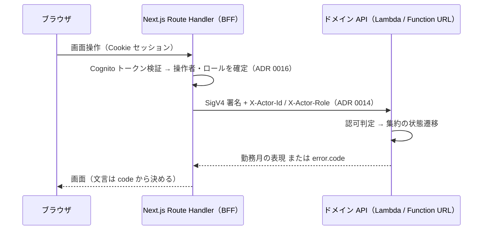

# ドメイン API の HTTP 契約 — 仕様

`services/api`（Lambda Function URL）が公開する **HTTP の契約**。MVP 3ユースケース（稼働実績の入力・編集／月次締め／承認申請・承認）と、それを支える参照系のエンドポイント・リクエスト／レスポンス DTO・エラー表現を定める。

**この契約は BFF（Next.js Route Handler、Issue #54）が参照・消費する唯一の実体である。** 契約の内容を Issue コメント・PR 本文・BFF 側のコードコメントへ書き写さない。参照はこのファイルへのリンクで行う（ADR 0004）。

**業務ルール（値域・丸め・未来日・締め可否・承認可否・自己承認排除・状態遷移）はこの仕様へ書き写さない。** 正解は `docs/specs/daily-record-entry.md` / `docs/specs/monthly-closing.md` / `docs/specs/approval.md` と `docs/domain/ubiquitous-language.md` にある。本仕様が決めるのは**その業務ルールを HTTP でどう表すか**だけである。実装設計（層への型配置・ポート）は `docs/specs/workmonth-implementation-design.md` が持つ。

- **決定者**: HTTP 表現の各決定は仕様工程（AI）。**業務ルールを新たに決めていない。** 業務仕様が答えを持たなかった論点（未生成の年月の締め・参照系の認可・操作者の伝達）は **2026-07-27 に**、当該年月に属さない対象日への削除は **2026-07-28 に**、いずれも**人間が明示選択して確定**し、末尾「人間が確定させた決定」に残した。`daily-record-entry.md` の時刻への改定（D-2・D-3・D-7・D-10〜D-17）に追随する際の論点（時刻の表し方・休憩の表し方・時刻の違反の `code` の粒度と判定順序上の位置）も **2026-10-15 に人間が明示選択して確定**した（決定5〜決定7）。その追随で AI が起案した点（D-16 の `code` の名前と `WORKING_HOURS_OUT_OF_RANGE` の廃止・D-17・D-18）も **2026-10-15 に人間が承認**した（条文中の「AI 起案（2026-10-15 に人間が承認）」）。契約一覧・稼働の推移の読む口の論点（口の形・認可・契約期間を持つ型）は **2026-10-21 に人間が明示選択して確定**した（決定8〜決定10。D-19〜D-21）。その反映で**仕様工程が定めた細部**（パス・クエリ・JSON の形・403 の `code` の流用・判定順序への当てはめ。D-22・AC-10-4・AC-10-5・AC-12・AC-13）は**人間の決定ではない**（条文中の「仕様工程の定め」。人間は採否を選んでいない）。ログインした技術者の契約を用意する口（E-10）の論点（口を足すこと・場所と契機・値を外から受け取らないこと・ロールを問わないこと）は **2026-10-29 に人間が明示選択して確定**した（`engineer-contract-provisioning.md` Q-3・Q-6・Q-7。D-23）。その反映で仕様工程が定めた細部（パス・応答の形・判定順序への当てはめ。D-23・AC-14）は人間の決定ではない。**未決の論点は無い**
- **日付**: 2026-07-27（人間の決定事項を反映）／**2026-07-28 追記**（D-13・AC-5-8。`daily-record-entry.md` D-9 の HTTP 表現）／**2026-07-30 追記**（AC-6-9。締めで複数条件が同時に該当する場合の判定順序を明示。**新しい決定ではなく AC-9 の順序の当てはめ**）／**2026-10-15 改定（時刻から算出・時刻の保存。Issue #108）**（E-3 のリクエストボディと勤務月の表現の稼働実績を時刻へ改めた。**D-5 を改め、D-14〜D-18 を足し、AC-4（リクエストボディ・4-1・4-5・4-5-a・4-5-b・4-9（4-9-a〜4-9-j）・4-10（4-10-a・4-10-b）・4-13（4-13-a〜4-13-j）・4-14（4-14-a〜4-14-e））・AC-9（エラー表・判定順序・9-7）・AC-10-1・AC-11-10・AC-11-11 を改めた／足した**。`WORKING_HOURS_OUT_OF_RANGE` を廃した（D-16）。**業務ルールを新たに決めていない**: 時刻の粒度・値域・前後関係・休憩の位置・稼働 0・保存する時刻の正解は `daily-record-entry.md` AC-2・AC-3 が持ち、本契約は**行番号で参照するだけ**である）／**2026-10-15 改定（AI 起案の承認。Issue #108）**（同日の人間決定により、D-16 の `code` の名前（`TIME_OF_DAY_OUT_OF_RANGE` / `INVALID_TIME_COMBINATION`）と `WORKING_HOURS_OUT_OF_RANGE` の廃止・D-17（順6 の中の順序。(2) を含む）・D-18（`break` の省略）を、「仕様工程の決定」「仕様工程（AI）の起案」から **AI 起案（2026-10-15 に人間が承認）** へ改めた。D-16・D-17・D-18・AC-9 のエラー表・決定6・決定7 の表記を改めた。**条文の要求は変えていない**）／**2026-10-21 改定（契約期間の定義への追随。Issue #109）**（2026-10-10 に人間が契約期間を年月の範囲として定義した（ADR 0021 決定2）ことで、**AC-11-5 の「契約の『期間』は業務仕様・ユビキタス言語のいずれにも定義が無く」という理由の字面が現況と食い違っていた**ため、理由の字面だけを改めた。**要求（契約期間と対象年月の整合を検査しない）は変えていない**。エンドポイント一覧・AC-10 は変えていない）／**2026-10-21 改定（契約一覧・稼働の推移の読む口。Issue #109）**（人間の明示選択（2026-10-21。決定8〜決定10）により、**E-8（契約一覧）・E-9（稼働の推移）を足し、D-19〜D-22・AC-1-6・AC-9（エラー表・判定順序）・AC-10-4・AC-10-5・AC-11-12〜AC-11-14・AC-12・AC-13 を足した／改めた**。**業務ルールを新たに決めていない**: 載せる契約・勤務月の範囲、並び順、未生成の年月を `下書き` と示すこと、比べる精算幅、平均と確定した月の扱いは `contracts-ui.md`・`work-trends-ui.md`・ADR 0021 決定2 が持ち、本契約は**行番号で参照するだけ**である。**D-12 は E-1・E-2 に限る決定として据え置いた**（決定9）。**E-1〜E-7 の表現・ステータス・判定は変えていない**）／**2026-10-28 改訂（AC-11-14 末尾の字面の現況への追随。Issue #137 I-6）**（「デモデータが契約期間を持つまで」という末尾の字面が、Issue #56（`demo-data-reset.md`）の後の現況と食い違っていた。このため字面だけを改めた。**エンドポイント・ステータス・`code`・判定は変えていない**）／**2026-10-29 改定（ログインした技術者の契約の用意。Issue #142）**（人間の明示選択（2026-10-29。`engineer-contract-provisioning.md` Q-3 (a)・(i)・(ii)、Q-6 (a)、Q-7 (a)）により、**E-10 を足し、D-23・AC-1-6・AC-9（エラー表・判定順序）・AC-11-15・AC-14 を足した／改めた**。**業務ルールを新たに決めていない**: 用意する契約の値・識別子の求め方・1件に保つ手段は `engineer-contract-provisioning.md` AC-1 が持ち、本契約は参照するだけである。**E-1〜E-9 の表現・ステータス・判定は変えていない**）

---

## スコープ

- **対象**: エンドポイントの一覧（メソッド・パス）、操作者の伝達方法、リクエスト／レスポンスの JSON フィールド名と型、ステータスコード、エラーコードと判定順序、一覧の並び順・ページング
- **非対象**:
  - **業務ルールそのもの**（3業務仕様が持つ。参照のみ）
  - **BFF・ブラウザ側の実装**（Issue #54。本仕様は BFF が呼ぶ相手側の契約に閉じる。BFF 側の実装設計は `docs/specs/bff-wiring.md`）
  - **画面の受け入れ条件**（各 UI 仕様）
  - **SigV4 署名の実装方法**（ADR 0003 / 0014。`apps/web/src/lib/lambda-client.ts` に集約する。`docs/rules/architecture.md`。仕様は `docs/specs/bff-wiring.md`）
  - **Cognito のトークン検証**（BFF で終端する。ADR 0016）

---

## 前提（P）— 確定事項（参照のみ、再定義しない）

| # | 前提 | 出典 |
|---|---|---|
| P-1 | Function URL は `authorization_type = "AWS_IAM"`。**呼べるのは SigV4 署名できる BFF のみ**で、ブラウザから直接到達する経路は構造的に存在しない | ADR 0003・0013・`docs/rules/architecture.md` |
| P-2 | エンドユーザー認証は **BFF で終端**する。ドメイン API はトークン検証をせず、BFF が確定させた操作者・ロールを受け取る | ADR 0016・`login-ui.md` AC-5 |
| P-3 | ロールは `Engineer` / `Approver` の2つ。ゲストは**未ログイン（未認証）**であり、状態を変える操作を持たない | ADR 0016・`docs/rules/scope.md`・`work-month-screen-ui.md` AC-3 |
| P-4 | 勤務月は `契約 × 年月` で一意。状態は `Draft` / `PendingApproval` / `Approved` | ユビキタス言語「勤務月の同一性」「状態遷移」 |
| P-5 | 勤務月は**初回入力時に暗黙生成**される。「月を開く」等の明示的な生成操作は存在しない | `daily-record-entry.md` D-6・AC-1-5 |
| P-6 | 超過／不足は**締め時に算出・保存**され、`Draft` では未確定 | `monthly-closing.md` D-2・AC-3／`work-month-screen-ui.md` AC-4-1 |
| P-7 | 承認済専用の横断一覧を設けない。承認者の到達手段は**承認待ち一覧**のみ | `approval.md` AC-8-2／`work-month-listing-ui.md` AC-2 |
| P-8 | 一覧は**対象年月の降順**・ページングあり。1ページの件数は仕様で固定しない | `work-month-listing-ui.md` AC-4 |

---

## 決定（D）— HTTP 表現

| # | 論点 | 決定 |
|---|---|---|
| D-1 | リソースの識別 | 勤務月は **`/work-months/{contractId}/{yearMonth}`** で識別する。代理キー（サロゲート ID）を導入しない（`契約 × 年月` で一意という P-4 をそのまま URL に写す） |
| D-2 | 操作者の伝達 | **リクエストヘッダ `X-Actor-Id` / `X-Actor-Role`** で伝える。両者は SigV4 の署名対象ヘッダに含める（署名済みのため経路上で改竄できない）。ゲストは**両ヘッダを送らない**（`Guest` というロール値を作らない）。**人間が 2026-07-27 に確定**（実装設計 D-9 の `port.Actor` と同じ決定） |
| D-3 | 稼働の量の表現 | 時・分の組 `{"hours": n, "minutes": n}` で表す。分は 0〜59。**小数・ISO 8601 duration・分の総和単一値を使わない**（UI が時・分で入出力し、値域の判定も時・分で行うため。`daily-record-entry.md` AC-3・`monthly-closing-ui.md`）。**時刻（1日の中の時点）には使わない**（D-14） |
| D-4 | 日付・年月の表現 | 対象日は `YYYY-MM-DD`、年月は `YYYY-MM`。**いずれもタイムゾーンを含めない**（暦日そのものを表す。当日判定は JST。`daily-record-entry.md` D-8） |
| D-5 | 日次の丸め値の返却 | 各稼働実績に**稼働時間**と**15分切り捨て後の寄与**の両方を含める（**2026-10-15 改定**: 稼働時間は入力値ではなく、**保存した時刻から算出した値**である＝`daily-record-entry.md` D-2・AC-2-6。旧: 「入力値」）。丸め規則を BFF / Web 側に再実装させないため（`daily-record-entry-ui.md` AC-1-2 の「整合」を BFF が計算せずに満たせる） |
| D-6 | 更新系の応答 | 入力・編集・削除・締め・承認・差戻しは、いずれも **更新後の勤務月の表現**を返す（BFF が再描画に使う。`work-month-screen-ui.md` AC-6-4 の「現在の状態を反映し直す」を1往復で満たす） |
| D-7 | 未生成の年月の取得 | 生成されていない `契約 × 年月` の取得は **404 にせず、空の下書き相当の表現**を返し、`generated: false` を添える（画面は「空状態と同じに見せる」。`daily-record-entry-ui.md` AC-2-2。かつ契約表示名・精算幅は常時表示が要る。`work-month-screen-ui.md` AC-1-1・AC-1-4） |
| D-8 | エラー表現 | `{"error": {"code": "...", "message": "..."}}`。**`code` が契約であり、利用者向け文言は BFF / UI が `code` から決める**（`message` は診断用。API は画面文言を持たない） |
| D-9 | 一覧の絞り込み | 単一のコレクション `GET /work-months` にクエリで絞り込む。**技術者を指定しない横断的な一覧は `state=PendingApproval` のときだけ許す**（承認済・下書きの横断一覧を構造的に不可能にする。P-7） |
| D-10 | API のバージョニング | **行わない**（消費者は BFF ただ1つ。ADR 0003 の一方通行）。パスに `/v1` 等を置かない |
| D-11 | 未生成の年月への**更新系**（締め・承認・差戻し） | **弾く（404 `WORK_MONTH_NOT_FOUND`）。** 締めを勤務月の生成契機にしない（`daily-record-entry.md` AC-1-5 を保つ）。`monthly-closing.md` D-6「空の勤務月は締められる」は**生成済みで実績0件の勤務月**を指すと確定した（同 D-6 の注記・AC-7-4）。**人間が 2026-07-27 に確定**。取得（D-7）とは扱いが異なることに注意 |
| D-12 | 参照系の認可 | **勤務月の取得（E-1）と `engineerId` 指定の一覧（E-2）は操作者で絞らない**（ゲストでも 200）。**承認待ち一覧（`engineerId` 省略 + `state=PendingApproval`）だけが `Approver` を要求する**。ゲスト＝閲覧のみ（`docs/rules/scope.md`・ADR 0016）というデモ公開の前提に沿う。**人間が 2026-07-27 に確定**（実装設計 AC-8-8〜AC-8-10 と同じ決定）。**本行は E-1・E-2 に限る決定であり、E-8・E-9 には及ばない**（D-20。2026-10-21 に人間が据え置きを確定＝決定9） |
| D-13 | 当該年月に属さない対象日への**削除**（E-4） | **400 `DATE_OUT_OF_WORK_MONTH`** で弾く（入力・編集の AC-4-7 と同じ表現に揃える）。**業務ルールの正解は `daily-record-entry.md` D-9・AC-5-5 が持ち**、本契約が定めるのはその違反の HTTP 表現（ステータス・`code`・判定順序上の位置＝AC-9 の順 6「業務バリデーション」）だけである。**未生成の年月への削除を 200 とする AC-5-3 の扱いより優先する**（未生成でも 400）。**人間が 2026-07-28 に確定**（それ以前の実装は 200 no-op だった） |
| D-14 | 時刻の表現（**2026-10-15**） | **時・分の組 `{"hour": n, "minute": n}`**（以下「**時刻オブジェクト**」）で表す。**稼働の量の時分オブジェクト `{"hours", "minutes"}`（D-3）とは別の形**とし、時刻と時間の長さを型で区別する（ユビキタス言語「時刻」`TimeOfDay` は「`WorkingHours` とは別の型」【確定】）。**文字列（`"9:15"` 等）・分の総和単一値を使わない**（D-3 が退けた理由＝UI が時・分で入出力し値域も時・分で判定する、は時刻にも当てはまる）。値の粒度と値域は `daily-record-entry.md` D-10・D-11 が持ち、本契約は書き写さない。**人間が 2026-10-15 に確定**（決定5） |
| D-15 | 休憩の表現（**2026-10-15**） | **`"break": null` または `"break": {"start": 時刻オブジェクト, "end": 時刻オブジェクト}`**。`null` が休憩なし、オブジェクトが休憩あり（休憩開始時刻＝`start`・休憩終了時刻＝`end`）。**休憩の有無を別のフィールド（`hasBreak` 等）に持たない。2つ目の休憩を表すフィールドを持たない**（`daily-record-entry.md` AC-3-10 の字面どおり）。2つ目に当たる値は**未知のフィールドとして無視する**（AC-4-10 の規則のまま）。リクエスト（AC-4）とレスポンス（AC-10-1）で同じ形を使う。**人間が 2026-10-15 に確定**（決定6） |
| D-16 | 時刻の違反の `code` と判定順序上の位置（**2026-10-15**） | **2つの `code` に分ける**: ①**時刻の値域外**（`daily-record-entry.md` AC-3 の 3-A のうち粒度・値域の行）→ **`TIME_OF_DAY_OUT_OF_RANGE`**、②**時刻の組み合わせの不正**（同 3-B の弾く行＝前後関係・休憩の前後・休憩の位置・稼働 0）→ **`INVALID_TIME_COMBINATION`**。**どちらも AC-9 の順6（業務バリデーション）**に置く。**項目の欠落・型の不正は従来どおり順2 の `INVALID_REQUEST`**（AC-4-9）。**`code` の分け方と位置は人間が 2026-10-15 に確定**（決定7）。**2つの `code` の名前は AI 起案（2026-10-15 に人間が承認）**である（決定7 で人間が選んだのは「2つに分ける」までで、名前は同日に別途承認した。名前を変えるときは本行・AC-9 の表・実装設計 AC-11-4 を同時に改める）。**帰結として `WORKING_HOURS_OUT_OF_RANGE` を廃する**（AI 起案（2026-10-15 に人間が承認））: 稼働時間を入力として受け取らなくなり（`daily-record-entry.md` D-2）、算出値に掛かる D-7 の違反のうち下限側（稼働 0）は ② に属すると人間が決め、上限側は 3-A・3-B を満たす入力から到達しない（同 AC-3-12）ため、**この `code` を生む要求が存在しない**。発生条件の無い `code` を表に残さない |
| D-17 | E-3 の順6 の中の順序（**2026-10-15**。AI 起案（2026-10-15 に人間が承認）） | E-3 で順6 の違反が複数同時に当たるときは **①時刻の値域外 → ②時刻の組み合わせの不正 → 当該月外（`DATE_OUT_OF_WORK_MONTH`）→ 未来日（`FUTURE_DATE_NOT_ALLOWED`）** の順に判定し、先に当たったものを返す（AC-4-13）。**業務ルールの優劣ではなく**（AC-9 の判定順序と同じ位置づけ）、この順序は**実装設計の構造から導かれる部分**と**AI が起案して選んだ部分**（2026-10-15 に人間が承認）からなる。**(1) 構造から導かれる部分**: 不正な値のインスタンスを存在させない（実装設計 AC-3 冒頭）ため、稼働実績が構築できなければ**稼働実績を受け取る集約のメソッド**（同 AC-4-1。当該月外 → 未来日の順に検査する）に到達しない。ゆえに **①・② → 当該月外 → 未来日** と、**ある休憩・稼働実績の構築（②）はそれが受け取る時刻の構築（①）の後**であることは一意に定まる。**(2) AI が起案して選んだ部分**（2026-10-15 に人間が承認）: **4つの時刻すべての値域の判定（①）を、休憩を含む組み合わせの判定（②）のいずれよりも先に行う**こと。構造だけでは一意に定まらない — 休憩の2時刻の構築と `Break` の構築を、開始時刻・終了時刻の構築より前に行っても不正なインスタンスは生じないため、開始時刻が値域外（`daily-record-entry.md` AC-3 の 3-2-b）で休憩の前後が不正（同 3-6-b）な入力に ② を返す順も構造上は成り立つ。これを ① に固定する理由は、(a) **AC-4-5-a が ② を「4つの時刻がいずれも 3-1・3-2 を満たし」たうえでの違反と定めている**こと（値域外の時刻を含む入力は ② の定義に入らない）、(b) 実装設計 AC-7-18 の **(i) 4つの時刻すべての `TimeOfDay` の構築 → (ii) `Break` と `DailyRecord` の構築** の順と一致させること、(c) どの時刻に値域外が現れても同じ `code` を返す（AC-4-5）のと同様に、**値域外の時刻の位置（開始・終了か休憩か）で返る `code` を変えない**ことである。組の期待は AC-4-13-b（休憩の時刻が値域外・開始と終了の組み合わせが不正）・AC-4-13-i（開始時刻が値域外・休憩の組み合わせが不正）・AC-4-13-j（終了時刻が値域外・休憩の組み合わせが不正）の3つで固定する。3つ要る理由は、**値域外を置く位置ごとに、その時刻の構築を `Break` の構築の後へ回す実装を検出する必要がある**ためである。開始時刻と終了時刻はそれぞれ独立に構築されるので、値域外を**開始と終了の両方の位置に**置く（4-13-i・4-13-j）。片方だけでは、もう片方の時刻の構築を `Break` の後へ回す実装が ② を返さず、Green のまま残る。休憩の側は、`Break` の構築が休憩開始・休憩終了の両時刻を受け取る（両時刻の構築が `Break` の構築より必ず先になる）ため、値域外を休憩の一方に置く1行（4-13-b）で足りる。2026-10-15 より前は順6 の中の順序を本契約が定めておらず、本行がそれを埋める。**E-4（削除）の順6 は当該月外だけ**であり、本行の対象外 |
| D-18 | `break` の省略（**2026-10-15**。AI 起案（2026-10-15 に人間が承認）） | **`break` のキーを省略した要求は、休憩なしとみなさず、項目の欠落として順2 の `INVALID_REQUEST` で弾く**（AC-4-9-c）。休憩なしは `"break": null` だけで表す。D-15 が `break` の値を「`null` またはオブジェクト」と定めたのを**必須の項目の型**として読み、欠落を `INVALID_REQUEST` とする既存の扱い（AC-4-9）に揃える。省略を休憩なしと読むと、休憩ありの時刻を送り損ねた要求が**休憩なしとして黙って保存される** |
| D-19 | 契約一覧・稼働の推移の読む口（**2026-10-21**） | **参照用のエンドポイントを2本新設する**: **E-8（契約一覧）** は契約のデータ（契約表示名・精算幅・契約期間）と、**指定した年月の勤務月の状態**を返す。**E-9（稼働の推移）** は契約ごと・勤務月ごとに、**状態・総稼働時間・写し取った精算幅・保存された超過と不足**を返す。**E-2 の行を広げない。BFF に E-1 を契約・月の数だけ呼ばせない**。未生成の年月の扱いは `contracts-ui.md` AC-2-5〜2-5-e に従う（AC-12-7）。**人間が 2026-10-21 に確定**（決定8）。パス・クエリ・JSON の形は D-22（仕様工程の定め） |
| D-20 | E-8・E-9 の認可（**2026-10-21**） | **`X-Actor-Role` が `Engineer` で、かつ `X-Actor-Id` がクエリの `engineerId` と一致する**ことを要求する（以下「**Engineer かつ本人**」）。**ゲスト（両ヘッダ不在）は 401、承認者と他人は 403**。**D-12 は E-1・E-2 に限る決定として据え置く**（E-1・E-2 は引き続き操作者で絞らない）。**非対称になる理由は決定9 が持つ**（要旨: E-1・E-2 はゲストのデモ閲覧を成り立たせる口であり、E-8・E-9 が支える画面は承認者とゲストの開けない画面と既に決まっている＝`contracts-ui.md` AC-5-3・`work-trends-ui.md` AC-7-3・`login-ui.md` AC-6-7）。**人間が 2026-10-21 に確定**（決定9）。403 の `code` と判定順序への当てはめは D-22（仕様工程の定め） |
| D-21 | 契約期間の表現（**2026-10-21**） | 契約期間は **E-8 の表現にだけ**載せる（E-1〜E-7・E-9 の表現に足さない）。**開始の年月と終了の年月が同じ契約は有効**（`contracts-ui.md` AC-2-3-a の例）。**終了の年月が定まらない契約は `end` を `null`** で表す。**開始の年月が終了の年月より後の永続化行は破損**として扱い、**500 `INTERNAL_ERROR` になるのは E-8 だけ**に留める（E-1〜E-7・E-9 は契約期間を読まないため影響を受けない＝AC-12-18）。**人間が 2026-10-21 に確定**（決定10）。キー名と値の書式は D-22（仕様工程の定め） |
| D-22 | E-8・E-9 の HTTP 表現の細部（**2026-10-21。仕様工程の定め。人間の決定ではない**） | ①**パスとクエリ**: E-8 は `GET /contracts`、E-9 は `GET /work-trends`（名は画面仕様のファイル名 `work-trends-ui.md` に倣った。**ユビキタス言語に語を足すものではない**）。どちらも **`engineerId` を必須のクエリ**とし（E-2 の `engineerId` と同じ名・同じく書式を検査しない）、E-8 は **`yearMonth`（`YYYY-MM`。D-4）も必須**とする。「今月」の決定（`contracts-ui.md` AC-2-5-a。JST の当月）は呼ぶ側が行い、API は**指定された年月を読むだけ**である（API は「今月」を知らない）。②**403 の `code`**: **既存の `FORBIDDEN_NOT_OWNER` を流用**し、「Engineer かつ本人」でない要求（承認者・他人のいずれも）を1つの `code` で表す。承認者と他人を `code` で区別しない。理由: 画面はその利用者を呼び出しの前に既定の画面へ移す（`contracts-ui.md` AC-5-3・`work-trends-ui.md` AC-7-3）ため BFF / UI が区別を要さず、新しい `code` を足すと BFF の `code` の一覧（`bff-wiring.md` AC-10-7・AC-13-9）の追随が要る。③**判定順序への当てはめ**（AC-9）: 順1 に E-8・E-9 の操作者ヘッダの有無、順2 に `engineerId`・`yearMonth` の欠落と書式、順4 に「Engineer かつ本人」を置く。**順3（対象の実在）・順5（状態）・順6（業務バリデーション）に当たる判定を持たない**（技術者の実在を検査しない＝E-2 と同じ扱い。`workmonth-implementation-design.md` AC-7-16）。④**ページングを持たない**（`contracts-ui.md` AC-1-6 は要求せず、`work-trends-ui.md` AC-3-1 は期間の既定を全月とし月数の上限を固定しないため）。⑤**E-9 は期間・契約で絞らない**（契約と期間の選択は画面が持つ＝`work-trends-ui.md` AC-1-3・AC-3。1回の呼び出しで本人の全契約の全月を返す）。⑥**E-9 は平均・確定した月の数・精算幅に収まったかを返さない**（算出と表記は ADR 0021 決定2 と `work-trends-ui.md` AC-4 が持ち、API へ写さない）。⑦JSON のキー名は AC-10-4・AC-10-5 |
| D-23 | ログインした技術者の契約を用意する口（E-10。**2026-10-29**） | **人間の決定（2026-10-29。`engineer-contract-provisioning.md` Q-3・Q-6・Q-7）**: ①BFF のサインインの戻りから呼ぶ**新しい口を1本足す**（Q-3 (a)）。②口は**要求の本文・クエリから契約の値を受け取らず、技術者を `X-Actor-Id` だけから決める**。本人の契約が既にあれば何も作らない（Q-3 (i)）。③**ロールを問わない**（`Engineer`・`Approver` のどちらでも同じ。Q-6 (a)）。④用意の失敗をどう扱うかは呼ぶ側（BFF）の定めであり、本契約は失敗をエラーとして返すだけである（Q-7 (a) の持ち主は `engineer-contract-provisioning.md` AC-7-4）。**仕様工程の定め（人間の決定ではない）**: ⑤**パスは `POST /contract-provisioning`**（名は仕様のファイル名 `engineer-contract-provisioning.md` に倣った。**ユビキタス言語に語を足すものではない**＝同 Q-8 (a)。D-22 ① と同じ扱い）。状態を変えるため `GET` にしない。`/contracts` に `POST` を足さない（契約の作成の口＝CRUD に見える形を避ける）。⑥**成功は 200 と本文 `{}`**。用意したときと既にあったときを応答で区別しない（呼ぶ側が区別を要さない＝同 AC-7-4）。⑦**判定順序への当てはめ**（AC-9）: 順1 に操作者ヘッダの有無、順2 に操作者ヘッダの書式（AC-1-4・1-5）を置き、**順3〜順6 に当たる判定を持たない**。⑧値・識別子・1件に保つ手段は `engineer-contract-provisioning.md` AC-1 が持ち、本契約へ書き写さない。具体は AC-14 |

---

## 受け入れ条件（AC）

| AC | 主題 | 主に効く工程 |
|---|---|---|
| AC-1 | 共通（ベース・ヘッダ・操作者の伝達） | tester・implementer・Issue #54 |
| AC-2 | 勤務月の取得（参照系） | tester・implementer・Issue #54 |
| AC-3 | 勤務月一覧（参照系） | tester・implementer・Issue #54 |
| AC-4 | 稼働実績の入力・編集（UC1） | tester・implementer |
| AC-5 | 稼働実績の削除（UC1） | tester・implementer |
| AC-6 | 締め（UC2） | tester・implementer |
| AC-7 | 承認（UC3） | tester・implementer |
| AC-8 | 差戻し（UC3） | tester・implementer |
| AC-9 | エラー表現・ステータスコード・判定順序 | tester・implementer・Issue #54 |
| AC-10 | 表現（JSON）の定義 | tester・implementer・Issue #54 |
| AC-11 | 限界 — 本契約が担保しないこと | reviewer |
| AC-12 | 契約一覧（参照系。**2026-10-21 追加**） | tester・implementer・BFF |
| AC-13 | 稼働の推移（参照系。**2026-10-21 追加**） | tester・implementer・BFF |
| AC-14 | 契約の用意（E-10。**2026-10-29 追加**） | tester・implementer・BFF |

### エンドポイント一覧

| # | メソッド | パス | 用途 | 出典 |
|---|---|---|---|---|
| E-1 | `GET` | `/work-months/{contractId}/{yearMonth}` | 勤務月1件の取得 | 参照系（`work-month-screen-ui.md`） |
| E-2 | `GET` | `/work-months` | 勤務月の一覧 | 参照系（`work-month-listing-ui.md`） |
| E-3 | `PUT` | `/work-months/{contractId}/{yearMonth}/daily-records/{date}` | 稼働実績の入力・編集 | UC1 |
| E-4 | `DELETE` | `/work-months/{contractId}/{yearMonth}/daily-records/{date}` | 稼働実績の削除 | UC1 |
| E-5 | `POST` | `/work-months/{contractId}/{yearMonth}/close` | 締め | UC2 |
| E-6 | `POST` | `/work-months/{contractId}/{yearMonth}/approve` | 承認 | UC3 |
| E-7 | `POST` | `/work-months/{contractId}/{yearMonth}/reject` | 差戻し | UC3 |
| E-8 | `GET` | `/contracts` | 契約一覧（契約のデータ・契約期間・指定した年月の勤務月の状態）。**2026-10-21 追加**（D-19） | 参照系（`contracts-ui.md`） |
| E-9 | `GET` | `/work-trends` | 稼働の推移（本人の勤務月ごとの状態・総稼働時間・写し取った精算幅・超過／不足）。**2026-10-21 追加**（D-19） | 参照系（`work-trends-ui.md`） |
| E-10 | `POST` | `/contract-provisioning` | ログインした技術者の契約を、無ければ1件用意する。**BFF のサインインの戻りだけが呼ぶ**。**2026-10-29 追加**（D-23） | システムの内部処理（`engineer-contract-provisioning.md`。業務ユースケースではない＝ADR 0023 決定3） |



### AC-1. 共通（ベース・ヘッダ・操作者の伝達）

| # | 条件 | 期待 |
|---|---|---|
| 1-1 | ベースパス | Function URL のルート直下。プレフィックス（`/api`・`/v1` 等）を付けない（D-10） |
| 1-2 | リクエストの `Content-Type` | ボディを持つリクエスト（E-3）は `application/json`。異なる場合は **400 `INVALID_REQUEST`** |
| 1-3 | レスポンスの `Content-Type` | すべて `application/json; charset=utf-8`（エラー応答を含む） |
| 1-4 | 操作者ヘッダ | `X-Actor-Id`（利用者識別子）と `X-Actor-Role`（`Engineer` または `Approver`）。**両方そろって送るか、両方送らないか**のいずれか。片方だけは **400 `INVALID_REQUEST`** |
| 1-5 | `X-Actor-Role` の値 | `Engineer` / `Approver` のみ（ユビキタス言語の英語名。大文字小文字を含めて一致）。それ以外は **400 `INVALID_REQUEST`**。**`Guest` という値を設けない**（ゲストはヘッダ不在で表す。P-3・D-2。人間が確定） |
| 1-6 | ヘッダ不在（ゲスト） | 勤務月の取得（E-1）と `engineerId` 指定の一覧（E-2）は**許可**（200。D-12）。**承認待ち一覧**（E-2 で `engineerId` 省略）は **401 `UNAUTHENTICATED`**（`Approver` を要求するため。AC-3-2）。更新系（E-3〜E-7）はすべて **401 `UNAUTHENTICATED`**（ゲストは状態を変えられない。`work-month-screen-ui.md` AC-3 ゲスト行）。**契約一覧（E-8）・稼働の推移（E-9）も 401 `UNAUTHENTICATED`**（「Engineer かつ本人」を要求するため。D-20・AC-12-12・AC-13-8。**2026-10-21 追加**）。**契約の用意（E-10）も 401 `UNAUTHENTICATED`**（ゲストは `sub` を持たず、用意の対象にならない。D-23・AC-14-3。**2026-10-29 追加**） |
| 1-7 | `X-Actor-Id` と技術者の突き合わせ | 「本人」判定は `X-Actor-Id` と**契約が指す技術者識別子**の一致で行う（`workmonth-implementation-design.md` AC-8）。両者は同一の識別子空間にある（Cognito が確定させた利用者識別子。ADR 0016） |
| 1-8 | 署名 | BFF は `X-Actor-Id` / `X-Actor-Role` を **SigV4 の署名対象ヘッダに含める**（D-2）。API 側は署名検証を IAM に委ねる（自前で検証しない。ADR 0003） |
| 1-9 | 複数ロールの同時保持 | 表現しない。1リクエストにつきロールは1つ（デモ用のロール切替。ADR 0016・`login-ui.md` AC-6） |
| 1-10 | `contractId` の書式 | 1〜64 文字の `A-Z a-z 0-9 _ -`。不一致は **400 `INVALID_REQUEST`** |
| 1-11 | 未定義のパス・メソッド | **404 `NOT_FOUND`**（メソッド不一致も 404 とし、405 を使い分けない） |

### AC-2. 勤務月の取得（E-1）

| # | 条件 | 期待 |
|---|---|---|
| 2-1 | 生成済みの勤務月 | **200**。勤務月の表現（AC-10-1）を返す |
| 2-2 | 未生成の `契約 × 年月`（契約は実在） | **200**。`generated: false`、`state: "Draft"`、`dailyRecords: []`、`totalHours: 0時間0分`、`excess`/`shortfall` は `null`、`settlementRange` は**契約が現在定める精算幅**（複写前の値。P-5・D-7） |
| 2-3 | 実在しない `contractId` | **404 `CONTRACT_NOT_FOUND`** |
| 2-4 | `yearMonth` の書式不正（`2026-13` 等） | **400 `INVALID_REQUEST`** |
| 2-5 | 操作者ヘッダの有無 | 取得は**操作者で絞り込まない**（D-12。人間が 2026-07-27 に確定）。ヘッダの有無・ロールにかかわらず同じ表現を返す。ゲスト（ヘッダ不在）でも **200**（デモ閲覧を成立させるため。`work-month-listing-ui.md` AC-3）。この分界の限界は AC-11-3 |
| 2-6 | `Draft` の超過／不足 | `excess`・`shortfall` はともに `null`（未確定。P-6）。**0 を返さない**（0 と未確定を混同させない） |
| 2-7 | `PendingApproval` / `Approved` | 締め時に確定した超過／不足を返す（`monthly-closing.md` AC-3／`approval.md` AC-5-2） |

### AC-3. 勤務月一覧（E-2）

クエリパラメータ: `engineerId`（文字列）／`state`（`Draft` / `PendingApproval` / `Approved`）／`limit`（1 以上の整数）／`offset`（0 以上の整数）。

| # | 条件 | 期待 |
|---|---|---|
| 3-1 | `engineerId` を指定 | **200**。その技術者が技術者である勤務月のみを返す（`work-month-listing-ui.md` AC-1-1）。`state` 併用可。**状態で自動的に除外しない**（承認済も含む。同 AC-1-3）。**操作者で絞らない**（`X-Actor-Id` と `engineerId` の一致を要求しない。ゲストでも 200。D-12。人間が確定） |
| 3-2 | `engineerId` を省略し `state=PendingApproval` | **200**。承認待ちの勤務月を技術者横断で返す（承認待ち一覧。同 AC-2-1）。**`X-Actor-Role: Approver` が必須**（参照系で唯一ロールを要求する。D-12）。ヘッダ不在は **401 `UNAUTHENTICATED`**、`Engineer` は **403 `FORBIDDEN_NOT_APPROVER`**（判定順序は AC-9） |
| 3-3 | `engineerId` を省略し `state` が `PendingApproval` 以外、または `state` も省略 | **400 `INVALID_REQUEST`**（承認済・下書きの横断一覧を提供しない。`approval.md` AC-8-2／横断ビュー非スコープ。D-9） |
| 3-4 | 並び順 | **対象年月の降順**（P-8）。同一年月内は `contractId` の昇順で安定させる（掛け持ちで同月に複数契約がありうるため。決定的な順序を保証する） |
| 3-5 | ページング | `limit` / `offset` で行う。応答に `total`（絞り込み後の総件数）・`limit`・`offset` を含める。**`limit` の既定値と上限は本契約で固定しない**（1ページの件数は仕様で固定しない。`work-month-listing-ui.md` AC-4-2） |
| 3-6 | `limit` が 0 以下・整数でない／`offset` が負・整数でない | **400 `INVALID_REQUEST`** |
| 3-7 | 該当0件 | **200** で `items: []`、`total: 0`（空は誤りではない。同 AC-7-1・AC-7-2） |
| 3-8 | 一覧に含まれるもの | **生成済みの勤務月のみ**（未生成の年月は行として現れない。P-5） |
| 3-9 | 行の内容 | 契約識別子・契約表示名・年月・状態（AC-10-2）。一覧では稼働実績・超過／不足を返さない（`work-month-listing-ui.md` AC-1-2・AC-2-3） |
| 3-10 | ゲスト向けデモ勤務月群 | **専用のエンドポイントを設けない。** BFF がデモ用の技術者識別子を `engineerId` に指定して本エンドポイントを呼ぶ（`work-month-listing-ui.md` AC-3）。デモデータの投入・日次リセットは本契約の対象外（`docs/rules/cost-guardrails.md`） |

### AC-4. 稼働実績の入力・編集（E-3）

リクエストボディ（**2026-10-15 改定**。旧: `{"workingHours": {"hours": n, "minutes": n}}`。稼働時間を入力として受け取らなくなった＝`daily-record-entry.md` D-2）:

```json
{
  "startTime": { "hour": 9, "minute": 15 },
  "endTime": { "hour": 17, "minute": 45 },
  "break": { "start": { "hour": 12, "minute": 30 }, "end": { "hour": 13, "minute": 15 } }
}
```

（値は `daily-record-entry.md` AC-2-6-a の入力。休憩なしは `"break": null`＝同 AC-2-6-b）

| フィールド | 型 | 必須 | 説明 |
|---|---|---|---|
| `startTime` | 時刻オブジェクト（D-14） | 必須 | 開始時刻（ユビキタス言語 `StartTime`） |
| `endTime` | 時刻オブジェクト | 必須 | 終了時刻（同 `EndTime`） |
| `break` | `null` またはオブジェクト（D-15） | **必須**（キーを省略しない＝D-18） | 休憩（同 `Break`）。`null` は休憩なし |
| `break.start` / `break.end` | 時刻オブジェクト | `break` がオブジェクトのとき必須 | 休憩開始時刻・休憩終了時刻（同 `BreakStart` / `BreakEnd`） |
| 時刻オブジェクトの `hour` / `minute` | 整数 | 必須 | 時・分。粒度と値域は `daily-record-entry.md` D-10・D-11 が持つ（本契約は書き写さない） |

**稼働時間を受け取るフィールドを持たない**（`daily-record-entry.md` D-2・AC-2-1。送られても無視する＝4-10）。

| # | 条件 | 期待 |
|---|---|---|
| 4-1 | 生成済み・`Draft`・本人・妥当な時刻 | **200**。当該日の実績を追加または上書きし、更新後の勤務月の表現を返す（D-6）。既にレコードのある日への送信は**編集**として扱う（`daily-record-entry.md` AC-2-3） |
| 4-2 | 未生成の `契約 × 年月` への入力 | **200**。当該 `契約 × 年月` の勤務月を**暗黙生成**し（契約から精算幅を複写）、実績を追加する（`daily-record-entry.md` AC-1-1・AC-1-2）。応答は `generated: true` |
| 4-3 | 操作者が本人でない（他の技術者・承認者） | **403 `FORBIDDEN_NOT_OWNER`**（`work-month-screen-ui.md` AC-3 の②③行）。**ロールは問わない**（本人であれば `Approver` でも許可。同④行） |
| 4-4 | 状態が `PendingApproval` / `Approved` | **409 `WORK_MONTH_NOT_EDITABLE`**（`daily-record-entry.md` AC-5-2・AC-5-3） |
| 4-5 | **時刻の値域外**（**2026-10-15 改定**。旧: 稼働時間が値域外 → `WORKING_HOURS_OUT_OF_RANGE`＝廃止。D-16）。4つの時刻（`startTime`・`endTime`・`break.start`・`break.end`）のいずれかの `hour` / `minute` が**整数として読めるが**、`daily-record-entry.md` AC-3 の **3-1-a・3-2-a・3-2-b** に当たる | **400 `TIME_OF_DAY_OUT_OF_RANGE`**（順6。D-16）。**4つの時刻のどこに現れても同じ `code`**（同 3-1-a・3-2-b の「いずれに現れても」）。**負の整数・時 24 以上・15分刻みの外は、整数である限り 4-9 ではなく本行に当たる** |
| 4-5-a | **時刻の組み合わせの不正**（**2026-10-15 追加**。D-16）。4つの時刻がいずれも 3-1・3-2 を満たし、`daily-record-entry.md` AC-3 の **3-5-a・3-5-b・3-5-c・3-5-e・3-6-a・3-6-b・3-8・3-8-a・3-8-b・3-9・3-9-a** のいずれかに当たる | **400 `INVALID_TIME_COMBINATION`**（順6。D-16）。前後関係・休憩の前後・休憩の位置・稼働 0 を**区別しない**（1つの `code`。AC-11-11）。3-5-b・3-5-c を日跨ぎとして読まない（同 D-11） |
| 4-5-b | **妥当な時刻**（**2026-10-15 追加**）。`daily-record-entry.md` AC-3 の**許可の行**（3-1・3-2・3-4-a・3-5・3-5-d・3-6・3-7・3-7-a・3-9-b・3-11・3-11-a・3-11-b・3-11-c）の入力 | **200**（他の条件は 4-1 を満たすとき）。応答の当該日の要素（AC-10-1）は、**送った時刻をそのまま**持ち（4-14）、**稼働時間を持つ行では `workingHours` がその行の稼働時間に一致する**（同 3-C・AC-2-1-a） |
| 4-6 | `{date}` が JST の当日より後 | **400 `FUTURE_DATE_NOT_ALLOWED`**（同 AC-4・D-8） |
| 4-7 | `{date}` の年月が `{yearMonth}` と一致しない | **400 `DATE_OUT_OF_WORK_MONTH`**（同 AC-2-4） |
| 4-8 | `{date}` が暦上存在しない（`2026-02-30` 等）／書式不正 | **400 `INVALID_REQUEST`** |
| 4-9 | 時刻・休憩の**欠落・型不一致**（**2026-10-15 改定**。旧: `workingHours` の欠落・型不一致）。内訳は下表 4-9-a〜4-9-j | **400 `INVALID_REQUEST`**（順2。D-16） |
| 4-10 | ボディの未知フィールド | **無視する**（エラーにしない）。**入れ子のオブジェクト（`break`・時刻オブジェクト）の中の未知フィールドも同じ**。**2026-10-15 改定**: 旧注記「開始・終了時刻や休憩時間の項目を契約に持たない」は、時刻と休憩を契約に持つようになった（D-14・D-15）ため改めた。**本行の規則（未知フィールドを無視する）そのものは変えていない**。帰結は下表 4-10-a・4-10-b |
| 4-11 | 実在しない `contractId` | **404 `CONTRACT_NOT_FOUND`** |
| 4-12 | 冪等性 | 同一の `PUT` を繰り返しても結果は同じ（1日1レコードの上書き。`daily-record-entry.md` D-1） |
| 4-13 | 複数の条件が同時に該当する場合（**2026-10-15 追加**） | **AC-9 の判定順序に従い、順6 の中は D-17 の順**（①時刻の値域外 → ②時刻の組み合わせの不正 → 当該月外 → 未来日）。組は下表 4-13-a〜4-13-j |
| 4-14 | 保存した時刻の返却（**2026-10-15 追加**。`daily-record-entry.md` AC-2-6） | 200 応答の勤務月の表現（AC-10-1）の当該日の要素は、**送った時刻をそのまま**返し、`workingHours` は**その時刻から算出した値**である。組は下表 4-14-a〜4-14-e |

**AC-4-9. 欠落・型不一致の内訳**（いずれも **400 `INVALID_REQUEST`**・順2。**値域・組み合わせ（順6）より先に返る**＝4-13-a）

| # | 要求 | 出典 |
|---|---|---|
| 4-9-a | `startTime` または `endTime` のキーが無い、または値が `null` | `daily-record-entry.md` AC-3-3 |
| 4-9-b | `break` がオブジェクトで、`start` または `end` のキーが無い、または値が `null`（`"break": {}` を含む） | 同 AC-3-4 |
| 4-9-c | `break` のキーが無い | D-18（休憩なしとみなさない） |
| 4-9-d | `break` が `null` でもオブジェクトでもない（例: `false`・`0`・`"none"`・`[]`・**休憩2つを並べた配列**） | D-15（配列は `break` の型の不正であり、未知のフィールドではない＝4-10-a と区別する） |
| 4-9-e | 時刻オブジェクトの位置にオブジェクト以外がある（例: 文字列 `"9:15"`・数値・配列） | D-14（文字列の時刻を受け付けない） |
| 4-9-f | 時刻オブジェクトに `hour` または `minute` のキーが無い、または値が `null` | D-14 |
| 4-9-g | `hour` / `minute` が JSON の整数でない（例: 文字列 `"9"`・真偽値・小数部や指数部を持つ数値 `9.5`・`9.0`・`9e0`） | D-14 |
| 4-9-h | `hour` / `minute` が整数だが 64 ビット符号付き整数で表せない | D-14（値域外＝4-5 ではなく型の不正として扱う） |
| 4-9-i | **旧形式のボディ**（`{"workingHours": {...}}` だけを送る） | 4-9-a に当たる（`workingHours` は 4-10 で無視される）。`daily-record-entry.md` AC-2-5（時刻を持たない稼働実績を受け付けない） |
| 4-9-j | ボディが JSON として読めない、または JSON のオブジェクトでない（例: `[]`・`null`） | — |

**AC-4-10. 未知フィールドの扱いの帰結**（いずれも未知フィールドが無い場合と**同じ応答**になる）

| # | 要求 | 期待 |
|---|---|---|
| 4-10-a | **2つ目の休憩に当たる値**を `break` 以外のキーで送る（例: `"break2": {...}`・`"breaks": [...]`）。`break` は妥当 | **無視する**。判定と保存は `break` だけで行い、応答の当該日の要素は `break` の休憩1つだけを持つ（`daily-record-entry.md` AC-3-10・D-12。D-15）。**2つ目に当たる値が時刻の値域外・組み合わせの不正であっても 400 にしない** |
| 4-10-b | 妥当な時刻に加えて**稼働時間**（例: `"workingHours": {"hours": 1, "minutes": 0}`）を送る | **無視する**。応答の `workingHours` は**時刻から算出した値**であり、送った値ではない（`daily-record-entry.md` D-2・AC-2-1） |

**AC-4-13. 複数の条件が同時に該当する場合**（AC-9 の判定順序・D-17。**時刻の値は `daily-record-entry.md` AC-3 の行で指定する**）

| # | 要求（他の条件はすべて 4-1 を満たす） | 期待 |
|---|---|---|
| 4-13-a | `endTime` が欠落（4-9-a）し、かつ `startTime` が 3-2-b に当たる | **400 `INVALID_REQUEST`**（順2 が順6 より先） |
| 4-13-b | `startTime`〜`endTime` が 3-5-a に当たり、かつ `break.start` の `minute` が 3-1-a に当たる | **400 `TIME_OF_DAY_OUT_OF_RANGE`**（① が ② より先。**4つの時刻すべての値域の判定が、組み合わせの判定より先**＝D-17） |
| 4-13-c | 3-5-a に当たり、かつ `{date}` の年月が `{yearMonth}` と一致しない（4-7） | **400 `INVALID_TIME_COMBINATION`**（② が当該月外より先） |
| 4-13-d | `startTime` が 3-1-a に当たり、かつ `{date}` が JST の当日より後（4-6） | **400 `TIME_OF_DAY_OUT_OF_RANGE`**（① が未来日より先） |
| 4-13-e | 時刻は妥当で、`{date}` の年月が `{yearMonth}` と一致せず、かつ `{date}` が JST の当日より後 | **400 `DATE_OUT_OF_WORK_MONTH`**（当該月外が未来日より先。実装設計 AC-4-1 の検査順） |
| 4-13-f | 3-5-a に当たり、かつ勤務月が `PendingApproval` | **409 `WORK_MONTH_NOT_EDITABLE`**（順5 が順6 より先） |
| 4-13-g | `startTime` が 3-2-b に当たり、かつ操作者が本人でない | **403 `FORBIDDEN_NOT_OWNER`**（順4 が順6 より先） |
| 4-13-h | 3-9 に当たり、かつ `契約 × 年月` が未生成（4-2） | **400 `INVALID_TIME_COMBINATION`**。**勤務月を生成しない**（続く E-1 が `generated: false` を返す。弾いた要求は保存しない＝AC-9-4・実装設計 AC-9-4） |
| 4-13-i | `startTime` が 3-2-b に当たり、かつ `break` が 3-6-b の休憩に当たる（`endTime` は 3-6-b の終了時刻） | **400 `TIME_OF_DAY_OUT_OF_RANGE`**（① が ② より先。4-13-b の**逆の配置**＝値域外が開始・終了の側、組み合わせの不正が休憩の側。**休憩の構築を開始時刻・終了時刻の構築より先に行う実装は ② を返す**ため、4-13-b だけでは検出できない＝D-17 (2)） |
| 4-13-j | `endTime` が 3-2-b に当たり、かつ `break` が 3-6-b の休憩に当たる（`startTime` は 3-6-b の開始時刻） | **400 `TIME_OF_DAY_OUT_OF_RANGE`**（① が ② より先。4-13-i の値域外を**終了時刻の位置**へ移した組。開始時刻と終了時刻は独立に構築されるため、**終了時刻の構築だけを休憩の構築より後に行う実装は ② を返し**、4-13-i では検出できない＝D-17 (2)） |

**AC-4-14. 保存した時刻の返却**（`daily-record-entry.md` AC-2-6 の各行を E-3 / E-1 に写したもの。**期待の値はその行が持ち、本契約は書き写さない**）

| # | 要求 | 期待（応答の `dailyRecords` の当該日の要素） |
|---|---|---|
| 4-14-a | 2-6-a の入力を E-3 で送る | `startTime` / `endTime` / `break.start` / `break.end` が 2-6-a の各時刻を時刻オブジェクトで持ち、`workingHours` が 2-6-a の稼働時間、`roundedWorkingHours` が同じ値（`daily-record-entry.md` AC-6-2-a） |
| 4-14-b | 2-6-b の入力を送る | `break` が **`null`**。**キーを省略せず**、`{"hour": 0, "minute": 0}` 等の値で埋めない（同 AC-2-6-b） |
| 4-14-c | 2-6-c の入力を送る | `break` が **`null` でない**オブジェクトで、`break.start` が 2-6-c の休憩開始時刻（最小の時刻）を持つ。**最小の時刻を休憩なしと取り違えない**（同 AC-2-6-c）。4-14-b と対にして置く |
| 4-14-d | 2-6-a の日に、2-6-d の再入力（編集）を送る | 4-14-b と同じ要素（編集前の休憩の時刻を残さない。同 AC-2-6-d） |
| 4-14-e | 4-14-a〜4-14-d のそれぞれの後に、同じ `契約 × 年月` を E-1 で取得する | 直前の E-3 の応答と**同じ要素**を返す（永続化を経て読み直しても同じ。同 AC-2-6 末尾） |

### AC-5. 稼働実績の削除（E-4）

| # | 条件 | 期待 |
|---|---|---|
| 5-1 | 生成済み・`Draft`・本人・`{date}` の年月が `{yearMonth}` と一致・当該日にレコードあり | **200**。レコードを取り除き、更新後の勤務月の表現を返す。その日は以降「レコードのない日＝稼働なし」（`daily-record-entry.md` AC-5-4・D-5） |
| 5-2 | `{date}` の年月が `{yearMonth}` と一致し、当該日にレコードが無い | **200**（成功として扱う）。「レコードのない日」と「稼働ゼロ」を区別しない業務決定（同 D-5）の帰結であり、削除後の観測可能な状態は同一である。**`{date}` の年月が一致しない場合はこの行を適用しない**（5-8） |
| 5-3 | 未生成の `契約 × 年月`（`{date}` の年月は `{yearMonth}` と一致） | **200**。勤務月を**生成せず**、空の表現（`generated: false`）を返す（明示的な生成契機を作らない。P-5）。**削除は D-11（未生成なら 404）の対象外**である。削除の観測可能な結果は 5-2 と同じ「その日にレコードが無い」であり、404 にする理由が無いため。**`{date}` の年月が一致しない場合はこの行を適用しない**（5-8 が優先し 400） |
| 5-4 | 操作者が本人でない | **403 `FORBIDDEN_NOT_OWNER`** |
| 5-5 | 状態が `PendingApproval` / `Approved` | **409 `WORK_MONTH_NOT_EDITABLE`** |
| 5-6 | 実在しない `contractId` | **404 `CONTRACT_NOT_FOUND`** |
| 5-7 | ボディ | 取らない（送られても無視する） |
| 5-8 | **`{date}` の年月が `{yearMonth}` と一致しない**（例: `/work-months/ctr-0001/2026-07/daily-records/2026-08-01`） | **400 `DATE_OUT_OF_WORK_MONTH`**（`daily-record-entry.md` AC-5-5・D-9。D-13）。**当該日にレコードがあるか否か、勤務月が生成済みか否かを問わず 400**（5-1〜5-3 に優先する）。入力・編集の AC-4-7 と同じ `code`・ステータス |
| 5-9 | 5-8 と他の条件が同時に該当する場合 | **AC-9 の判定順序に従う。** 5-8 は**順 6（業務バリデーション）**であり、認証(1)・構文(2)・存在(3)・認可(4)・状態(5) の後に判定される。したがって、ゲスト → **401**（AC-1-6）、`{date}` が暦上存在しない／書式不正 → **400 `INVALID_REQUEST`**、実在しない `contractId` → **404**（5-6）、本人でない → **403**（5-4）、`PendingApproval` / `Approved` → **409**（5-5）が**先に**返る |

### AC-6. 締め（E-5）

| # | 条件 | 期待 |
|---|---|---|
| 6-1 | 生成済み・`Draft`・本人 | **200**。締めが成立し、超過／不足が確定した勤務月の表現を返す（`state: "PendingApproval"`、`excess` / `shortfall` は数値）。算出規則・境界は `monthly-closing.md` AC-4 が持つ |
| 6-2 | 状態が `PendingApproval` / `Approved` | **409 `INVALID_STATE_FOR_CLOSE`**（二重締め・終端。同 AC-1-2・AC-1-3） |
| 6-3 | 操作者が本人でない（他の技術者・承認者） | **403 `FORBIDDEN_NOT_OWNER`**（承認者の代行締めは無い。同 D-5・AC-2-2・AC-2-3） |
| 6-4 | 締めのタイミング | 月末・月途中を問わず受け付ける（月末制約を課さない。同 D-3・AC-1-4） |
| 6-5 | **生成済み**で稼働実績が0件（空月）／未入力日を含む月 | **締められる**（同 D-1・D-6・AC-7-1・AC-7-2）。未入力を理由に弾かない・警告を返さない |
| 6-6 | **未生成**の `契約 × 年月`（一度も入力されていない年月） | **404 `WORK_MONTH_NOT_FOUND`**（締めを生成契機にしない。P-5・`daily-record-entry.md` AC-1-5）。**人間が 2026-07-27 に確定**し、`monthly-closing.md` D-6 の「空の勤務月」は**生成済みで実績0件の月**（6-5）に限ると確定した（同 AC-7-4）。6-5 とは別物である |
| 6-7 | 締めの取り消し | **エンドポイントを設けない**（同 D-4・AC-6）。`PendingApproval` → `Draft` は差戻し（E-7）だけが起こす |
| 6-8 | ボディ | 取らない（送られても無視する） |
| 6-9 | 複数の条件が同時に該当する場合 | **AC-9 の判定順序に従う。** ゲスト → **401 `UNAUTHENTICATED`**（順1。AC-1-6）、`yearMonth` の書式不正 → **400 `INVALID_REQUEST`**（順2）、実在しない `contractId` → **404 `CONTRACT_NOT_FOUND`**（順3）、未生成 → **404 `WORK_MONTH_NOT_FOUND`**（順3。6-6。**操作者が本人でなくても 404 が先に返る**）、本人でない → **403 `FORBIDDEN_NOT_OWNER`**（順4。6-3）、`Draft` 以外 → **409 `INVALID_STATE_FOR_CLOSE`**（順5。6-2）。**締めには順6（業務バリデーション）に当たる判定が無い**（未入力日・空月を弾かないため。6-5・`monthly-closing.md` D-1・D-6） |

> **Issue #54（BFF / Web）への申し送り**: **未生成の月（`generated: false`）に締めボタンを提供しないのは BFF / Web 側の責務である。** ドメイン API は 404 `WORK_MONTH_NOT_FOUND` で弾くだけで、導線の抑止は行わない。`monthly-closing-ui.md` AC-5-2 の「空月でも締めボタンを提供する」は、`generated: true` かつ実績0件の月（6-5）を指す（`monthly-closing.md` AC-7-4）。**未生成の月に締めボタンを出すと、利用者から見て理由の分からない 404 になる。**

### AC-7. 承認（E-6）

| # | 条件 | 期待 |
|---|---|---|
| 7-1 | `PendingApproval`・`X-Actor-Role: Approver`・**本人でない** | **200**。`state: "Approved"` の表現を返す。総稼働時間・超過／不足は**締め時の値のまま**（`approval.md` AC-5-1・AC-5-2） |
| 7-2 | 状態が `Draft` / `Approved` | **409 `INVALID_STATE_FOR_APPROVE`**（同 AC-1-2・AC-1-3・AC-7-1） |
| 7-3 | `X-Actor-Role` が `Approver` でない | **403 `FORBIDDEN_NOT_APPROVER`**（同 AC-3-2） |
| 7-4 | `X-Actor-Role: Approver` かつ操作者がその勤務月の技術者本人 | **403 `FORBIDDEN_SELF_APPROVAL`**（同 D-4・AC-4-1。ロール切替によらず維持。ADR 0016） |
| 7-5 | 承認の成立に必要な人数 | **1人**（同 D-2・AC-3-3）。複数回の承認を求めない。「誰が承認したか」を応答に含めない（同 AC-5-4） |
| 7-6 | 未生成の `契約 × 年月` | **404 `WORK_MONTH_NOT_FOUND`**（D-11） |
| 7-7 | 承認の取り消し | **エンドポイントを設けない**（承認済は終端。同 AC-7-4・ユビキタス言語「状態遷移」） |
| 7-8 | ボディ | 取らない（送られても無視する） |

### AC-8. 差戻し（E-7）

| # | 条件 | 期待 |
|---|---|---|
| 8-1 | `PendingApproval`・`X-Actor-Role: Approver`・**本人でない** | **200**。`state: "Draft"` の表現を返す。`excess` / `shortfall` は **`null`（未確定）に戻る**（再締め時に改めて算出される。`approval.md` AC-6-3） |
| 8-2 | 状態が `Draft` / `Approved` | **409 `INVALID_STATE_FOR_REJECT`**（同 AC-2-2・AC-2-3・AC-7-2） |
| 8-3 | `X-Actor-Role` が `Approver` でない | **403 `FORBIDDEN_NOT_APPROVER`** |
| 8-4 | 操作者がその勤務月の技術者本人 | **403 `FORBIDDEN_SELF_APPROVAL`**（差戻しも自己承認と同様に扱う。同 D-4） |
| 8-5 | 差戻しの理由 | **リクエストに理由のフィールドを設けない**（差戻しは状態を戻すだけ。同 D-3・AC-6-4）。送られた未知フィールドは無視する |
| 8-6 | 差戻し回数 | 上限を設けず、応答にも含めない（同 AC-6-5） |
| 8-7 | 差戻し後の編集 | 以降 E-3 / E-4 が本人に対して 200 を返すようになる（`Draft` へ戻るため。同 AC-6-2） |
| 8-8 | 未生成の `契約 × 年月` | **404 `WORK_MONTH_NOT_FOUND`**（D-11） |

### AC-9. エラー表現・ステータスコード・判定順序

**エラーボディ**（すべてのエラー応答で共通）:

```json
{ "error": { "code": "INVALID_STATE_FOR_CLOSE", "message": "work month is not in Draft" } }
```

| # | 条件 | 期待 |
|---|---|---|
| 9-1 | 形 | `error.code`（文字列・下表のいずれか）と `error.message`（診断用の短い説明）。**フィールドを増やさない** |
| 9-2 | `code` の位置づけ | **`code` が契約である。** BFF / UI は `code` から利用者向け文言を決める（D-8。`work-month-screen-ui.md` AC-6-1 の「理由の提示」は BFF 側の責務） |
| 9-3 | `message` | 診断用。**利用者向け文言としてそのまま画面に出すことを前提にしない。** 機密・内部実装の詳細（SQL・スタックトレース等）を含めない（`docs/rules/security.md`） |

**エラーコードとステータスコード**:

| `code` | ステータス | 発生条件 | 業務仕様の出典 |
|---|---:|---|---|
| `INVALID_REQUEST` | 400 | パス・クエリ・ヘッダ・ボディの構文／型／書式が不正（AC-1-2・1-4・1-5・1-10、AC-2-4、AC-3-3・3-6、AC-4-8・4-9、**AC-12-15・12-16・AC-13-11**） | — |
| `TIME_OF_DAY_OUT_OF_RANGE` | 400 | 時刻（開始・終了・休憩開始・休憩終了のいずれか）が整数として読めるが粒度・値域の外（AC-4-5。**2026-10-15 追加**。名前は AI 起案（2026-10-15 に人間が承認）＝D-16） | `daily-record-entry.md` AC-3 の 3-1-a・3-2-a・3-2-b |
| `INVALID_TIME_COMBINATION` | 400 | 時刻の組み合わせの不正（前後関係・休憩の前後・休憩の位置・稼働 0。AC-4-5-a。**2026-10-15 追加**。名前は AI 起案（2026-10-15 に人間が承認）＝D-16） | 同 3-5-a・3-5-b・3-5-c・3-5-e・3-6-a・3-6-b・3-8・3-8-a・3-8-b・3-9・3-9-a、D-7・D-13 |
| `FUTURE_DATE_NOT_ALLOWED` | 400 | 対象日が JST の当日より後 | 同 AC-4・D-8 |
| `DATE_OUT_OF_WORK_MONTH` | 400 | 対象日が当該勤務月の年月に属さない。**入力・編集（AC-4-7）と削除（AC-5-8）の双方**で返す（削除では勤務月の生成有無・当該日のレコードの有無を問わない） | 同 AC-2-4（入力・編集）／同 AC-5-5・D-9（削除） |
| `UNAUTHENTICATED` | 401 | 更新系（E-3〜E-7）・**承認待ち一覧**（AC-3-2）・**契約一覧（E-8）・稼働の推移（E-9）**（**2026-10-21 追加**。D-20）・**契約の用意（E-10）**（**2026-10-29 追加**。D-23）で操作者ヘッダが無い（ゲスト） | ADR 0016／`work-month-screen-ui.md` AC-3／`contracts-ui.md` AC-5-3・`work-trends-ui.md` AC-7-3 |
| `FORBIDDEN_NOT_OWNER` | 403 | 入力・編集・削除・締めを本人以外が行った。**契約一覧（E-8）・稼働の推移（E-9）を「Engineer かつ本人」でない者（承認者・他の技術者）が要求した**（**2026-10-21 追加**。D-20。既存の `code` の流用は D-22 ②＝仕様工程の定め） | `monthly-closing.md` AC-2／`work-month-screen-ui.md` AC-3／`contracts-ui.md` AC-5-3・`work-trends-ui.md` AC-7-3 |
| `FORBIDDEN_NOT_APPROVER` | 403 | 承認・差戻し・承認待ち一覧を承認者ロール以外が行った | `approval.md` AC-3-2／`work-month-listing-ui.md` AC-2-4 |
| `FORBIDDEN_SELF_APPROVAL` | 403 | 承認・差戻しの操作者がその勤務月の技術者本人 | `approval.md` D-4・AC-4-1 |
| `CONTRACT_NOT_FOUND` | 404 | `contractId` が実在しない | — |
| `WORK_MONTH_NOT_FOUND` | 404 | 対象の勤務月が未生成（締め・承認・差戻し。D-11） | `monthly-closing.md` AC-7-4／`daily-record-entry.md` AC-1-5 |
| `NOT_FOUND` | 404 | 未定義のパス・メソッド | AC-1-11 |
| `WORK_MONTH_NOT_EDITABLE` | 409 | `Draft` 以外での入力・編集・削除 | `daily-record-entry.md` AC-5-2・AC-5-3 |
| `INVALID_STATE_FOR_CLOSE` | 409 | `Draft` 以外での締め | `monthly-closing.md` AC-1-2・AC-1-3 |
| `INVALID_STATE_FOR_APPROVE` | 409 | `PendingApproval` 以外での承認 | `approval.md` AC-1-2・AC-1-3 |
| `INVALID_STATE_FOR_REJECT` | 409 | `PendingApproval` 以外での差戻し | `approval.md` AC-2-2・AC-2-3 |
| `INTERNAL_ERROR` | 500 | 上記以外（永続化の失敗等） | — |

> **`WORKING_HOURS_OUT_OF_RANGE` は 2026-10-15 に廃した**（D-16。稼働時間を入力として受け取らなくなり、この `code` を生む要求が存在しない）。ドメイン API はこの `code` を返さない。

**判定順序**（複数の条件に該当する場合、**先に該当したものを返す**。テストが期待値を一意に決められるようにするための順序であり、業務ルールの優劣ではない）:

| 順 | 判定 | 例 |
|---:|---|---|
| 1 | 認証（更新系・承認待ち一覧・**E-8・E-9**での操作者ヘッダの有無。**2026-10-21 改定**＝D-22 ③。**E-10 も同じ**＝**2026-10-29 改定**、D-23 ⑦。**E-10 は順3〜順6 に当たる判定を持たない**） | ゲストが締めを実行 → 401。ゲストが承認待ち一覧を要求 → 401。ゲストが `yearMonth=2026-13` で契約一覧を要求 → 401（順2 より先＝AC-12-19-a） |
| 2 | リクエストの構文・型・書式 | `yearMonth=2026-13` → 400 `INVALID_REQUEST` |
| 3 | 対象の実在（契約 → 勤務月） | 未生成の月への承認 → 404 |
| 4 | 認可（本人・ロール・自己承認。**E-8・E-9 では「Engineer かつ本人」**＝D-20・D-22 ③） | 承認者ロールを持たない者が `Draft` を承認 → 403。承認者が契約一覧を要求 → 403 `FORBIDDEN_NOT_OWNER`。**E-8・E-9 は順3・順5・順6 に当たる判定を持たない**（D-22 ③） |
| 5 | 状態 | 承認者が `Draft` を承認 → 409 |
| 6 | 業務バリデーション（時刻の値域・時刻の組み合わせ・当該月外・未来日。**E-3 での順序は D-17**＝AC-9-7） | 本人が `Draft` に `daily-record-entry.md` AC-3 の 3-2-b に当たる終了時刻を入力 → 400 `TIME_OF_DAY_OUT_OF_RANGE`。本人が `Draft` に同 3-5-a に当たる時刻を入力 → 400 `INVALID_TIME_COMBINATION`（**2026-10-15 改定**。旧例「25時間0分を入力 → 400」は稼働時間を入力しなくなったため改めた）。本人が `2026-07` の `Draft` に対し `2026-08-01` の削除を要求 → 400 `DATE_OUT_OF_WORK_MONTH`（AC-5-8。**勤務月が未生成でも 400**。ただし同じ要求をゲストが行えば 401、他人が行えば 403、`Approved` に対して行えば 409 が先に返る） |

| # | 条件 | 期待 |
|---|---|---|
| 9-4 | 競合（他経路で状態が変わっていた） | 状態の検査で弾かれ 409 を返す。**部分的な更新を残さない**（更新は集約単位で原子的。`workmonth-implementation-design.md` AC-10-7）。BFF は 409 を受けて再取得する（`work-month-screen-ui.md` AC-6-4） |
| 9-5 | 版番号・ETag による楽観的排他 | **設けない**（`workmonth-implementation-design.md` AC-13-5） |
| 9-6 | 500 の応答 | `code: "INTERNAL_ERROR"` のみを返し、原因の詳細を含めない |
| 9-7 | 順6 の中の順序（**2026-10-15 追加**） | E-3 では **時刻の値域外 → 時刻の組み合わせの不正 → 当該月外 → 未来日**（D-17）。組の期待は AC-4-13。E-4 の順6 は当該月外だけである（AC-5-9） |

### AC-10. 表現（JSON）の定義

#### AC-10-1. 勤務月の表現（E-1・E-3〜E-7 の 200 応答）

```json
{
  "contractId": "ctr-0001",
  "contractDisplayName": "サンプル株式会社 / 基幹システム保守",
  "yearMonth": "2026-07",
  "state": "PendingApproval",
  "generated": true,
  "settlementRange": {
    "lowerBound": { "hours": 140, "minutes": 0 },
    "upperBound": { "hours": 180, "minutes": 0 }
  },
  "totalHours": { "hours": 180, "minutes": 15 },
  "excess": { "hours": 0, "minutes": 15 },
  "shortfall": { "hours": 0, "minutes": 0 },
  "dailyRecords": [
    {
      "date": "2026-07-01",
      "startTime": { "hour": 9, "minute": 15 },
      "endTime": { "hour": 17, "minute": 45 },
      "break": { "start": { "hour": 12, "minute": 30 }, "end": { "hour": 13, "minute": 15 } },
      "workingHours": { "hours": 7, "minutes": 45 },
      "roundedWorkingHours": { "hours": 7, "minutes": 45 }
    },
    {
      "date": "2026-07-02",
      "startTime": { "hour": 9, "minute": 0 },
      "endTime": { "hour": 18, "minute": 0 },
      "break": null,
      "workingHours": { "hours": 9, "minutes": 0 },
      "roundedWorkingHours": { "hours": 9, "minutes": 0 }
    }
  ]
}
```

（`dailyRecords` の2要素は `daily-record-entry.md` AC-2-6-a・AC-2-6-b の値。2要素目の稼働時間は同 AC-3-11。**2026-10-15 改定**: 旧例の稼働時間 8時間50分 → 寄与 8時間45分 は、時刻からの算出では生じない＝同 AC-6-2。`totalHours` 等は形の例示であり、2要素の合計ではない）

| フィールド | 型 | 説明 |
|---|---|---|
| `contractId` | string | 契約の識別子（AC-1-10） |
| `contractDisplayName` | string | **契約表示名**（人間可読。`work-month-screen-ui.md` AC-1-1・確定事項 Q9） |
| `yearMonth` | string | `YYYY-MM`（D-4） |
| `state` | string | `"Draft"` / `"PendingApproval"` / `"Approved"`（ユビキタス言語の英語名） |
| `generated` | boolean | 当該 `契約 × 年月` の勤務月が生成済みか（D-7・P-5） |
| `settlementRange.lowerBound` / `.upperBound` | 時分オブジェクト | 精算幅。生成済みなら**生成時に複写したスナップショット**、未生成なら契約が現在定める値（AC-2-2） |
| `totalHours` | 時分オブジェクト | 総稼働時間（各日を15分切り捨てて合計した値。`daily-record-entry.md` AC-6） |
| `excess` | 時分オブジェクト **または `null`** | 超過。`Draft` では `null`（未確定。P-6・AC-2-6） |
| `shortfall` | 時分オブジェクト **または `null`** | 不足。`Draft` では `null` |
| `dailyRecords` | 配列 | 稼働実績。**対象日の昇順**。レコードの無い日は要素として現れない（`daily-record-entry.md` D-5） |
| `dailyRecords[].date` | string | `YYYY-MM-DD`（D-4） |
| `dailyRecords[].startTime` / `.endTime` | 時刻オブジェクト | **保存した開始時刻・終了時刻をそのまま**（**2026-10-15 追加**。`daily-record-entry.md` D-17・AC-2-6。編集フォームの初期表示に使う＝`daily-record-entry-ui.md` AC-5-1） |
| `dailyRecords[].break` | `{"start": 時刻オブジェクト, "end": 時刻オブジェクト}` **または `null`** | **2026-10-15 追加**（D-15）。休憩ありなら保存した休憩開始時刻・休憩終了時刻をそのまま、**休憩なしなら `null`**。**キーを省略しない**（休憩なしでも `"break": null` を載せる）。休憩なしを時刻の値で埋めず、最小の時刻を持つ休憩を `null` にしない（`daily-record-entry.md` AC-2-6-b・AC-2-6-c） |
| `dailyRecords[].workingHours` | 時分オブジェクト | **保存した時刻から算出した稼働時間**（**2026-10-15 改定**。旧: 入力された値。`daily-record-entry.md` D-2・AC-2-1-a・AC-2-6。リクエストで受け取った値ではない＝AC-4-10-b） |
| `dailyRecords[].roundedWorkingHours` | 時分オブジェクト | **15分切り捨て後の寄与**（総稼働時間との整合表示に使う。D-5・`daily-record-entry-ui.md` AC-1-2） |

**時分オブジェクト**: `{ "hours": 整数（0 以上）, "minutes": 整数（0〜59） }`（D-3）。稼働の量（時間の長さ）に使う。

**時刻オブジェクト**（**2026-10-15 追加**）: `{ "hour": 整数, "minute": 整数 }`（D-14）。1日の中の時点に使う。応答に載る値は常に `daily-record-entry.md` D-10・D-11 の粒度・値域を満たす（満たさない行は永続化の破損として `INTERNAL_ERROR` になる＝実装設計 AC-9-15-h）。**時分オブジェクトと取り違えない**（キー名が異なる）。

**`null` を取りうるのは `excess` / `shortfall` / `dailyRecords[].break` のみ。**（**2026-10-15 改定**。旧: `excess` / `shortfall` のみ）

#### AC-10-2. 一覧の表現（E-2 の 200 応答）

```json
{
  "items": [
    { "contractId": "ctr-0001", "contractDisplayName": "…", "yearMonth": "2026-07", "state": "PendingApproval" }
  ],
  "total": 42,
  "limit": 20,
  "offset": 0
}
```

| フィールド | 型 | 説明 |
|---|---|---|
| `items[]` | 配列 | 行。`contractId` / `contractDisplayName` / `yearMonth` / `state`（AC-3-9） |
| `total` | 整数 | 絞り込み後の総件数（ページング UI 用） |
| `limit` / `offset` | 整数 | 実際に適用された値（AC-3-5） |

#### AC-10-4. 契約一覧の表現（E-8 の 200 応答。**2026-10-21 追加**。キー名・形は D-22＝仕様工程の定め）

```json
{
  "items": [
    {
      "contractId": "ctr-0001",
      "contractDisplayName": "サンプル株式会社 / 基幹システム保守",
      "settlementRange": {
        "lowerBound": { "hours": 140, "minutes": 0 },
        "upperBound": { "hours": 180, "minutes": 0 }
      },
      "contractPeriod": { "start": "2025-04", "end": "2027-03" },
      "workMonth": { "yearMonth": "2026-10", "state": "PendingApproval", "generated": true }
    },
    {
      "contractId": "ctr-0002",
      "contractDisplayName": "サンプル商事 / 受発注刷新",
      "settlementRange": {
        "lowerBound": { "hours": 150, "minutes": 0 },
        "upperBound": { "hours": 190, "minutes": 0 }
      },
      "contractPeriod": { "start": "2025-04", "end": null },
      "workMonth": { "yearMonth": "2026-10", "state": "Draft", "generated": false }
    }
  ]
}
```

（値は形の例示。2要素目は終了の年月が定まらない契約で、指定した年月の勤務月が未生成のもの＝AC-12-7）

| フィールド | 型 | 説明 |
|---|---|---|
| `items[]` | 配列 | 行。**契約識別子の昇順**（AC-12-4）。0件なら空配列（`null` にしない） |
| `items[].contractId` | string | 契約の識別子（AC-1-10） |
| `items[].contractDisplayName` | string | 契約表示名 |
| `items[].settlementRange.lowerBound` / `.upperBound` | 時分オブジェクト | **契約がいま定める精算幅**（勤務月が写し取った値ではない。`contracts-ui.md` AC-2-2・P-4） |
| `items[].contractPeriod.start` | string | 契約期間の開始の年月 `YYYY-MM`（D-4・D-21） |
| `items[].contractPeriod.end` | string **または `null`** | 契約期間の終了の年月 `YYYY-MM`。**終了の年月が定まらない契約は `null`**（D-21）。**キーを省略しない** |
| `items[].workMonth.yearMonth` | string | 要求の `yearMonth` をそのまま `YYYY-MM` で返す（D-4） |
| `items[].workMonth.state` | string | `"Draft"` / `"PendingApproval"` / `"Approved"`。**未生成なら `"Draft"`**（AC-12-7） |
| `items[].workMonth.generated` | boolean | 当該 `契約 × 年月` の勤務月が生成済みか（D-7 と同じ意味） |

**`null` を取りうるのは `items[].contractPeriod.end` のみ。** ページングのフィールド（`total` / `limit` / `offset`）を持たない（D-22 ④）。

#### AC-10-5. 稼働の推移の表現（E-9 の 200 応答。**2026-10-21 追加**。キー名・形は D-22＝仕様工程の定め）

```json
{
  "items": [
    {
      "contractId": "ctr-0001",
      "yearMonth": "2026-08",
      "state": "Approved",
      "settlementRange": {
        "lowerBound": { "hours": 140, "minutes": 0 },
        "upperBound": { "hours": 180, "minutes": 0 }
      },
      "totalHours": { "hours": 180, "minutes": 15 },
      "excess": { "hours": 0, "minutes": 15 },
      "shortfall": { "hours": 0, "minutes": 0 }
    },
    {
      "contractId": "ctr-0001",
      "yearMonth": "2026-09",
      "state": "Draft",
      "settlementRange": {
        "lowerBound": { "hours": 140, "minutes": 0 },
        "upperBound": { "hours": 180, "minutes": 0 }
      },
      "totalHours": { "hours": 96, "minutes": 30 },
      "excess": null,
      "shortfall": null
    }
  ]
}
```

（値は形の例示）

| フィールド | 型 | 説明 |
|---|---|---|
| `items[]` | 配列 | 行（勤務月1件につき1行）。**契約識別子の昇順、同じ契約の中は対象年月の昇順**（AC-13-3）。0件なら空配列 |
| `items[].contractId` | string | 契約の識別子 |
| `items[].yearMonth` | string | `YYYY-MM`（D-4） |
| `items[].state` | string | `"Draft"` / `"PendingApproval"` / `"Approved"`（ユビキタス言語の英語名） |
| `items[].settlementRange.lowerBound` / `.upperBound` | 時分オブジェクト | **その勤務月が生成時に写し取った精算幅**（契約のいまの値ではない。`work-trends-ui.md` P-10）。AC-10-1 の生成済みの勤務月の `settlementRange` と同じ値 |
| `items[].totalHours` | 時分オブジェクト | 総稼働時間。AC-10-1 の `totalHours` と同じ値（`Draft` でもその時点の値＝`work-trends-ui.md` AC-2-3） |
| `items[].excess` / `items[].shortfall` | 時分オブジェクト **または `null`** | 締め時に保存された超過／不足。**`Draft` では `null`**（P-6・AC-2-6。0 を返さない）。AC-10-1 の同名フィールドと同じ値。**キーを省略しない** |

**`null` を取りうるのは `items[].excess` / `items[].shortfall` のみ。** 契約表示名・契約期間・稼働実績・ページングのフィールドを持たない（契約表示名は E-8 から得る＝`work-trends-ui.md` AC-1-3）。

#### AC-10-3. 表現に**含めないもの**

| # | 含めないもの | 出典 |
|---|---|---|
| 10-3-1 | **技術者・承認者の氏名／識別子**、「誰が承認したか」 | `approval.md` D-1・D-2・AC-5-4 |
| 10-3-2 | **差戻しの理由・差戻し回数** | 同 D-3・AC-6-4・AC-6-5 |
| 10-3-3 | **締め・承認の日時、操作の履歴** | `monthly-closing.md` AC-8-3（監査履歴は非スコープ） |
| 10-3-4 | **精算金額**（超過・不足は時間側の量のみ） | 同 AC-8-4 |
| 10-3-5 | **`Draft` における見込みの超過／不足** | `work-month-screen-ui.md` AC-4-5（確定事項 Q7） |

### AC-11. 限界 — 本契約が担保しないこと

**以下は仕様どおりであり、欠陥ではない。**

| # | 内容 |
|---|---|
| 11-1 | **業務ルールを本契約は持たない。** 値域・丸め・境界・締め可否・承認可否の正解は3業務仕様にある。本契約は「それを弾いたときに何を返すか」だけを固定する |
| 11-2 | **CORS・ブラウザからの直接呼び出しを想定しない**（`Access-Control-*` を返さない）。到達できるのは SigV4 署名できる BFF のみ（P-1・ADR 0003） |
| 11-3 | **参照系（E-1・E-2 の `engineerId` 指定）を操作者で絞らない**（AC-2-5・AC-3-1・D-12。**人間が確定した仕様**であり、実装の手抜きではない）。**他人の勤務月を BFF が取得することは API では防がれない。** 防御は「BFF しか到達できない」（P-1）と BFF 側の導線に依存する（`workmonth-implementation-design.md` AC-13-10） |
| 11-4 | **未生成の年月に対する締め・承認・差戻しを弾く**（404。D-11・AC-6-6。**人間が確定**）。未生成の月に締めボタンを出さないことは BFF / Web 側の責務であり、本契約は担保しない（AC-6 の申し送り） |
| 11-5 | **契約期間と対象年月の整合を検査しない**（**人間が 2026-07-27 に確定し、2026-10-10 に契約期間を定義した際も維持した**＝ADR 0021 決定2・「将来の検討事項」。`workmonth-implementation-design.md` AC-13-9）。契約期間はユビキタス言語「契約期間」【確定】が年月の範囲として定義しているが、**表示にだけ使う**ものであり、勤務月の生成・入力・締め・承認の規則に結び付けない。検査を加えることは勤務月の生成・入力の規則を変える業務判断であり、加えるかどうかは人間が決める。帰結として、契約が実在すれば**契約期間の外にある年月を含め**どの年月に対しても入力・締め・承認が通る |
| 11-6 | **レート制限・冪等キー・リトライ制御を持たない。** 流量の一次防御は BFF（Route Handler）側（`docs/rules/cost-guardrails.md`） |
| 11-7 | **API のバージョニング・後方互換の保証をしない**（D-10）。契約の変更は本ファイルの更新と BFF の同時更新で行う |
| 11-8 | **デモデータの投入・日次リセットは対象外**（`docs/rules/cost-guardrails.md`）。ゲスト向けデモ勤務月群は AC-3-10 の呼び出しで得る |
| 11-9 | **OpenAPI 等のスキーマ生成物を正とはしない。** 本ファイルが契約の唯一の実体である（ADR 0004） |
| 11-10 | **2つ目の休憩に当たる値を送った誤りを検出しない**（**2026-10-15 追加**。AC-4-10-a・D-15。**人間が確定した仕様**＝決定6）。`break` 以外のキーで送られた休憩は未知のフィールドとして無視され、200 が返る。**BFF が休憩を2つ送ろうとした誤りは API では 400 にならず、1つ目だけが保存される**。休憩を1組だけにする防御は画面（`daily-record-entry-ui.md` AC-3-1-a）と BFF に依存する |
| 11-11 | **時刻の組み合わせの不正の理由を `code` で区別しない**（**2026-10-15 追加**。AC-4-5-a・D-16。**人間が確定した仕様**＝決定7）。前後関係・休憩の前後・休憩の位置・稼働 0 はいずれも `INVALID_TIME_COMBINATION` になる。画面が理由を互いに異なる文で示すこと（`daily-record-entry-ui.md` AC-4-9）は**画面側の事前検査**に依り、**ドメイン API が弾いた場合に BFF は `code` から理由を1つに特定できない** |
| 11-12 | **E-8・E-9 の認可と E-1・E-2 の認可は非対称である**（**2026-10-21 追加**。D-20・**人間が確定した仕様**＝決定9）。E-8・E-9 は「Engineer かつ本人」を要求するが、E-1・`engineerId` 指定の E-2 は操作者で絞らない（D-12 を据え置き）。**帰結**: 他人の勤務月の状態・総稼働時間・写し取った精算幅・超過／不足は、E-9 では読めないが **E-2 で一覧を得て E-1 を月ごとに呼べば読める**（AC-11-3）。**E-8・E-9 の認可は、他人の勤務月を API で秘匿するものではない**。契約期間だけは E-8 以外に載らない（D-21）ため、他人の契約期間は API から読めない |
| 11-13 | **E-8・E-9 はページングを持たず、件数の上限も持たない**（**2026-10-21 追加**。D-22 ④＝仕様工程の定め）。応答の大きさは本人の契約・勤務月の数に比例する。契約のデータはデモデータとして投入され日次リセットされる（`contracts-ui.md` P-7・`docs/rules/cost-guardrails.md`）ことを前提とし、**上限を課す手段を本契約は持たない** |
| 11-14 | **契約期間の破損した永続化行は E-8 だけを 500 にする**（**2026-10-21 追加**。D-21・**人間が確定した仕様**＝決定10）。契約期間を読むのは E-8 だけであり、破損の検出も E-8 だけで起こる。**同じ契約に対する E-1〜E-7・E-9 は 200 を返し続け、契約期間の破損に気付かない**。契約期間を持たない（開始の年月が欠けた）契約の行も同じく E-8 の 500 になる（AC-12-18）。**2026-10-28 改訂（#137 I-6）**: 末尾の字面を現況へ改めた。そうした行がどこに・いつ生じうるかは `workmonth-implementation-design.md` AC-10-21 ③ が参照する `demo-data-reset.md` が持つ。E-8 の 500 と、E-1〜E-7・E-9 が 200 を返し続けることは変えない。旧: 「（AC-12-18）ため、**デモデータが契約期間を持つまで E-8 は 500 を返しうる**」 |
| 11-15 | **E-10 は `X-Actor-Id` の形を検査せず、操作者ヘッダを持つ要求なら誰の値でも契約を用意する**（**2026-10-29 追加**。D-23）。ドメイン API は BFF が確定させた操作者を信じる（P-2）。E-10 を呼べるのは SigV4 署名できる BFF だけであり（P-1）、BFF は検証済みトークンの `sub` だけを載せる（`bff-auth-termination.md` AC-5-2）。**この前提が崩れたとき（BFF 以外が署名できる・BFF が `sub` 以外を載せる）に、任意の技術者識別子の契約が作られることを本契約は防がない**。用意した契約の行を減らす手段も本契約は持たない（`engineer-contract-provisioning.md` AC-5-4） |

### AC-14. 契約の用意（E-10。**2026-10-29 追加**）

要求はボディを取らず、クエリを取らない。用意する契約の値・識別子の求め方・1件に保つ手段の正解は `engineer-contract-provisioning.md` AC-1 が持ち、本表は**それを行う API の振る舞い**だけを定める（ADR 0004）。

| # | 条件 | 期待 | 決定の別 |
|---|---|---|---|
| 14-1 | メソッドとパス | **`POST /contract-provisioning`** | 口を足すことは人間の明示選択（2026-10-29。`engineer-contract-provisioning.md` Q-3 (a)）。パスは仕様工程の定め（D-23 ⑤） |
| 14-2 | 本文・クエリ | **読まない**。本文・クエリに何が付いていても（契約表示名・精算幅・`engineerId`・`contractId` 等を含む JSON・不正な JSON・`Content-Type` が `application/json` でないもの）、付いていないときと同じ結果になる（**400 にしない**）。AC-1-2 の `Content-Type` の検査は E-10 に掛からない（本文を持つ要求ではないため） | 値を外から受け取らないことは人間の明示選択（同 Q-3 (i)）。400 にしないことは仕様工程の定め（承認・差戻しが未知のフィールドを落とすのと同じく、読まないものを検査しない） |
| 14-3 | ゲスト（両ヘッダ不在） | **401 `UNAUTHENTICATED`**。用意しない | 帰結（`sub` を持たない者は用意の対象でない＝同 AC-1-1）。`code` は既存の流用 |
| 14-4 | 操作者ヘッダの片方だけ／`X-Actor-Role` の値が `Engineer`・`Approver` 以外 | **400 `INVALID_REQUEST`**（AC-1-4・AC-1-5 のまま）。用意しない | 帰結 |
| 14-5 | `X-Actor-Role: Engineer` と `X-Actor-Role: Approver` | **どちらも同じ振る舞い**（14-6）。403 を返さない | 人間の明示選択（同 Q-6 (a)） |
| 14-6 | 認証済みの要求 | `X-Actor-Id` の利用者の契約が無ければ用意し、あれば何もしない（同 AC-1-14）。**どちらの場合も 200 と本文 `{}`**（応答で区別しない） | 用意すること・あれば何もしないことは人間の明示選択（同 Q-3 (a)・(i)・Q-5 (a)）。200 と `{}` は仕様工程の定め（D-23 ⑥） |
| 14-7 | 永続化の失敗 | **500 `INTERNAL_ERROR`**（AC-9。原因を応答に含めない） | 帰結 |
| 14-8 | `GET`・`PUT`・`DELETE` 等、`POST` 以外のメソッド | **404 `NOT_FOUND`**（AC-1-11） | 帰結 |
| 14-9 | 複数の条件が同時に該当する場合 | ゲストかつ不正な本文 → **401**。ゲストかつ `X-Actor-Role` の値が不正は起こらない（ゲストは両ヘッダ不在）。`X-Actor-Role` の値が不正かつ不正な本文 → **400**（本文は読まない＝14-2） | 仕様工程の定め（判定順序の当てはめ＝D-23 ⑦） |
| 14-10 | 呼ぶ側 | **BFF のサインインの戻りだけ**が呼ぶ（`engineer-contract-provisioning.md` AC-2-6・AC-7）。`bff-wiring.md` の業務の Route Handler（R-1〜R-11）は呼ばない。**検査は BFF の側にあり、`engineer-contract-provisioning.md` AC-7 の 7-i〜7-l（ファイル走査）が持つ**（ドメイン API の側は、呼び元が BFF の実行ロールであることしか見えず、BFF の中のどの処理が呼んだかを区別できない。限界は同 AC-5-12） | 人間の明示選択（同 Q-3 (ii)）。検査の置き場所と形は仕様工程の定め |

### AC-12. 契約一覧（E-8。**2026-10-21 追加**）

クエリパラメータ: `engineerId`（文字列。**必須**）／`yearMonth`（`YYYY-MM`。**必須**）。ボディを取らない。**以下の表の「本人」は D-20 の「Engineer かつ本人」**（`X-Actor-Role: Engineer` かつ `X-Actor-Id` = `engineerId`）を指す。行の内容・並び・除外しないものの正解は `contracts-ui.md` AC-1・AC-2 が持ち、本表は**それを返す API の振る舞い**だけを定める。

| # | 条件 | 期待 | 決定の別 |
|---|---|---|---|
| 12-1 | 本人の要求 | **200**。AC-10-4 の表現。`items` は**契約の技術者が `engineerId` である契約のすべて**（掛け持ちなら複数。`contracts-ui.md` AC-1-1） | 人間の明示選択（2026-10-21。決定8・決定9） |
| 12-2 | 他の技術者の契約 | どの条件でも `items` に含めない（`contracts-ui.md` AC-1-2） | 同上の帰結 |
| 12-3 | 契約期間による除外 | **しない**。契約期間が `yearMonth` より前に終わった契約・`yearMonth` より後に始まる契約・終了の年月が定まらない契約のいずれも含める（`contracts-ui.md` AC-1-3。本契約 AC-11-5） | 既存条文（ADR 0021 決定2）の帰結 |
| 12-4 | 並び順 | **`contractId` の昇順**（`contracts-ui.md` AC-1-5） | 既存条文の帰結 |
| 12-5 | 勤務月の有無による除外 | **しない**。勤務月が1件も無い契約も含める（`contracts-ui.md` AC-1-4） | 既存条文の帰結 |
| 12-6 | 指定した年月の勤務月が生成済み | 当該行の `workMonth.state` は**その勤務月の状態**、`workMonth.generated` は `true` | 人間の明示選択（2026-10-21。決定8） |
| 12-7 | 指定した年月の勤務月が未生成 | 当該行の `workMonth.state` は **`"Draft"`**、`workMonth.generated` は `false`（E-1 の AC-2-2・D-7 と同じ扱い。`contracts-ui.md` AC-2-5-c が `下書き` と示す根拠）。**勤務月を生成しない**（`contracts-ui.md` AC-4-3。続く E-1 が `generated: false` を返す） | 人間の明示選択（2026-10-21。決定8「未生成の年月の扱いは docs の既存の定めに従う」）。`generated` を載せることは仕様工程の定め（D-22 ⑦） |
| 12-8 | `yearMonth` が契約期間の外 | 12-6・12-7 のとおり（契約期間を判定に使わない。`contracts-ui.md` AC-2-5-d。本契約 AC-11-5） | 既存条文の帰結 |
| 12-9 | 精算幅 | **契約がいま定める精算幅**。`yearMonth` の勤務月が生成済みで写し取った精算幅が異なっていても、契約の値を返す（`contracts-ui.md` AC-2-2・AC-7-1） | 既存条文の帰結 |
| 12-10 | 契約期間 | `contractPeriod.start` は開始の年月、`contractPeriod.end` は終了の年月または `null`（D-21）。**開始＝終了の契約**（例: `2026-06`〜`2026-06`）は `start` と `end` が同じ値の **200**（`contracts-ui.md` AC-2-3-a の例） | 人間の明示選択（2026-10-21。決定10）。キーの形は仕様工程の定め（D-22） |
| 12-11 | 該当0件 | **200** で `items: []` | 仕様工程の定め（AC-3-7 に揃えた） |
| 12-12 | ゲスト（両ヘッダ不在） | **401 `UNAUTHENTICATED`** | 人間の明示選択（2026-10-21。決定9） |
| 12-13 | `X-Actor-Role: Approver`（`X-Actor-Id` が `engineerId` と**一致していても**） | **403 `FORBIDDEN_NOT_OWNER`** | 403 は人間の明示選択（決定9）。`code` は仕様工程の定め（D-22 ②） |
| 12-14 | `X-Actor-Role: Engineer` で `X-Actor-Id` ≠ `engineerId` | **403 `FORBIDDEN_NOT_OWNER`** | 同上 |
| 12-15 | `engineerId` のキーが無い、または値が空文字 | **400 `INVALID_REQUEST`** | 仕様工程の定め（D-22 ①） |
| 12-16 | `yearMonth` のキーが無い／値が空文字／書式不正（`2026-13`・`2026-7`・`2026-10-01` 等。AC-2-4 と同じ規則） | **400 `INVALID_REQUEST`** | 同上 |
| 12-17 | 未知のクエリ（`limit`・`offset`・`state` を含む） | **無視する**（エラーにしない。ページングも絞り込みも適用しない＝D-22 ④） | 同上 |
| 12-18 | 永続化行の破損 — 契約期間の**開始の年月が終了の年月より後**／開始の年月が欠ける／終了の年・月の**片方だけ**が欠ける／年月として成り立たない値（月が 13 等）／精算幅の下限 > 上限 | **500 `INTERNAL_ERROR`**（AC-9-6。原因を応答に含めない）。**1行でも破損があれば全体を 500** とし、破損した行を除いた 200 を返さない | 契約期間の前後の扱いは人間の明示選択（2026-10-21。決定10）。それ以外の破損の扱いは仕様工程の定め（`workmonth-implementation-design.md` AC-9-17-d に揃えた） |
| 12-19 | 複数の条件が同時に該当する場合 | AC-9 の判定順序に従う（D-22 ③）。組は下表 12-19-a〜12-19-e | 仕様工程の定め（判定順序の当てはめ） |

**AC-12-19. 複数の条件が同時に該当する場合**（他の条件は 12-1 を満たす）

| # | 要求 | 期待 |
|---|---|---|
| 12-19-a | ゲスト、かつ `yearMonth=2026-13` | **401 `UNAUTHENTICATED`**（順1 が順2 より先） |
| 12-19-b | ゲスト、かつ `engineerId` が無い | **401 `UNAUTHENTICATED`**（同上） |
| 12-19-c | `X-Actor-Role: Approver`、かつ `yearMonth=2026-13` | **400 `INVALID_REQUEST`**（順2 が順4 より先） |
| 12-19-d | `X-Actor-Role: Engineer`・`X-Actor-Id` ≠ `engineerId`、かつ `yearMonth` が無い | **400 `INVALID_REQUEST`**（同上） |
| 12-19-e | `X-Actor-Role: Engineer`・`X-Actor-Id` ≠ `engineerId`、かつ `engineerId` の技術者の契約が0件 | **403 `FORBIDDEN_NOT_OWNER`**（200 の空配列にしない。認可を該当件数より先に判定する） |

### AC-13. 稼働の推移（E-9。**2026-10-21 追加**）

クエリパラメータ: `engineerId`（文字列。**必須**）。ボディを取らない。「本人」は D-20 の「Engineer かつ本人」。載せる勤務月・区分・期間・要約の正解は `work-trends-ui.md` AC-1〜AC-4 が持ち、本表は**画面がそれを組み立てるのに要る値を返す API の振る舞い**だけを定める（区分・平均・数え上げを API へ写さない＝D-22 ⑥）。

| # | 条件 | 期待 | 決定の別 |
|---|---|---|---|
| 13-1 | 本人の要求 | **200**。AC-10-5 の表現 | 人間の明示選択（2026-10-21。決定8・決定9） |
| 13-2 | 載せる勤務月 | **契約の技術者が `engineerId` である契約の、生成済みの勤務月のすべて**。**状態で除外しない**（`Draft` を含む＝`work-trends-ui.md` AC-2-2）。**未生成の年月を行として作らない**（0時間の月として返さない＝同 AC-1-5）。他の技術者の勤務月を含めない（同 AC-1-1） | 人間の明示選択（決定8）と既存条文の帰結 |
| 13-3 | 並び順 | **`contractId` の昇順、同じ契約の中は `yearMonth` の昇順**（`work-trends-ui.md` AC-3-5 の昇順・`contracts-ui.md` AC-1-5 の契約の順） | 仕様工程の定め（既存条文の順を写した） |
| 13-4 | 契約・期間・状態での絞り込み | **受け付けない**（D-22 ⑤。未知のクエリ＝`contractId`・`from`・`to`・`state`・`limit`・`offset` 等は無視し、絞り込まずに 13-2 の全件を返す） | 仕様工程の定め |
| 13-5 | 各行の精算幅 | **その勤務月が写し取った精算幅**。契約のいまの精算幅が異なっていても写し取った値を返す（`work-trends-ui.md` P-10・AC-4-4・AC-5-2） | 人間の明示選択（決定8「写し取った精算幅」） |
| 13-6 | 各行の総稼働時間・超過／不足 | 同じ `契約 × 年月` を E-1 で取得したときの `totalHours`・`excess`・`shortfall` と**同じ値**。`Draft` の行は `excess`・`shortfall` が `null`（0 にしない）。`PendingApproval`・`Approved` の行は締め時に保存された値（`work-trends-ui.md` AC-4-3-a・AC-5-3。**API で算出し直さない**） | 人間の明示選択（決定8「保存された超過と不足」） |
| 13-7 | 該当0件 | **200** で `items: []` | 仕様工程の定め |
| 13-8 | ゲスト（両ヘッダ不在） | **401 `UNAUTHENTICATED`** | 人間の明示選択（決定9） |
| 13-9 | `X-Actor-Role: Approver`（`X-Actor-Id` が `engineerId` と一致していても） | **403 `FORBIDDEN_NOT_OWNER`** | 403 は人間の明示選択（決定9）。`code` は仕様工程の定め（D-22 ②） |
| 13-10 | `X-Actor-Role: Engineer` で `X-Actor-Id` ≠ `engineerId` | **403 `FORBIDDEN_NOT_OWNER`** | 同上 |
| 13-11 | `engineerId` のキーが無い、または値が空文字 | **400 `INVALID_REQUEST`** | 仕様工程の定め |
| 13-12 | 永続化行の破損（勤務月・稼働実績の行が E-1 で `INTERNAL_ERROR` になる行。`workmonth-implementation-design.md` AC-9-15） | **500 `INTERNAL_ERROR`**。1行でも破損があれば全体を 500 とする。**契約期間の破損では 500 にしない**（E-9 は契約期間を読まない＝D-21・AC-11-14） | 仕様工程の定め（E-1 と同じ扱い）。契約期間を読まないことは人間の明示選択（決定10） |
| 13-13 | 複数の条件が同時に該当する場合 | ゲストかつ `engineerId` が無い → **401**（順1 が順2 より先）。`Approver` かつ `engineerId` が無い → **400**（順2 が順4 より先）。他人かつ該当0件 → **403**（200 の空配列にしない） | 仕様工程の定め（判定順序の当てはめ＝D-22 ③） |

---

## 人間が確定させた決定

業務仕様が答えを持たず、**推測で埋めなかった**論点は、**2026-07-27 および 2026-07-28 に人間が明示選択して確定した**（Issue #51）。`daily-record-entry.md` の時刻への改定に追随する際の論点（決定5〜決定7）は **2026-10-15 に人間が明示選択して確定した**（Issue #108。オーケストレーター経由で受領）。その反映で AI が起案した点（`code` の名前・`WORKING_HOURS_OUT_OF_RANGE` の廃止・D-17・D-18）も、**同日に人間が承認した**（同じく受領）。契約一覧・稼働の推移の読む口の論点（決定8〜決定10）は **2026-10-21 に人間が明示選択して確定した**（Issue #109。AskUserQuestion の明示選択を呼び出し元経由で受領）。決定8〜決定10 の「確定した決定」の欄は**人間の明示選択の範囲だけ**を書き、その反映で仕様工程が定めた細部（D-22・AC-10-4・AC-10-5・AC-12・AC-13 の「仕様工程の定め」）は**この表に含めない**（人間は採否を選んでいない）。**未決の論点は残っていない。** 確定内容は上表の D と各 AC に反映済みであり、下表は「何を選び、何を退けたか」を残すためのものである（Issue コメントに書き写さない。ADR 0004）。

| # | 論点 | 確定した決定 | 退けた案 | 反映先 |
|---|---|---|---|---|
| 1 | **一度も入力されていない年月を締められるか。** `monthly-closing.md` D-6「空の勤務月は締められる」と `daily-record-entry.md` AC-1-5「入力以外の生成契機を設けない」のどちらに属するかが定まっていなかった | **締められない（404 `WORK_MONTH_NOT_FOUND`）。** あわせて `monthly-closing.md` D-6 の「空の勤務月」は**生成済みで実績0件の勤務月**を指すと確定した。UI は未生成の月に締めボタンを出さない（BFF / Web の責務） | (a) 締めを生成契機として認める（`daily-record-entry.md` AC-1-5 に例外を足す） (b) 未生成の月は締め前に必ず1件の入力が要る運用にする | D-11・AC-6-6・AC-11-4／`monthly-closing.md` D-6 の注記・AC-7-4／実装設計 AC-4-3・AC-7-9 |
| 2 | **参照系の認可。** 3業務仕様は参照の認可について AC を持たない | **勤務月の取得・`engineerId` 指定の一覧は絞らない。承認待ち一覧のみ `Approver` を要求する**（ゲスト＝閲覧のみというデモ公開の前提に沿う） | (a) 取得も「本人 or 承認者」に限る（ゲストのデモ閲覧をどう通すかの設計が要る） (b) API 側では一切判定せず、承認待ち一覧のロール要求も外す | D-12・AC-1-6・AC-2-5・AC-3-1・AC-3-2・AC-11-3／実装設計 AC-8-8〜AC-8-10 |
| 3 | **操作者ヘッダ名**（`X-Actor-Id` / `X-Actor-Role`）と**ゲストの表し方** | **ヘッダ2本のまま。ゲストは両ヘッダ不在**で表し、`Guest` というロール値を作らない（ロールは `Engineer` / `Approver` の2つのまま） | (a) ロール値に `Guest` を足す（ユビキタス言語への語の追加になる） (b) 操作者を BFF が署名した短命トークンで渡す（実装コストが増える） | D-2・AC-1-4〜AC-1-6／実装設計 D-9 |
| 4 | **当該年月に属さない対象日への削除**（2026-07-28 確定）。`daily-record-entry.md` は AC-2-4 で入力側だけを弾いており、削除側の規則が無かった。それ以前の実装は 200 no-op だった | **400 `DATE_OUT_OF_WORK_MONTH` で弾く。** 集約の不変条件（勤務月は当該年月の実績のみ保持）と一致し、`Reconstruct` が同じ日付を弾くこと（実装設計 AC-2-5）とも整合する。200 だとクライアントのバグが黙って隠れる | (a) 200 no-op のまま（「レコードのない日への削除は成功」＝ `daily-record-entry.md` D-5 の延長として扱う） (b) 404 を返す（対象日を独立したリソースとみなす） | D-13・AC-5-8・AC-5-9・AC-9（エラー表・判定順序 順6）／**`daily-record-entry.md` D-9・AC-5-5**（業務ルールの実体）／実装設計 AC-2-5・AC-3-11・AC-4-2・AC-7-9 |
| 5 | **HTTP での時刻の表し方**（**人間決定 2026-10-15**。仕様工程が H1 として起票）。`daily-record-entry.md` D-2・D-10 で稼働時間の入力が時刻に替わったが、本契約は時刻の表現を持たなかった | **(b) `{"hour": n, "minute": n}`（時刻オブジェクト）。** 稼働時間の `{"hours", "minutes"}`（D-3）とは別の形にし、時刻と時間の長さを型で区別する。D-3 が文字列・単一値を退けた理由（UI が時・分で入出力し、値域も時・分で判定する）は時刻にも当てはまる | (a) **稼働時間と同じ形 `{"hours", "minutes"}`** — 時刻と時間の長さが同じ形になり、取り違えを型で防げない (c) **文字列 `"9:15"`** — D-3 が退けた理由がそのまま当てはまり、構文解析が要る | D-14・AC-4（リクエストボディ・4-9-e〜4-9-h）・AC-10-1（時刻オブジェクト）／実装設計 AC-9-6-e・AC-9-11-g |
| 6 | **休憩の有無と2つ目の休憩の表し方**（**人間決定 2026-10-15**。H2 として起票） | **(a) `"break": null \| {"start": 時刻, "end": 時刻}`。** 2つ目の休憩を表す項目を持たない（`daily-record-entry.md` AC-3-10 の字面どおり）。2つ目に当たる値は**未知のフィールドとして AC-4-10 のとおり無視する**（**AC-4-10 の規則そのもの・実装設計 AC-9-6-g は改めない**）。ただし AC-4-10 の注記「開始・終了時刻や休憩時間の項目を契約に持たない」は D-2・D-3 の改定と食い違うため、**注記だけを現況へ改めた** | (b) **`hasBreak` と時刻2つを並べる** — 有無と時刻が食い違う組（`hasBreak: false` で時刻あり等）を表せてしまう (c) **`breaks` 配列で2要素以上を 400** — 2つ目を表す項目を形に持つことになり、3-10 の字面に反する | D-15・D-18（省略の扱いは AI 起案（2026-10-15 に人間が承認））・AC-4-9-b〜4-9-d・AC-4-10・AC-4-10-a・AC-10-1・AC-11-10／実装設計 AC-9-6-e・AC-9-6-g |
| 7 | **時刻の違反の `code` の粒度と判定順序上の位置**（**人間決定 2026-10-15**。H3 として起票。実装設計 Q-7 と同じ論点） | **(b) 2つに分ける**: ①時刻の値域外（時 24・15分刻み外）、②時刻の組み合わせの不正（前後関係・休憩の前後・休憩の位置・稼働 0）。**どちらも順6（業務バリデーション）**。項目の欠落・型の不正は従来どおり順2 の `INVALID_REQUEST`。**`code` の名前（`TIME_OF_DAY_OUT_OF_RANGE` / `INVALID_TIME_COMBINATION`）は AI 起案（2026-10-15 に人間が承認）**。`WORKING_HOURS_OUT_OF_RANGE` の廃止は**この決定からの帰結**（D-16 に根拠。AI 起案（2026-10-15 に人間が承認））。ドメインの番兵も `code` と1対1で2つに分ける（実装設計 決定16） | (a) **既存の `WORKING_HOURS_OUT_OF_RANGE` を使い回す** — 時刻の値域外を「稼働時間の値域外」と呼ぶことになり、名と意味がずれる (c) **画面の理由の区分（`daily-record-entry-ui.md` AC-4-5〜4-8）に合わせて細分する** — `code` が最も増え、複数の違反が同時に当たる入力の順序を区分ごとに定める必要が生じる | D-16・D-17（順6 の中の順序は AI 起案（2026-10-15 に人間が承認））・AC-4-5・AC-4-5-a・AC-4-9・AC-4-13・AC-9（エラー表・順6・9-7）・AC-11-11／実装設計 AC-3-14・AC-7-18・AC-11-4・AC-11-13・AC-12-18・決定16 |
| 8 | **契約一覧・稼働の推移が読む口の形**（**人間の明示選択（2026-10-21）**。仕様工程が Q1 として起票）。E-1〜E-7 は勤務月だけを扱い、契約の一覧も、勤務月ごとの総稼働時間・精算幅・超過／不足を一度に読む口も無かった（`contracts-ui.md` AC-7-3・`work-trends-ui.md` AC-9-2） | **(a) 参照用のエンドポイントを2本新設する。** 1本目は契約一覧（契約期間と、指定した年月の勤務月の状態を返す。未生成の年月の扱いは `contracts-ui.md` AC-2-5〜2-5-e に従う）。2本目は推移用（契約ごと・勤務月ごとに、状態・総稼働時間・写し取った精算幅・保存された超過と不足を返す）。ポートの追加（実装設計 AC-6-6 の改定）と `bff-wiring.md` AC-6・AC-12 の改定を含む | (b) 契約一覧だけを新設し、推移は E-2 の行を広げて賄う（E-2 の行の項目を定めた AC-3-9 と、一覧で総稼働時間を返さない `work-month-listing-ui.md` AC-1-2 との整理が要る） (c) 契約一覧だけを新設し、推移は BFF が E-1 を月の数だけ呼ぶ（呼び出し回数が月の数に比例する） | D-19・E-8・E-9・AC-12・AC-13／実装設計 AC-6-6・AC-6-8〜AC-6-11・決定18／`bff-wiring.md` AC-6・AC-12・D 節 #109 |
| 9 | **E-8・E-9 の認可**（**人間の明示選択（2026-10-21）**。Q2 として起票）。D-12 は勤務月の参照（E-1・E-2）について「操作者で絞らない」と決めていたが、新しい2本に及ぶかは定まっていなかった | **(b) Engineer かつ本人（`X-Actor-Id` が `engineerId` と一致）であることを要求する。ゲスト（操作者ヘッダ不在）は 401、承認者と他人は 403。D-12 は勤務月の参照（E-1・E-2）に限る決定として据え置く。** **非対称になる理由**（人間が選択時に示した根拠）: 2本が支える画面は、すでに**承認者とゲストの開けない画面**と決まっている（`contracts-ui.md` AC-5-3・`work-trends-ui.md` AC-7-3・`login-ui.md` AC-6-7）。一方、E-1・E-2 はゲストのデモ閲覧（`work-month-listing-ui.md` AC-3）を成り立たせる口であり、決定2 の理由がそのまま残る。**帰結**: API の認可が口ごとに異なる（AC-11-12）。具体的な `code` と判定順序への当てはめは仕様工程に委ねられた（D-22 ②③。既存の `code` の流用を優先） | (a) D-12 と同じく絞らない（ゲスト・承認者・他人に契約期間と推移を返す口になる） (c) 認証済みであることだけを要求する（承認者・他人には返す） | D-20・AC-1-6・AC-9（エラー表・順1・順4）・AC-11-12・AC-12-12〜12-14・AC-13-8〜13-10／実装設計 AC-8-12・決定19 |
| 10 | **契約期間を持たせる型と、前後の不正の扱い**（**人間の明示選択（2026-10-21）**。Q3 として起票） | **(b) 契約期間は契約一覧のリードモデルにだけ持たせる。** 実装設計の `port.Contract`（AC-6-3）には足さない。**開始が終了より後の行は `ErrInvalidValue` とし、500 になるのは契約一覧だけに留める。開始＝終了の年月は有効**（`contracts-ui.md` AC-2-3-a の例）。**終了未定は `null`** | (a) `port.Contract` に足す（E-1〜E-7 の経路でも契約期間を読み、破損が E-1〜E-7 の 500 に広がる） (c) (b) で前後を検査しない（開始が終了より後の値がそのまま表示に出る） | D-21・AC-10-4・AC-11-14・AC-12-10・AC-12-18／実装設計 AC-6-10・AC-9-20・決定20 |

> **実装設計側の論点も確定済み**（`workmonth-implementation-design.md`「人間が確定させた決定」。集約が技術者を持つか・UC1 の操作名・Postgres ドライバ・契約期間の検査は 2026-07-27、当該年月に属さない対象日への削除は 2026-07-28）。**2026-07-30 に UC2 の実装設計から上がっていた1件（復元時の超過／不足と状態の整合検査）も 2026-07-31 に確定し**（同ファイル決定9＝検査する。違反は `ErrInvalidValue`）、**実装設計側にも未決の論点は残っていない**。**この決定は集約の復元に閉じ、本契約の表現・ステータス・判定順序を変えない**（対象は**正常な経路では作られない永続化行**のみで、利用者の要求の不正ではない。外向きには AC-9 のエラー表の `INTERNAL_ERROR`＝500「永続化の失敗等」に含まれ、400 のいずれの `code` にも割り当てない）。**Postgres ドライバは pgx に確定し、ADR 0017 を起票した**（本契約には影響しない。HTTP の表現は変わらない）。**2026-10-15 に実装設計側で起票した Q-7（番兵の分け方。本ファイルの決定7 と同じ論点）・Q-8（時刻を持たない稼働実績の移行の手段）も同日に人間が確定した**（同ファイル決定16・決定17）。Q-8 は永続化の手段の選択であり、本契約の表現を変えない。
>
> **決定5〜決定7 の「退けた案」の欄の理由は、仕様工程が選択肢を示した際に添えた帰結である**（人間が選択時に述べた理由ではない）。人間が選んだのは各行の「確定した決定」の案である。**決定8〜決定10 の「退けた案」の括弧内も同じく仕様工程が添えた帰結である**（出所: 2026-10-21 の仕様工程の停止申告 Q1〜Q3 の選択肢。作業記憶に要旨が残る）。決定9 の「非対称になる理由」だけは、人間の選択とあわせて呼び出し元から根拠として受領したものである。
>
> **2026-10-21 の実装設計側の追随**（`workmonth-implementation-design.md` 決定18〜決定20）は本ファイルの決定8〜決定10 と同じ論点を実装設計の側から記録したものであり、新しい論点ではない。
>
> **2026-10-29 の E-10 の追加（D-23）は、上表の決定に行を足していない。** 人間の決定（口を足すこと・場所と契機・値を外から受け取らないこと・ロールを問わないこと・失敗の扱い）と、選ばなかった案の記録は `engineer-contract-provisioning.md` の Q 節が持つ（ADR 0004。同じ決定を2か所に置かない）。
