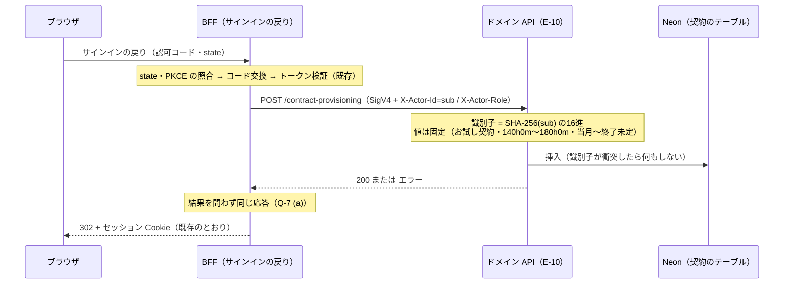

# ログインした技術者の契約の自動での用意 — 仕様

discussion #142「ログインした技術者がデモで入力と締めを体験できるようにするか」の決定を受け入れ条件に落とす仕様である。ログインした技術者には、初回ログイン時にシステムが契約を1件自動で用意する（ADR 0023。提案中）。

業務ルール・ユビキタス言語は**この仕様へ書き写さない**。正解は各業務仕様と `docs/domain/ubiquitous-language.md` にある。本仕様に書くのは次のものに限る（ADR 0004）。

- 既に決まっていることの要旨と出典（P 節）
- 人間の決定（Q 節。選択肢と起草時の評価を記録として残す）
- 受け入れ条件（AC 節）。用意する契約の値・ドメイン API の側の実装設計・BFF の側の振る舞いの持ち主は本仕様である。**ドメイン API の HTTP の口（E-10）の表現は `domain-api-http-contract.md` AC-14 が持ち**、本仕様は参照する
- 限界（AC-5）

- **状態**: **Q-1〜Q-9 は 2026-10-29 に人間が決定した**（AskUserQuestion による明示選択。main セッション経由で受領）。AC は決定に従って確定した。**ADR 0023 は提案中のまま**である
- **日付**: 2026-10-29（仕様工程が起草した）／**2026-10-29 改訂**（Q-1〜Q-9 の決定を受け、決定欄を埋め、AC を確定し、AC-6〜AC-8 を足した）
- **決定者**: 決定1〜3（下の「決定」）と Q-1〜Q-9 の決定は人間（2026-10-29 に AskUserQuestion で明示選択。main セッション経由で受領）。Q 節の選択肢と起草時の評価、AC 節で「仕様工程の定め」と印を付けた行は仕様工程が定めたものであり、**人間の決定ではない**
- **前提 ADR**: 0004（docs が正）／0007（標準 `testing` + go-cmp）／0008（クリーンアーキテクチャ）／0016（認証・ゲスト）／0021（契約・閲覧系の画面）／0022（日次リセット）／**0023（本仕様の決定。提案中）**

---

## 決定（2026-10-29 人間が決定）

本文は ADR 0023 が持つ。要旨は次のとおり。

1. ログインした技術者には、初回ログイン時に、システムが契約を1件自動で用意する
2. 画面を作らない。契約の管理（CRUD）は非スコープのままとする
3. 業務ユースケースを増やさない（システムの内部処理である）

本仕様の中では、決定1 で用意する契約を「**利用者の契約**」と呼ぶ。**本仕様の中の呼び名であり、ユビキタス言語の用語ではない**（Q-8 (a)。語を足さない）。`docs/specs/demo-data-reset.md` の「**デモの契約**」（同「デモデータの値」節 V-2 の契約。技術者はデモの技術者識別子）とは別のものである。

---

## スコープ

- **対象**:
  - 利用者の契約を用意する契機・場所・中身（AC-1）
  - 利用者の契約が、契約を作成・更新する口にならないための条件（AC-2）
  - 利用者の契約と、日次リセット（`docs/specs/demo-data-reset.md`）との関係（AC-1-12）
  - ドメイン API の側の実装設計（AC-6）と、BFF のサインインの戻りの側の振る舞い（AC-7）
  - 利用者の契約の識別子と、デモの契約の識別子が衝突しないこと（AC-8）
- **非スコープ**:
  - **契約の管理（CRUD）**。利用者が契約を作成・変更・削除する画面・操作は作らない（決定2。`docs/specs/contracts-ui.md` AC-4-1・AC-6-2 を変えない）
  - **勤務月・稼働実績を用意すること**。決定1 が用意するのは契約だけである。勤務月は、従来どおり初回入力を契機に生成される（`daily-record-entry.md` D-6）。**仕様工程の読み**: 人間の決定の字面「契約を1件」から読んだ範囲であり、勤務月の例を併せて用意するかを人間が否定したものではない
  - **承認者の割り当て・承認待ち一覧の絞り込みの変更・自己承認の規則の変更**（`docs/rules/scope.md`・`approval.md` D-4。Q-9 (a) により改めない）
  - **Cognito のユーザーの作成**（`cognito-auth-infra.md` 非スコープ・AC-10-4）。**Cognito のトリガーに Lambda を作らない**（Q-3 (a) を採ったため。`cognito-auth-infra.md` AC-7-3・AC-10-5 を変えない）
  - 画面の仕様。契約一覧・勤務月一覧・稼働の推移の見え方は、各 UI 仕様が持つ

---

## 前提（P）

既存の条文で**既に決まっていること**の要旨である。本文は出典にあり、ここへ書き写さない。

| # | 前提（要旨） | 出典 |
|---|---|---|
| P-1 | 集約は `WorkMonth` の1つ。契約は与件であり、集約の外にある。勤務月は `契約 × 年月` で一意に決まる | `docs/rules/scope.md`／ユビキタス言語「勤務月の同一性」「契約が持つもの（参照系）」 |
| P-2 | 勤務月は、生成時に契約の精算幅を写し取り、以降は契約から独立する | ユビキタス言語「契約と精算幅の保持」【確定】 |
| P-3 | 契約が持つのは、識別子・契約表示名・技術者識別子・精算幅・契約期間である | `workmonth-implementation-design.md` AC-6-3・AC-10-21 ①／ADR 0021 決定2 |
| P-4 | 契約期間の開始の年・月は NULL を取らない。終了の年・月は、ともに NULL（終了未定）か、ともに値ありのどちらか。開始が終了より後の行は不正 | `demo-data-reset.md` P-6／`workmonth-implementation-design.md` AC-10-21 ① |
| P-5 | 契約期間の開始の年月を持たない契約の行は、E-8 で 500 になる | `workmonth-implementation-design.md` AC-10-21 ③／`domain-api-http-contract.md` AC-11-14 |
| P-6 | 精算幅の下限が上限より大きい契約の行は、読み出しで `ErrInvalidValue` になる | `workmonth-implementation-design.md` AC-9-17-d |
| P-7 | 契約期間は表示にだけ使い、対象年月が契約期間の外にあるかを検査しない | ユビキタス言語「契約が持つもの（参照系）」の注記／`workmonth-implementation-design.md` AC-13-9 |
| P-8 | `X-Actor-Id` に載せるのは、検証済みトークンの `sub` だけである | `bff-auth-termination.md` AC-5-2 |
| P-9 | 「本人」は、`X-Actor-Id` と契約が指す技術者識別子の一致で判定する | `domain-api-http-contract.md` AC-1-7 |
| P-10 | 同じメールアドレスでも、ログイン方式が違えば別の `sub` になる（別人として現れる） | `cognito-auth-infra.md` AC-4-6・AC-11-9 |
| P-11 | ゲストはセッション Cookie の不在で表し、Cognito のユーザーも未認証 ID も発行しない。ゲストは操作者のヘッダを送らない | `bff-auth-termination.md` AC-11-4・5-g |
| P-12 | 検証済みセッションがあり、ロール Cookie が無いとき、操作者のロールは `Engineer` である。ロールはデモ用に切り替えられ、切替はログインを伴わない | `bff-auth-termination.md` 5-a・5-11・11-2 (iii)／`login-ui.md` AC-6-1 |
| P-13 | 稼働実績の入力（E-3）は本人であればロールを問わない。契約一覧（E-8）と稼働の推移（E-9）は「Engineer かつ本人」を要求する | `domain-api-http-contract.md` AC-4-3・D-20 |
| P-14 | 承認待ち一覧は、承認待ちの勤務月を技術者横断で返し、`Approver` を要求する | `domain-api-http-contract.md` AC-3-2・D-12 |
| P-15 | 承認者は、自分自身が技術者である勤務月を承認・差戻しできない | `approval.md` D-4・AC-4 |
| P-16 | 利用者のデータとゲスト向けデモ勤務月群は、技術者識別子で分ける。デモの技術者識別子は Cognito の `sub` が取りうる形（UUID の形）に当たらない | `demo-data-reset.md` Q-5 (a)・AC-7-2 |
| P-17 | 日次リセットは、勤務月と稼働実績の行をすべて破棄する（技術者識別子で選り分けない）。契約の行は削除も追加もしない。デモの契約以外の契約の行には触れない | `demo-data-reset.md` Q-2 (a)・AC-1-1・AC-1-4・AC-6-9 |
| P-18 | BFF は DB に接続しない。ブラウザ → Route Handler → ドメイン API の一方通行であり、ドメイン API の Function URL は IAM 認証である | `docs/rules/architecture.md`／ADR 0003・0014 |
| P-19 | 契約の読み取りのポート（`ContractRepository`）は作成・更新のメソッドを持たず、その実装は書き込みを提供しない。ポートの数は限られており、足すことは設計変更である。**2026-10-29 注記**: Q-4 (a) により、書き込みは別のポート（AC-6-1）が持つ。`ContractRepository` は読み取り専用のまま変えない | `workmonth-implementation-design.md` AC-6-2・AC-6-6・AC-9-17-c |
| P-20 | Cognito のトリガーに Lambda を作らない。必要になったら停止して人間へ上げる | `cognito-auth-infra.md` AC-7-3・AC-10-5 |
| P-21 | BFF の認証の Route Handler は、サインインの開始・サインインの戻り（コールバック）・デモ用ロール切替の3つの役割に限る。広げる必要があれば、作る前に停止して人間へ上げる。**2026-10-29 注記**: Q-3 (a) により、サインインの戻りがドメイン API の E-10 を呼ぶよう改めた（同 AC-11-1・AC-11-2 (ii)）。役割の数は3つのまま変えない | `bff-auth-termination.md` AC-11-1・AC-11-2 |
| P-22 | 操作者ヘッダの `X-Actor-Role` は、ロール Cookie の確定（正当な Cookie が無ければ `Engineer`）の結果だけから決める。署名鍵が欠けているときは `Engineer` へ落ちない | `bff-wiring.md` AC-4-2・AC-5-5／`bff-auth-termination.md` AC-5-5 (viii)・5-11 |
| P-23 | 「当日」は `port.Clock` の `Today()` が返す。基準タイムゾーンは `daily-record-entry.md` D-8 が持つ | `workmonth-implementation-design.md` AC-6-5 |
| P-24 | 契約識別子は、HTTP の口で 1〜64 文字の `A-Z a-z 0-9 _ -` に限られる | `domain-api-http-contract.md` AC-1-10 |

---

## 人間の決定（Q）

**Q-1〜Q-9 は 2026-10-29 に人間が決定した**（AskUserQuestion による明示選択。main セッション経由で受領）。各 Q の表の選択肢と「起草時の評価」は、決定の前に仕様工程が並べたものを**記録として残す**。評価に書いた「〜を改める判断が要る」は起草時の見立てであり、改めた条文は各 Q の「AC への落とし方」に記す。

### 一覧

| # | 論点 | 決定（2026-10-29 人間） |
|---|---|---|
| Q-1 | 日次リセットで、利用者の契約をどう扱うか | **(a)** 残す（リセットは利用者の契約に触れない） |
| Q-2 | 用意する契約の中身（契約表示名・精算幅・契約期間） | 値の出所 **(b)**（全利用者で同じ固定値。精算幅 140時間0分〜180時間0分、契約表示名「お試し契約」）。契約期間の基準 **(i)**（用意した日の年月を開始とし、終了未定） |
| Q-3 | 用意する場所と契機。契約を作る口を外から呼べないようにする方法 | 場所と契機 **(a)**（BFF のサインインの戻り）。口の閉じ方 **(i)+(ii)** |
| Q-4 | 契約のテーブルへの書き込みを、どの層が持つか | **(a)** `usecase/port` にポートを足し、interactor から呼ぶ |
| Q-5 | 1件に保つ方法（冪等性・同時の初回ログイン） | **(a)** 識別子を `sub` から決定的に求め、識別子の一意性で2件目を作らない。識別子は `sub` をそのまま読める形にせず、ハッシュで求めた形にする |
| Q-6 | ロールの扱い（どのロールのときに用意するか） | **(a)** ロールを問わない |
| Q-7 | 用意に失敗したときの扱い | **(a)** 失敗してもログインを失敗させない。次のログインで再び試す |
| Q-8 | ユビキタス言語に語を足すか | **(a)** 足さない |
| Q-9 | 承認待ち一覧に他の訪問者の勤務月が出ること、自分の勤務月を自分で承認できないこと | **(a)** いまの条文のまま許す |

### Q-1. 日次リセットで、利用者の契約をどう扱うか

`demo-data-reset.md` は、日次リセットで契約の行を残す（Q-2 (a)）、デモの契約以外の契約の行に触れない（AC-6-9）と決めている。デモの契約以外の契約の行が無いことは、初回デプロイの前に人が確かめる（同 U-8 (i)・AC-3-6）。利用者の契約は、初回デプロイの後に生じるデモの契約以外の行である。

| 選択肢 | 内容 | 起草時の評価 |
|---|---|---|
| (a) | 残す（リセットは利用者の契約に触れない） | `demo-data-reset.md` Q-2 (a)・AC-1-4・AC-6-9 をそのまま満たし、同仕様の改訂が要らない。勤務月と稼働実績は毎日破棄される（P-17）ため、翌日は契約だけが残り、入力をやり直せる。「初回ログイン」は利用者ごとに一度きりになる。行はログインした `sub` の数だけ増え続け、減らす手段が無い（P-10 により、同じ人でもログイン方式ごとに増える）。契約期間を用意した日を基準にすると、日が経つにつれて古くなる（Q-2 と組み合わさる） |
| (b) | リセットのたびに削除する（デモの契約以外の契約の行を削除する） | 行は増え続けない。`demo-data-reset.md` Q-2 (a)「契約の行は残す」・AC-1-4「削除も追加もしない」・AC-6-9「削除もしない」を改める判断が要る（いずれも人間の決定かその帰結）。削除の後は、Q-3 の契機が再び来るまで契約が無い。Q-3 (a)（ログイン時）と組むと、午前4時のリセットをまたいで続くセッションでは、再ログインまで AC-13-1 と同じ空の状態になる |
| (c) | 残し、リセットの中で契約期間だけを書き換える（デモの契約に対する `demo-data-reset.md` U-1 (i) の扱いを広げる） | 契約期間をリセット日を基準にした相対の年月に保てる。`demo-data-reset.md` AC-6-9・AC-15-9（デモの契約以外の行に書き換えの文を当てない）を改める判断が要る。リセットの手段（同 AC-15）が、デモの契約の識別子（同 AC-6-4）以外の行を選ぶ方法を持つ必要がある。行が増え続ける点は (a) と同じ |

- **決定（Q-1）**: **(a) 残す（リセットは利用者の契約に触れない）**。2026-10-29 に人間が AskUserQuestion で明示選択した
- **AC への落とし方**: AC-1-12・AC-2-3。`demo-data-reset.md` の条文（Q-2 (a)・AC-1-4・AC-6-9・AC-15-9）は改めない。行が増え続けることは限界 AC-5-4 に置く

### Q-2. 用意する契約の中身

利用者の契約は、P-3 の項目を持つ。技術者識別子は決定1 と P-8 から `sub` に決まる（AC-1-2）。識別子は Q-5 と組み合わさる。残る3つの項目の値を決める。

**値の出所**

| 選択肢 | 内容 | 起草時の評価 |
|---|---|---|
| (a) | デモの契約 A（`demo-data-reset.md` V-2）の契約表示名・精算幅を写す | 値を新たに決めずに済み、ゲスト向けデモ群と同じ精算幅で体験できる。承認待ち一覧（P-14）には、利用者の勤務月とデモの契約 A の勤務月が同じ契約表示名で並び、承認者として入った訪問者に見分けにくい。V-2 の値が変わったときに追随させるかが別に要る |
| (b) | 利用者の契約のための値を、人間が新たに決める（全利用者で同じ値） | デモの契約と見分けられる。値は人間が決める業務の値である（精算幅は超過・不足の判定の入力＝`monthly-closing.md` AC-4） |
| (c) | (b) に加え、契約表示名に利用者ごとの違いを持たせる（例: 用意した日付を含める） | 承認待ち一覧で利用者ごとに見分けやすい。契約表示名にメールアドレス等の利用者の情報を含めると、承認待ち一覧を通じて他の訪問者に見える（P-14）ため、含めるものを選ぶ判断が要る |

**契約期間の基準**

| 選択肢 | 内容 | 起草時の評価 |
|---|---|---|
| (i) | 用意した日の年月を開始とし、終了未定とする | 値が1つに決まる。用意した日より前の月にも入力できる（P-7。契約期間は表示にだけ使う）ため、契約一覧の表示と入力できる月がずれて見える |
| (ii) | 用意した日を基準にした相対の年月とする（例: デモの契約 A と同じく「6か月前〜終了未定」） | 過去の月に入力しても契約期間の内に収まって見える。Q-1 (a) と組むと、日が経つにつれて基準が古くなる |
| (iii) | Q-1 (c) と組み、リセットのたびにリセット日を基準にした相対の年月へ書き換える | デモの契約と同じ見え方を保てる。Q-1 (c) を採ることが前提になる |

- 契約期間と精算幅がどの値でも、P-4・P-6 を満たすことは要る（AC-1-6・AC-1-7。帰結）
- **決定（Q-2）**: 値の出所は **(b)**。全利用者で同じ固定値とし、**精算幅は 140時間0分〜180時間0分**（デモの契約 A と同じ値）、**契約表示名は「お試し契約」**（デモの契約と別の名前）。契約期間の基準は **(i) 用意した日の年月を開始とし、終了未定**。2026-10-29 に人間が AskUserQuestion で明示選択した
- **AC への落とし方**: AC-1-6〜AC-1-8・AC-1-15・AC-1-16（期待値の表は AC-1-a〜AC-1-f）。精算幅がデモの契約 A と同じ値であることは、V-2 の値を**写す**ことを意味しない（V-2 が変わっても本仕様の値は変わらない。値の出所は (b) であり (a) ではない）

### Q-3. 用意する場所と契機。契約を作る口を外から呼べないようにする方法

人間の決定は「初回ログイン時」である。BFF は DB に接続しない（P-18）ため、どの選択肢でも、DB へ書くのはドメイン API の Lambda か、新たな Lambda である。

**場所と契機**

| 選択肢 | 内容 | 起草時の評価 |
|---|---|---|
| (a) | BFF のサインインの戻り（P-21 の (ii)）で、トークンの検証の後に、ドメイン API の新しい口を呼び、本人の契約が無ければ用意させる | 契機が「ログイン」と字面で一致する。ドメイン API に口を1つ足すことになり、`domain-api-http-contract.md` の E の一覧の改訂が要る。サインインの戻りがドメイン API を呼ぶことは、`bff-auth-termination.md` AC-11-1（広げるなら停止して上げる）に当たり、同仕様の改訂が要る。Q-1 (b) と組むと、リセットをまたぐセッションで空白が出る |
| (b) | ドメイン API が、本人として契約を読む要求（E-8・E-9 等、「Engineer かつ本人」の要求）の中で、本人の契約が無ければ用意する | HTTP の口は増えない。参照系の `GET` が書き込みを伴う。E-1・E-2 は操作者で絞らない（D-12）ため契機にならず、勤務月一覧を先に開いた利用者には、契約一覧か稼働の推移を開くまで契約が無い。契機が「ログイン」と字面で一致しないため、人間の決定の「初回ログイン時」をこの形で満たすと読めるかの確認が要る。Q-1 (b) と組んでも、次の要求で戻る |
| (c) | Cognito のトリガー（確認後・認証後）に Lambda を足し、その Lambda が DB に書く | BFF にもドメイン API にも口を足さない。`cognito-auth-infra.md` AC-7-3・AC-10-5（トリガーに Lambda を作らない）を改める判断と、5本目の Lambda（`docs/rules/cost-guardrails.md` の予約同時実行数の行・`infra-terraform.md`・実行ロール・ログ保持）が要る。Google でのフェデレーションの初回サインインで、どのトリガーが走るかは未実測である |

**口の閉じ方**（いずれの場所でも、ブラウザから値を与えて契約を作る口にしないための条件）

| 選択肢 | 内容 | 起草時の評価 |
|---|---|---|
| (i) | 口は、要求の本文・クエリから契約の値を受け取らない。技術者は `X-Actor-Id`（P-8）だけから決め、中身は Q-2 の固定の定めだけから求める。本人の契約が既にあれば何も作らない | 呼ばれても「本人に1件」以上のことが起きない。`demo-data-reset.md` AC-6-10（値を外から受け取らないことで、契約を更新する手段にしない）と同じ考え方である。ドメイン API の Function URL は IAM 認証であり、呼べるのは BFF の実行ロールだけである（P-18） |
| (ii) | (i) に加え、BFF のブラウザ向けの Route Handler として独立に公開しない（サインインの戻りの内側からだけ呼ぶ） | Q-3 (a) を採るときに意味を持つ。ブラウザから任意の時点で呼べる経路が増えない |
| (iii) | (i) に加え、ドメイン API の HTTP の口にしない（Q-3 (b) の読み取りの内側、または Q-3 (c) の Lambda の内側に閉じる） | HTTP の契約の口が増えない。Q-3 (b)・(c) を採るときに意味を持つ |

- **決定（Q-3）**: 場所と契機は **(a)**（BFF のサインインの戻りで、トークンの検証の後にドメイン API の新しい口を呼び、本人の契約が無ければ用意させる）。口の閉じ方は **(i)+(ii)**（値を外から受け取らず、`X-Actor-Id` だけから決める。BFF のブラウザ向けの Route Handler として独立に公開しない）。2026-10-29 に人間が AskUserQuestion で明示選択した
- **AC への落とし方**: AC-1-9・AC-2-2・AC-2-6・AC-6・AC-7。ドメイン API の新しい口は **E-10**（`domain-api-http-contract.md` D-23・AC-14）。改めた既存の条文は `domain-api-http-contract.md`（エンドポイント一覧・AC-1-6・AC-9・D-23・AC-11-15・AC-14）・`bff-auth-termination.md`（P-10・AC-7-7・AC-11-1・AC-11-2 (ii)）・`bff-wiring.md`（AC-1-5・AC-6 の前文・AC-6-1・AC-6-11）である。各条文に「2026-10-29 改定（#142 Q-3）」と残した

### Q-4. 契約のテーブルへの書き込みを、どの層が持つか

いまの条文は、契約を読み取り専用の与件とし、書き込みを提供しない（P-19）。リセットの手段は、`usecase/port` に載せない gateway の手段として足された（`demo-data-reset.md` AC-15-1。interactor を通さない）。

| 選択肢 | 内容 | 起草時の評価 |
|---|---|---|
| (a) | `usecase/port` に、本人の契約を1件用意するポートを足し、interactor から呼ぶ | 依存の向き（ADR 0008）に沿い、手書きの Fake でテストできる（ADR 0007）。`workmonth-implementation-design.md` AC-6-2・AC-6-6（ポートの追加は設計変更）・AC-9-17-c・AC-10-21 ②・AC-13-7 を改める判断が要る。Q-3 (a)・(b) と組む |
| (b) | `usecase/port` に載せず、gateway の手段にとどめる（`demo-data-reset.md` AC-15-1 と同じ形） | ポートの数（AC-6-6）を変えない。HTTP の要求の経路（Q-3 (a)・(b)）から呼ぶと、interactor を通らずに gateway を呼ぶ形になり、ADR 0008 の層の使い方に沿わない。層の使い方を変える判断は人間の承認事項である（`docs/rules/development-process.md`） |
| (c) | Q-3 (c) の Lambda の `cmd` が、gateway の手段を直接呼ぶ（リセット用 Lambda の `cmd` と同じ形） | `demo-data-reset.md` U-6・U-9 と同じく、`cmd` を足すことと import してよい範囲の承認が要る。Q-3 (c) を採るときだけの選択肢である |

- **決定（Q-4）**: **(a) `usecase/port` に、本人の契約を1件用意するポートを足し、interactor から呼ぶ**。2026-10-29 に人間が AskUserQuestion で明示選択した
- **AC への落とし方**: AC-2-5・AC-6。改めた既存の条文は `workmonth-implementation-design.md` AC-6-2・AC-6-6・AC-6-12（追加）・AC-7-1・AC-9-17-c・AC-10-16・AC-10-21 ②・AC-13-7 である。**`ContractRepository`（AC-6-2）には作成・更新のメソッドを足さず、読み取り専用のまま残す**（書き込みは別のポート＝AC-6-1 が持つ。仕様工程の定め。理由: 読み取りの Fake・実装に書き込みを混ぜず、AC-9-17-c の「書き込みを提供しない」を `ContractRepository` の実装について保つため）

### Q-5. 1件に保つ方法（冪等性・同時の初回ログイン）

決定1 は「1件」である（AC-1-4）。同じ利用者のサインインが同時に2つ走る（複数のタブ・二重の送信）ときにも1件に保つかを決める。デモの技術者は2つの契約を持つ（掛け持ち＝`demo-data-reset.md` V-2）ため、技術者識別子だけで契約を一意にする制約は、テーブル全体には置けない。

| 選択肢 | 内容 | 起草時の評価 |
|---|---|---|
| (a) | 利用者の契約の識別子を `sub` から決定的に求め（同じ `sub` なら同じ識別子）、識別子の一意性で2件目を作らない（挿入が衝突したら何もしない） | 列を足さない。同時の初回ログインでも1件に保てる。識別子の求め方が、デモの契約の識別子（`demo-data-reset.md` AC-6-4）と衝突しないことが要る。識別子は URL のパスに現れる（E-1 等）ため、`sub` がそのまま読める形にするかの判断が要る |
| (b) | 「本人の契約が無ければ挿入する」をアプリで判定するだけにする（制約を置かない） | 実装が単純である。同時の初回ログインで2件できうる。できたときは限界として許すことになり、決定1 の「1件」との関係の確認が要る |
| (c) | 利用者の契約を示す区分の列を足し、区分と技術者識別子で一意にする | `demo-data-reset.md` Q-5 (b)（デモ群を示す区分の列を足す）が「ユビキタス言語に無い概念を持ち込む」として退けた形と同じ問題を持つ |

- **決定（Q-5）**: **(a)**。利用者の契約の識別子を `sub` から決定的に求め、識別子の一意性で2件目を作らない（挿入が衝突したら何もしない）。**識別子は `sub` をそのまま読める形にせず、ハッシュで求めた形にする**（人間が選んだ推奨に含まれていたもの）。2026-10-29 に人間が AskUserQuestion で明示選択した。求め方の詳細（ハッシュの種類・表記・デモの契約の識別子と衝突しないこと）は仕様工程で定めてよいとされ、定めた条文には「仕様工程の定め」と印を付けた
- **AC への落とし方**: AC-1-4・AC-1-13・AC-1-14・AC-6-3・AC-8

### Q-6. ロールの扱い

サインインの直後、ロール Cookie が無ければロールは `Engineer` である（P-12）。ロールの切替はログインを伴わない（P-12）。入力（E-3）は本人であればロールを問わない（P-13）。

| 選択肢 | 内容 | 起草時の評価 |
|---|---|---|
| (a) | ロールを問わず、ログインした利用者（`sub` を持つ利用者）に用意する | 承認者として入っていた利用者も、切り替えればすぐ入力できる。承認者のままの利用者にも、使われない契約の行ができる |
| (b) | ロールが `Engineer` のときだけ用意する | 「技術者に用意する」と字面で一致する。Q-3 (a) と組むと、前のロール Cookie が `Approver` のまま残っていた利用者には、ログイン時に用意されず、切り替えても契機が来ない |

- **決定（Q-6）**: **(a) ロールを問わず、ログインした利用者（`sub` を持つ利用者）に用意する**。2026-10-29 に人間が AskUserQuestion で明示選択した
- **AC への落とし方**: AC-1-10・AC-6-2 ②・`domain-api-http-contract.md` AC-14-5

### Q-7. 用意に失敗したときの扱い

| 選択肢 | 内容 | 起草時の評価 |
|---|---|---|
| (a) | 失敗しても、ログイン（Q-3 (b) なら読み取りの要求）を失敗させない。契約が無いまま進み、次の契機で再び試す | 用意の失敗がログインを妨げない。その間は AC-13-1（`demo-data-reset.md`）と同じ空の状態になり、利用者には理由が見えない |
| (b) | ログイン（または要求）を失敗させ、エラーを示す | 失敗が利用者に見える。DB の一時的な失敗でログインできなくなる。ゲストとしての閲覧には影響しない |

- Q-3 (c)（Cognito のトリガー）を採るときは、トリガーの失敗が Cognito 側でサインインを失敗させるかどうかの確認も要る（未実測）。**Q-3 (a) を採ったため、この確認は要らなくなった**
- **決定（Q-7）**: **(a) 失敗しても、ログインを失敗させない。契約が無いまま進み、次のログインで再び試す**。2026-10-29 に人間が AskUserQuestion で明示選択した
- **AC への落とし方**: AC-1-11・AC-7-4〜AC-7-6。改めた既存の条文は `bff-auth-termination.md` AC-7-7（用意のために読む構成の欠落でサインインの戻りを 5xx にしない）である

### Q-8. ユビキタス言語に語を足すか

| 選択肢 | 内容 | 起草時の評価 |
|---|---|---|
| (a) | 語を足さない。「利用者の契約」は本仕様の中の呼び名にとどめる（`demo-data-reset.md` AC-15 の「リセットの手段」と同じ扱い） | 契約は契約であり、出所が違うだけである。画面に呼び分けを出さないなら足りる |
| (b) | ユビキタス言語に語を登録する | 画面・ヘルプ・承認待ち一覧で、利用者の契約とデモの契約を呼び分ける必要があるなら要る。語の確定は人間の決定である（`docs/rules/responsibility.md`） |

- **決定（Q-8）**: **(a) 語を足さない**。「利用者の契約」は本仕様の中の呼び名にとどめる。2026-10-29 に人間が AskUserQuestion で明示選択した
- **AC への落とし方**: 画面・ヘルプ・API の表現に「利用者の契約」を呼び分ける項目を足さない（AC-2-1。E-10 のパス名は語を足すものではない＝`domain-api-http-contract.md` D-23）。`docs/domain/ubiquitous-language.md` に語を足さない（契約の節に ADR 0023 の決定と Q-8 (a) を指す注記のみ置く）

### Q-9. 承認待ち一覧に他の訪問者の勤務月が出ること、自分の勤務月を自分で承認できないこと

利用者の契約で締めた勤務月は、承認待ち一覧（P-14）に技術者横断で出る。承認者として入った他の訪問者は、それを承認・差戻しできる。利用者は自分の勤務月を承認できない（P-15）。人間が決定の根拠に挙げた「訪問者どうしの干渉を避ける」は、契約と勤務月の持ち主（技術者の側）について成り立つ。承認待ち一覧の側は、いまの条文のままでは次のとおりになる。

| 選択肢 | 内容 | 起草時の評価 |
|---|---|---|
| (a) | いまの条文のまま許す | 条文を改めずに済む。ある訪問者の勤務月が、契約表示名とともに他の訪問者に見え、他の訪問者が承認・差戻しできる（Q-2 の契約表示名の選び方が見え方に効く）。崩れは次のリセットで消える（P-17。`demo-data-reset.md` Q-5 (i) がデモ群について許した「最大1日」と同じ長さ）。一人の訪問者は、承認（UC3）を自分の月で通せず、ゲスト向けデモ群の承認待ちの例で体験する |
| (b) | 別の discussion へ切り出す（承認待ち一覧の範囲・自己承認の規則・承認者の割り当てに関わる） | 承認待ち一覧を技術者横断で返す定め（P-14）・自己承認の排除（P-15）・承認者の割り当てを作らない定め（`docs/rules/scope.md`）のいずれかを改める業務判断になり、#142 の決定の範囲を超える。切り出すまでの間は (a) の状態になる |

- **決定（Q-9）**: **(a) いまの条文のまま許す**。2026-10-29 に人間が AskUserQuestion で明示選択した
- **AC への落とし方**: AC-3-3・AC-3-4・限界 AC-5-2。`approval.md`・`domain-api-http-contract.md` AC-3-2 は改めない

---

## 受け入れ条件（AC）

各行の「定め」欄は、その行の出所を示す。

- **人間**: 人間の決定（決定1〜3・Q-1〜Q-9・既存の決定）をそのまま条件にした行
- **仕様工程の定め**: 人間が決めていない細部を仕様工程が埋めた行。人間の決定ではない
- **帰結**: 既存の条文から一意に導いた行

### 全体の流れ（参考図。条文は下の表が持つ）



### AC-1. 用意する契約

| # | 条件 | 期待 | 定め |
|---|---|---|---|
| 1-1 | ゲスト（検証済みセッションが無い） | 利用者の契約を用意しない。ゲストは `sub` を持たず、サインインの戻りを通らない（P-11）。E-10 は操作者ヘッダの無い要求を 401 で弾く（`domain-api-http-contract.md` AC-14-3） | 帰結 |
| 1-2 | 利用者の契約の技術者識別子 | 検証済みトークンの `sub`（`X-Actor-Id` に載る値と同じ。P-8）である。このため、利用者は利用者の契約について「本人」になる（P-9） | 人間（決定1・ADR 0023 の根拠「AC-5-2 を保つ」） |
| 1-3 | 技術者識別子の出所 | 要求の本文・クエリ・ブラウザの入力から決めない。`sub` 以外のクレーム（メールアドレス等）から決めない（P-8） | 帰結（P-8・決定2） |
| 1-4 | 1人の利用者（1つの `sub`）が持つ利用者の契約の数 | **1件**である。既に利用者の契約を持つ利用者に、2件目を用意しない。**同時の初回ログイン（同じ `sub` のサインインの戻りが同時に2つ走る）でも1件に保つ**。手段は 1-13・1-14 | 人間（決定1「1件」・Q-5 (a)） |
| 1-5 | デモの技術者識別子との関係 | 利用者の契約の技術者識別子は、デモの技術者識別子と一致しない（P-16。デモの技術者識別子は UUID の形に当たらない）。利用者の契約の用意は、デモの契約の行を変えない（1-14） | 帰結（P-16） |
| 1-6 | 利用者の契約の契約期間 | **開始の年月は、用意した日（1-15）の年月**。**終了の年・月は、ともに NULL（終了未定）**。これにより P-4 を満たし、P-5 の 500 を生まない | 人間（Q-2 (i)）。P-4・P-5 を満たすことは帰結 |
| 1-7 | 利用者の契約の精算幅 | **下限 140時間0分（8400分）、上限 180時間0分（10800分）**。下限が上限より大きくない（P-6 の `ErrInvalidValue` を生まない） | 人間（Q-2 (b)）。分の値への換算と P-6 を満たすことは帰結 |
| 1-8 | 利用者の契約の契約表示名 | **`お試し契約`**（全角・半角の違いを含めてこの5文字。前後に空白を付けない）。デモの契約の契約表示名（`demo-data-reset.md` V-2 の「基幹システム更改」「運用保守」）と異なる | 人間（Q-2 (b)）。字面の固定（空白を付けない）は仕様工程の定め |
| 1-9 | 用意する契機と場所 | **BFF のサインインの戻り**（`bff-auth-termination.md` AC-11-2 (ii)）で、**トークンの検証（同 AC-2）が成功した後に、ドメイン API の E-10 を呼ぶ**。E-10 は、利用者の契約が無ければ用意し、あれば何もしない。**サインインの戻りが成功するたびに E-10 を呼ぶ**（2回目以降のログインでは何も作らない＝1-14）。これにより「初回ログイン時に用意する」（決定1）と「次のログインで再び試す」（Q-7 (a)）を同じ経路で満たす | 人間（決定1・Q-3 (a)・Q-7 (a)）。「成功するたびに呼ぶ」は Q-3 (a)「本人の契約が無ければ用意させる」と Q-7 (a) の帰結 |
| 1-10 | 用意するロール | **ロールを問わない**。ロール Cookie が `Approver` を示す利用者のサインインでも用意する。E-10 は `Engineer` と `Approver` のどちらでも同じ値で用意する（1-a・1-b） | 人間（Q-6 (a)） |
| 1-11 | 用意に失敗したとき | **ログインを失敗させない**。サインインの戻りの応答（ステータス・`Location`・`Set-Cookie`）は、用意が成功したときと同じである（AC-7-4）。**同じサインインの中で再び試さない**。次のログイン（次のサインインの戻り）で再び E-10 を呼ぶ（1-9） | 人間（Q-7 (a)）。「同じサインインの中で再び試さない」は Q-7 (a)「次のログインで再び試す」からの読み（仕様工程の定め） |
| 1-12 | 日次リセットの後の利用者の契約 | **残る**。日次リセットは利用者の契約の行を削除せず、書き換えない（`demo-data-reset.md` AC-1-4・AC-6-9・AC-15-9 のまま）。利用者の契約に付いた勤務月と稼働実績は、他の勤務月と同じく破棄される（P-17）。リセットの翌日は、契約だけが残った状態から入力をやり直せる | 人間（Q-1 (a)）。勤務月・稼働実績の破棄は帰結（P-17） |
| 1-13 | 利用者の契約の識別子 | **`X-Actor-Id` の値（＝`sub`）のバイト列の SHA-256 を、小文字の16進で表した 64 文字**とする。`sub` の字面を含まない。同じ `sub` からは常に同じ識別子が、異なる `sub` からは異なる識別子が求まる（SHA-256 の衝突は限界 AC-5-6）。64 文字の `0-9 a-f` であり、P-24（1〜64 文字の `A-Z a-z 0-9 _ -`）を満たす | 人間（Q-5 (a)：`sub` から決定的に求める・ハッシュで求めた形にする）。**SHA-256・小文字の16進・前置きを付けないことは仕様工程の定め**（理由: 標準ライブラリだけで求まる＝ADR 0007・`docs/rules/development-process.md`。64 文字は P-24 の上限にちょうど収まる。前置きを付けると上限を超える） |
| 1-14 | 1件に保つ手段 | 利用者の契約の挿入は、**識別子が既にある行と衝突したら何もしない**（既にある行を書き換えない・削除しない・エラーにしない）。「本人の契約が既にあるか」は、1-13 の識別子の行があるかで判定し、技術者識別子で別に引かない | 人間（Q-5 (a)「挿入が衝突したら何もしない」）。「技術者識別子で別に引かない」は仕様工程の読み（理由: 1-13 の識別子の行以外に、技術者識別子が `sub` である契約の行は生じない＝デモの契約の技術者は UUID の形に当たらず〔P-16〕、デモの契約以外の行は初回デプロイの前に無いことを確かめる〔`demo-data-reset.md` AC-3-6〕） |
| 1-15 | 「用意した日」 | E-10 が要求を処理した時点の **`port.Clock` の `Today()`**（P-23。基準タイムゾーンは `daily-record-entry.md` D-8）。挿入が衝突して何もしなかった要求では、契約期間は変わらない（初めて挿入した日の年月のまま） | 仕様工程の定め（既存の「当日」の定めを使い、新しい時刻の出所を作らない） |
| 1-16 | 値が利用者で変わらないこと | 契約表示名・精算幅・契約期間の終了は、全利用者で同じである。利用者で変わるのは識別子（1-13）・技術者識別子（1-2）・契約期間の開始（1-15）だけである | 人間（Q-2 (b)「全利用者で同じ固定値」）。開始が利用者で変わりうることは Q-2 (i) の帰結 |

#### 期待値の表（下表がそのままテストの入出力になる。interactor を手書きの Fake で検査する＝AC-6-2）

`Today()` は Fake の `Clock` が返す値である。精算幅は「時間:分」で示す。

| # | 入力（操作者・`Today()`） | 期待（Fake の `ContractProvisioner` が受け取る値） |
|---|---|---|
| 1-a | 認証済み・ID `abc`・ロール `Engineer`・`Today()` 2026-10-29 | 識別子 **`ba7816bf8f01cfea414140de5dae2223b00361a396177a9cb410ff61f20015ad`**・契約表示名 **`お試し契約`**・技術者識別子 **`abc`**・精算幅 **140:00〜180:00**・契約期間 **開始 2026-10、終了なし（`nil`）**。`ProvisionIfAbsent` が**ちょうど1回**呼ばれ、出力ポートの `Present` が1回呼ばれる |
| 1-b | 1-a と同じで、ロールだけ `Approver` | **1-a と同じ値**（Q-6 (a)。ロールで値も呼び出しの有無も変わらない） |
| 1-c | ID `abc`・`Today()` 2026-10-31 ／ 2026-11-01 | 開始 **2026-10** ／ **2026-11**（月末と月初の境界） |
| 1-d | ID `abc`・`Today()` 2026-12-31 ／ 2027-01-01 | 開始 **2026-12** ／ **2027-01**（年の境界） |
| 1-e | ID `abc` と ID `abd`（他は同じ） | 識別子が**異なる**。同じ ID で2回呼ぶと識別子が**同じ** |
| 1-f | ID `0a1b2c3d-4e5f-4a6b-8c7d-9e0f1a2b3c4d`（UUID の形。`sub` の例。架空の値） | 識別子が **64 文字で、すべて `0-9 a-f`**。識別子が ID の字面（`0a1b2c3d-4e5f-4a6b-8c7d-9e0f1a2b3c4d`）を含まない |
| 1-g | 未認証の操作者（ゲスト） | 出力ポートの `PresentError` が **`port.ErrUnauthenticated`** で1回呼ばれる。**`ProvisionIfAbsent` が呼ばれない** |
| 1-h | 1-a の入力で、Fake の `ProvisionIfAbsent` がエラー（テスト内で作った番兵）を返す | `PresentError` が**その番兵**（`errors.Is` で一致）で1回呼ばれる。`Present` が呼ばれない |

**1-a の識別子の出所**: NIST が公開する SHA-256 の例（入力 `abc`。FIPS 180-2 付録 B.1 の "One-Block Message"）の出力値である。**テストは出所をテストの字面に残す。一致しないときに期待値を書き換えて合わせない**（求め方を誤っている。変える前に停止して人間へ上げる）。`abc` は `sub` の形（UUID の形）ではないが、求め方の正しさを外部の値で確かめるために用いる（1-f が UUID の形を受け持つ）。

### AC-2. 契約を作成・更新する口にしないこと（決定2）

| # | 条件 | 期待 | 定め |
|---|---|---|---|
| 2-1 | 画面 | 契約を作成・変更・削除する画面・操作要素を足さない（`contracts-ui.md` AC-4-1・AC-6-2 を変えない）。画面・ヘルプに利用者の契約とデモの契約を呼び分ける表示を足さない | 人間（決定2・Q-8 (a)） |
| 2-2 | 用意する手段が受け取る値 | 契約の値（契約表示名・精算幅・契約期間・技術者識別子・識別子）を、要求の本文・クエリ・ブラウザの入力から受け取らない。値は 1-2・1-6〜1-8・1-13・1-15 の定めだけから求める。E-10 は本文・クエリを読まない（`domain-api-http-contract.md` AC-14-2） | 人間（Q-3 (i)。2026-10-29）。起草時は仕様工程の定めとしていた（決定2 を、利用者が値を与えて契約を作る口にしないことと読んだ。`demo-data-reset.md` AC-6-10 と同じ考え方）。Q-3 (i) の決定で確定した |
| 2-3 | 既にある契約の変更・削除 | 用意する手段は、既にある契約の行（利用者の契約・デモの契約のいずれも）を書き換えず、削除しない（1-14）。日次リセットも利用者の契約に触れない（1-12） | 仕様工程の定め（決定1 は「用意する」であり、変更・削除を含まない）。リセットの側は人間（Q-1 (a)） |
| 2-4 | 勤務月・稼働実績 | 用意する手段は、勤務月・稼働実績を作らない（スコープの非スコープ） | 仕様工程の定め（決定1 の字面「契約を1件」からの読み） |
| 2-5 | 書き込みを持つ層 | `usecase/port` のポート（AC-6-1）と、それを呼ぶ interactor（AC-6-2）が持つ。**`ContractRepository` には作成・更新のメソッドを足さない**（`workmonth-implementation-design.md` AC-6-2・AC-9-17-c） | 人間（Q-4 (a)）。`ContractRepository` に足さないことは仕様工程の定め（Q-4 の「AC への落とし方」） |
| 2-6 | ブラウザから呼べる口にしない | **E-10 を呼ぶのは、BFF のサインインの戻りの処理だけ**とする。E-10 のための Route Handler（`src/app/api/` 配下の `route.ts`）を足さない。業務の Route Handler（`bff-wiring.md` AC-6 の R-1〜R-11）から E-10 を呼ばない。サインインの開始・ロール切替（`bff-auth-termination.md` AC-11-2 (i)・(iii)）からも E-10 を呼ばない。**置き場所は AC-7 の 7-9、検査は 7-i〜7-n**（ファイル走査。限界は AC-5-12） | 人間（Q-3 (ii)）。置き場所と検査の形は仕様工程の定め |
| 2-7 | 更新・削除の口を持たない | E-10 は「無ければ用意する」だけを行う。AC-6-1 のポートは**メソッドを1つだけ**持ち、既にある行を書き換える・削除するメソッドを持たない | 帰結（決定2・2-3） |

### AC-3. 用意された後に成り立つこと（既存の条文の帰結）

| # | 条件 | 期待 | 定め |
|---|---|---|---|
| 3-1 | 利用者の契約を持つ利用者が、ロール `Engineer` で契約一覧（E-8）を開く | 利用者の契約が載る（「Engineer かつ本人」＝P-13。P-9 と 1-2 から）。契約表示名は `お試し契約`、精算幅は 140時間0分〜180時間0分、契約期間は用意した月〜（終了未定） | 帰結 |
| 3-2 | 同じ利用者が、利用者の契約について稼働実績を入力し（E-3）、締める（E-5） | 本人として許可される（P-9・P-13）。勤務月は生成時に 140時間0分〜180時間0分 を写し取る（P-2）。業務ルールは各業務仕様のとおりである | 帰結 |
| 3-3 | 同じ利用者が、承認者に切り替えて自分の勤務月を承認・差戻しする | 弾かれる（P-15）。この扱いを改めない | 帰結。改めないことは人間（Q-9 (a)） |
| 3-4 | 利用者の契約で締めた勤務月 | 承認待ち一覧（P-14）に技術者横断で載り、承認者として入った他の訪問者が承認・差戻しできる。この扱いを改めない | 帰結。改めないことは人間（Q-9 (a)） |

### AC-4. 検査の単位

| # | 対象 | 単位 | 定め |
|---|---|---|---|
| 4-1 | AC-1（値・識別子・順序）・AC-6-2 | **Go の単体テスト**（`usecase/interactor`。標準 `testing` + go-cmp。`ContractProvisioner`・`Clock`・出力ポートは手書きのインメモリ Fake）。期待値は AC-1 の 1-a〜1-h | 帰結（ADR 0007・Q-4 (a)） |
| 4-2 | AC-6-3（gateway） | **Go の単体テスト**（`adapter/gateway`。既存の gateway のテストと同じく、SQL 実行インターフェースの手書きの Fake で、渡した文と引数を記録して見る）。実 DB を起動しない | 帰結（`workmonth-implementation-design.md` AC-12・AC-13-4） |
| 4-3 | AC-6-4・AC-6-5（controller・presenter・ルーティング・結線）と `domain-api-http-contract.md` AC-14 | **Go の単体テスト**（`httptest`。既存の E-8・E-9 の検査と同じ形） | 帰結 |
| 4-4 | AC-7（BFF のサインインの戻り・lambda-client） | **Vitest**（`apps/web`。lambda-client は手書きの Fake。外部へ通信しない）。7-i〜7-n は**ファイル走査**（`bff-wiring.md` 1-a・6-h と同じ単位） | 帰結（`bff-auth-termination.md` AC-8・`bff-wiring.md` AC-11） |
| 4-5 | AC-8（デモの契約の識別子の形） | **Go の単体テスト**（`cmd/demo-data-reset`） | 帰結 |
| 4-6 | Red の順序 | tester 工程が先にテストを書き、Red を確かめてから実装へ入る | 帰結（`docs/rules/development-process.md`） |
| 4-7 | `terraform test` | **足さない**。新しいリソース・環境変数・権限を足さない（BFF はドメイン API を既に呼べる＝`bff-wiring.md` AC-3。Cognito のトリガーを作らない＝Q-3 (a)） | 帰結 |

### AC-5. 限界 — 本仕様が担保しないこと

**以下は決定に基づく限界であり、欠陥ではない。**

| # | 内容 |
|---|---|
| 5-1 | **同じ人でも、ログイン方式ごとに別の利用者の契約を持つ**（P-10）。1-4 の「1件」は `sub` ごとに数える |
| 5-2 | **承認待ち一覧の側の干渉は残る**（Q-9 (a)）。ある訪問者が締めた勤務月は、契約表示名 `お試し契約` とともに承認者として入った他の訪問者に見え、承認・差戻しされうる。崩れは次の日次リセットで消える（P-17）。一人の訪問者は、自分の勤務月を自分で承認できない（P-15）。承認（UC3）は、ゲスト向けデモ群の承認待ちの例で体験する。全利用者の契約表示名が同じであるため、承認待ち一覧で訪問者ごとに見分けられない（Q-2 (b)。(c) を採らなかった帰結） |
| 5-3 | **デモの契約以外の契約の行が無いことの確認（`demo-data-reset.md` AC-3-6）は、初回デプロイの前の手順として残る**。利用者の契約は、その後に生じる行である。`demo-data-reset.md` AC-3-1〜3-3 の対象はデモの契約の行に限られる（同 U-8 (i)）ため、利用者の契約の契約期間が P-4 を満たすことは、本仕様の AC-1-6 が持つ |
| 5-4 | **利用者の契約の行は増え続け、減らす手段が無い**（Q-1 (a)）。行の数は、ログインに成功した `sub` の数に等しい（5-1 により、同じ人でもログイン方式ごとに増える）。E-8・E-9 はページングを持たないが、本人の契約しか返さないため、1人あたりの応答の大きさは変わらない（`domain-api-http-contract.md` AC-11-13）。DB の容量への影響は本仕様では測らない |
| 5-5 | **契約期間は用意した月から動かず、日が経つにつれて古く見える**（Q-1 (a)・Q-2 (i)）。用意した月より前の月にも入力できる（P-7。契約期間は表示にだけ使い、対象年月を検査しない）ため、契約一覧の契約期間と、入力できる月がずれて見える |
| 5-6 | **SHA-256 の衝突は考慮しない**。異なる `sub` から同じ識別子が求まったときは、2人目の挿入が衝突して何もせず、2人目は契約を持たない（1-14）。起こる見込みは無視できるとして扱い、検出も回復もしない |
| 5-7 | **同時の初回ログインで1件に保つことは、実 DB では検査されない**。テストが見るのは、挿入の文が識別子の衝突で何もしない形であること（AC-6-3）と、Fake の上の振る舞いまでである（`workmonth-implementation-design.md` AC-13-4 と同じ。実 DB を起動しない）。衝突の扱いが実際に効くことは、本番の Neon の主キーの制約（契約のテーブルの識別子の列）に依る |
| 5-8 | **用意の失敗は利用者に見えない**（Q-7 (a)）。失敗した利用者は、次のログインまで `demo-data-reset.md` AC-13-1 と同じ空の状態（本人の勤務月の一覧・契約一覧・稼働の推移が空）になり、理由は画面に出ない。失敗をログへ残すかは本仕様が定めない（残す場合も、トークン・資格情報・失敗の内部的な理由を応答に載せない＝AC-7-6） |
| 5-9 | **サインインの戻りは E-10 の応答を待つため、ドメイン API が遅いときはログインが遅れる**。待つ長さの上限は lambda-client の時間切れ（`bff-wiring.md` AC-8-8）であり、それを超えると失敗として扱う（1-11）。時間切れの値は本仕様が定めない |
| 5-10 | **E-10 は `X-Actor-Id` の形を検査しない**。ドメイン API は BFF が確定させた操作者を信じる（`domain-api-http-contract.md` P-2）。BFF は `sub` だけを載せる（P-8）ため、デモの技術者識別子（UUID の形に当たらない）を技術者とする利用者の契約は生じない（1-5）。BFF の実行ロール以外は E-10 を呼べない（P-18） |
| 5-11 | **ログイン以外の契機で用意しない**。サインインの戻りを通らずに続くセッション（Cookie の有効期間の中で、ログインをやり直さない利用者）は、そのセッションの最初のログインで用意に失敗していたとき、再ログインまで契約を持たない（5-8） |
| 5-12 | **「E-10 をブラウザから呼べる口にしない」（2-6・7-8）は、走査できる範囲（7-i〜7-n）を超えて機械検査できない**。次のものは走査に掛からず、担保はレビューと規律に留まる（`bff-wiring.md` 13-5 と同じ性質）。(i) E-10 の値を文字列の連結などで組み立てる書き方（7-i に掛からない）。(ii) 引数が文字列リテラルでない動的 `import()`・`require`、末尾の区切りがファイル名と一致しない指定子（7-m に掛からない）。(iii) テストと `src/test-support/` の中の記述（母集団の外）。(iv) **サインインの戻りの `route.ts` の中の配線**。7-m が確かめるのは、サインインの戻りの処理のファイル（7-9）に届く経路が、サインインの戻りの `route.ts` の1つのメソッドだけであることまでである。そのメソッドが、同じファイルの中の、トークンの検証を経ずに E-10 を呼ぶ別の関数を呼ぶ配線は検出されない（7-1・7-f の振る舞いの検査は、サインインの戻りの処理を直接の入力にし、`route.ts` を通らない）。(v) テストが名指す2つのファイル（サインインの戻りの処理のファイル・サインインの戻りの `route.ts`）が、実際にサインインの戻りの経路であること（構成側の戻り先と一致すること）は、`bff-auth-termination.md` 10-10 と同じく機械検査されない。**サインインの開始とロール切替が lambda-client を呼ばないことの振る舞いの検査は置かない**（仕様工程の定め）。理由: 両者は lambda-client を引数で受けない（7-3 が引数で受けるのはサインインの戻りの処理だけである）ため、手書きの Fake を差し込んで呼び出しを観測する口が無く、検査のためだけに口を足すと、両者が lambda-client を受け取る形そのものを作ることになる。代わりに、両者を置くファイルから E-10 に届かないことを 7-9 の分離と 7-i・7-k (iii)・7-m で確かめる |

### AC-6. ドメイン API の側の実装設計（Q-4 (a)）

`workmonth-implementation-design.md` の層の分担（AC-1・AC-6〜AC-11）に従う。**以下の Go の識別子・署名・型は仕様工程の定め**であり、既存の E-8・E-9（同 AC-6-10・AC-7-19〜AC-7-21・AC-10-22）の形に倣った。

#### AC-6-1. ポート `ContractProvisioner`（`usecase/port`）

`usecase/port` に次の形で置く（**下記以外のフィールド・メソッドを足さない**）。

```go
// ProvisionedContract は、利用者の契約として用意する1件の値（engineer-contract-provisioning.md AC-1）。
type ProvisionedContract struct {
	ContractID      workmonth.ContractID
	DisplayName     string
	EngineerID      string
	SettlementRange workmonth.SettlementRange
	Period          ContractPeriod // AC-6-10 の既存の型。利用者の契約では End は常に nil
}

// ContractProvisioner は、利用者の契約を、識別子の行が無いときだけ挿入する。
type ContractProvisioner interface {
	ProvisionIfAbsent(ctx context.Context, contract ProvisionedContract) error
}
```

| # | 条件 | 期待 |
|---|---|---|
| 6-1-a | 呼び出し元 | **`ProvisionContract`（AC-6-2）だけ**が使う |
| 6-1-b | `ContractRepository` との関係 | **別のポート**とする。`ContractRepository`（`workmonth-implementation-design.md` AC-6-2）にメソッドを足さない（2-5） |
| 6-1-c | 既にある行 | 識別子の行が既にあるときは**何もせず、エラーを返さない**（1-14）。既にある行の値を読み出して比べない・書き換えない |
| 6-1-d | `Actor` | 受け取らない（ポートは認可を判定しない。同 AC-6-10-g と同じ） |
| 6-1-e | 値の構築 | 渡される値は interactor が構築済みである。ポートは値を作り直さず、検査し直さない |

#### AC-6-2. interactor `ProvisionContract`（`usecase/interactor`）

```go
// usecase/port
type ProvisionContractInput struct { Actor Actor }
type ProvisionContractOutputPort interface {
	Present()
	PresentError(err error)
}

// usecase/interactor
func NewProvisionContract(provisioner port.ContractProvisioner, clock port.Clock, output port.ProvisionContractOutputPort) *ProvisionContract
func (i *ProvisionContract) Execute(ctx context.Context, input port.ProvisionContractInput)
```

| # | 条件 | 期待 |
|---|---|---|
| 6-2-a | 責務順序 | ①**未認証なら `PresentError(port.ErrUnauthenticated)`**。以降を行わない（`ProvisionIfAbsent` を呼ばない） → ②**ロールを判定しない**（Q-6 (a)。`ErrNotOwner`・`ErrNotApprover` を返す経路を持たない） → ③値の構築: 識別子は 1-13（`Actor.ID` から）、契約表示名は `お試し契約`、技術者識別子は `Actor.ID`、精算幅は `workmonth.NewWorkingHours(140, 0)`・`workmonth.NewWorkingHours(180, 0)` から `workmonth.NewSettlementRange` で、契約期間は `Clock.Today()` の年・月から `workmonth.NewYearMonth` で作った開始と `End: nil` → ④`ProvisionIfAbsent(ctx, 値)` → ⑤エラーなら**そのまま** `PresentError` へ渡す（包まない・番兵へ置き換えない。`workmonth-implementation-design.md` AC-11-11 で `INTERNAL_ERROR` へ写る）。エラーでなければ `Present()` |
| 6-2-b | ③の構築の失敗 | 固定の値と `Today()` から作るため起こらないが、起きたときは `ProvisionIfAbsent` を呼ばず、そのエラーを `PresentError` へ渡す |
| 6-2-c | 依存 | **`ContractProvisioner`・`Clock`・出力ポートの3つだけ**。`ContractRepository`・`WorkMonthRepository`・`WorkMonthQuery`・`ContractListQuery`・`WorkTrendQuery` を取らない |
| 6-2-d | 値の出所 | 入力 DTO は `Actor` だけを持つ。**契約の値を持つフィールドを入力 DTO に足さない**（2-2） |
| 6-2-e | 識別子の求め方の置き場所 | `usecase/interactor` の内側（標準ライブラリの `crypto/sha256`・`encoding/hex`）。`domain` に置かない（契約は集約の外＝P-1） |
| 6-2-f | 戻り値 | 返さない（`workmonth-implementation-design.md` AC-7-3） |

#### AC-6-3. gateway（`adapter/gateway`）

| # | 条件 | 期待 |
|---|---|---|
| 6-3-a | 形 | `func NewContractProvisioner(db DB) *ContractProvisioner`。`*ContractProvisioner` が `port.ContractProvisioner` を満たす |
| 6-3-b | 文の数と手段 | `ProvisionIfAbsent` は、SQL 実行インターフェースの **`Exec` をちょうど1回**呼ぶ。`Begin` を呼ばない（1文で済むため）。`Query` を呼ばない（既にある行を読み出さない＝6-1-c） |
| 6-3-c | 文 | 契約のテーブルへの**挿入**であり、**識別子の衝突で何もしない**形（PostgreSQL の `ON CONFLICT (識別子の列) DO NOTHING`）とする。**`DO UPDATE` を用いない**。列の名前と DDL 上の型は固定しない（`workmonth-implementation-design.md` AC-10-6） |
| 6-3-d | 引数の並び | **識別子・契約表示名・技術者識別子・精算幅の下限の時・下限の分・上限の時・上限の分・契約期間の開始の年・開始の月・終了の年・終了の月**の 11 個をこの順で渡す。終了の年・月は **`nil`**（SQL の NULL）。1-a の入力では `"ba7816bf8f01cfea414140de5dae2223b00361a396177a9cb410ff61f20015ad"`・`"お試し契約"`・`"abc"`・`140`・`0`・`180`・`0`・`2026`・`10`・`nil`・`nil` |
| 6-3-e | エラー | `Exec` のエラーは**そのまま**返す（番兵へ変換しない。`workmonth-implementation-design.md` AC-10-13 ② と同じ扱い） |
| 6-3-f | `ContractRepository` の実装 | 書き込みを足さない（`workmonth-implementation-design.md` AC-9-17-c） |

#### AC-6-4. controller・presenter

| # | 条件 | 期待 |
|---|---|---|
| 6-4-a | controller | `func HandleProvisionContract(r *http.Request, invoker provisionContractInvoker, output errorPresenter)`。操作者ヘッダを既存の解釈（`domain-api-http-contract.md` AC-1-4・1-5）で読み、`port.ProvisionContractInput` を作って invoker を呼ぶ。**本文とクエリを読まない**（2-2）。`provisionContractInvoker` は `Execute(ctx context.Context, input port.ProvisionContractInput)` の1メソッドだけを持つ |
| 6-4-b | presenter | `Present()` で **200** と本文 **`{}`**（`domain-api-http-contract.md` AC-14-6）。`PresentError` は既存の対応表（同 AC-9。`ErrUnauthenticated` → 401 `UNAUTHENTICATED`、いずれにも当たらないエラー → 500 `INTERNAL_ERROR`）を使い、新しい対応を足さない |

#### AC-6-5. 結線（`driver/lambda`）

| # | 条件 | 期待 |
|---|---|---|
| 6-5-a | `Endpoints` | **`ProvisionContract http.Handler` のフィールドを足す**。`NewRouter` は、これが `nil` なら panic する（既存のフィールドと同じ） |
| 6-5-b | ルーティング | E-10 のパス（`/contract-provisioning`）を**メソッド `POST` だけ**へ振り分ける。他のメソッドは既存と同じく 404 `NOT_FOUND`（`domain-api-http-contract.md` AC-1-11） |
| 6-5-c | 組み立て | `BuildProvisionContractInvoker(db gateway.DB, clock port.Clock) func(port.ProvisionContractOutputPort) ProvisionContractInvoker` を置き、`gateway.NewContractProvisioner` と `interactor.NewProvisionContract` を結線する。`NewProvisionContractHandler(buildInvoker func(port.ProvisionContractOutputPort) ProvisionContractInvoker) http.Handler` はリクエストごとに presenter を生成し、6-4-a の controller を呼ぶ。`ProvisionContractInvoker`（`driver/lambda`）は `Execute(ctx context.Context, input port.ProvisionContractInput)` の1メソッドだけを持つ |
| 6-5-d | 全体の組み立て | `NewHandler`（`workmonth-implementation-design.md` AC-10-16）は、受け取った `port.Clock` を 6-5-c へ渡し、E-10 を `Endpoints` へ載せる |

#### 検査（Go）— 6-3〜6-5 の入出力

| # | 入力 | 期待 |
|---|---|---|
| 6-a | gateway に 1-a の値を渡す（SQL 実行インターフェースは Fake） | `Exec` が**ちょうど1回**、6-3-d の 11 個の引数で呼ばれる。`Begin`・`Query` が呼ばれない。文が `ON CONFLICT` と `DO NOTHING` を含み、`DO UPDATE` を含まない |
| 6-b | Fake の `Exec` がエラーを返す | そのエラーが（`errors.Is` で一致して）返る |
| 6-c | 組み立てた `http.Handler` に `POST /contract-provisioning`・`X-Actor-Id: abc`・`X-Actor-Role: Engineer` を送る（SQL 実行インターフェースは Fake、`Clock` は 2026-10-29 を返す Fake） | **200**・本文 `{}`。Fake の `Exec` が 6-3-d の値（1-a と同じ）で1回呼ばれる |
| 6-d | 6-c と同じで、本文に `{"displayName":"x","engineerId":"other","contractId":"c-001"}`、クエリに `?engineerId=other&displayName=x` を付ける | **6-c と同じ結果**（Fake の `Exec` の引数が 1-a の値のまま。2-2） |
| 6-e | 6-c のパスへ `GET`・`PUT`・`DELETE` を送る | **404 `NOT_FOUND`**。Fake の `Exec` が呼ばれない |

### AC-7. BFF のサインインの戻りの側（Q-3 (a)・Q-6 (a)・Q-7 (a)）

`bff-auth-termination.md` AC-11-2 (ii) の処理（`src/lib/` 側。同 AC-11-11）に足す。その処理を置くファイルは 7-9 が定める。

| # | 条件 | 期待 | 定め |
|---|---|---|---|
| 7-1 | 呼ぶ時点 | **既存の検査（state・PKCE の照合＝同 AC-12-3・12-4、コード交換、トークンの検証＝同 AC-2）がすべて成功した後**に、E-10 を**ちょうど1回**呼ぶ。いずれかで拒否した経路（同 12-d〜12-g）と、構成の欠落で本来の処理へ到達しない経路（同 AC-7-7）では**呼ばない** | 人間（Q-3 (a)「トークン検証の後」）。拒否の経路で呼ばないことは帰結 |
| 7-2 | 操作者 | `X-Actor-Id` は**検証したトークンの `sub`**（P-8）。`X-Actor-Role` は、その要求のロール Cookie を **`bff-wiring.md` AC-4-2 と同じ確定**（同仕様 P-22。正当なロール Cookie が無ければ `Engineer`）にかけた結果とする。**ロール Cookie の署名鍵が未設定・空のときは E-10 を呼ばない**（`Engineer` へ落として呼ばない＝P-22）。これは用意の失敗として扱う（7-4） | 帰結（P-8・P-22・Q-7 (a)）。ロールの値で用意の有無が変わらないことは人間（Q-6 (a)） |
| 7-3 | 呼ぶ手段 | lambda-client（`bff-wiring.md` AC-1）を通して呼ぶ。lambda-client が受ける値は `{ endpoint: "E-10"; actor: { id; role } }`（同 AC-6-11）。**サインインの戻りの処理は lambda-client を引数で受ける**（`bff-wiring.md` の業務の処理の `lambdaClient` と同じく必須とする。省略されたときに呼ばずに済ませる形にしない＝配線漏れが「黙って用意しない」経路になるため） | 仕様工程の定め（既存の業務の処理の形に倣った） |
| 7-4 | 結果を問わず応答を変えない | lambda-client の結果が**成功・契約のエラー（例: 500 `INTERNAL_ERROR`）・契約外（通信の失敗・時間切れ・429・構成や資格情報の欠落）のいずれでも、また呼び出しが例外で終わっても**、サインインの戻りの応答は**用意が成功したときと同じ**（ステータス・`Location`・`Set-Cookie` の集まりが同じ）である。7-2 で呼ばなかったときも同じ | 人間（Q-7 (a)） |
| 7-5 | 構成の欠落を 5xx にしない | E-10 を呼ぶために読む構成（ドメイン API の呼び先＝`bff-wiring.md` AC-3-1、実行ロールの資格情報＝同 AC-3-3、ロール Cookie の署名鍵）が未設定・空でも、**サインインの戻りを 5xx にしない**（`bff-auth-termination.md` AC-7-7 の対象に入れない）。サインインの戻りが従来から読む構成の欠落は、従来どおり同 AC-7-7 の 5xx である | 人間（Q-7 (a)） |
| 7-6 | 待つこと・再試行しないこと | E-10 の応答（または lambda-client の時間切れ）を**待ってから**応答を返す（応答を返した後に呼ぶ形にしない。理由: Lambda は応答の後の処理を保証しない）。**同じサインインの戻りの中で E-10 を2回以上呼ばない**（1-11） | 仕様工程の定め（待つこと）。再試行しないことは 1-11 |
| 7-7 | 応答へ載せないもの | 用意の成否・E-10 の `code`・失敗の理由を、サインインの戻りの応答（本文・ヘッダ・`Location` のクエリ）に載せない。Cognito のトークンをドメイン API へ転送しない（`bff-auth-termination.md` AC-6-2） | 帰結（同 AC-4・AC-6-2・7-4） |
| 7-8 | Route Handler を足さない | E-10 のための `route.ts` を足さない（2-6）。サインインの戻りの `route.ts` の入口のレート制限（`bff-auth-termination.md` AC-11-12）は既存のまま通る。**検査は 7-i〜7-n** | 人間（Q-3 (ii)）。検査の形は仕様工程の定め |
| 7-9 | サインインの戻りの処理の置き場所 | **実装工程への要求**: サインインの戻りの処理（`bff-auth-termination.md` AC-11-2 (ii)。E-10 を呼ぶ処理を含む）を、`src/lib/` 配下の**専用のファイル**（以下「サインインの戻りの処理のファイル」）に定義する。このファイルに、サインインの開始（同 (i)）・ロール切替（同 (iii)）・業務の Route Handler の処理（`bff-wiring.md` R-1〜R-11 が呼ぶもの）を定義しない。サインインの戻りの処理を、サインインの開始・ロール切替と同じファイルに置いている実装は、ファイルを分ける。**ファイル名は本仕様で固定しない**（テストが名指してよい）。サインインの戻りの処理のファイルが、他の `src/lib/` のファイルから共通の部品（応答の組み立て等）を import することは妨げない。逆向き（他のファイルがサインインの戻りの処理のファイルを import すること）は 7-m が許さない。**既存の条文との関係**: `bff-auth-termination.md` AC-1-3（具体のファイル名を固定しない）・AC-11-3（パスは実装側が持つ）・AC-11-11（`src/lib/` 配下に置き、単体で呼べる形にする）と、`bff-wiring.md` AC-1-2（lambda-client を import してよい場所）は、いずれもファイルの分け方を定めておらず、本行と矛盾しない | 仕様工程の定め（Q-3 (ii) の担保の手段。人間の決定ではない）。理由: 7-i の判定はファイル単位であり、サインインの戻りの処理と同じファイルにブラウザから到達できる別の処理（サインインの開始・ロール切替）があると、その処理が E-10 を呼ぶ変異を 7-i が区別できない |

#### 検査（Vitest）— 下表がそのままテストの入出力になる

**lambda-client は手書きの Fake で受け、外部へ通信しない。** 呼んだ回数と受け取った値を Fake で見る。**呼ばない側と呼ぶ側を対で検査する**（呼ばない側だけでは、常に呼ばない実装が緑になる）。基準の入力は、`bff-auth-termination.md` 12-c（受理側）と同じく state・一時 Cookie・認可コードがそろい、交換とトークンの検証が成功する要求とする（以下「成功する戻り」）。

| # | 入力 | 期待 |
|---|---|---|
| 7-a | 成功する戻り。ロール Cookie なし。署名鍵あり | Fake が**ちょうど1回**、`{ endpoint: "E-10", actor: { id: <検証したトークンの sub>, role: "Engineer" } }` で呼ばれる。応答は従来どおり（302・セッション Cookie の `Set-Cookie`・一時 Cookie の破棄） |
| 7-b | 成功する戻り。正当に署名された `Approver` のロール Cookie | Fake が**ちょうど1回**、`role: "Approver"` で呼ばれる（Q-6 (a)。呼ばないことにならない） |
| 7-c | 成功する戻り。`Approver` を主張する改竄されたロール Cookie | Fake が `role: "Engineer"` で呼ばれる（P-22） |
| 7-d | 成功する戻り。署名鍵が**未設定**／**空**（2通り） | **Fake が呼ばれない**。応答は 7-a の応答と**同じ**（ステータス・`Location`・`Set-Cookie` の集まり）。5xx でない |
| 7-e | 成功する戻り。Fake が返す結果を (i) 成功（200・`{}`）、(ii) 契約のエラー（500・`INTERNAL_ERROR`）、(iii) 契約外（`rateLimited: false`）、(iv) 契約外（`rateLimited: true`）、(v) 例外を投げる、の5通りにする | **5通りとも応答が同じ**（ステータス・`Location`・`Set-Cookie` の集まりが (i) と一致する）。5xx・401・429 にならない。Fake はいずれも**ちょうど1回**呼ばれる（再試行しない） |
| 7-f | `bff-auth-termination.md` 12-d・12-e（3通り）・12-f・12-g の各入力 | **Fake が呼ばれない** |
| 7-g | `bff-auth-termination.md` 7-a のうち、サインインの戻りへの入力（サインインの戻りが従来から読む構成の欠落） | **Fake が呼ばれない**（従来どおり 5xx） |
| 7-h | 7-e の (ii)〜(v) の応答 | 本文・ヘッダ・`Location` に、`INTERNAL_ERROR`・`E-10`・`contract-provisioning` の文字列が現れない（7-7） |

#### 検査（Vitest・ファイル走査）— E-10 をブラウザから呼べる口にしないこと（2-6・7-8。Q-3 (ii)）

**この小節の検査の形（走査の対象・照合する字面・陽性対照）は仕様工程の定めである**（Q-3 (ii) の担保の手段として仕様工程が定めた。人間の決定ではない。`bff-wiring.md` AC-1 の 1-a〜1-c・6-h の走査の書き方に倣った）。**母集団（走査の対象ファイル）は手書きで列挙せず、ファイルの走査で得る。不在の主張には陽性対照を添える**（`bff-wiring.md` AC-11-4 と同じ）。母集団は `bff-wiring.md` 1-a と同じく、`apps/web/src/` 配下の `.ts` / `.tsx` から**テスト（`*.test.ts` / `*.test.tsx`）と `src/test-support/` を除いたもの**とする。「E-10 の値」は、引用符（`"`・`'`・`` ` ``）で囲まれた `E-10` の字面（lambda-client の `endpoint` の値＝`bff-wiring.md` AC-6-11）を指す。

| # | 入力 | 期待 |
|---|---|---|
| 7-i | 母集団を走査し、E-10 の値を含むファイルを集める | 集まったファイルが **`src/lib/lambda-client.ts` と、サインインの戻りの処理のファイル（7-9）の、ちょうど2つ**である（どちらか一方だけ・0件を一致とみなさない）。後者はテストが名指してよい。名指しが実装の移動に取り残されて緑のまま残る形にしないことは 7-m (i) が確かめる。サインインの開始・ロール切替の処理を置くファイル、業務の Route Handler の処理（R-1〜R-11 が呼ぶ `src/lib/` 側）、いずれの `route.ts` も集まらない（2-6） |
| 7-j | `src/app/api/` 配下の `route.ts` を**ファイル走査で列挙**する（`bff-wiring.md` 6-h と同じ列挙） | 列挙された件数が**1件以上**である。**どの `route.ts` も、ディレクトリの位置（`src/app/api/` からのパス）に `contract-provisioning` の区切りを持たない**（E-10 のための `route.ts` が無い＝7-8） |
| 7-k | 7-i の判定を、**合成入力**へ当てる（陽性対照）: (i) 許可外の `src/lib/` のファイル（例: `src/lib/work-month-handlers.ts` の位置）に E-10 の値を持つもの、(ii) `src/app/api/` 配下の任意の `route.ts` の位置に E-10 の値を持つもの、(iii) サインインの開始・ロール切替の処理を置くファイルの位置（例: `src/lib/auth-handlers.ts`）に E-10 の値を持つもの（ロール切替の処理が E-10 を呼ぶ変異の形） | (i)〜(iii) とも**違反として検出される** |
| 7-l | 7-j の判定を、**合成入力**（`src/app/api/contract-provisioning/route.ts` の位置にある `route.ts`）へ当てる（陽性対照） | **違反として検出される** |
| 7-m | 母集団の各ファイルの import の指定子を**構文として読む**。静的な `import`（`import type` を含む）・再輸出の `export … from`・引数が文字列リテラルの動的 `import()` のいずれも数える。指定子の末尾の区切り（拡張子を除く）が、あるファイルの名前（拡張子を除く）に一致するとき、そのファイルを import しているとみなす（`@/` 始まり・相対・拡張子つきのいずれの書き方も同じに扱う） | (i) **サインインの戻りの処理のファイル（7-i で名指したもの）を import するファイルが、ちょうど1つ**であり、それが**サインインの戻りの `route.ts`**（テストが名指してよい。7-j の列挙に含まれること）である（0件・2件以上を一致とみなさない）。(ii) **母集団のどのファイルも、末尾の区切りが `route` の指定子を持たない**（`route.ts` を別のファイルが import して呼ぶ形にしない。サインインの戻りの `route.ts` を経由して (i) を迂回させない）。(iii) **サインインの戻りの `route.ts` がエクスポートする HTTP メソッドの関数が、ちょうど1つ**である（`bff-wiring.md` 6-h と同じ読み方。同じ `route.ts` に、サインインの戻りの処理のファイルへ届く別のメソッドを足させない） |
| 7-n | 7-m の判定を、**合成入力**へ当てる（陽性対照）: (i) ロール切替の `route.ts` の位置（例: `src/app/api/auth/role/route.ts`）が、サインインの戻りの処理のファイルを import するもの、(ii) 新しい名前の `route.ts`（例: `src/app/api/auth/other/route.ts`）が同じファイルを import するもの（サインインの戻りの処理のファイルに関数を足し、別の `route.ts` から呼ぶ変異の形）、(iii) `src/lib/` の別のファイル（例: `src/lib/auth-handlers.ts` の位置）が同じファイルを `export … from` で再輸出するもの、(iv) 同じファイルを動的 `import()` で読むもの・`import type` で読むもの、(v) (i) の import の指定子を `@/lib/…`・相対（`../…`）・拡張子つきの3通りで書いたもの、(vi) どのファイルもサインインの戻りの処理のファイルを import しない母集団（0件）、(vii) `src/lib/` のファイルが `src/app/api/` 配下の `route.ts` を import するもの、(viii) サインインの戻りの `route.ts` の位置で、HTTP メソッドの関数を2つエクスポートするもの | (i)〜(viii) とも**違反として検出される**。**対として**、サインインの戻りの `route.ts` だけがサインインの戻りの処理のファイルを import し、そのメソッドの関数が1つである合成入力は**違反にならない**（判定が常に違反を返しても緑になる形にしない） |

lambda-client の側の検査（E-10 を `POST /contract-provisioning` へ、本文なし・クエリなしで送ること）は `bff-wiring.md` AC-6-11 が持つ。

### AC-8. デモの契約の識別子と衝突しないこと（Q-5 (a)）

| # | 条件 | 期待 | 定め |
|---|---|---|---|
| 8-1 | デモの契約の識別子の形 | デモの契約の識別子（`demo-data-reset.md` AC-6-4。リセット用 Lambda の内側の1箇所に持つ値）は、いずれも **64 文字の `0-9 a-f` だけからなる形に当たらない**。これにより、1-13 の識別子と衝突しない | 帰結（Q-5 (a) の起草時の評価が挙げた要件「識別子の求め方が、デモの契約の識別子と衝突しないことが要る」。人間は Q-5 の決定で、衝突しないことを含む求め方の詳細を仕様工程へ委ねた）。**形の定めと検査の手段は仕様工程の定め** |
| 8-2 | 検査 | `cmd/demo-data-reset` のテストで、デモの各契約の識別子が 8-1 の形に当たらないことを確かめる。**陽性対照として、64 文字の `0-9 a-f` の値（1-a の識別子）がその判定で「当たる」と出ることを併せて確かめる**（判定が常に「当たらない」を返しても緑になる形にしない） | 仕様工程の定め |
| 8-3 | デモの契約の識別子を変えるとき | 8-1 を満たす値に限る（`demo-data-reset.md` AC-6-4 の注記） | 仕様工程の定め |
