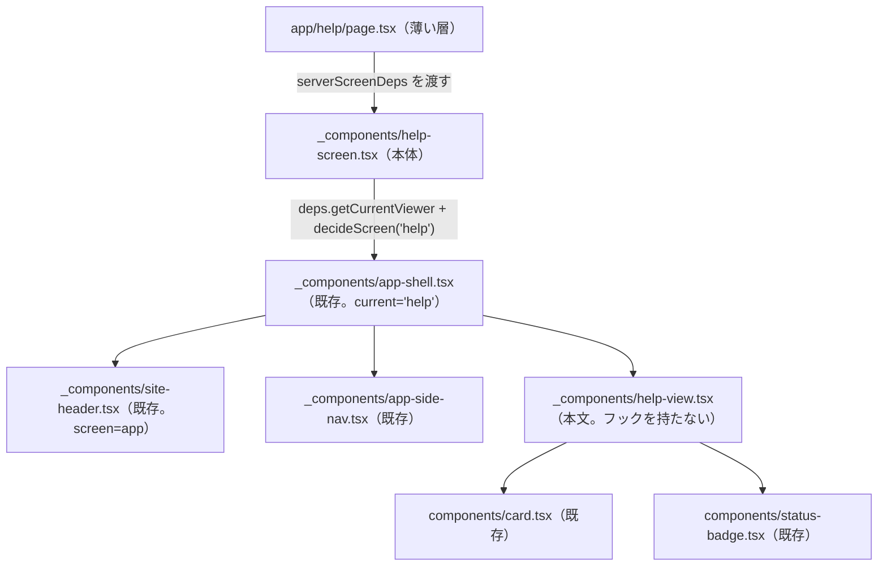
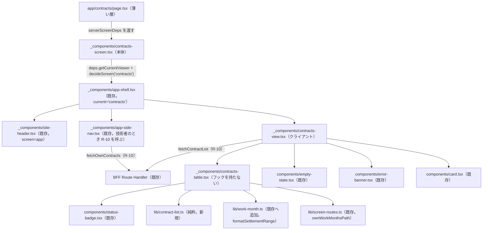
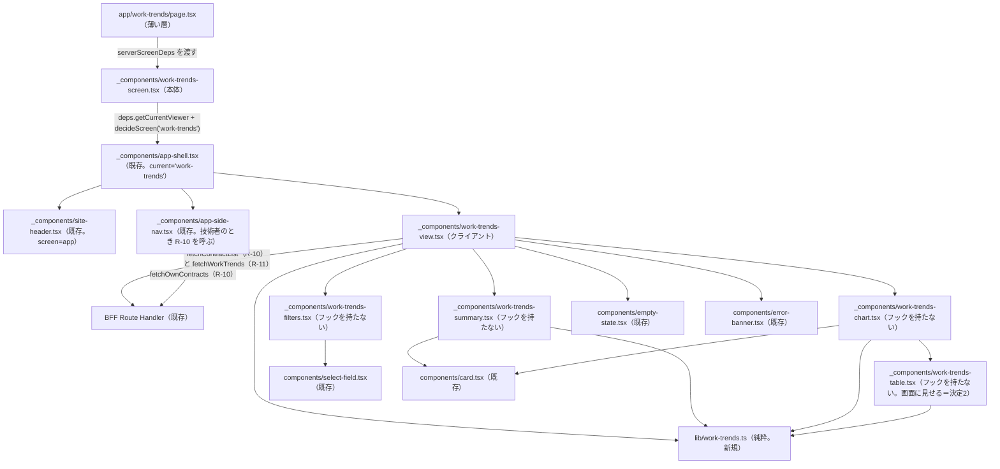

# 閲覧系の画面 実装設計 — 仕様

`apps/web` の閲覧系の画面（ヘルプ・契約一覧・稼働の推移）について、**どのファイルを置き、既存のどの部品・lib を使い、どの AC をどのテストファイルが担うか**を定める（Issue #111）。

**要求（受け入れ条件）はこの仕様へ書き写さない。** 正解は各 UI 仕様（`help-ui.md`・`contracts-ui.md`・`work-trends-ui.md`）と、それらが参照する条文（`login-ui.md`・`work-month-listing-ui.md`・`design-system.md` ほか）にあり、本仕様は AC 番号で参照するだけである（ADR 0004）。本仕様が決めるのは実装設計に限る。文言・節の構成・書かないことを本仕様に写さない。

- **決定者**: 3画面のページ設計と文言の置き場を、`web-screens-implementation-design.md` とは別の新しい実装設計の仕様（本仕様）にまとめることは、**2026-11-05 人間の明示選択（問2 = 新しい実装設計の仕様）**による。H 節の起案は AI 起案であり、末尾「人間の承認」に挙げた8項目と、それ以外の H 節の残りのすべてを、**2026-11-06 人間が承認（AskUserQuestion で明示選択）した**。H 節に人間の承認前の起案は残らない。契約一覧・稼働の推移の節（K 節・S 節）は、文言の置き場と、2026-11-06 人間が承認（AskUserQuestion で明示選択）した字面（末尾「人間の承認」の G-1〜G-6）だけを持つ。G-3 の形は AI の案ではなく人間が選んだものである。2026-11-06、人間が時間の表記と S 節の補足2件を決めた（AskUserQuestion で明示選択。末尾「人間の承認」の「時間の表記と S 節の補足」）。同日、人間が稼働の推移の単位「時間」の扱いを決めた（AskUserQuestion で明示選択。末尾「人間の承認」の「単位『時間』の扱い」）。同日、人間が表の精算幅の列の形とページの説明文を決めた（AskUserQuestion で明示選択。末尾「人間の承認」の「表の精算幅の列とページの説明文」）。2026-11-09、人間がヘルプの 4-1「出典の無い値」の読み方を決めた（AskUserQuestion で明示選択。末尾「人間の承認」の「4-1『出典の無い値』の読み方」）。同日、人間が稼働の推移のページ設計の未決2点を決めた（AskUserQuestion で明示選択。末尾「人間の承認」の「稼働の推移のページ設計の未決2点」）。契約一覧・稼働の推移のページ設計（KP 節・SP 節）は、この2点を除き AI 起案である。2026-11-10、人間が KP-5・SP-7 の論点6つを決め（AskUserQuestion で明示選択。SP-7 (i) は起案から変更）、KP 節・SP 節の残りの起案を書かれた内容のまま承認し、ゲート1（実装の方向性）を承認した（末尾「人間の承認」の「契約一覧・稼働の推移のページ設計（KP 節・SP 節）」）。SP-7 (i) の決定を反映するために AI が足した `monthAxisLabels`（SP-4・SP-5）は、同日、人間が書かれた内容のまま承認した（AskUserQuestion で明示選択。末尾「人間の承認」の「`monthAxisLabels` の切り出し」）。**KP 節・SP 節に人間の承認前の起案は残らない**（末尾「起案のまま残るもの」）
- **日付**: 2026-11-05（ヘルプの節＝H 節を起こした）。2026-11-06、H 節の起案へ人間の承認を反映した（末尾「人間の承認」の8項目と、それ以外の H 節の残りのすべて）。同日、契約一覧・稼働の推移の文言の節（K 節・S 節）を足し、文言 G-1〜G-6 の人間の決定を反映した。同日、時間の表記の人間の決定（`work-trends-ui.md` 4-6・`contracts-ui.md` 2-2-a の改定）と S 節の補足2件を K 節・S 節へ反映し、S 節「決まっていないこと」の3件を解消した。同日、単位「時間」の扱いの人間の決定を S 節へ反映し、S 節「決まっていないこと」の1件を解消した。同日、表の精算幅の列の形とページの説明文の人間の決定を K 節・S 節へ反映し、S 節「決まっていないこと」の残りの1件を解消した。2026-11-09、4-1「出典の無い値」の読み方の人間の決定と、検査の外に残るものを限界とする人間の決定を H-4 へ反映した。2026-11-10、契約一覧・稼働の推移のページ設計（KP 節・SP 節）を AI 起案として足し、稼働の推移のページ設計の未決2点の人間の決定（2026-11-09）を SP 節へ反映した。同日、KP-5・SP-7 の論点への人間の決定と、KP 節・SP 節の残りの起案の承認・ゲート1 の承認を KP 節・SP 節・S-1 へ反映した（SP-7 (i) の決定により、図の横軸と表の「対象年月」の列の月の表記を S-1 に足した）。同日、`monthAxisLabels` の切り出しの人間の承認を SP 節と末尾「人間の承認」へ反映した。同日、往復3 の W-1'' を限界とする人間の決定を SP-6 と末尾「人間の承認」へ反映した
- **前提の仕様**: `web-screens-implementation-design.md`（C-1 置き場所の規則・C-2 ルート表・C-3 利用者の区分の解決・C-4 開ける画面の判定・W-1 の構成・W-6 サイドバー・T-0 差し替えの方針）。H 節はこれに加えて `help-ui.md`（AC-1〜AC-6）／`login-ui.md` AC-6-7〜6-9-b・AC-9／`work-month-listing-ui.md` AC-10-1〜10-6／`design-system.md` AC-5-1・5-3・AC-6 の 6-1・6-4・AC-8 の 8-1-j・8-5-a／`bff-wiring.md` AC-1。K 節は `contracts-ui.md` 2-2-a・AC-6 の 6-3、S 節は `work-trends-ui.md` AC-1・AC-3〜AC-5・AC-8。両節の文言の置き方の先例は `web-screens-implementation-design.md` W-4・W-5、時間の表記は同 M-5。KP 節は `contracts-ui.md` AC-1〜AC-7、SP 節は `work-trends-ui.md` AC-1〜AC-9。両節は加えて `bff-wiring.md` AC-6 の R-10・R-11 の行と 6-9・6-10、`domain-api-http-contract.md` AC-10-4・AC-10-5、`web-screens-implementation-design.md` の W-2・W-3・W-6・W-8・M-5・T-0・T-2 を前提にする

---

## スコープ

- **対象**: ヘルプ・契約一覧・稼働の推移のページ設計（置くファイル・使う部品と lib・テストの置き場）と、文言を実装のどこに置くか
- **本版で書いた節**: ヘルプ（H 節）、契約一覧・稼働の推移の文言（K 節・S 節）、契約一覧・稼働の推移のページ設計（置くファイル・使う部品と lib・テストの置き場。KP 節・SP 節）である。**KP 節・SP 節は、SP 節に出所を添えた人間の決定（2026-11-09 の2点・2026-11-10 の論点6つ）を除き AI 起案であり、そのすべてを 2026-11-10 人間が承認した（AskUserQuestion で明示選択）。同日の決定を反映するために AI が足した `monthAxisLabels`（SP-4・SP-5）も、同日に人間が承認した（AskUserQuestion で明示選択）**
- **非対象**:
  - 受け入れ条件そのもの（各 UI 仕様が持つ）
  - 画面間で共有する土台（ルート表・区分の解決・開ける画面の判定・置き場所の規則・サイドバー・ヘッダー）。`web-screens-implementation-design.md` の C 節・W-6・L 節が持ち、本仕様では変えない。本仕様はそれを使うだけである
  - BFF の Route Handler とドメイン API（`bff-wiring.md`・`domain-api-http-contract.md`）

---

## H. ヘルプ

本節で AC 番号だけを書いたものは `help-ui.md` の AC である。**本節の決定は AI 起案であり、そのすべてを 2026-11-06 人間が承認（AskUserQuestion で明示選択）した。** 末尾「人間の承認」に挙げた8項目には各所に出所を添えた。出所を添えていない決定も、同日の2度目の承認（末尾「人間の承認」の、8項目の一覧に続く段落）で承認済みである。ただし H-4 の表の後の第3項のうち 4-1「出典の無い値」一般の読み方は、2026-11-09 に人間が決め直した（末尾「人間の承認」の「4-1『出典の無い値』の読み方」）。ファイル名・関数名は、`web-screens-implementation-design.md` の C-1（置き場所の規則）・W-1（薄いページ＋本体の screen 関数＋`AppShell`）・T-0-2（`ScreenDeps` の注入）を当てはめて決まるものとして起案した。

### H-1. 構成



| ファイル | 種別 | 責務 | 主に担う AC | 出所 |
|---|---|---|---|---|
| `app/help/page.tsx` | サーバー（async。薄い層） | `helpScreen(serverScreenDeps)` を返すだけ。判定も描画の組み立ても持たない。`searchParams` を受けない（ヘルプは条件を受け取らない） | — | パス `/help` は `web-screens-implementation-design.md` C-2（2026-10-29 人間の明示選択 Q-7 = (a)）。ファイル名は C-1・T-0-2 の当てはめ。`helpScreen(serverScreenDeps)` を返すだけであること・`searchParams` を受けないことも含めて AI 起案（2026-11-06 人間が承認（AskUserQuestion で明示選択）） |
| `app/_components/help-screen.tsx` | サーバー（async 関数。依存を引数で受ける） | `helpScreen(deps: ScreenDeps)`。`deps.getCurrentViewer()` が `misconfigured` なら例外を投げる（C-3）。`decideScreen("help", viewer)` が `redirect` なら移す（C-4。`login-ui.md` 6-7 によりヘルプは全区分で `show` になるが、判定を省かない＝C-4 の「どのページも」）。`show` なら `deps.getTheme()` を待ち、`AppShell`（`current="help"`）の中に `HelpView` を描く。`screen-deps.ts`・`current-viewer.ts` を値として輸入しない（T-0-2） | 1-1・1-4・1-5 | 関数名・ファイル名は W-1 の `demoWorkMonthsScreen` の形の当てはめ（AI 起案。2026-11-06 人間が承認（AskUserQuestion で明示選択）） |
| `app/_components/help-view.tsx` | フックを持たない（`"use client"` を付けない。props を受けない） | `HelpView()`。見出し（`h1`）と、3つの節を `Card`（`title` に節の見出しを渡す。`Card` は `title` を `h2` で描く）で並べる。勤務月の流れの節では、状態の行の先頭に `StatusBadge` を置く。文言は AC-3 の表の字面をこのファイルの中に定数として持つ。取得・状態・操作要素を持たない | AC-2・AC-3・AC-4・AC-5 | ファイル名・関数名は W-1 の `*-view.tsx` の当てはめ。文言をこのファイルに置くこと・フックを持たない部品にすることは AI 起案。いずれも 2026-11-06 人間が承認（AskUserQuestion で明示選択） |
| `lib/screen-routes.ts`（既存） | 純粋 | `HELP_PATH` を使うだけで、値を変えない。付いているコメント「ページは本仕様では置かない」は、ページが入った時点で本仕様（H 節）を指すように改める | — | C-2。コメントを改めることは AI 起案（2026-11-06 人間が承認（AskUserQuestion で明示選択）） |

- **新しく作らないもの**: 共通コンポーネント（`src/components/` 直下の `*.tsx`）を足さない（AC-2-5・`design-system.md` 5-3「ヘルプの本文」）。`ScreenDeps` 以外の依存の注入口を足さない（`HelpView` は外部に依存しない）。`lib/` に新しい関数を足さない（判定も通信も持たないため）
- **使う既存の部品・lib**: `AppShell`・`SiteHeader`・`AppSideNav`（W-1。ヘッダーとサイドバー）、`Card`（`design-system.md` 6-4）、`StatusBadge`（同 6-1）、`decideScreen`（C-4）、`ScreenDeps`（T-0-2。`import type` に限る）
- **サイドバーとヘッダー**: ヘルプの導線（1-2）とヘッダーの構成（1-3）は `AppShell` が既存の `AppSideNav`・`SiteHeader` で描く。`current="help"` により、サイドバーの選択中はヘルプの項目だけになる（`work-month-listing-ui.md` 10-5。`side-nav-items.ts` の `SideNavCurrent` に `"help"` は既にある）。本節はサイドバー・ヘッダーの実装を変えない
- **ロール切替の後・URL を直に開いたとき（1-4・1-5）**: 切替のための別処理を持たない。L-4 の `router.refresh()` でサーバーの描画がやり直され、`helpScreen` の `decideScreen("help")` が全区分で `show` を返すため、ヘルプに留まる（C-4 の経路そのもの）

### H-2. 本文の組み立て（`help-view.tsx`）

本文の要求（見出し・節の数と順・`Card`・`StatusBadge`・文言・書かないこと）は AC-2〜AC-4 が持ち、ここには写さない。ここで決めるのは、それを満たす DOM の組み方だけである（AC-6-3 により画面固有の合成は画面 Issue が持つ）。

- 文言は AC-3 の表の各行（3-1-b〜3-1-g・3-2-b〜3-2-i・3-3-b〜3-3-e）を、**1行につき1つの要素**として、表の記載順に置く（AI 起案。2026-11-06 人間が承認（AskUserQuestion で明示選択））。節の見出しの行（3-1-a・3-2-a・3-3-a）は `Card` の `title` へ渡す。要素の種類（段落か一覧の項目か）と余白は実装工程が選ぶ（実装工程に委ねることは AI 起案。2026-11-06 人間が承認（AskUserQuestion で明示選択））
- 状態の行（2-4）は、出典が状態を名指す3行 —— 3-1-b（出典 `work-month-screen-ui.md` AC-3 の `Draft` の行）→ `Draft`、3-1-c（同 `PendingApproval` の行）→ `PendingApproval`、3-1-d（ユビキタス言語「承認済」）→ `Approved` —— である。各行を「`StatusBadge` ＋ 文言の要素」の組で包み、組の先頭に `StatusBadge` を置く。3-1-e〜3-1-g には置かない（行の対応の読み方と、組で包む形は AI 起案。2026-11-06 人間が承認（AskUserQuestion で明示選択））
- 文言の字面は `help-view.tsx` の中にだけ持ち、`lib/` や他の画面と共有しない（AI 起案。2026-11-06 人間が承認（AskUserQuestion で明示選択）。共有すると AC-2-5 の「画面固有の合成」の外へ出るため）
- 出典の条文が改まったときは、`help-ui.md` AC-3 の表を先に改め、`help-view.tsx` の字面とテストの期待値をそれに合わせる（AC-6-1 の運用）。本仕様は字面を持たないため改めない

### H-3. 取得しないこと（AC-5）

- `helpScreen`・`HelpView` は、BFF の経路を呼ぶ lib（`work-month-list-client.ts` 等）も `lambda-client` も輸入せず、`fetch` を呼ばない（5-2）。取得しないため `ErrorBanner` を置かない（5-3）
- **5-2 の「本文」の範囲**: 技術者がヘルプを開くと、サイドバー（`AppSideNav`）は自分の契約を取得する（W-1・W-6。`bff-wiring.md` R-10）。サイドバーは `help-ui.md` のスコープの非対象（`work-month-listing-ui.md` AC-10 が持つ）であり、本文の取得ではない。本節はこの取得を 5-2 の違反として扱わず、テストでも本文（`HelpView`）とサイドバーを分けて読む（H-4）。この読み方は `help-ui.md` のスコープ（非対象の1項目め）からの帰結として AI が書いた（2026-11-06 人間が承認（AskUserQuestion で明示選択））

### H-4. テストの置き場

T-0 の差し替えの方針（`web-screens-implementation-design.md` T-0-1・T-0-2）に従う。`vi.mock` するのは `next/navigation` だけで、`ScreenDeps` は手書きの Fake を渡す。ブラウザの `fetch` は手書きの Fake を `globalThis.fetch` に代入して数える。

**文言の期待値は、テストの中に `help-ui.md` AC-3 の字面を書き、`help-view.tsx` の定数を輸入しない**（輸入すると実装の字面と期待値が同じ写しになり、字面が仕様からずれても緑のままになる）。この1文は AI 起案であり、2026-11-06 人間が承認（AskUserQuestion で明示選択）した。

| テストファイル | 担う AC | 読むこと（手段の細部は tester が選ぶ） |
|---|---|---|
| `apps/web/src/app/_components/help-screen.test.tsx`（新規） | 1-1・1-2（`work-month-listing-ui.md` 10-5 の選択中）・1-3（`login-ui.md` 9-6）・1-4・1-5・5-2（画面全体）、C-3 の `misconfigured` | 技術者・承認者・ゲストのいずれでも `redirect` せず描画する（1-1・1-4・1-5）。3区分で `<main>` の中身が同じである（1-1「ロールによって本文を変えない」）。サイドバーで `aria-current` を持つ項目がヘルプだけである（1-2）。ゲストにはヘッダーのログインへのリンクが出て、技術者・承認者には出ない（1-3）。ゲスト・承認者では `fetch` が0回、技術者では契約の取得（R-10）だけで、それ以外の経路を呼ばない（5-2。H-3）。`misconfigured` で例外を投げ、`redirect` も描画もしない |
| `apps/web/src/app/_components/help-view.test.tsx`（新規） | AC-2（2-1〜2-4）・AC-3・AC-4・5-1・5-2（本文）・5-3 | `h1` が1つで文言が 2-1 のとおり。`h2` がちょうど3つで、文言と順が 3-1-a・3-2-a・3-3-a のとおり（2-2）。各 `h2` が `Card` の見出しとして描かれている（2-3）。`StatusBadge` がちょうど3つで、`下書き`・`締め済`・`承認済` の順に各1回、それぞれ 3-1-b・3-1-c・3-1-d の文言と同じ組の先頭にある（2-4）。AC-3 の各行の文言が、字面のとおり本文に出る（AC-3）。本文に `12:00` と `13:00` が無く、本文が見出し・状態の表示3つ・AC-3 の18行だけからなる（4-1。表の後の第3項）。3-1-d の行に `確定` が無い（4-2）。本文に `目安` が無い（4-3）。本文に稼働の推移で使う語（`確定した月`・`入力中`・`精算幅に収まった月`）・`契約期間`・`請求`・`精算金額` が無い（4-4）。ボタン・入力欄・選択欄・チェックボックス・ラジオ・フォームが無い（5-1）。描画しても `fetch` が0回（5-2）。`role="alert"` の要素が無い（5-3） |
| `apps/web/src/lib/screen-access.test.ts`（既存。変えない） | 1-1・1-4・1-5 の判定（`login-ui.md` 6-7・6-8-a・6-9） | `help` × 区分3種の組は既に表で持つ（`web-screens-implementation-design.md` T-1） |
| `apps/web/src/lib/lambda-client-boundary.test.ts`（既存。変えない） | 5-2 のうち `lambda-client` を輸入しないこと | 母集団を走査で得るため、`help-screen.tsx`・`help-view.tsx`・`app/help/page.tsx` は追加しただけで検査の対象に入る |
| `apps/web/src/components/component-inventory.test.ts`（既存。変えない） | 2-5 | `src/components/` 直下に新しいファイルを足さないことは、台帳との一致の検査がそのまま担う |

- 4-4 を「語が本文に現れないこと」で読むのは、4-4 の「説明しない」を検査できる形へ落とした AI の読み方である。この読み方と、上の表の `help-view.tsx` の行が読む語の集合（`確定した月`・`入力中`・`精算幅に収まった月`・`契約期間`・`請求`・`精算金額`）は、2026-11-06 人間が承認（AskUserQuestion で明示選択）した
- 4-2 は条文のとおり 3-1-d の行だけを読み、本文全体に `確定` を禁じない（4-2 は締めについて使うことを許す）
- 4-1 は条文が `12:00`・`13:00` を名指すため、その2つを読む。「出典の無い値」一般は、**本文が見出し（2-1 の `h1` と 3-1-a・3-2-a・3-3-a の `h2`）・状態の表示3つ（2-4 の `StatusBadge`）・AC-3 の18行だけからなる**ことを読んで担保する（文言を持つ要素が、この25個と過不足なく一致する。本文に AC-3 以外の文を置かない）。この読み方は AI 起案であり、2026-11-09 人間が承認（AskUserQuestion で明示選択）した

テストで担保しないもの（限界）:

- `app/help/page.tsx` は薄い層であり、テストしない（`web-screens-implementation-design.md` T-0-2）
- ヘルプの文言が出典の条文と食い違っていないこと（AC-6-1。運用で保つ）
- 節の配置・余白（AC-6-3。画面固有の合成）
- `router.refresh()` の後に Next がサーバーの描画をやり直すこと（Next の振る舞い。`web-screens-implementation-design.md` T-1 の限界と同じ）
- 4-1 の決め打ちの検査が読むのは、描画の根の中の要素が持つテキストだけである。次の3つは検査の外にあり、運用で保つ（2026-11-09 人間が決定（AskUserQuestion で明示選択）。PR #158 の往復3 の Info）
  - CSS（`style`・`className`）で隠した要素。`hidden` 属性・`aria-hidden="true"` の要素が無いことは別の検査が確かめるが、CSS による非表示はその検査も見ない
  - 属性（`aria-label`・`title` など）に置いた文言
  - `createPortal` で描画の根の外へ出した文

---

## K. 契約一覧 — 文言

本節で AC 番号だけを書いたものは `contracts-ui.md` の AC である。**本節が持つのは、`contracts-ui.md` が字面を固定していない文言の置き場と、2026-11-06 人間が承認（AskUserQuestion で明示選択）した字面だけである。** ページのファイル構成・使う部品と lib・テストの置き場は本節に無く、KP 節が持つ（AI 起案。2026-11-10 人間が承認（AskUserQuestion で明示選択））。

字面の置き場は、`web-screens-implementation-design.md` W-4・W-5（勤務月一覧の取得エラーの文などを実装設計の表に置き、UI 仕様に写さなかった先例）に倣い、本節の表とする。`contracts-ui.md` には写さない（ADR 0004。字面の正を1か所に置く）。逆に、`contracts-ui.md` が既に字面を持つもの（2-6 の表の見出し・2-7 の `h1`・3-4 の導線・6-1 の `title`）は同仕様が正であり、本節に写さない。

### K-1. 文言

| 要素 | 部品 | 文言 | 出所 | AC |
|---|---|---|---|---|
| 精算幅の列の値 | — | 「140.0〜180.0 時間」の形（`formatHours(下限)`〜`formatHours(上限)` と単位「時間」。`web-screens-implementation-design.md` M-5 の精算幅の行と同じ形） | 2026-11-06 人間が決定（AskUserQuestion で明示選択。精算幅の形を「勤務月画面と同じ」とした） | 2-2・2-2-a |
| ページの説明文 | — | 「担当している契約の精算幅と契約期間です。」 | 2026-11-06 人間が決定（AskUserQuestion で明示選択。ページの説明文） | 2-8 |
| 取得エラー | `ErrorBanner`（`onRetry` 付き） | 「契約を読み込めませんでした。通信状態を確認して、もう一度お試しください。」 | 2026-11-06 人間が承認（AskUserQuestion で明示選択。G-6）。W-4 の取得エラーの文と同じ形で、画面ごとに分ける | 6-3 |

- 本節の表に無い字面は承認されていない

## KP. 契約一覧 — ページ設計

本節で AC 番号だけを書いたものは `contracts-ui.md` の AC である。**本節の決定は、出所を添えた人間の決定を除き AI 起案であり、そのすべてを 2026-11-10 人間が承認した（AskUserQuestion で明示選択）。** 出所を添えていない決定も、同日の承認（末尾「人間の承認」の「契約一覧・稼働の推移のページ設計（KP 節・SP 節）」の決定7）で承認済みである。本節に当たる人間の決定は KP-5 の論点 (c) の1つである（2026-11-09 の決定1・2 はいずれも稼働の推移のもので、SP 節にある）。文言の字面は K-1 と `contracts-ui.md` が持ち、本節は字面を足さない。要求は AC 番号で指すだけで、書き写さない（H 節の前文と同じ）。

ファイル名・関数名・分け方は、`web-screens-implementation-design.md` の C-1（置き場所の規則）・W-1（薄いページ＋本体の screen 関数＋`AppShell`＋中身の view）・T-0-2（`ScreenDeps` の注入）、本仕様の H-1 を当てはめて起案した。データの取り方は同 W-2 の理由（ページ・`_components` は `lambda-client` を輸入しない。サーバーから自分の Route Handler を呼ぶとレート制限の鍵が閲覧者のものでなくなる）を当てはめた。

### KP-1. 構成



| ファイル | 種別 | 責務 | 主に担う AC | 出所 |
|---|---|---|---|---|
| `app/contracts/page.tsx` | サーバー（async。薄い層） | `contractsScreen(serverScreenDeps)` を返すだけ。`searchParams` を受けない（契約一覧は条件を受け取らない） | — | パス `/contracts` は `web-screens-implementation-design.md` C-2（2026-10-29 人間の明示選択 Q-7 = (a)）。ファイル名と形は C-1・T-0-2・H-1 の `app/help/page.tsx` の当てはめ（AI 起案） |
| `app/_components/contracts-screen.tsx` | サーバー（async 関数。依存を引数で受ける） | `contractsScreen(deps: ScreenDeps)`。`deps.getCurrentViewer()` が `misconfigured` なら例外を投げる（C-3）。`decideScreen("contracts", viewer)` が `redirect` なら移す（C-4。承認者・ゲストは既定の画面へ＝5-3）。`show` なら `deps.getTheme()` を待ち、`AppShell`（`current="contracts"`）の中に `ContractsView` を描く。`screen-deps.ts`・`current-viewer.ts` を値として輸入しない（T-0-2） | 5-1・5-3・5-4・5-4-a・5-5 | W-1 の `*-screen.tsx`・H-1 の `help-screen.tsx` の当てはめ（AI 起案） |
| `app/_components/contracts-view.tsx` | クライアント（`"use client"`） | `ContractsView()`。R-10 を取得し（KP-2）、見出し（`h1`。2-7）・説明文（K-1）・取得エラー（K-1）・0件（6-1）・表を並べる。文言は K-1・`contracts-ui.md` の字面をこのファイルの中に定数として持つ | 1-1・1-3・1-4・2-7・2-8・AC-4・6-1・6-2・6-3 | W-1 の `*-view.tsx`・W-2 の当てはめ（AI 起案） |
| `app/_components/contracts-table.tsx` | フックを持たない（props を受ける） | `ContractsTable({ contracts })`。2-6 の列見出しと、各行の契約表示名（2-1）・精算幅（2-2・K-1）・契約期間（2-3）・今月の状態の `StatusBadge`（2-5）・勤務月を見るリンク（AC-3）を描く。入力の順を保ち、並べ替えない（1-5） | 1-5・2-1〜2-6・3-1〜3-5 | W-1 の `work-month-table.tsx`（フックを持たない表）の当てはめ（AI 起案） |
| `lib/contract-list.ts`（新規） | 純粋 | R-10 の行の型 `ContractListItem` と、契約期間の表記 `formatContractPeriod`（KP-3） | 2-3・2-3-a・2-3-b | C-1（純粋な関数は `lib/`）の当てはめ（AI 起案） |
| `lib/work-month.ts`（既存へ追加） | 純粋 | `formatSettlementRange(range)` を足す（KP-3）。`formatHours`（M-5）は変えない。稼働の推移（SP 節）も同じ関数を使う | 2-2・2-2-a | K-1 の精算幅の形（M-5 の精算幅の行と同じ形）を1か所で組み立てるための置き場（AI 起案） |
| `lib/work-month-list-client.ts`（既存へ追加） | 純粋（ブラウザで動く） | `fetchContractList(now, fetchImpl?)` を足す（KP-3）。既存の `fetchOwnContracts` とその戻り値の型は変えない | 6-3・7-3 | W-8 の取得関数の当てはめ（AI 起案）。分類は既存の `getJson` を使う（W-2・W-8） |
| `lib/screen-routes.ts`（既存） | 純粋 | `CONTRACTS_PATH` と `ownWorkMonthsPath` を使うだけで、値を変えない。`CONTRACTS_PATH` のコメント「ページは本仕様では置かない」は、ページが入った時点で本仕様（KP 節）を指すように改める | 3-2 | C-2。コメントを改めることは H-1 の `HELP_PATH` の先例の当てはめ（AI 起案） |

- **新しく作らないもの**: 共通コンポーネント（`src/components/` 直下の `*.tsx`）を足さない（`design-system.md` 5-3 の「契約一覧の表」は画面固有の合成＝7-4）。`ScreenDeps` 以外の依存の注入口を足さない。BFF の Route Handler・`lambda-client`・ドメイン API を変えない（R-10 は既にある）。`ScreenId`・`SideNavCurrent` に値を足さない（`"contracts"` は既にある）
- **使う既存の部品・lib**: `AppShell`・`SiteHeader`・`AppSideNav`（W-1）、`Card`・`StatusBadge`・`EmptyState`・`ErrorBanner`（`design-system.md` AC-6 の 6-4・6-1・6-8・6-7）、`decideScreen`（C-4）、`ScreenDeps`（T-0-2。`import type` に限る）、`currentJstYearMonth`（`lib/jst-month.ts`）、`formatHours`（M-5）、`formatYearMonth`（W-8。契約期間の年月の表記に使う）、`ownWorkMonthsPath`（C-2。3-2 の遷移先）、`FetchResult` と `getJson` の分類（W-8）
- **サイドバーとヘッダー**: `AppShell` のまま変えない。`current="contracts"` により、サイドバーの選択中は契約一覧の項目だけになる（`work-month-listing-ui.md` 10-5）。導線（5-1・5-2）とヘッダー（5-5）は既存の `AppSideNav`・`SiteHeader` が描く
- **ロール切替の後・URL を直に開いたとき（5-3・5-4）**: 切替のための別処理を持たない。L-4 の `router.refresh()` でサーバーの描画がやり直され、`contractsScreen` の `decideScreen("contracts")` が承認者・ゲストを既定の画面へ移す（C-4 の経路そのもの。H-1 と同じ）

### KP-2. 取得と状態

**データはクライアント部品（`ContractsView`）が BFF の R-10 から取る。** 理由は `web-screens-implementation-design.md` W-2 の1・2と同じである（AI 起案）。

- **呼ぶもの**: 描画の後（`useEffect`）に `fetchContractList(new Date())` を1回呼ぶ。今月は、取得の時点の時刻で `currentJstYearMonth` が決め、R-10 のクエリ `yearMonth` に付ける（2-5-a。W-3 の「選択肢」・W-6・`own-work-months-view.tsx` が `fetchOwnContracts(new Date())` を呼ぶ形の当てはめ）。描画の中では時刻を読まない
- **応答の分類**: W-2・W-8 と同じ —— 200 → `ok`、401・403 → `refresh`、それ以外の応答（429 を含む）・例外・本文が JSON として読めない／`items` が配列でない → `failed`。`refresh` は `router.refresh()` をちょうど1回呼び、区分の判定をサーバーに任せる（C-4）。`failed` は K-1 の取得エラーの文を `ErrorBanner`（`onRetry` 付き）で出し、表を出さない（6-3。今月の状態を推測して出さない）。再試行は同じ GET をやり直すだけである
- **今月の状態の出所**: 各行の `workMonth.state` をそのまま `StatusBadge` に渡す。未生成（`generated` が偽）の行も、R-10 が返す `"Draft"` のまま `下書き` と示す（2-5-c。`domain-api-http-contract.md` AC-10-4 の `workMonth.state` の行）。画面は `generated` で表示を変えない（2-5-c「未生成であることを区別する表示を置かない」）。勤務月の取得（R-1）を呼ばない
- **除外しない**: 応答の `items` をすべて、応答の順のまま載せる（1-1・1-3・1-4・1-5）。契約期間・今月・勤務月の有無で行を除かない。応答が契約識別子の昇順であることは `domain-api-http-contract.md` AC-10-4 の `items[]` の行が持ち、画面は並べ替えない（W-3 の「並び」と同じ扱い）
- **取得中**: 一覧の領域に `aria-busy="true"` を付け、文言を出さない（W-2 の先例。K-1・`contracts-ui.md` に取得中の文言は無い）

| 状態 | 持ち主 | 内容 |
|---|---|---|
| 利用者の区分・ロール | **サーバー**（C-3） | `contractsScreen` が解決し、`AppShell` へ props で渡す。`ContractsView` は区分を受けない（開けるのは技術者だけ＝C-4） |
| 取得の結果 | クライアント（`useState`） | `loading` / `failed` / `loaded`（`ContractListItem` の配列） |
| 再試行の回数 | クライアント（`useState`） | 変わると取得をやり直す（`own-work-months-view.tsx` の `attempt` と同じ形） |

- 状態を URL に書き戻さない（W-2）。並べ替え・絞り込み・ページを持たない（1-6 はページングを要求しない）

**画面の並び**（AI 起案。`own-work-months-view.tsx` の並びの当てはめ）: 見出し（`h1`）と説明文 → `aria-busy` を付けた領域 → (取得エラー | 0件の `EmptyState`（`action` を渡さない＝6-2） | `Card` に収めた `ContractsTable`)。表に名（アクセシブル名）を付けない（K-1・`contracts-ui.md` に字面が無いため。`h1` が画面の名を持つ）。

### KP-3. 関数の形と props（AI 起案）

R-10 の行の型は `domain-api-http-contract.md` AC-10-4 のキー名に従う（W-8 の「行・契約の形は AC-10-4 のキー名に従う」と同じ）。

```ts
// lib/contract-list.ts（純粋。新規）
import type { WorkingHours } from "./working-hours";
import type { ContractSummary, WorkMonthState } from "./work-month-list";

export interface ContractListItem extends ContractSummary {   // AC-10-4 の items[] の1行
  settlementRange: { lowerBound: WorkingHours; upperBound: WorkingHours };
  contractPeriod: { start: string; end: string | null };      // YYYY-MM。end は null を取りうる
  workMonth: { yearMonth: string; state: WorkMonthState; generated: boolean };
}
export function formatContractPeriod(period: ContractListItem["contractPeriod"]): string; // 2-3-a・2-3-b。年月は formatYearMonth

// lib/work-month.ts（既存へ追加）
export function formatSettlementRange(range: { lowerBound: WorkingHours; upperBound: WorkingHours }): string;
// "formatHours(下限)〜formatHours(上限)"（例 "140.0〜180.0"）。単位「時間」を含めず、呼ぶ側が添える

// lib/work-month-list-client.ts（既存へ追加）
export function fetchContractList(now: Date, fetchImpl?: typeof fetch): Promise<FetchResult<ContractListItem[]>>;
// R-10。yearMonth = currentJstYearMonth(now)。fetchOwnContracts と同じ要求を送り、行を AC-10-4 の形で返す

// app/_components
export function contractsScreen(deps: ScreenDeps): Promise<JSX.Element>;            // contracts-screen.tsx
export function ContractsView(): JSX.Element;                                        // contracts-view.tsx。"use client"
export function ContractsTable(props: { contracts: readonly ContractListItem[] }): JSX.Element; // contracts-table.tsx。フックを持たない
```

- `formatSettlementRange` が単位を含めないのは、稼働の推移の精算幅の `Card`（S-1）が値と単位を別の要素で描く形（`work-month-summary.tsx` が `formatHours` の値の後に単位「時間」を別の要素で置く形。M-5）と、表のセル（K-1・S-1。値と単位を1つの文字列で示す）の両方から使うためである。どちらでも描かれた文字は「140.0〜180.0 時間」になる（K-1・S-1 の字面。数と単位の間は半角の空白1つ）
- `fetchContractList` の `fetchImpl` を省いたときは、呼び出しの時点の大域の `fetch` を使う（W-8）。`fetchOwnContracts`（W-8。サイドバーと本人一覧が使う）の戻り値の型 `ContractSummary[]` は変えない
- 契約期間の年月を `formatYearMonth` で示すのは、2-3-a の形（`{年}年{月}月`。月に先頭の0を付けない）が W-8 の `formatYearMonth`（`2026-07` → 「2026年7月」）と同じ形であるため
- 遷移の列のリンク（3-1〜3-4）は `next/link` で、`href` は `ownWorkMonthsPath({ contractId })`、表示とアクセシブル名は 3-4 の字面。今月の状態の `StatusBadge` をリンクやボタンの中に置かない（2-5-e）。2-6 の遷移の列の見出しは、`work-month-table.tsx` と同じく視覚的に隠した要素（`sr-only`）で `操作` と読ませる

### KP-4. テストの置き場

T-0 の差し替えの方針（`web-screens-implementation-design.md` T-0-1・T-0-2）に従う。`vi.mock` するのは `next/navigation` だけで、`ScreenDeps` は手書きの Fake を渡す。ブラウザの `fetch` は手書きの Fake を `globalThis.fetch` に代入して数え、時刻は引数で注入するか `vi.useFakeTimers` で固める。**文言の期待値は、テストの中に K-1・`contracts-ui.md` の字面を書き、実装の定数を輸入しない**（H-4 前文の先例の当てはめ。AI 起案）。

| テストファイル | 担う AC | 読むこと（手段の細部は tester が選ぶ） |
|---|---|---|
| `apps/web/src/lib/contract-list.test.ts`（新規） | 2-3・2-3-a・2-3-b | `formatContractPeriod` を表で読む。2-3-a の例（開始 `2025-04`・終了 `2027-03` → `2025年4月〜2027年3月`、開始と終了が同じ `2026-06` → `2026年6月〜2026年6月`）と、2-3-b の例（終了 `null` → `2025年4月〜`。`〜` の後に何も無い）。月に先頭の0が付かない。日を含まない |
| `apps/web/src/lib/work-month.test.ts`（既存へ追加） | 2-2-a（K-1 の精算幅の形） | `formatSettlementRange` が `{140,0}`・`{180,0}` → `140.0〜180.0`、端数のある `{140,15}`・`{180,30}` → `140.25〜180.5`（M-5 の `formatHours` の例と同じ丸め）。単位を含まない |
| `apps/web/src/lib/work-month-list-client.test.ts`（既存へ追加） | 6-3・7-3 | `fetchContractList(now)` が R-10 のパスへ GET を1回送り、本文を持たず、`engineerId` を付けず、クエリ `yearMonth` が `currentJstYearMonth(now)`（JST の月の境目の前後 `2026-10-31T14:59:59Z` → `2026-10`、`2026-10-31T15:00:00Z` → `2026-11`）。200 で `items` を AC-10-4 のキーのまま返す（`contractPeriod.end` の `null` を保つ）。200・401・403・429・500・例外・JSON でない本文・`items` が配列でない本文の分類（`ok`／`refresh`／`failed`）。`fetchImpl` を省くと呼び出しの時点の `globalThis.fetch` を使う |
| `apps/web/src/app/_components/contracts-table.test.tsx`（新規） | 1-5・2-1・2-2・2-2-a・2-3・2-4・2-5・2-5-b・2-5-c・2-5-d・2-5-e・2-6・3-1・3-2・3-3・3-4・3-5 | 列見出しが 2-6 の順で、遷移の列の見出しが `操作` として読める（2-6）。行が入力の順に並ぶ（1-5）。各行に契約表示名・`140.0〜180.0 時間` の形の精算幅（K-1）・2-3-a／2-3-b の形の契約期間・`StatusBadge` が出る。技術者の列が無い（2-4）。`state` が `Draft`・`PendingApproval`・`Approved` でそれぞれ `下書き`・`締め済`・`承認済`（2-5-b）、`generated` が偽で `state` が `Draft` の行も `下書き` で、未生成を区別する文字が無い（2-5-c）。契約期間の外の今月の行も状態を示す（2-5-d）。`StatusBadge` がリンク・ボタンの中に無い（2-5-e）。各行にリンクがちょうど1つあり、表示が `勤務月を見る`、アクセシブル名が `{契約表示名}の勤務月を見る`、`href` が `ownWorkMonthsPath({ contractId })`（3-1・3-3・3-4）。勤務月が無い契約（`generated` が偽）にもリンクがある（3-5） |
| `apps/web/src/app/_components/contracts-view.test.tsx`（新規） | 1-1・1-3・1-4・2-7・2-8・AC-4・6-1・6-2・6-3、取得中 | 応答の行がすべて載る（契約期間が過ぎた・始まっていない・終了 `null`・今月の勤務月が未生成の行を含め、除かない＝1-3・1-4）。`h1` が `契約一覧`（2-7）、説明文が K-1 の字面（2-8）。0件で `EmptyState` の title が `担当している契約はありません`で、`EmptyState` の中にリンク・ボタンが無い（6-1・6-2）。失敗（500・429・例外）で `role="alert"` が K-1 の取得エラーの文を持って出て、表も `StatusBadge` も出ず（6-3）、再試行で再び GET する。401・403 で `router.refresh()` がちょうど1回。描画しても再試行しても GET 以外を送らない（4-3）。読み込んだ状態で、ボタン・入力欄・選択欄・チェックボックス・ラジオ・フォーム・メニュー項目が無い（4-1・4-2）。取得中は領域に `aria-busy="true"` があり、文言を足さない |
| `apps/web/src/app/_components/contracts-screen.test.tsx`（新規） | 5-1・5-3・5-4・5-5、C-3 の `misconfigured` | T-0-2 の形。技術者で `redirect` せず描画し、サイドバーで `aria-current` を持つ項目が `契約一覧` だけ（5-1。`work-month-listing-ui.md` 10-5）。承認者・ゲストで、それぞれ `defaultScreenPath` の値（承認待ち一覧・デモ勤務月群）へ `redirect` し、表を描かない（5-3・5-4。切替の後も同じ経路＝KP-1）。ヘッダーが出る（5-5）。`misconfigured` で例外を投げ、`redirect` も描画もしない |
| `apps/web/src/lib/screen-access.test.ts`・`side-nav-items.test.ts`（既存。変えない） | 5-1〜5-4 の判定と導線 | `contracts` × 区分3種の判定と、技術者だけに `契約一覧` の項目が出ることは既に表で持つ（`web-screens-implementation-design.md` T-1・T-2） |
| `apps/web/src/lib/lambda-client-boundary.test.ts`・`apps/web/src/components/component-inventory.test.ts`（既存。変えない） | 6-3 の経路（`lambda-client` を輸入しない）・7-4 | 走査で母集団を得るため、足したファイルはそのまま検査の対象に入る。`src/components/` 直下にファイルを足さないことは台帳との一致の検査が担う |

テストで担保しないもの（限界）:

- `app/contracts/page.tsx` は薄い層であり、テストしない（`web-screens-implementation-design.md` T-0-2）
- 他の技術者の契約が載らないこと（1-1・1-2）は BFF とドメイン API が担保する（`bff-wiring.md` 6-4、`domain-api-http-contract.md` D-20）。画面のテストが読むのは、要求に `engineerId` を付けないことまでである
- 応答が契約識別子の昇順であること（1-5）はドメイン API が担保する。画面のテストが読むのは、入力の順を保つことまでである
- 表の列幅・余白・狭い画面での配置（7-4）と、`sr-only` の要素が視覚的に隠れること（jsdom は CSS を当てない）
- 開いたまま JST の月が替わったときに今月の状態が改まらないこと（7-6。要求しない）
- `router.refresh()` の後に Next がサーバーの描画をやり直すこと（Next の振る舞い。T-1 の限界と同じ）
- サイドバーと本文が同じ描画で R-10 を2回呼ぶこと（KP-5 の論点 (c)。2026-11-10 人間が「共有しない」を決定）は、レート制限の消費として残る。回数の上限はテストしない

### KP-5. 人間に決めてもらう論点

本節の論点は 2026-11-10 に人間が決めた（AskUserQuestion で明示選択。末尾「人間の承認」の「契約一覧・稼働の推移のページ設計（KP 節・SP 節）」）。論点の記録として残し、各論点に決定と行き先を添える。

- **(c) サイドバーと本文の R-10 の2回の呼び出し**（稼働の推移にも掛かる。SP-7）: 技術者が契約一覧・稼働の推移を開くと、`AppSideNav`（W-6）と本文（`ContractsView`・`WorkTrendsView`）が、同じ描画で R-10 をそれぞれ1回呼ぶ
  - **起案の案**: 共有しない（それぞれ呼ぶ）。`web-screens-implementation-design.md` W-8「`OwnWorkMonthsView` と `AppSideNav` はそれぞれ R-10 を呼ぶ（結果を共有しない）」の当てはめ。ただし W-8 は AI 起案のまま人間の承認前である（同ファイル 1269 行の「W-8 の全体を含む」）
  - **代わりの選択肢**: (i) 結果を共有する —— `AppShell` の下に契約の取得を1回にまとめる層（React の Context 等）を置き、`AppSideNav` と本文が同じ結果を読む。(ii) 本文の取得をサーバーの描画へ移して props で渡す（W-2 の理由2 に反する）
  - **それぞれの影響**: 起案の案は既存の `app-side-nav.tsx`・W-6 を変えず、本人一覧と同じ形になる。開くたびに BFF のレート制限（`rate-limit.ts`。閲覧者のアドレスで数える）を、契約一覧で R-10 ×2、稼働の推移で R-10 ×2 と R-11 ×1 消費する。(i) は呼び出しが1回減るが、W-6 と `app-side-nav.tsx`・その既存のテスト（`app-side-nav.test.tsx`）の形が変わり、本人一覧（W-4）にも同じ変更を広げるかの判断が要る。(ii) はレート制限の鍵が閲覧者のものでなくなる（W-2）
  - **2026-11-10 人間が決定（AskUserQuestion で明示選択）**: 起案の案のとおり、共有しない（`AppSideNav` と本文がそれぞれ R-10 を呼ぶ） → KP-4・SP-6（テストで担保しないもの）。`web-screens-implementation-design.md` の W-8 の承認の有無は、この決定で変わらない（同ファイルが持つ）

## S. 稼働の推移 — 文言

本節で AC 番号だけを書いたものは `work-trends-ui.md` の AC である。**本節が持つのは、`work-trends-ui.md` が字面を固定していない文言の置き場と、2026-11-06 人間が承認（AskUserQuestion で明示選択）した字面だけである。** ページのファイル構成・使う部品と lib・テストの置き場は本節に無く、SP 節が持つ（出所を添えた人間の決定を除き AI 起案。2026-11-10 人間が承認（AskUserQuestion で明示選択）。同日に AI が足した `monthAxisLabels` も同日に承認した）。

字面の置き場は K 節と同じく本節の表とし、`work-trends-ui.md` には写さない（W-4・W-5 の先例。ADR 0004）。`work-trends-ui.md` が既に字面を持つもの（4-1-b の平均の見出し・5-9 の図の見出し・7-6 の `h1`・8-1 と 8-2 の `title`）は同仕様が正であり、本節に写さない。

### S-1. 文言

| 要素 | 部品 | 文言 | 出所 | AC |
|---|---|---|---|---|
| ページの説明文 | — | 「月ごとの総稼働時間と、契約の精算幅との関係です。」 | 2026-11-06 人間が決定（AskUserQuestion で明示選択。ページの説明文） | — |
| 絞り込みの領域 | — | 領域の名前「稼働の推移の絞り込み」 | 2026-11-06 人間が承認（AskUserQuestion で明示選択。G-1） | 1-3・3-2 |
| 契約の選択 | `SelectField`（1-3） | ラベル「契約」 | 同（G-1） | 1-3 |
| 期間の選択 | `SelectField` を2つ（3-2） | ラベル「期間（開始）」「期間（終了）」。2つを「期間」という名前のグループにまとめる。選択肢の表示は「2026年7月」の形（W-4 の「対象年月の表示」と同じ） | 同（G-1） | 3-2・3-3 |
| 平均 | `Card`（4-5） | 見出しは 4-1-b の字面（本節に写さない） | 同（G-2。4-1-b の字面と同じものを承認した） | 4-1-b・4-5 |
| 平均（確定した月が0件） | 同上 | 値の位置に「—」を残し、そのそばに「確定した月はありません」を添える。「—」に単位「時間」（4-1-c）を付けない | **2026-11-06 人間が選んだ形**（AskUserQuestion で明示選択。G-3）。AI の案（「確定した月はありません」だけを示し、「—」を置かない）は採られなかった。「—」はハンドオフ `Trends.dc.html` 183 行の平均の値に由来する。単位を付けないことは 2026-11-06 人間が決定（AskUserQuestion で明示選択。G-3 の補足） | 4-2・8-3 |
| 精算幅に収まった月 | `Card`（4-5） | 見出し「精算幅に収まった月」。値は「9 / 11 か月」の形（4-3 の、収まった月の数と確定した月の数）。確定した月が0件のときは「0 / 0 か月」 | 同（G-2。0件のときは G-3） | 4-3・4-5・8-3 |
| 精算幅 | `Card`（4-5） | 見出し「精算幅」。期間の月の精算幅がすべて同じときの値は「140.0〜180.0 時間」の形（`formatHours(下限)`〜`formatHours(上限)` と単位「時間」。`web-screens-implementation-design.md` M-5 の精算幅の行と同じ形）。月によって異なるときの値は「月によって異なります」 | 見出しは G-2、4-4-b の値は G-4。4-4-a の値の形は 2026-11-06 人間が決め直した（AskUserQuestion で明示選択。G-2 で承認した「140時間00分〜180時間00分」を、勤務月画面と同じ形へ改めた） | 4-4-a・4-4-b・4-5 |
| 図の凡例 | — | 「稼働時間」「超過した分」「不足している分」「入力中（下書き）」「精算幅」 | 同（G-5） | 5-2・5-4・5-5 |
| 図の各月の値 | — | 各月の総稼働時間を 4-6 のとおり `formatHours` で示し、単位「時間」を添えない（例 `162.5`） | 2026-11-06 人間が決定（AskUserQuestion で明示選択。単位「時間」の扱い） | 4-6・5-4 |
| 札 | — | 「超過 {量}」「不足 {量}」（{量} は 5-3 の量で、4-6 のとおり `formatHours` で示し、単位「時間」を添えない。例 `超過 5.25`） | 同（G-5）。{量} の数の形は 2026-11-06 人間が決定（4-6 の改定）。単位を添えないことは 2026-11-06 人間が決定（AskUserQuestion で明示選択。単位「時間」の扱い） | 5-3 |
| 図のアクセシブル名 | — | 「月ごとの総稼働時間」 | 同（G-5） | 5-6 |
| 図と同じ内容の表 | 表 | 図に添える。列は「対象年月」「総稼働時間」「区分」「精算幅」。区分は「入力中」「超過 {量} 時間」「不足 {量} 時間」「精算幅に収まった」。「精算幅」の列の値は「140.0〜180.0 時間」の形（精算幅の `Card` と同じ形）。総稼働時間と {量} は 4-6 のとおり `formatHours` で示す。「総稼働時間」の列の値と区分の {量} には単位「時間」を添え、数と単位の間に半角の空白を1つ置く（例 `162.5 時間`・`超過 5.25 時間`） | 同（G-5）。数の形は 2026-11-06 人間が決定（4-6 の改定）。単位を添えることは 2026-11-06 人間が決定（AskUserQuestion で明示選択。単位「時間」の扱い）。空白はその決定に含まれず、文字列で数と単位を並べる先例（`web-screens-implementation-design.md` M-5 の `dayLabel` の例「9.75 時間」・ハンドオフ `Trends.dc.html` 186 行の読み上げ文 `fmt(h) + ' 時間'`）がいずれも半角の空白1つで一致することから導いた。「精算幅」の列の値の形は 2026-11-06 人間が決定（AskUserQuestion で明示選択。表の精算幅の列） | 5-6 |
| 図の横軸と表の「対象年月」の列の月の表記 | — | 選んだ期間の先頭の月と、各年の1月は「{年}年{月}月」（例 `2026年7月`）、ほかの月は「{月}月」（例 `8月`）。月に先頭の0を付けない。図の横軸と、図と同じ内容の表の「対象年月」の列の両方に使う | 2026-11-10 人間が決定（AskUserQuestion で明示選択。SP-7 (i)）。年を付けた月の形はハンドオフ `Trends.dc.html` 169 行から写した | 5-6 |
| 縦軸の注記 | — | 「縦軸は {N}時間から始まります。」（縦軸を 0 以外から始めるとき。{N} は縦軸の始まりの値で、整数の時間で示す。例 `120`） | 同（G-5）。{N} を整数の時間で示すことは 2026-11-06 人間が決定（AskUserQuestion で明示選択。G-5 の補足） | 5-7 |
| 取得エラー | `ErrorBanner`（`onRetry` 付き） | 「稼働の推移を読み込めませんでした。通信状態を確認して、もう一度お試しください。」 | 同（G-6）。W-4 の取得エラーの文と同じ形で、画面ごとに分ける | 8-4 |

- 本節の表に無い字面は承認されていない。`work-trends-ui.md` にページの説明文の条文は無い（ページの説明文の行の AC が「—」であるのはこのため）
- **決まっていないこと**: 無い（2026-11-06 に解消した。末尾「人間の承認」の「表の精算幅の列とページの説明文」）

## SP. 稼働の推移 — ページ設計

本節で AC 番号だけを書いたものは `work-trends-ui.md` の AC である。**本節の決定は、出所を添えた人間の決定を除き AI 起案であり、そのすべてを 2026-11-10 人間が承認した（AskUserQuestion で明示選択）。** 出所を添えていない決定も、同日の承認（末尾「人間の承認」の「契約一覧・稼働の推移のページ設計（KP 節・SP 節）」の決定7）で承認済みである。同日の SP-7 (i) の決定を反映するために AI が足した `monthAxisLabels`（SP-4・SP-5）も、同日に人間が承認した（末尾「人間の承認」の「`monthAxisLabels` の切り出し」）。決定1（R-10 が失敗したときの扱い）と決定2（図と同じ内容の表を画面に見せる）は、2026-11-09 に人間が AskUserQuestion で明示選択した（末尾「人間の承認」の「稼働の推移のページ設計の未決2点」）。SP-7 の論点 (a)・(b)・(d)・(e)・(i) は、2026-11-10 に人間が AskUserQuestion で明示選択した（SP-7 の各論点と、末尾「人間の承認」の「契約一覧・稼働の推移のページ設計（KP 節・SP 節）」）。文言の字面は S-1 と `work-trends-ui.md` が持ち、本節は字面を足さない。要求は AC 番号で指すだけで、書き写さない（H 節の前文と同じ）。

ファイル名・関数名・分け方は KP 節と同じく、`web-screens-implementation-design.md` の C-1・W-1・T-0-2、本仕様の H-1 を当てはめて起案した。平均・精算幅に収まった月・精算幅の同一の判定・期間の絞り込み・縦軸の範囲は、テストから直接呼べるよう `lib/` の純粋な関数へ切り出す（C-1「純粋な判定・通信の関数は `lib/`」の当てはめ。AI 起案）。

### SP-1. 構成



| ファイル | 種別 | 責務 | 主に担う AC | 出所 |
|---|---|---|---|---|
| `app/work-trends/page.tsx` | サーバー（async。薄い層） | `workTrendsScreen(serverScreenDeps)` を返すだけ。`searchParams` を受けない（契約・期間の条件を URL に持たない＝SP-2） | — | パス `/work-trends` は `web-screens-implementation-design.md` C-2（2026-10-29 人間の明示選択 Q-7 = (a)）。形は C-1・T-0-2・H-1 の当てはめ（AI 起案） |
| `app/_components/work-trends-screen.tsx` | サーバー（async 関数。依存を引数で受ける） | `workTrendsScreen(deps: ScreenDeps)`。`misconfigured` なら例外（C-3）。`decideScreen("work-trends", viewer)` が `redirect` なら移す（C-4。7-3）。`show` なら `deps.getTheme()` を待ち、`AppShell`（`current="work-trends"`）の中に `WorkTrendsView` を描く。`screen-deps.ts`・`current-viewer.ts` を値として輸入しない | 7-1・7-3・7-4・7-4-a・7-5 | KP-1 の `contracts-screen.tsx` と同じ当てはめ（AI 起案） |
| `app/_components/work-trends-view.tsx` | クライアント（`"use client"`） | `WorkTrendsView()`。R-10・R-11 を取得し（SP-2）、選んだ契約・期間を状態に持ち、見出し（`h1`。7-6）・説明文（S-1）・取得エラー（S-1。決定1）・空状態（8-1・8-2）・絞り込み・要約・図を並べる（SP-3）。文言は S-1・`work-trends-ui.md` の字面をこのファイルと下の部品の中に定数として持つ | 1-3・1-4・3-1〜3-4・6-1・6-2・7-6・8-1・8-2・8-4 | W-1 の `*-view.tsx`・W-2 の当てはめ（AI 起案） |
| `app/_components/work-trends-filters.tsx` | フックを持たない（値とハンドラを props で受ける） | 絞り込みの領域（S-1。`role="search"`）に、契約の `SelectField`（1-3）と、「期間」のグループに入れた開始・終了の `SelectField`（3-2・3-3）を出す | 1-3・3-2・3-3 | W-1 の `work-month-filters.tsx` の当てはめ（AI 起案） |
| `app/_components/work-trends-summary.tsx` | フックを持たない（props を受ける） | 平均・精算幅に収まった月・精算幅の3つの `Card`（4-5）。値は `lib/work-trends.ts` の結果を受けて描く | 4-1-b・4-1-c・4-2・4-3・4-4-a・4-4-b・4-5・4-7・8-3 | M-5 の `work-month-summary.tsx` の当てはめ（AI 起案） |
| `app/_components/work-trends-chart.tsx` | フックを持たない（props を受ける） | 図の `Card`（見出しは 5-9）に、凡例（S-1）・月ごとの棒と精算幅の帯・札・各月の値・`入力中` の語・縦軸の注記（S-1）・横軸の月の表記（S-1）を描き、図の後に `WorkTrendsTable` を置く。描画の手段は SP-3（HTML と CSS。2026-11-10 人間が決定＝SP-7 (a)） | 2-2・2-4・3-5・4-6・5-1〜5-5・5-7・5-9 | AI 起案。描画の手段は 2026-11-10 人間が決定（AskUserQuestion で明示選択。SP-7 (a)） |
| `app/_components/work-trends-table.tsx` | フックを持たない（props を受ける） | 図と同じ内容の表（S-1）。**画面に見える形で置き、視覚的に隠さない**（決定2） | 4-4-b・4-6・5-6 | 表を置くこと・列・区分の字面は S-1（G-5 ほか）。見える形で置くことは 2026-11-09 人間が決定（AskUserQuestion で明示選択。決定2）。ファイルに分けることは AI 起案 |
| `lib/work-trends.ts`（新規） | 純粋 | R-11 の行の型と、契約・期間の絞り込み・選択肢・月の区分・平均・精算幅に収まった月の数・精算幅の同一の判定・縦軸の範囲・図の横軸と表の「対象年月」の列の月の表記（SP-4・SP-5） | 1-2・1-5・2-1・2-2・3-1〜3-3・3-6・3-6-a・4-1〜4-4-b・5-3・5-6・5-7 | C-1 の当てはめ（AI 起案） |
| `lib/work-month-list-client.ts`（既存へ追加） | 純粋（ブラウザで動く） | `fetchWorkTrends(fetchImpl?)` を足す（SP-5）。R-10 は KP-3 の `fetchContractList` を使う | 8-4・9-2 | W-8 の取得関数の当てはめ（AI 起案）。分類は既存の `getJson` |
| `lib/work-month.ts`（既存へ追加） | 純粋 | KP-3 の `formatSettlementRange` を使う（精算幅の `Card`・表の「精算幅」の列） | 4-4-a・5-6 | KP-3 |
| `lib/screen-routes.ts`（既存） | 純粋 | `WORK_TRENDS_PATH` を使うだけで値を変えない。コメント「ページは本仕様では置かない」を本仕様（SP 節）を指すように改める | — | H-1 の先例の当てはめ（AI 起案） |

- **新しく作らないもの**: 共通コンポーネント（`src/components/` 直下の `*.tsx`）を足さない（図と要約カードは画面固有の合成＝`design-system.md` 5-3。9-4）。**新しい依存（グラフの描画ライブラリ等）を足さない**（5-8。足すかは技術選定であり人間の論点＝SP-7 (a)。2026-11-10 人間が「HTML と CSS」を決定）。BFF の Route Handler・`lambda-client`・ドメイン API を変えない（R-10・R-11 は既にある）。超過・不足を算出し直す関数を作らない（9-3。保存された値を読む）。`ScreenId`・`SideNavCurrent` に値を足さない（`"work-trends"` は既にある）
- **使う既存の部品・lib**: `AppShell`・`SiteHeader`・`AppSideNav`（W-1）、`SelectField`・`Card`・`EmptyState`・`ErrorBanner`（`design-system.md` AC-6 の 6-12・6-4・6-8・6-7）、`decideScreen`（C-4）、`ScreenDeps`（`import type` に限る）、`currentJstYearMonth`、`formatHours`（M-5。4-6）、`formatYearMonth`・`contractOptionsFromContracts`・`FilterOption`（W-8。契約の選択肢は R-10 の順のまま＝1-3）、`FetchResult` と `getJson` の分類（W-8）、KP-3 の `ContractListItem`・`fetchContractList`・`formatSettlementRange`
- **サイドバーとヘッダー**: `AppShell` のまま変えない。`current="work-trends"` により、サイドバーの選択中は稼働の推移の項目だけになる（`work-month-listing-ui.md` 10-5）。導線（7-1・7-2）とヘッダー（7-5）は既存の部品が描く
- **ロール切替の後・URL を直に開いたとき（7-3・7-4）**: KP-1 と同じく C-4 の経路だけで移す

### SP-2. 取得と状態

**データはクライアント部品（`WorkTrendsView`）が BFF の R-10 と R-11 から取る**（理由は W-2 の1・2。AI 起案）。R-11 は本人の全契約の全月を1回で返し、契約・期間で絞らない（9-2）。契約の選択肢と契約表示名は R-10 から読む（1-3・9-2）。

- **呼ぶもの**: 描画の後（`useEffect`）に、`fetchContractList(new Date())`（R-10）と `fetchWorkTrends()`（R-11）を並べて1回ずつ呼ぶ（`own-work-months-view.tsx` が R-2 と R-10 を `Promise.all` で並べる形の当てはめ。AI 起案）。R-10 にクエリ `yearMonth` を付けるのは、ドメイン API の E-8 がそれを必須とするためである（`bff-wiring.md` 6-9。稼働の推移は R-10 の `workMonth` を読まない）
- **契約・期間を変えても取得し直さない**: 取得した全件をブラウザで絞る（9-2 の「1回の呼び出しで…まとめて読む」の当てはめ。AI 起案）。選択を変えたときに `fetch` を呼ばない（6-2 の「状態を変えない」とあわせて GET 以外も送らない）
- **応答の分類**: W-2・W-8 と同じ —— 200 → `ok`、401・403 → `refresh`、それ以外（429 を含む）・例外・本文が JSON として読めない／`items` が配列でない → `failed`
  - **どちらかが `refresh`** なら `router.refresh()` をちょうど1回呼び、ほかに何も出さない（`own-work-months-view.tsx` と同じ形。AI 起案）
  - **R-10・R-11 のどちらかが `failed`**（もう一方が `ok` でも）なら、S-1 の取得エラーの文を `ErrorBanner`（`onRetry` 付き）で出し、**図と要約を出さない**。絞り込みも空状態も出さない。出所: 2026-11-09 人間が決定（AskUserQuestion で明示選択。決定1 = 稼働の推移の文に揃える）。K-1 の契約一覧の取得エラーの文を使わない。再試行は R-10 と R-11 の両方をやり直す（AI 起案）
- **取得中**: 本文の領域に `aria-busy="true"` を付け、文言を出さない（W-2 の先例。S-1・`work-trends-ui.md` に取得中の文言は無い。AI 起案）
- **R-11 にあって R-10 に無い契約の行**: 選ばれることが無いため、どこにも描かれない（契約の選択肢は R-10 の集合＝1-3、示すのは選んだ契約の月だけ＝1-2 からの帰結）。捨てる処理も警告も足さない（AI 起案。SP-7 の「論点にしなかった候補」）

| 状態 | 持ち主 | 内容 |
|---|---|---|
| 利用者の区分・ロール | **サーバー**（C-3） | `workTrendsScreen` が解決し、`AppShell` へ props で渡す。`WorkTrendsView` は区分を受けない |
| 取得の結果 | クライアント（`useState`） | `loading` / `failed` / `loaded`（`ContractListItem` の配列と `WorkTrendRow` の配列） |
| 選んだ契約 | クライアント（`useState`） | 契約識別子。取得が済んだら先頭の契約（1-4）。契約が0件なら空文字 |
| 選んだ期間 | クライアント（`useState`） | `TrendPeriod`（開始と終了の `YYYY-MM`）。取得が済んだとき・契約を変えたときに `defaultPeriod` へ戻す（3-1・3-4）。開始を変えたときは `withStart` で終了をそろえる（3-3）。選んだ契約の月が0件のときは無い |
| 再試行の回数 | クライアント（`useState`） | 変わると両方の取得をやり直す |

- 契約・期間を URL に書き戻さない（W-2 の先例。再読み込みすると既定へ戻る）

### SP-3. 画面の組み立て

**並び**（AI 起案。ハンドオフ `Trends.dc.html` 29〜123 行の並び —— 絞り込み → 要約の3枚 → 図 —— に倣う）: 見出し（`h1`）と説明文 → `aria-busy` を付けた領域 → (取得エラー | 8-1 の `EmptyState` | 絞り込み → (8-2 の `EmptyState` | 要約 → 図の `Card`（図 → 縦軸の注記 → 図と同じ内容の表）))。

- **8-1（契約が0件）**: `EmptyState` だけを出し、絞り込みを出さない（選択肢が無いため。2026-11-10 人間が決定（AskUserQuestion で明示選択。SP-7 (e)））。`action` を渡さない
- **8-2（選んだ契約の月が0件）**: 絞り込みのうち契約の選択を残し、期間のグループを出さない（選択肢が無いため。2026-11-10 人間が決定（AskUserQuestion で明示選択。SP-7 (e)））。その下に `EmptyState`（`action` なし）
- **絞り込み**（`work-trends-filters.tsx`）: S-1 の領域の名・ラベル・グループの名で組む。契約の選択肢は `contractOptionsFromContracts(R-10 の items)`（1-3。応答の順＝契約識別子の昇順）。期間の選択肢は `periodOptions`、終了の選択肢は `endOptions`（SP-4）。`SelectField` に `placeholder` を渡さない（「すべて」を置かない＝1-2）
- **要約**（`work-trends-summary.tsx`）: S-1 の3行を `Card`（`title` に見出し）で並べる。値の要素は `work-month-summary.tsx`（M-5）の形に倣い、数の後に半角の空白1つと単位の要素を置く（平均は `時間`、精算幅は `時間`、精算幅に収まった月は S-1 の「9 / 11 か月」の形）。確定した月が0件の平均は S-1 の行のとおり（「—」に単位を付けず、そばに S-1 の文を添える）。どの `Card` にも `--danger` の色を当てない（4-7）
- **図**（`work-trends-chart.tsx`）: `Card` の `title` に 5-9 の見出しを渡す（`Card` は `title` を `h2` で描く）。その中に次を置く
  - 凡例: S-1 の5語を、それぞれ見本の要素と並べる。超過・不足の見本だけを `--danger` で塗る（5-4 (iv)）
  - 図の本体: 1つの要素に `role="img"` と S-1 の図のアクセシブル名を付ける（5-6。ハンドオフ 94 行の形）。各月を1列とし、`rowsInPeriod` の順（3-5）に並べる。各列に、総稼働時間の棒（5-1）、その月の精算幅の帯（5-2。月ごとの `settlementRange`）、`monthKind` が超過・不足の月の札（5-3。S-1 の札の字面、量は保存された `excess`／`shortfall` を `formatHours`）、総稼働時間の値（S-1。`formatHours`、単位なし）、入力中の月には `入力中` の語を値と別の要素で添える（2-2。括弧などの字を足さない）、横軸の月の表記（S-1 の「図の横軸と表の『対象年月』の列の月の表記」。`monthAxisLabels(rows)` の同じ位置の値。2026-11-10 人間が決定＝SP-7 (i)）を置く。赤（`--danger`）を当てる要素と当てない要素は 5-4 のとおりで、棒の高さと帯の位置は縦軸の範囲（SP-4 の `axisRange`）に対する割合で決める
  - 縦軸の注記: `axisRange` の始まりが 0 より大きいときだけ、S-1 の注記を `{N}` に始まりの値を入れて出す（5-7）。縦軸の目盛りの文字は置かない（2026-11-10 人間が決定（AskUserQuestion で明示選択。SP-7 (b)））
  - 図と同じ内容の表（`work-trends-table.tsx`）: 図の後、同じ `Card` の中に置く。**画面に見える形で置き、`sr-only`・`hidden`・`aria-hidden` で隠さない**。出所: 2026-11-09 人間が決定（AskUserQuestion で明示選択。決定2 = 画面に見せる）。列・区分・単位・空白は S-1 の行のとおりで、行は図と同じ月を同じ順に並べる。「対象年月」の列は図の横軸と同じ表記（S-1 の「図の横軸と表の『対象年月』の列の月の表記」。`monthAxisLabels(rows)` の同じ位置の値）とする（2026-11-10 人間が決定＝SP-7 (i)）。区分は `monthKind` から決める（入力中・超過・不足・精算幅に収まった）。表の文字に `--danger` を当てない（5-4 が赤にする要素に表を挙げていないため。AI 起案）
- **図の描画の手段**（2026-11-10 人間が決定（AskUserQuestion で明示選択。SP-7 (a) = 起案のとおり）。割合の `style` で与えること・SVG を使わないことは AI 起案で、同日に承認）: 依存を足さず、HTML の要素と CSS（高さ・位置を割合の `style` で与える）で描く。ハンドオフ `Trends.dc.html` 94〜119 行が同じ手段で描いている。SVG は使わない

### SP-4. 純粋な計算（`lib/work-trends.ts`）

いずれも入力の配列を書き換えず、新しい値を返す（W-8 の先例）。業務の規則を持ち込まない —— 月の区分・平均・収まったかは ADR 0021 決定2 と `work-trends-ui.md` の条文の当てはめだけで、超過・不足を算出し直さない（9-3）。

- **契約で絞る**（`rowsOfContract`）: 選んだ契約の行だけを、入力の順のまま返す（1-2・1-5）。R-11 の行は契約識別子の昇順・同じ契約の中は対象年月の昇順で返る（`domain-api-http-contract.md` AC-10-5 の `items[]` の行）ため、並べ替えない（W-3 の「並び」と同じ扱い）
- **期間の既定と選択肢**（`defaultPeriod`・`periodOptions`・`endOptions`・`withStart`）: 既定は最も古い月から最も新しい月まで（3-1）。選択肢は重複なしの対象年月で、`label` は `formatYearMonth`（S-1）。並びは昇順（2026-11-10 人間が決定（AskUserQuestion で明示選択。SP-7 (d)））。終了の選択肢は開始と同じかそれより後（3-3）。開始を終了より後へ変えたら終了を開始にそろえる（3-3）
- **期間で絞る**（`rowsInPeriod`）: 開始以上・終了以下の対象年月の行だけを、入力の順のまま返す（3-6・3-6-a）。年月は `YYYY-MM` の文字列の比較で足りる
- **月の区分**（`monthKind`）: `Draft` → 入力中（2-2）。`PendingApproval`・`Approved` は確定した月で（2-1）、保存された `excess` が 0 でなければ超過、`shortfall` が 0 でなければ不足、両方 0 なら精算幅に収まった（4-3-a・5-3）。0 かどうかは `hours` と `minutes` がともに 0 であることで読む。`totalHours` と精算幅を比べない（4-3-a。9-3）
- **平均**（`averageLabel`）: 期間の確定した月の `totalHours` を**分の整数**（`hours × 60 + minutes`）で合計し、月数とあわせて、整数の演算だけで時間の小数第1位へ四捨五入する（浮動小数の割り算を経ない）。小数第1位の `0` を省かない。ADR 0021 決定2（同 ADR 75 行）の「小数第1位まで示す（小数第2位を四捨五入する）」と、4-1-d の (c)「浮動小数の誤差で `160.5` としない」・4-1-e を満たすための手段である（AI 起案）。確定した月が0件なら値を返さない（4-2）
- **精算幅に収まった月の数**（`withinCount`）: 期間の確定した月の数と、そのうち `monthKind` が「精算幅に収まった」の月の数（4-3・8-3）
- **精算幅の同一の判定**（`settlementRangeSummary`）: 期間の月（入力中の月を含む。4-4）の `settlementRange` の下限・上限の `hours`・`minutes` の4つがすべて等しければ「同じ」としてその精算幅を、1つでも違えば「月によって異なる」を返す（4-4-a・4-4-b）
- **縦軸の範囲**（`axisRange`。SP-7 (b)）: 期間の月（入力中の月を含む）の総稼働時間と精算幅の下限・上限を時間（`hours + minutes / 60`）で読み、始まり = max(0, floor((最小 − 20) / 10) × 10)、終わり = ceil((最大 + 10) / 10) × 10 とする（ハンドオフ `Trends.dc.html` 160・161 行の式。ただしハンドオフは入力中の月を最小から外しているが、ここでは含める。入力中の月を最小に含めることは 2026-11-10 人間が決定（AskUserQuestion で明示選択。SP-7 (b) = 起案のとおり））。始まりは整数の時間であり、S-1 の縦軸の注記の `{N}` に入る
- **図の横軸と表の「対象年月」の列の月の表記**（`monthAxisLabels`。SP-7 (i)）: 受けた行と同じ数・同じ順の文字列を返す。先頭の行（期間で絞った後の行を受けるため、選んだ期間の先頭の月）と、月が `1` の行は `formatYearMonth` の形（「2026年7月」）、ほかの行は「{月}月」（月に先頭の0を付けない）とする（S-1。2026-11-10 人間が決定（AskUserQuestion で明示選択）。ハンドオフ `Trends.dc.html` 169 行の `label` の式で、同 157 行で期間に絞った後の添字 `i === 0` を先頭とする）。図と表の両方がこの関数を使い、表記を2か所で組み立てない（関数に切り出すこと・関数名・形は、SP-7 (i) の決定を反映するために 2026-11-10 に AI が足した起案であり、同日に人間が承認した。末尾「人間の承認」の「`monthAxisLabels` の切り出し」）

### SP-5. 関数の形と props（AI 起案）

R-11 の行の型は `domain-api-http-contract.md` AC-10-5 のキー名に従う。

```ts
// lib/work-trends.ts（純粋。新規）
import type { WorkingHours } from "./working-hours";
import type { FilterOption, WorkMonthState } from "./work-month-list";

export interface WorkTrendRow {                       // AC-10-5 の items[] の1行
  contractId: string;
  yearMonth: string;                                  // YYYY-MM
  state: WorkMonthState;
  settlementRange: { lowerBound: WorkingHours; upperBound: WorkingHours };
  totalHours: WorkingHours;
  excess: WorkingHours | null;                        // Draft では null
  shortfall: WorkingHours | null;                     // Draft では null
}
export interface TrendPeriod { start: string; end: string }   // YYYY-MM。start <= end
export type MonthKind = "in-progress" | "excess" | "shortfall" | "within";
export type SettlementRangeSummary =
  | { kind: "same"; range: WorkTrendRow["settlementRange"] }
  | { kind: "varies" };

export function rowsOfContract(rows: readonly WorkTrendRow[], contractId: string): WorkTrendRow[]; // 1-2・1-5
export function defaultPeriod(rows: readonly WorkTrendRow[]): TrendPeriod | undefined;           // 3-1。0件は undefined
export function periodOptions(rows: readonly WorkTrendRow[]): FilterOption[];                     // 3-2。重複なし・昇順
export function endOptions(options: readonly FilterOption[], start: string): FilterOption[];      // 3-3
export function withStart(period: TrendPeriod, start: string): TrendPeriod;                       // 3-3
export function rowsInPeriod(rows: readonly WorkTrendRow[], period: TrendPeriod): WorkTrendRow[]; // 3-6・3-6-a
export function monthKind(row: WorkTrendRow): MonthKind;                                          // 2-1・2-2・4-3-a・5-3
export function averageLabel(rows: readonly WorkTrendRow[]): string | undefined;                  // 4-1・4-1-a・4-1-d・4-1-e・4-2
export function withinCount(rows: readonly WorkTrendRow[]): { within: number; settled: number };  // 4-3・8-3
export function settlementRangeSummary(rows: readonly WorkTrendRow[]): SettlementRangeSummary;    // 4-4・4-4-a・4-4-b。1件以上で呼ぶ
export function axisRange(rows: readonly WorkTrendRow[]): { start: number; end: number };         // 5-7。1件以上で呼ぶ
export function monthAxisLabels(rows: readonly WorkTrendRow[]): string[];                         // 5-6・S-1。期間で絞った行を受け、同じ数・同じ順で返す

// lib/work-month-list-client.ts（既存へ追加）
export function fetchWorkTrends(fetchImpl?: typeof fetch): Promise<FetchResult<WorkTrendRow[]>>;  // R-11。クエリを付けない

// app/_components
export function workTrendsScreen(deps: ScreenDeps): Promise<JSX.Element>;  // work-trends-screen.tsx
export function WorkTrendsView(): JSX.Element;                              // work-trends-view.tsx。"use client"
export function WorkTrendsFilters(props: {
  contractId: string;
  contractOptions: readonly FilterOption[];
  period?: TrendPeriod;                         // 省くと期間のグループを出さない（8-2）
  periodOptions: readonly FilterOption[];
  onContractChange: (contractId: string) => void;
  onPeriodChange: (period: TrendPeriod) => void;
}): JSX.Element;
export function WorkTrendsSummary(props: { rows: readonly WorkTrendRow[] }): JSX.Element; // 期間で絞った行
export function WorkTrendsChart(props: { rows: readonly WorkTrendRow[] }): JSX.Element;   // 期間で絞った行。表を含む
export function WorkTrendsTable(props: { rows: readonly WorkTrendRow[] }): JSX.Element;   // 期間で絞った行
```

- `fetchWorkTrends` は R-11 のパスへ GET を1回だけ送り、クエリ・本文を持たない（`bff-wiring.md` AC-6 の R-11 の行「他のクエリを送らない」。`engineerId` は BFF がセッションから決める＝6-4）。パスの文字列は `bff-wiring.md` が持ち、本仕様に書き写さない
- `fetchImpl` を省いたときは、呼び出しの時点の大域の `fetch` を使う（W-8）
- 要約・図・表は、期間で絞った同じ行（`rowsInPeriod(rowsOfContract(…), period)`）を受ける（3-6・3-6-a。平均と同じ月の集まりにそろえる）
- 図（`WorkTrendsChart`）と表（`WorkTrendsTable`）は、受けた行から `monthAxisLabels(rows)` で月の表記を得る。期間で絞った行を受けるため、年を付ける「先頭の月」は選んだ期間の先頭の月になる（S-1・SP-4。SP-7 (i)）。この関数を置くことは 2026-11-10 に AI が足した起案であり、同日に人間が承認した（末尾「人間の承認」の「`monthAxisLabels` の切り出し」）

### SP-6. テストの置き場

T-0 の差し替えの方針に従う（KP-4 の前文と同じ）。**文言の期待値は、テストの中に S-1・`work-trends-ui.md` の字面を書き、実装の定数を輸入しない**（H-4 前文の先例の当てはめ。AI 起案）。平均の期待値は 4-1-d の組から書き、実装の関数で期待値を作らない。

| テストファイル | 担う AC | 読むこと（手段の細部は tester が選ぶ） |
|---|---|---|
| `apps/web/src/lib/work-trends.test.ts`（新規） | 1-2・1-5・2-1・2-2・2-4・3-1・3-2・3-3・3-6・3-6-a・4-1・4-1-a・4-1-d・4-1-e・4-2・4-3・4-3-a・4-4・4-4-a・4-4-b・5-3・5-6（月の表記）・5-7 | 純粋な関数を表で読む。`rowsOfContract` が他の契約の行を含めず、入力の順を保つ。`defaultPeriod` が最古〜最新で、0件で `undefined`。`periodOptions` が重複なし・昇順で `label` が「2026年7月」の形。`endOptions` が開始より前を含めない。`withStart` が終了をそろえる・そろえない両方。`rowsInPeriod` が境界（開始・終了ちょうど）を含み、外を含めない。`monthKind` が `Draft` で入力中、`excess` が 0 でない・`shortfall` が 0 でない・両方 0 の確定した月でそれぞれ超過・不足・収まった。**`totalHours` が精算幅の外でも `excess`・`shortfall` が 0 なら収まった**（算出し直さない＝4-3-a）。`averageLabel` が 4-1-d の (a)〜(f) の組でそれぞれの表示（(c) が `160.6`、(f) が `160.0`）を返し、入力中の月と期間の外の月を含めず（4-1）、確定した月が0件で値を返さない（4-2）。`withinCount` が入力中を数えない（4-3）、すべて入力中で `0 / 0`（8-3）。`settlementRangeSummary` が、入力中の月だけ精算幅が違う期間で「異なる」を返す（4-4）。`axisRange` の始まりが 0 になる組と 0 より大きくなる組（入力中の月を最小に含める＝SP-7 (b)。入力中の月だけが低い組で始まりが 0 になる）。`monthAxisLabels` が S-1 の月の表記を返す —— 年をまたぐ期間（例 `2025-11`〜`2026-02` → `2025年11月`・`12月`・`2026年1月`・`2月`）、年の途中から始まる期間（先頭だけに年が付く。例 `2026-07`・`2026-08` → `2026年7月`・`8月`）、1件だけの期間。月に先頭の0が付かず、受けた行と同じ数・同じ順 |
| `apps/web/src/lib/work-month-list-client.test.ts`（既存へ追加） | 8-4・9-2 | `fetchWorkTrends` が R-11 のパスへ GET を1回だけ送り、クエリ（`engineerId` を含む）と本文を持たない。200 で `items` を AC-10-5 のキーのまま返す（`excess`・`shortfall` の `null` を保つ）。分類は KP-4 の `fetchContractList` の行と同じ組 |
| `apps/web/src/app/_components/work-trends-summary.test.tsx`（新規） | 4-1-b・4-1-c・4-2・4-3・4-4-a・4-4-b・4-5・4-7・8-3 | `Card` がちょうど3つで、見出しが 4-1-b・S-1 の字面。平均の値の文字が「160.5 時間」の形（4-1-c）。確定した月が0件で値が「—」、単位「時間」が無く、「確定した月はありません」が添えられ、`0` を示さない（4-2・S-1）。精算幅に収まった月が「9 / 11 か月」の形、0件で「0 / 0 か月」（4-3・8-3）。精算幅が「140.0〜180.0 時間」の形（4-4-a）、異なるとき「月によって異なります」（4-4-b）。どの `Card` の中にも `--danger` の色の当て先が無い（4-7） |
| `apps/web/src/app/_components/work-trends-chart.test.tsx`（新規） | 2-2・2-4・3-5・4-6・5-1・5-2・5-3・5-4・5-4-a・5-5・5-6（図のアクセシブル名）・5-7・5-9 | 見出しが 5-9 の字面で `h2`。凡例の5語が S-1 の字面。図の要素が `role="img"` で、アクセシブル名が S-1 の字面（5-6）。月の列が期間の月と同じ数で、対象年月の昇順（3-5）。各月の値が `formatHours` の形で単位が無い（4-6・S-1）。入力中の月に `入力中` の語があり、札が無い（2-2・2-4・5-5）。超過の月に「超過 5.25」の形、不足の月に「不足 …」の形の札、収まった月に札が無い（5-3）。赤の当て先が 5-4 の (i)〜(iv) に限られ、収まった月の棒・入力中の月の棒と語・総稼働時間の値の文字・帯・横軸の文字に無い（5-4）。帯が月ごとの `settlementRange` で描かれる（5-2。精算幅の違う2つの月で帯の位置が違う）。縦軸の始まりが 0 より大きい組で S-1 の注記が `{N}` を整数で持って出て、0 の組で出ない（5-7）。縦軸の目盛りの文字が無い（SP-7 (b)）。横軸の月の表記が S-1 の形（年をまたぐ期間で先頭の月と1月にだけ年が付き、ほかは「8月」の形）で、月の列と同じ順（SP-7 (i)）。図の後に表がある |
| `apps/web/src/app/_components/work-trends-table.test.tsx`（新規） | 4-4-b・4-6・5-6、決定2 | 列見出しが S-1 の4語で、その順。行が図と同じ月・同じ順。「対象年月」の列が図の横軸と同じ S-1 の月の表記（先頭の月と1月にだけ年が付き、ほかは「8月」の形。SP-7 (i)）。総稼働時間が「162.5 時間」の形。区分が「入力中」「超過 5.25 時間」「不足 … 時間」「精算幅に収まった」。精算幅の列が「140.0〜180.0 時間」の形で、月ごとの値（4-4-b）。**表とその祖先に `sr-only` のクラス・`hidden` 属性・`aria-hidden="true"` が無い**（決定2。画面に見える形で置く） |
| `apps/web/src/app/_components/work-trends-view.test.tsx`（新規） | 1-3・1-4・3-1・3-2・3-3・3-4・6-1・6-2・7-6・8-1・8-2・8-4、決定1、取得中 | `h1` が 7-6 の字面、説明文が S-1 の字面。契約の選択肢が R-10 の順・契約表示名で、既定が先頭（1-3・1-4）。期間の既定が選んだ契約の全月（3-1）。開始を終了より後へ変えると終了がそろう（3-3）。契約を変えると期間が既定へ戻る（3-4）。選択を変えても `fetch` が呼ばれない（6-2・SP-2）。契約0件で 8-1 の `EmptyState` だけが出て、絞り込み・要約・図が無い。選んだ契約の月が0件で、契約の選択が残り、8-2 の `EmptyState` が出て、要約・図が無い。**R-10 だけの失敗・R-11 だけの失敗・両方の失敗のいずれでも、`role="alert"` が S-1 の取得エラーの文を持って出て、要約・図・表・絞り込みが無く、K-1 の文が出ない**（8-4・決定1）。再試行で R-10 と R-11 を再び GET する。401・403 で `router.refresh()` がちょうど1回。どの操作でも GET 以外を送らない（6-1・6-2）。読み込んだ状態で、選択欄のほかに入力欄・ボタン・フォームが無い（6-1）。取得中は `aria-busy="true"` で文言を足さない |
| `apps/web/src/app/_components/work-trends-screen.test.tsx`（新規） | 7-1・7-3・7-4・7-4-a・7-5、C-3 の `misconfigured` | KP-4 の `contracts-screen.test.tsx` と同じ形。選択中の項目が `稼働の推移` だけ（7-1） |
| `apps/web/src/lib/screen-access.test.ts`・`side-nav-items.test.ts`・`lambda-client-boundary.test.ts`・`apps/web/src/components/component-inventory.test.ts`（既存。変えない） | 7-1〜7-4 の判定と導線、`lambda-client` を輸入しないこと、9-4 | KP-4 の同じ行と同じ |

テストで担保しないもの（限界）:

- `app/work-trends/page.tsx` は薄い層であり、テストしない（T-0-2）
- 他の技術者の勤務月が載らないこと（1-1）は BFF とドメイン API が担保する（`bff-wiring.md` 6-4、`domain-api-http-contract.md` D-20）。画面のテストが読むのは、R-11 に `engineerId` を付けないことまでである
- R-11 の行の並び（契約の中で対象年月の昇順）と、確定した月の `excess`・`shortfall` が `null` でないことは、ドメイン API が担保する（`domain-api-http-contract.md` AC-10-5）。確定した月で `null` が返った行の扱いは定めず、テストしない
- 棒の長さ・帯の位置が見た目として値に比例して見えること、図の寸法・赤以外の色・狭い画面での配置（9-4）。テストが読むのは割合を与える値と、赤の当て先の有無までである
- 赤が `--danger` の色として見えること（jsdom は CSS を当てない。テストはクラスの当て先を読む）
- 図の中で、超過・不足の月の列の外に置いた、文字を持たない赤い要素（5-4・4-7）。赤の当て先の検査が読むのは、各月の列の中の棒の部分・帯と、札の文字までである。クラスと `style` から赤や隠れ方を列挙する検査は網羅できないため、残りは運用で保つ（2026-11-10 人間が決定（AskUserQuestion で明示選択）。PR #159 の往復3 の W-1'' を、テストで塞がずに限界とした）
- R-10 と R-11 の応答の時点がずれて、両者の契約の集合が食い違うこと（SP-2）
- サイドバーと本文の R-10 の2回の呼び出し（KP-5 の論点 (c)。2026-11-10 人間が「共有しない」を決定）
- `router.refresh()` の後に Next がサーバーの描画をやり直すこと（T-1 の限界と同じ）

### SP-7. 人間に決めてもらう論点

優先度の高い順に挙げる。起案はいずれも依存を足さない案である。サイドバーと本文の R-10 の2回の呼び出し（論点 (c)）は KP-5 にある。

本節の論点は 2026-11-10 に人間が決めた（AskUserQuestion で明示選択。末尾「人間の承認」の「契約一覧・稼働の推移のページ設計（KP 節・SP 節）」）。(a)・(b)・(d)・(e) は起案の案のとおり、(i) は起案から変更した。論点の記録として残し、各論点に決定と行き先を添える。

- **(a) 図の描画の手段（5-8。技術選定）**
  - **起案の案**: 依存を足さず、HTML の要素と CSS で描く（SP-3）。ハンドオフ `Trends.dc.html` 94〜119 行と同じ手段
  - **代わりの選択肢**: (i) 依存を足さず、手書きの SVG で描く。(ii) グラフの描画ライブラリを足す（ADR が要る）
  - **それぞれの影響**: 起案の案はハンドオフの見た目に近く、jsdom でも要素とクラスを読める。目盛りや軸を細かく描くほど CSS が増える。(i) は軸・目盛りを描きやすいが、`--danger` 等のトークンを SVG の属性へ当てる形を新たに決める要がある。(ii) は `package.json` の依存・CI・バンドルの大きさが増え、`design-system.md` のトークンとの整合とアクセシビリティ（5-6）をライブラリに合わせて設計し直す。ADR と devcontainer の再ビルドが要る
  - **2026-11-10 人間が決定（AskUserQuestion で明示選択）**: 起案の案のとおり、HTML と CSS で描く（依存を足さない） → SP-1（`work-trends-chart.tsx` の行・「新しく作らないもの」）・SP-3（図の描画の手段）
- **(b) 縦軸の範囲と始まりの値（5-7。`{N}` の決め方）と目盛りの文字**
  - **起案の案**: ハンドオフ 160・161 行の式で、**入力中の月を最小・最大に含める**（SP-4）。月の途中の入力中の月（総稼働時間が小さい）があれば始まりは 0 になり、注記は出ない。縦軸の目盛りの文字は置かない（各月の値が棒に添えてあり、S-1 に目盛りの字面が無いため）
  - **代わりの選択肢**: (i) 常に 0 から始める（注記は出ない）。(ii) ハンドオフのとおり入力中の月を最小から外し、始まりより低い入力中の月の棒を下端に短く描く（ハンドオフ 167 行）。(iii) 目盛りの文字（始まりと終わりの値。ハンドオフ 99・100 行）を置く
  - **それぞれの影響**: 起案の案は、入力中の月があると縦軸が 0 からになり、確定した月どうしの差が見えにくくなる。(i) は常にそうなり、承認済みの縦軸の注記（S-1。G-5）が使われなくなる。(ii) はハンドオフの見た目に近いが、ハンドオフの注記は「（入力中の月は下端に表示）」を足しており（同 185 行）、その字面は S-1 に無いため、文言の人間の決定が新たに要る。(iii) は数の字面（整数か、単位を付けるか）を S-1 へ足す決定が要る
  - **2026-11-10 人間が決定（AskUserQuestion で明示選択）**: 起案の案のとおり、入力中の月も最小・最大に含め、縦軸の目盛りの文字は置かない → SP-3（縦軸の注記）・SP-4（縦軸の範囲）・SP-6（`work-trends.test.ts`・`work-trends-chart.test.tsx` の行）
- **(d) 期間の選択肢の並び**
  - **起案の案**: 昇順（古い月が先頭）。図の月の並び（3-5）とハンドオフ 156 行（選択肢を月の順に作る）に合わせる
  - **代わりの選択肢**: 降順（新しい月が先頭）。本人一覧の対象年月の選択肢（`work-month-listing-ui.md` 9-6-a。W-8 の `yearMonthOptions`）に合わせる
  - **それぞれの影響**: 昇順は図と同じ向きで、既存の `yearMonthOptions` を使えず `periodOptions` を新しく置く。降順は一覧画面と同じ向きで `yearMonthOptions` を使い回せるが、図と逆向きになる
  - **2026-11-10 人間が決定（AskUserQuestion で明示選択）**: 起案の案のとおり、昇順 → SP-4（期間の既定と選択肢）・SP-5（`periodOptions`）
- **(e) 8-1・8-2 での絞り込みの欄**
  - **起案の案**: 8-1（契約0件）では絞り込みを出さない。8-2（選んだ契約の月が0件）では契約の選択だけを出し、期間のグループを出さない（いずれも選択肢が無いため）
  - **代わりの選択肢**: (i) 8-2 で期間のグループも出す（選択肢が空の `SelectField` を2つ）。(ii) 8-1 でも契約の選択を出す（選択肢が空）
  - **それぞれの影響**: 起案の案は操作できない欄を出さない。8-2 の条文は契約の選択を残すことだけを定め、期間には触れていないため、読み方の確認として挙げる。(i)・(ii) は選べない欄が残り、空の `select` の読み上げが支援技術で分かりにくくなる
  - **2026-11-10 人間が決定（AskUserQuestion で明示選択）**: 起案の案のとおり、選べない欄は出さない（8-1 では絞り込みを出さず、8-2 では契約の選択だけを出す） → SP-3（8-1・8-2）・SP-5（`WorkTrendsFilters` の `period`）
- **(i) 図の横軸と表の「対象年月」の列の月の表記**
  - **起案の案**: 「2026年7月」の形（`formatYearMonth`）をすべての月に使う。S-1 の期間の選択肢の表示（W-4 の「対象年月の表示」と同じ）に合わせる
  - **代わりの選択肢**: ハンドオフ 169 行の形（先頭の月と1月にだけ年を付け、ほかは「7月」）
  - **それぞれの影響**: 起案の案は S-1 で承認済みの形の使い回しだが、横軸と表の列の字面としては S-1 に無い（「本節の表に無い字面は承認されていない」）。月が多いと横軸が混み合う。ハンドオフの形は横軸が短くなるが、新しい表記の規則を S-1 に足す決定が要る
  - **2026-11-10 人間が決定（AskUserQuestion で明示選択。起案から変更）**: 起案の案（すべての月を「2026年7月」の形）は採られず、ハンドオフの形を選んだ。選んだ期間の先頭の月と各年の1月にだけ年を付け（「2026年7月」の形）、ほかは「8月」の形とする。図の横軸と表の「対象年月」の列の両方に使う。「先頭の月」はハンドオフ 157 行で期間に絞った後の添字 `i === 0` であり、選んだ期間の先頭の月（表示される最初の月）である → S-1（図の横軸と表の「対象年月」の列の月の表記）・SP-3（図の本体・図と同じ内容の表）・SP-4・SP-5（`monthAxisLabels`）・SP-6（`work-trends.test.ts`・`work-trends-chart.test.tsx`・`work-trends-table.test.tsx` の行）。期間の選択肢の表示（S-1 の期間の選択）は変えず、「2026年7月」の形のままである

**論点にしなかった候補と理由**:

- **(g) R-11 にあって R-10 に無い契約の行**: 選択肢を R-10 の集合とすること（1-3）と、一度に1つの契約だけを示すこと（1-2）から、その行は選ばれず描かれない。業務の規則を新たに要さないため、起案（SP-2）とした
- **(h) 取得中の表示**: `web-screens-implementation-design.md` W-2 の先例（文言を出さず `aria-busy="true"` を付ける）にそのまま倣える。S-1 に取得中の字面を足さずに済むため、起案（SP-2）とした。ただし W-2 のこの項も AI 起案である
- **(f) 要約の値と単位「時間」の並べ方**: `work-month-summary.tsx`（M-5）が値の後に半角の空白1つと単位の要素を置く形に倣える。描かれた文字は S-1 の字面（「140.0〜180.0 時間」等）と一致するため、起案（SP-3）とした

---

## 人間の承認

2026-11-06、人間が H 節の次の起案を承認し（AskUserQuestion で明示選択）、各節へ反映した。いずれも本仕様の末尾に「起案のまま残るもの（人間の承認前）」として挙げていたものであり、書かれていた内容のまま承認された:

1. ファイル名・関数名 —— `app/help/page.tsx`・`app/_components/help-screen.tsx` の `helpScreen(deps: ScreenDeps)`・`app/_components/help-view.tsx` の `HelpView()`（C-1・W-1・T-0-2 の当てはめ） → H-1（`page.tsx`・`help-screen.tsx`・`help-view.tsx` の行）
2. `HelpView` をフックを持たない部品（`"use client"` なし・props なし）にすること → H-1（`help-view.tsx` の行）
3. 文言の字面を `help-view.tsx` の中にだけ持ち、共有しないこと → H-1（`help-view.tsx` の行）・H-2 第3項
4. 1行につき1要素で置き、状態の行を「`StatusBadge` ＋ 文言」の組で包むこと。2-4 の「状態の行」を 3-1-b・3-1-c・3-1-d と読むこと → H-2 第1項・第2項
5. 5-2 の「本文」にサイドバーの契約の取得を含めない読み方（H-3） → H-3 第2項
6. テストの期待値に `help-ui.md` の字面を書き、実装の定数を輸入しないこと → H-4 前文
7. 4-4 を語の不在で読むこと、および読む語の集合 → H-4 の表の後の第1項
8. `screen-routes.ts` の `HELP_PATH` のコメントを本仕様を指すように改めること → H-1（`screen-routes.ts` の行）

同じ 2026-11-06、人間が H 節の残りの起案を、書かれている内容のまま、まとめて承認した（AskUserQuestion で明示選択）。上の8項目に含まれず出所を書いていなかったものであり、次を含む:

- H-2 第1項のうち、要素の種類（段落か一覧の項目か）と余白を実装工程が選ぶこと → H-2 第1項
- H-1 の `app/help/page.tsx` の行のうち、ファイル名を除く形（`helpScreen(serverScreenDeps)` を返すだけであること・`searchParams` を受けないこと） → H-1（`page.tsx` の行）
- 出所を書いていなかった H 節の残りのすべて（H-1「新しく作らないもの」「使う既存の部品・lib」「サイドバーとヘッダー」「ロール切替の後・URL を直に開いたとき」、H-2 第4項、H-3 第1項、H-4 の前文の第1文とテストの表の置き場、表の後の第2項・第3項（4-2・4-1 の読み方）、テストで担保しないもの） → H 節の前文（第3項の 4-1「出典の無い値」の担保は 2026-11-09 に決め直した。下の「4-1『出典の無い値』の読み方」）

### 契約一覧・稼働の推移の文言（G-1〜G-6）

G-1〜G-6 は、2画面の文言を決めるために仕様工程が人間へ示した論点の番号（本仕様の番号）である。2026-11-06、人間が AskUserQuestion で明示選択し、K 節・S 節へ反映した。

- **G-1**（稼働の推移 1-3・3-2）: 承認 → S-1（絞り込みの領域・契約の選択・期間の選択）
- **G-2**（同 4-3〜4-5）: 承認 → S-1（平均・精算幅に収まった月・精算幅）（4-4-a の値の形は 2026-11-06 に決め直した。下の「時間の表記と S 節の補足」）
- **G-3**（同 4-2・8-3）: AI の案（「確定した月はありません」だけを示す）は採られず、人間が「ハンドオフの『—』を残し、『確定した月はありません』をそばに添える」形を選んだ。8-3 の精算幅に収まった月は「0 / 0 か月」 → S-1（平均（確定した月が0件）・精算幅に収まった月）
- **G-4**（同 4-4-b）: 承認 → S-1（精算幅）
- **G-5**（同 5-4・5-6・5-7）: 承認 → S-1（図の凡例・札・図のアクセシブル名・図と同じ内容の表・縦軸の注記）
- **G-6**（契約一覧 6-3・稼働の推移 8-4）: 承認 → K-1・S-1（取得エラー）

### 時間の表記と S 節の補足

S 節の「決まっていないこと」に挙げていた3件を、2026-11-06 人間が AskUserQuestion で明示選択して決め、各節へ反映した。

- **時間の表記**: 人間は「ハンドオフに合わせる」を選んだ。稼働の推移と契約一覧の総稼働時間・精算幅・超過と不足の量を、勤務月画面と同じく小数の時間（`web-screens-implementation-design.md` M-5 の `formatHours`）で示す → `work-trends-ui.md` 4-6・`contracts-ui.md` 2-2-a の改定、S-1（札・図と同じ内容の表）。平均（`work-trends-ui.md` 4-1-a）と勤務月画面（M-5）は変えない。精算幅の形は「勤務月画面と同じ」を選び、「140.0〜180.0 時間」とした。G-2 で承認した「140時間00分〜180時間00分」の決め直しである → S-1（精算幅）・K-1（精算幅の列の値）
- **G-3 の補足**: 確定した月が0件のとき、「—」に単位「時間」を付けない → S-1（平均（確定した月が0件））
- **G-5 の補足**: 縦軸の注記の {N} は整数の時間で示す（例 `120`） → S-1（縦軸の注記）

### 単位「時間」の扱い

S 節の「決まっていないこと」に挙げていた単位「時間」の扱いを、2026-11-06 人間が AskUserQuestion で明示選択して決め（「図はなし・表はあり」）、S 節へ反映した。

- **図**: 各月の総稼働時間の値と札の {量} に単位「時間」を添えない（例 `超過 5.25`） → S-1（図の各月の値・札）
- **図と同じ内容の表**: 「総稼働時間」の列の値と区分の {量} に単位「時間」を添える（例 `162.5 時間`・`超過 5.25 時間`） → S-1（図と同じ内容の表）。数と単位の間の空白は決定に含まれず、S-1 の同じ行に書いた先例から導いた
- 同じ日に、人間は `work-trends-ui.md` P-7 と 4-1-d に注記を足すことを選んだ（事実は変えない） → `work-trends-ui.md` P-7・4-1-d

### 表の精算幅の列とページの説明文

S 節の「決まっていないこと」に挙げていた1件と、K 節・S 節で決まっていなかったページの説明文を、2026-11-06 人間が AskUserQuestion で明示選択して決め、各節へ反映した。

- **表の精算幅の列**: 図と同じ内容の表の「精算幅」の列の値は「140.0〜180.0 時間」とする（単位を付ける。精算幅の `Card` と同じ形） → S-1（図と同じ内容の表）
- **ページの説明文**: 置く。字面は、稼働の推移が「月ごとの総稼働時間と、契約の精算幅との関係です。」、契約一覧が「担当している契約の精算幅と契約期間です。」 → S-1・K-1（ページの説明文）

### 4-1「出典の無い値」の読み方

H-4 の表の後の第3項（4-1 の読み方）のうち「出典の無い値」一般の担保を、2026-11-09 人間が AskUserQuestion で明示選択して決め（「本文の中身を決め打ちで検査」）、H-4 へ反映した。2026-11-06 に承認した「AC-3 の字面との一致とあわせて担保する」は、本文に出典の無い文を足しても検査が通るため、担保として成り立っていなかった（PR #158 の往復1 の W-1）。

- **読み方**: 本文は見出し（`h1` 1つと `h2` 3つ）・状態の表示3つ・AC-3 の18行だけからなる。本文に AC-3 以外の文を置かない → H-4（表の `help-view.tsx` の行・表の後の第3項）
- **検査の外に残るもの**: 同じ 2026-11-09、人間は、この検査が読まない3つ（CSS で隠した要素・属性に置いた文言・`createPortal` で描画の根の外へ出した文）を、検査の範囲を広げずに「テストで担保しないもの（限界）」へ書き足すことを選んだ（AskUserQuestion で明示選択） → H-4（テストで担保しないもの）

### 稼働の推移のページ設計の未決2点

SP 節を起こす前に未決だった2点を、2026-11-09 人間が AskUserQuestion で明示選択して決め、SP 節へ反映した。

- **決定1 — R-10（契約一覧の取得）が失敗したとき**: 人間は「稼働の推移の文に揃える」を選んだ。R-10・R-11 のどちらが失敗しても、S-1 の取得エラーの文を `ErrorBanner`（`onRetry` 付き）で出し、図と要約を出さない → SP-2（応答の分類）・SP-6（`work-trends-view.test.tsx` の行）
- **決定2 — `work-trends-ui.md` 5-6 の図と同じ内容の表**: 人間は「画面に見せる」を選んだ。図に添えて見える形で置き、`sr-only` で隠さない → SP-1（`work-trends-table.tsx` の行）・SP-3（図と同じ内容の表）・SP-6（`work-trends-table.test.tsx` の行）

### 契約一覧・稼働の推移のページ設計（KP 節・SP 節）

2026-11-10、人間が KP-5・SP-7 の論点を決め、KP 節・SP 節の残りの起案を承認し、ゲート1（実装の方向性）を承認した（いずれも AskUserQuestion で明示選択）。論点の番号は KP-5・SP-7 の番号である。

1. **SP-7 (a) 図の描画の手段**: 起案のとおり、HTML と CSS で描く（依存を足さない） → SP-1（`work-trends-chart.tsx` の行・「新しく作らないもの」）・SP-3（図の描画の手段）・SP-7 (a)
2. **SP-7 (b) 縦軸**: 起案のとおり、入力中の月も最小・最大に含める。縦軸の目盛りの文字は置かない → SP-3（縦軸の注記）・SP-4（縦軸の範囲）・SP-6・SP-7 (b)
3. **KP-5 (c) サイドバーと本文の R-10 の2回の呼び出し**: 起案のとおり、共有しない → KP-4・SP-6（テストで担保しないもの）・KP-5 (c)
4. **SP-7 (i) 図の横軸と表の「対象年月」の列の月の表記**: **起案から変更した。** 起案の案（すべての月を「2026年7月」の形）は採られず、人間はハンドオフの省略形を選んだ。選んだ期間の先頭の月と各年の1月にだけ年を付け（「2026年7月」の形。月に先頭の0を付けない）、ほかは「8月」の形とする。図の横軸と表の「対象年月」の列の両方に使う。年を付けた月の形はハンドオフ `Trends.dc.html` 169 行から写した → S-1（図の横軸と表の「対象年月」の列の月の表記）・SP-3（図の本体・図と同じ内容の表）・SP-4・SP-5・SP-6・SP-7 (i)
5. **SP-7 (d) 期間の選択肢の並び**: 起案のとおり、昇順 → SP-4（期間の既定と選択肢）・SP-7 (d)
6. **SP-7 (e) 8-1・8-2 の絞り込みの欄**: 起案のとおり、選べない欄は出さない → SP-3（8-1・8-2）・SP-7 (e)
7. **KP 節・SP 節の残りの AI 起案**: 書かれた内容のまま承認 → KP 節・SP 節の前文（ファイル名・関数名・型・取得と状態の持ち主・画面の並び・純粋な計算の切り出しと手段・テストの置き場と限界を含む）
8. **ゲート1（実装の方向性）**: 承認 → KP 節・SP 節

決定4 を反映するために AI が足した `monthAxisLabels` は、決定7 の承認の後に足したものであり、決定7 に含まれない（下の「`monthAxisLabels` の切り出し」）。

### `monthAxisLabels` の切り出し

2026-11-10、上の決定4 を反映するため、図と表が使う純粋な関数 `monthAxisLabels` を AI が `lib/work-trends.ts` に足した。同日、人間がこれを承認した（AskUserQuestion で明示選択）。

- **図と表の月の表記を1つの純粋な関数で組み立てること・その関数名と形**: 人間は「書かれた内容のまま承認」を選んだ → SP-3（図の本体・図と同じ内容の表）・SP-4（図の横軸と表の「対象年月」の列の月の表記）・SP-5（`monthAxisLabels` の署名と、図・表が使う旨）・SP-6

### 往復3 の W-1'' の扱い

2026-11-10、PR #159 の reviewer との往復が上限（3回）に達した時点で、Warning が1件（W-1''）残った。図の中で、超過・不足の月の列の外に置いた文字を持たない赤い要素を、テストが見分けない件である（実装は正しい）。人間は「限界へ書き足す」を選んだ（AskUserQuestion で明示選択）。Info に下げることに合意し、テストで塞がない → SP-6（テストで担保しないもの）

### 起案のまま残るもの

H 節には無い。K 節・S 節は承認された字面だけを持ち、起案を持たない。S 節の「決まっていないこと」は無い（2026-11-06 に解消した）。

KP 節・SP 節は 2026-11-10 に起こし、同日に人間が論点を決め、残りの起案を承認した（上の「契約一覧・稼働の推移のページ設計（KP 節・SP 節）」）。KP-5・SP-7 の論点はすべて決まり、決まっていない論点は無い。決定4 を反映するために AI が足した `monthAxisLabels`（図と表の月の表記を1つの純粋な関数で組み立てること・その関数名と形。SP-4・SP-5・SP-6）も、同日に人間が承認した（上の「`monthAxisLabels` の切り出し」）。**KP 節・SP 節に人間の承認前の起案は残らない。** 月の表記の字面と規則そのものは決定4 として S-1 にあり、起案ではない。
