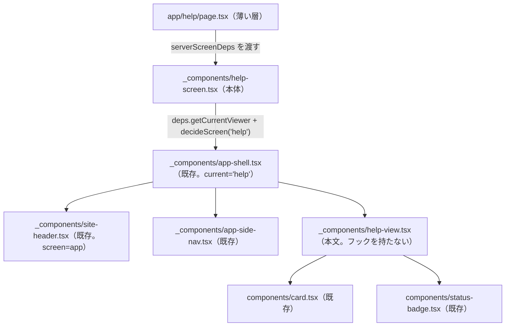

# 閲覧系の画面 実装設計 — 仕様

`apps/web` の閲覧系の画面（ヘルプ・契約一覧・稼働の推移）について、**どのファイルを置き、既存のどの部品・lib を使い、どの AC をどのテストファイルが担うか**を定める（Issue #111）。

**要求（受け入れ条件）はこの仕様へ書き写さない。** 正解は各 UI 仕様（`help-ui.md`・`contracts-ui.md`・`work-trends-ui.md`）と、それらが参照する条文（`login-ui.md`・`work-month-listing-ui.md`・`design-system.md` ほか）にあり、本仕様は AC 番号で参照するだけである（ADR 0004）。本仕様が決めるのは実装設計に限る。文言・節の構成・書かないことを本仕様に写さない。

- **決定者**: 3画面のページ設計と文言の置き場を、`web-screens-implementation-design.md` とは別の新しい実装設計の仕様（本仕様）にまとめることは、**2026-11-05 人間の明示選択（問2 = 新しい実装設計の仕様）**による。H 節の起案は AI 起案であり、末尾「人間の承認」に挙げた8項目と、それ以外の H 節の残りのすべてを、**2026-11-06 人間が承認（AskUserQuestion で明示選択）した**。H 節に人間の承認前の起案は残らない。契約一覧・稼働の推移の節（K 節・S 節）は、文言の置き場と、2026-11-06 人間が承認（AskUserQuestion で明示選択）した字面（末尾「人間の承認」の G-1〜G-6）だけを持つ。G-3 の形は AI の案ではなく人間が選んだものである
- **日付**: 2026-11-05（ヘルプの節＝H 節を起こした）。2026-11-06、H 節の起案へ人間の承認を反映した（末尾「人間の承認」の8項目と、それ以外の H 節の残りのすべて）。同日、契約一覧・稼働の推移の文言の節（K 節・S 節）を足し、文言 G-1〜G-6 の人間の決定を反映した
- **前提の仕様**: `web-screens-implementation-design.md`（C-1 置き場所の規則・C-2 ルート表・C-3 利用者の区分の解決・C-4 開ける画面の判定・W-1 の構成・W-6 サイドバー・T-0 差し替えの方針）。H 節はこれに加えて `help-ui.md`（AC-1〜AC-6）／`login-ui.md` AC-6-7〜6-9-b・AC-9／`work-month-listing-ui.md` AC-10-1〜10-6／`design-system.md` AC-5-1・5-3・AC-6 の 6-1・6-4・AC-8 の 8-1-j・8-5-a／`bff-wiring.md` AC-1。K 節は `contracts-ui.md` AC-6 の 6-3、S 節は `work-trends-ui.md` AC-1・AC-3〜AC-5・AC-8。両節の文言の置き方の先例は `web-screens-implementation-design.md` W-4・W-5

---

## スコープ

- **対象**: ヘルプ・契約一覧・稼働の推移のページ設計（置くファイル・使う部品と lib・テストの置き場）と、文言を実装のどこに置くか
- **本版で書いた節**: ヘルプ（H 節）と、契約一覧・稼働の推移の文言（K 節・S 節）である。**契約一覧・稼働の推移のページ設計（置くファイル・使う部品と lib・テストの置き場）は後続で足す**
- **非対象**:
  - 受け入れ条件そのもの（各 UI 仕様が持つ）
  - 画面間で共有する土台（ルート表・区分の解決・開ける画面の判定・置き場所の規則・サイドバー・ヘッダー）。`web-screens-implementation-design.md` の C 節・W-6・L 節が持ち、本仕様では変えない。本仕様はそれを使うだけである
  - BFF の Route Handler とドメイン API（`bff-wiring.md`・`domain-api-http-contract.md`）

---

## H. ヘルプ

本節で AC 番号だけを書いたものは `help-ui.md` の AC である。**本節の決定は AI 起案であり、そのすべてを 2026-11-06 人間が承認（AskUserQuestion で明示選択）した。** 末尾「人間の承認」に挙げた8項目には各所に出所を添えた。出所を添えていない決定も、同日の2度目の承認（末尾「人間の承認」の、8項目の一覧に続く段落）で承認済みである。ファイル名・関数名は、`web-screens-implementation-design.md` の C-1（置き場所の規則）・W-1（薄いページ＋本体の screen 関数＋`AppShell`）・T-0-2（`ScreenDeps` の注入）を当てはめて決まるものとして起案した。

### H-1. 構成

| ファイル | 種別 | 責務 | 主に担う AC | 出所 |
|---|---|---|---|---|
| `app/help/page.tsx` | サーバー（async。薄い層） | `helpScreen(serverScreenDeps)` を返すだけ。判定も描画の組み立ても持たない。`searchParams` を受けない（ヘルプは条件を受け取らない） | — | パス `/help` は `web-screens-implementation-design.md` C-2（2026-10-29 人間の明示選択 Q-7 = (a)）。ファイル名は C-1・T-0-2 の当てはめ。`helpScreen(serverScreenDeps)` を返すだけであること・`searchParams` を受けないことも含めて AI 起案（2026-11-06 人間が承認（AskUserQuestion で明示選択）） |
| `app/_components/help-screen.tsx` | サーバー（async 関数。依存を引数で受ける） | `helpScreen(deps: ScreenDeps)`。`deps.getCurrentViewer()` が `misconfigured` なら例外を投げる（C-3）。`decideScreen("help", viewer)` が `redirect` なら移す（C-4。`login-ui.md` 6-7 によりヘルプは全区分で `show` になるが、判定を省かない＝C-4 の「どのページも」）。`show` なら `deps.getTheme()` を待ち、`AppShell`（`current="help"`）の中に `HelpView` を描く。`screen-deps.ts`・`current-viewer.ts` を値として輸入しない（T-0-2） | 1-1・1-4・1-5 | 関数名・ファイル名は W-1 の `demoWorkMonthsScreen` の形の当てはめ（AI 起案。2026-11-06 人間が承認（AskUserQuestion で明示選択）） |
| `app/_components/help-view.tsx` | フックを持たない（`"use client"` を付けない。props を受けない） | `HelpView()`。見出し（`h1`）と、3つの節を `Card`（`title` に節の見出しを渡す。`Card` は `title` を `h2` で描く）で並べる。勤務月の流れの節では、状態の行の先頭に `StatusBadge` を置く。文言は AC-3 の表の字面をこのファイルの中に定数として持つ。取得・状態・操作要素を持たない | AC-2・AC-3・AC-4・AC-5 | ファイル名・関数名は W-1 の `*-view.tsx` の当てはめ。文言をこのファイルに置くこと・フックを持たない部品にすることは AI 起案。いずれも 2026-11-06 人間が承認（AskUserQuestion で明示選択） |
| `lib/screen-routes.ts`（既存） | 純粋 | `HELP_PATH` を使うだけで、値を変えない。付いているコメント「ページは本仕様では置かない」は、ページが入った時点で本仕様（H 節）を指すように改める | — | C-2。コメントを改めることは AI 起案（2026-11-06 人間が承認（AskUserQuestion で明示選択）） |

- **新しく作らないもの**: 共通コンポーネント（`src/components/` 直下の `*.tsx`）を足さない（AC-2-5・`design-system.md` 5-3「ヘルプの本文」）。`ScreenDeps` 以外の依存の注入口を足さない（`HelpView` は外部に依存しない）。`lib/` に新しい関数を足さない（判定も通信も持たないため）
- **使う既存の部品・lib**: `AppShell`・`SiteHeader`・`AppSideNav`（W-1。ヘッダーとサイドバー）、`Card`（`design-system.md` 6-4）、`StatusBadge`（同 6-1）、`decideScreen`（C-4）、`ScreenDeps`（T-0-2。`import type` に限る）
- **サイドバーとヘッダー**: ヘルプの導線（1-2）とヘッダーの構成（1-3）は `AppShell` が既存の `AppSideNav`・`SiteHeader` で描く。`current="help"` により、サイドバーの選択中はヘルプの項目だけになる（`work-month-listing-ui.md` 10-5。`side-nav-items.ts` の `SideNavCurrent` に `"help"` は既にある）。本節はサイドバー・ヘッダーの実装を変えない
- **ロール切替の後・URL を直に開いたとき（1-4・1-5）**: 切替のための別処理を持たない。L-4 の `router.refresh()` でサーバーの描画がやり直され、`helpScreen` の `decideScreen("help")` が全区分で `show` を返すため、ヘルプに留まる（C-4 の経路そのもの）

### H-2. 本文の組み立て（`help-view.tsx`）

本文の要求（見出し・節の数と順・`Card`・`StatusBadge`・文言・書かないこと）は AC-2〜AC-4 が持ち、ここには写さない。ここで決めるのは、それを満たす DOM の組み方だけである（AC-6-3 により画面固有の合成は画面 Issue が持つ）。

- 文言は AC-3 の表の各行（3-1-b〜3-1-g・3-2-b〜3-2-i・3-3-b〜3-3-e）を、**1行につき1つの要素**として、表の記載順に置く（AI 起案。2026-11-06 人間が承認（AskUserQuestion で明示選択））。節の見出しの行（3-1-a・3-2-a・3-3-a）は `Card` の `title` へ渡す。要素の種類（段落か一覧の項目か）と余白は実装工程が選ぶ（実装工程に委ねることは AI 起案。2026-11-06 人間が承認（AskUserQuestion で明示選択））
- 状態の行（2-4）は、出典が状態を名指す3行 —— 3-1-b（出典 `work-month-screen-ui.md` AC-3 の `Draft` の行）→ `Draft`、3-1-c（同 `PendingApproval` の行）→ `PendingApproval`、3-1-d（ユビキタス言語「承認済」）→ `Approved` —— である。各行を「`StatusBadge` ＋ 文言の要素」の組で包み、組の先頭に `StatusBadge` を置く。3-1-e〜3-1-g には置かない（行の対応の読み方と、組で包む形は AI 起案。2026-11-06 人間が承認（AskUserQuestion で明示選択））
- 文言の字面は `help-view.tsx` の中にだけ持ち、`lib/` や他の画面と共有しない（AI 起案。2026-11-06 人間が承認（AskUserQuestion で明示選択）。共有すると AC-2-5 の「画面固有の合成」の外へ出るため）
- 出典の条文が改まったときは、`help-ui.md` AC-3 の表を先に改め、`help-view.tsx` の字面とテストの期待値をそれに合わせる（AC-6-1 の運用）。本仕様は字面を持たないため改めない

### H-3. 取得しないこと（AC-5）

- `helpScreen`・`HelpView` は、BFF の経路を呼ぶ lib（`work-month-list-client.ts` 等）も `lambda-client` も輸入せず、`fetch` を呼ばない（5-2）。取得しないため `ErrorBanner` を置かない（5-3）
- **5-2 の「本文」の範囲**: 技術者がヘルプを開くと、サイドバー（`AppSideNav`）は自分の契約を取得する（W-1・W-6。`bff-wiring.md` R-10）。サイドバーは `help-ui.md` のスコープの非対象（`work-month-listing-ui.md` AC-10 が持つ）であり、本文の取得ではない。本節はこの取得を 5-2 の違反として扱わず、テストでも本文（`HelpView`）とサイドバーを分けて読む（H-4）。この読み方は `help-ui.md` のスコープ（非対象の1項目め）からの帰結として AI が書いた（2026-11-06 人間が承認（AskUserQuestion で明示選択））

### H-4. テストの置き場

T-0 の差し替えの方針（`web-screens-implementation-design.md` T-0-1・T-0-2）に従う。`vi.mock` するのは `next/navigation` だけで、`ScreenDeps` は手書きの Fake を渡す。ブラウザの `fetch` は手書きの Fake を `globalThis.fetch` に代入して数える。

**文言の期待値は、テストの中に `help-ui.md` AC-3 の字面を書き、`help-view.tsx` の定数を輸入しない**（輸入すると実装の字面と期待値が同じ写しになり、字面が仕様からずれても緑のままになる）。この1文は AI 起案であり、2026-11-06 人間が承認（AskUserQuestion で明示選択）した。

| テストファイル | 担う AC | 読むこと（手段の細部は tester が選ぶ） |
|---|---|---|
| `apps/web/src/app/_components/help-screen.test.tsx`（新規） | 1-1・1-2（`work-month-listing-ui.md` 10-5 の選択中）・1-3（`login-ui.md` 9-6）・1-4・1-5・5-2（画面全体）、C-3 の `misconfigured` | 技術者・承認者・ゲストのいずれでも `redirect` せず描画する（1-1・1-4・1-5）。3区分で `<main>` の中身が同じである（1-1「ロールによって本文を変えない」）。サイドバーで `aria-current` を持つ項目がヘルプだけである（1-2）。ゲストにはヘッダーのログインへのリンクが出て、技術者・承認者には出ない（1-3）。ゲスト・承認者では `fetch` が0回、技術者では契約の取得（R-10）だけで、それ以外の経路を呼ばない（5-2。H-3）。`misconfigured` で例外を投げ、`redirect` も描画もしない |
| `apps/web/src/app/_components/help-view.test.tsx`（新規） | AC-2（2-1〜2-4）・AC-3・AC-4・5-1・5-2（本文）・5-3 | `h1` が1つで文言が 2-1 のとおり。`h2` がちょうど3つで、文言と順が 3-1-a・3-2-a・3-3-a のとおり（2-2）。各 `h2` が `Card` の見出しとして描かれている（2-3）。`StatusBadge` がちょうど3つで、`下書き`・`締め済`・`承認済` の順に各1回、それぞれ 3-1-b・3-1-c・3-1-d の文言と同じ組の先頭にある（2-4）。AC-3 の各行の文言が、字面のとおり本文に出る（AC-3）。本文に `12:00` と `13:00` が無い（4-1）。3-1-d の行に `確定` が無い（4-2）。本文に `目安` が無い（4-3）。本文に稼働の推移で使う語（`確定した月`・`入力中`・`精算幅に収まった月`）・`契約期間`・`請求`・`精算金額` が無い（4-4）。ボタン・入力欄・選択欄・チェックボックス・ラジオ・フォームが無い（5-1）。描画しても `fetch` が0回（5-2）。`role="alert"` の要素が無い（5-3） |
| `apps/web/src/lib/screen-access.test.ts`（既存。変えない） | 1-1・1-4・1-5 の判定（`login-ui.md` 6-7・6-8-a・6-9） | `help` × 区分3種の組は既に表で持つ（`web-screens-implementation-design.md` T-1） |
| `apps/web/src/lib/lambda-client-boundary.test.ts`（既存。変えない） | 5-2 のうち `lambda-client` を輸入しないこと | 母集団を走査で得るため、`help-screen.tsx`・`help-view.tsx`・`app/help/page.tsx` は追加しただけで検査の対象に入る |
| `apps/web/src/components/component-inventory.test.ts`（既存。変えない） | 2-5 | `src/components/` 直下に新しいファイルを足さないことは、台帳との一致の検査がそのまま担う |

- 4-4 を「語が本文に現れないこと」で読むのは、4-4 の「説明しない」を検査できる形へ落とした AI の読み方である。この読み方と、上の表の `help-view.tsx` の行が読む語の集合（`確定した月`・`入力中`・`精算幅に収まった月`・`契約期間`・`請求`・`精算金額`）は、2026-11-06 人間が承認（AskUserQuestion で明示選択）した
- 4-2 は条文のとおり 3-1-d の行だけを読み、本文全体に `確定` を禁じない（4-2 は締めについて使うことを許す）
- 4-1 は条文が `12:00`・`13:00` を名指すため、その2つを読む。「出典の無い値」一般は機械で列挙できないため、AC-3 の字面との一致（AC-3 の行）とあわせて担保する

テストで担保しないもの（限界）:

- `app/help/page.tsx` は薄い層であり、テストしない（`web-screens-implementation-design.md` T-0-2）
- ヘルプの文言が出典の条文と食い違っていないこと（AC-6-1。運用で保つ）
- 節の配置・余白（AC-6-3。画面固有の合成）
- `router.refresh()` の後に Next がサーバーの描画をやり直すこと（Next の振る舞い。`web-screens-implementation-design.md` T-1 の限界と同じ）

---

## K. 契約一覧 — 文言

本節で AC 番号だけを書いたものは `contracts-ui.md` の AC である。**本節が持つのは、`contracts-ui.md` が字面を固定していない文言の置き場と、2026-11-06 人間が承認（AskUserQuestion で明示選択）した字面だけである。** ページのファイル構成・使う部品と lib・テストの置き場は本節に無く、後続で足す。

字面の置き場は、`web-screens-implementation-design.md` W-4・W-5（勤務月一覧の取得エラーの文などを実装設計の表に置き、UI 仕様に写さなかった先例）に倣い、本節の表とする。`contracts-ui.md` には写さない（ADR 0004。字面の正を1か所に置く）。逆に、`contracts-ui.md` が既に字面を持つもの（2-6 の表の見出し・2-7 の `h1`・3-4 の導線・6-1 の `title`）は同仕様が正であり、本節に写さない。

### K-1. 文言

| 要素 | 部品 | 文言 | 出所 | AC |
|---|---|---|---|---|
| 取得エラー | `ErrorBanner`（`onRetry` 付き） | 「契約を読み込めませんでした。通信状態を確認して、もう一度お試しください。」 | 2026-11-06 人間が承認（AskUserQuestion で明示選択。G-6）。W-4 の取得エラーの文と同じ形で、画面ごとに分ける | 6-3 |

- 本節の表に無い字面は承認されていない。ページの説明文（2-8 は書き写さないことだけを定める）は、置くかどうかも字面も決まっていない

## S. 稼働の推移 — 文言

本節で AC 番号だけを書いたものは `work-trends-ui.md` の AC である。**本節が持つのは、`work-trends-ui.md` が字面を固定していない文言の置き場と、2026-11-06 人間が承認（AskUserQuestion で明示選択）した字面だけである。** ページのファイル構成・使う部品と lib・テストの置き場は本節に無く、後続で足す。

字面の置き場は K 節と同じく本節の表とし、`work-trends-ui.md` には写さない（W-4・W-5 の先例。ADR 0004）。`work-trends-ui.md` が既に字面を持つもの（4-1-b の平均の見出し・5-9 の図の見出し・7-6 の `h1`・8-1 と 8-2 の `title`）は同仕様が正であり、本節に写さない。

### S-1. 文言

| 要素 | 部品 | 文言 | 出所 | AC |
|---|---|---|---|---|
| 絞り込みの領域 | — | 領域の名前「稼働の推移の絞り込み」 | 2026-11-06 人間が承認（AskUserQuestion で明示選択。G-1） | 1-3・3-2 |
| 契約の選択 | `SelectField`（1-3） | ラベル「契約」 | 同（G-1） | 1-3 |
| 期間の選択 | `SelectField` を2つ（3-2） | ラベル「期間（開始）」「期間（終了）」。2つを「期間」という名前のグループにまとめる。選択肢の表示は「2026年7月」の形（W-4 の「対象年月の表示」と同じ） | 同（G-1） | 3-2・3-3 |
| 平均 | `Card`（4-5） | 見出しは 4-1-b の字面（本節に写さない） | 同（G-2。4-1-b の字面と同じものを承認した） | 4-1-b・4-5 |
| 平均（確定した月が0件） | 同上 | 値の位置に「—」を残し、そのそばに「確定した月はありません」を添える | **2026-11-06 人間が選んだ形**（AskUserQuestion で明示選択。G-3）。AI の案（「確定した月はありません」だけを示し、「—」を置かない）は採られなかった。「—」はハンドオフ `Trends.dc.html` 183 行の平均の値に由来する | 4-2・8-3 |
| 精算幅に収まった月 | `Card`（4-5） | 見出し「精算幅に収まった月」。値は「9 / 11 か月」の形（4-3 の、収まった月の数と確定した月の数）。確定した月が0件のときは「0 / 0 か月」 | 同（G-2。0件のときは G-3） | 4-3・4-5・8-3 |
| 精算幅 | `Card`（4-5） | 見出し「精算幅」。期間の月の精算幅がすべて同じときの値は「140時間00分〜180時間00分」の形（下限〜上限）。月によって異なるときの値は「月によって異なります」 | 同（見出しと 4-4-a の値は G-2、4-4-b の値は G-4） | 4-4-a・4-4-b・4-5 |
| 図の凡例 | — | 「稼働時間」「超過した分」「不足している分」「入力中（下書き）」「精算幅」 | 同（G-5） | 5-2・5-4・5-5 |
| 札 | — | 「超過 {量}」「不足 {量}」（{量} は 5-3 の量） | 同（G-5） | 5-3 |
| 図のアクセシブル名 | — | 「月ごとの総稼働時間」 | 同（G-5） | 5-6 |
| 図と同じ内容の表 | 表 | 図に添える。列は「対象年月」「総稼働時間」「区分」「精算幅」。区分は「入力中」「超過 {量}」「不足 {量}」「精算幅に収まった」 | 同（G-5） | 5-6 |
| 縦軸の注記 | — | 「縦軸は {N}時間から始まります。」（縦軸を 0 以外から始めるとき。{N} は縦軸の始まりの値） | 同（G-5） | 5-7 |
| 取得エラー | `ErrorBanner`（`onRetry` 付き） | 「稼働の推移を読み込めませんでした。通信状態を確認して、もう一度お試しください。」 | 同（G-6）。W-4 の取得エラーの文と同じ形で、画面ごとに分ける | 8-4 |

- 本節の表に無い字面は承認されていない。ページの説明文は、置くかどうかも字面も決まっていない
- **決まっていないこと**（人間の決定待ち。推測で埋めない）:
  - 確定した月が0件のとき、「—」に単位 `時間`（4-1-c）を添えるか
  - {N} の表記（整数の時間か、4-6 の時・分の表記か）
  - 総稼働時間と {量} の具体の形。4-6 は「勤務月画面と同じ時・分の表記」で「小数の時間で示さない」とするが、勤務月画面の実装（`web-screens-implementation-design.md` M-5 の `formatHours`）は小数の時間（例 `9.5`）で示しており、4-6 の2つの句は両立しない。本節で形が決まっているのは、G-2 で承認された 4-4-a の値の形（「140時間00分〜180時間00分」）だけである。`contracts-ui.md` 2-2-a にも同じ食い違いがある

---

## 人間の承認

2026-11-06、人間が H 節の次の起案を承認し（AskUserQuestion で明示選択）、各節へ反映した。いずれも本仕様の末尾に「起案のまま残るもの（人間の承認前）」として挙げていたものであり、書かれていた内容のまま承認された:

1. ファイル名・関数名 —— `app/help/page.tsx`・`app/_components/help-screen.tsx` の `helpScreen(deps: ScreenDeps)`・`app/_components/help-view.tsx` の `HelpView()`（C-1・W-1・T-0-2 の当てはめ） → H-1（`page.tsx`・`help-screen.tsx`・`help-view.tsx` の行）
2. `HelpView` をフックを持たない部品（`"use client"` なし・props なし）にすること → H-1（`help-view.tsx` の行）
3. 文言の字面を `help-view.tsx` の中にだけ持ち、共有しないこと → H-1（`help-view.tsx` の行）・H-2 第3項
4. 1行につき1要素で置き、状態の行を「`StatusBadge` ＋ 文言」の組で包むこと。2-4 の「状態の行」を 3-1-b・3-1-c・3-1-d と読むこと → H-2 第1項・第2項
5. 5-2 の「本文」にサイドバーの契約の取得を含めない読み方（H-3） → H-3 第2項
6. テストの期待値に `help-ui.md` の字面を書き、実装の定数を輸入しないこと → H-4 前文
7. 4-4 を語の不在で読むこと、および読む語の集合 → H-4 の表の後の第1項
8. `screen-routes.ts` の `HELP_PATH` のコメントを本仕様を指すように改めること → H-1（`screen-routes.ts` の行）

同じ 2026-11-06、人間が H 節の残りの起案を、書かれている内容のまま、まとめて承認した（AskUserQuestion で明示選択）。上の8項目に含まれず出所を書いていなかったものであり、次を含む:

- H-2 第1項のうち、要素の種類（段落か一覧の項目か）と余白を実装工程が選ぶこと → H-2 第1項
- H-1 の `app/help/page.tsx` の行のうち、ファイル名を除く形（`helpScreen(serverScreenDeps)` を返すだけであること・`searchParams` を受けないこと） → H-1（`page.tsx` の行）
- 出所を書いていなかった H 節の残りのすべて（H-1「新しく作らないもの」「使う既存の部品・lib」「サイドバーとヘッダー」「ロール切替の後・URL を直に開いたとき」、H-2 第4項、H-3 第1項、H-4 の前文の第1文とテストの表の置き場、表の後の第2項・第3項（4-2・4-1 の読み方）、テストで担保しないもの） → H 節の前文

### 契約一覧・稼働の推移の文言（G-1〜G-6）

G-1〜G-6 は、2画面の文言を決めるために仕様工程が人間へ示した論点の番号（本仕様の番号）である。2026-11-06、人間が AskUserQuestion で明示選択し、K 節・S 節へ反映した。

- **G-1**（稼働の推移 1-3・3-2）: 承認 → S-1（絞り込みの領域・契約の選択・期間の選択）
- **G-2**（同 4-3〜4-5）: 承認 → S-1（平均・精算幅に収まった月・精算幅）
- **G-3**（同 4-2・8-3）: AI の案（「確定した月はありません」だけを示す）は採られず、人間が「ハンドオフの『—』を残し、『確定した月はありません』をそばに添える」形を選んだ。8-3 の精算幅に収まった月は「0 / 0 か月」 → S-1（平均（確定した月が0件）・精算幅に収まった月）
- **G-4**（同 4-4-b）: 承認 → S-1（精算幅）
- **G-5**（同 5-4・5-6・5-7）: 承認 → S-1（図の凡例・札・図のアクセシブル名・図と同じ内容の表・縦軸の注記）
- **G-6**（契約一覧 6-3・稼働の推移 8-4）: 承認 → K-1・S-1（取得エラー）

### 起案のまま残るもの

H 節には無い。K 節・S 節は承認された字面だけを持ち、起案を持たない。S 節の「決まっていないこと」は起案ではなく、人間の決定待ちである。
