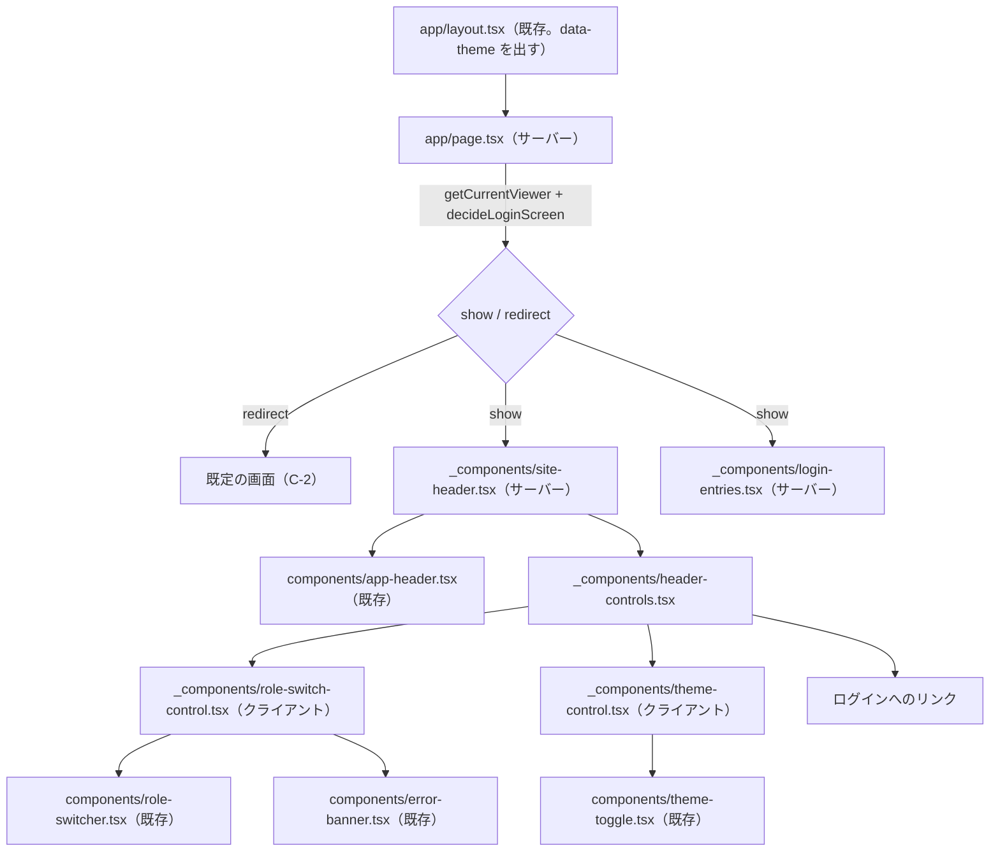
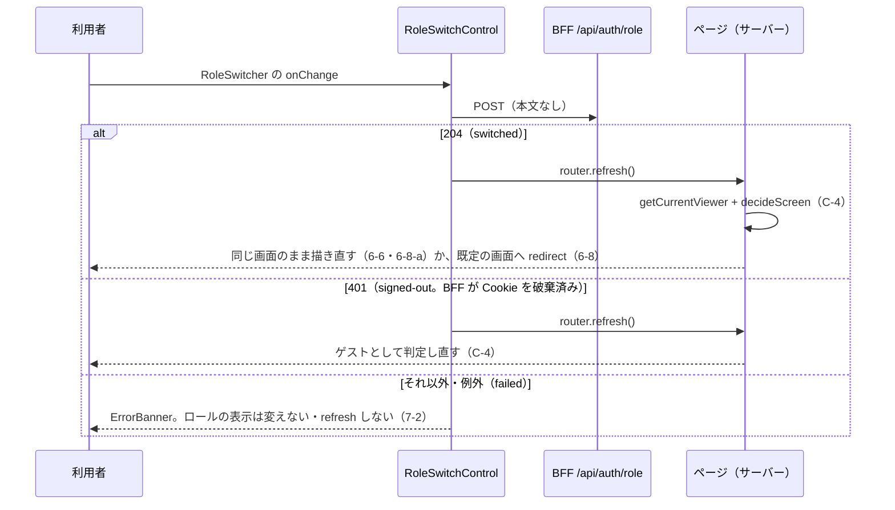

# Web 画面 実装設計 — 仕様

`apps/web` の画面について、**どのルートにどのページを置き、既存のどの部品・lib を使い、どの状態をサーバーとクライアントのどちらが持ち、どの AC をどのテストファイルが担うか**を定める（Issue #55 の完了条件「コンポーネント構成・状態管理の実装設計を `docs/specs/` に残す」）。

**要求（受け入れ条件）はこの仕様へ書き写さない。** 正解は各 UI 仕様（`login-ui.md` ほか）と `design-system.md`・`bff-auth-termination.md` にあり、本仕様は AC 番号で参照するだけである（ADR 0004）。本仕様が決めるのは実装設計に限る。

- **決定者**: 実装設計の各決定は仕様工程（AI 起案。**人間の承認前**）。ただし文言・ログインの入口の行き先・ログイン失敗の担い手・区分の解決が失敗したときの扱い（本仕様の Q-1〜Q-4）は、**2026-10-29 に人間が明示選択で決めた**。決定は該当の節の本文に、出所「2026-10-29 人間の明示選択（Q-n = …）」を添えて置く。ここでいう Q-n は**本仕様の論点の番号**であり、P-1 が引く `cognito-auth-infra.md` の Q-1 とは別物である
- **日付**: 2026-10-29（画面1 の節を起こし、同日に Q-1〜Q-4 の決定を反映した。画面2・3 の節は後で追記する）
- **前提の仕様**: `login-ui.md`／`design-system.md`（AC-5・AC-6・AC-8・AC-12）／`bff-auth-termination.md`（AC-5-5・AC-5-11・AC-11-2）／`work-month-listing-ui.md` AC-10（サイドバーの項目。画面2 の節で扱う）

---

## スコープ

- **対象**: 画面1（ログイン画面・デモ用ロール切替・ヘッダー）と、画面1 が最初に要する**画面間で共有する土台**（C 節: ルート表のうち既定の画面、利用者の区分の解決、開ける画面の判定、置き場所の規則）
- **非対象**:
  - 受け入れ条件そのもの（各 UI 仕様が持つ）
  - BFF の Route Handler（`/api/auth/*`・業務の経路）。既存のものを使うだけで、本仕様では変えない（`bff-auth-termination.md`・`bff-wiring.md`）
  - 画面2・3（各一覧・勤務月画面・サイドバー）。後で節を足す
  - ヘルプ・契約一覧・稼働の推移の画面。C-3 の判定で画面の識別子として名前が出るだけで、ページの設計は持たない
  - ユーザー・ロール管理画面（非スコープ。`docs/rules/scope.md`・`login-ui.md` AC-8-1）
  - サインアウト（要求する仕様が無い。`bff-auth-termination.md` の非対象表）

---

## 前提（P）— 既存の決定と実装（参照のみ）

| # | 前提 | 出典 |
|---|---|---|
| P-1 | 自前のログイン画面は3つの入口の提示に留まり、メール+パスワード・MFA(TOTP)・Google の画面は Cognito のホストされたサインイン画面が持つ（Q-1 = (a)） | `cognito-auth-infra.md` Q-1・11-11 |
| P-2 | サインインの開始は `GET /api/auth/sign-in`、戻りは `GET /api/auth/callback`。戻りが成功すると `/` へ 302 で戻す（`auth-handlers.ts` の `SIGN_IN_LANDING_PATH`） | `bff-auth-termination.md` AC-11-2 (i)(ii) |
| P-3 | ロール切替は `POST /api/auth/role`。要求からロールを読まず、検証した現在のロールを反転させる。成功は 204、未認証は 401（Cookie を破棄）、構成欠落は 5xx、レート制限は 429 | 同 AC-5-5・AC-5-11・AC-11-2 (iii)・AC-11-12 |
| P-4 | テーマは `et_theme` Cookie（`theme-cookie.ts`）。`layout.tsx` が最初の描画から `<html data-theme>` を出す | `design-system.md` AC-12-3・12-6 |
| P-5 | 部品 `AppHeader`・`RoleSwitcher`・`ThemeToggle`・`ErrorBanner` は既存。いずれも保存・通信・ロールの判定をしない | `design-system.md` 6-3・6-7・6-11・6-14 |
| P-6 | `apps/web/src/components/` 直下の `*.tsx` は台帳（`design-system.md` AC-5-1）と過不足なく一致しなければならない。画面固有の合成は台帳に載らない | `design-system.md` AC-5-1〜5-3・`component-inventory.test.ts` |
| P-7 | URL・ルートは UI 仕様で固定されていない | `design-system.md` 8-4・`login-ui.md` 8-6 |
| P-8 | 新しい npm 依存を入れない（状態管理ライブラリを含む） | Issue #55 の前提 |

**デザインのハンドオフとの関係** —— `design/handoff/2026-10-theme-b/` のログイン画面は、自前のメール+パスワードのフォーム・2段階認証の状態・失敗の状態を描いている。これは P-1（Q-1 = (a)）と両立しないため、本設計はフォームを作らず、入口を Cognito のホストされた画面への導線として置く（L-2）。ハンドオフから採るのは入口の文言だけである（L-2。2026-10-29 人間の明示選択（Q-1 = (a)、ただし「・新規登録」を付けない））。2段階認証の状態・失敗の状態はログイン画面に描かない（L-2。2026-10-29 人間の明示選択（Q-3 = (a)））。

---

## C. 画面間で共有する土台

### C-1. 置き場所の規則

| 対象 | 置き場所 | 理由 |
|---|---|---|
| ページ | `apps/web/src/app/` 配下の `page.tsx`（ルートは C-2） | App Router |
| 画面固有の合成（ヘッダーの右側の組み立て・ログインの入口など） | `apps/web/src/app/_components/`（`_` 始まりはルートにならない） | P-6。`src/components/` に置くと台帳と食い違う |
| 純粋な判定・通信の関数 | `apps/web/src/lib/` | 既存の `auth-handlers.ts` 等と同じ。テストから直接呼べる |
| サーバー専用の取得（`next/headers` を読むもの） | `apps/web/src/app/_lib/` | `src/lib/` を Next の実行時に依存させない |

- クライアント部品（`"use client"`）は、`role-cookie.ts`・`viewer.ts`・`auth-config.ts` を**値として**輸入しない（`node:crypto` と署名鍵の読み取りをブラウザへ持ち込まない）。型 `Role` は `import type` に限る（`role-switcher.tsx` と同じ形）
- ページ・`_components` は `lambda-client` を輸入しない（`lambda-client-boundary.test.ts` が検査済み。`login-ui.md` AC-5-1）

### C-2. ルート表（画面1 が定める分）

| 画面 | パス | 置くファイル | 定めた節 |
|---|---|---|---|
| ログイン画面 | `/` | `app/page.tsx` | L-1 |
| 本人の勤務月一覧（技術者の既定の画面。`login-ui.md` 6-7-a） | `/work-months` | 画面2 の節で置く | C-3 の遷移先として本節で決める |
| 承認待ち一覧（承認者の既定の画面） | `/pending-approvals` | 同上 | 同上 |
| デモ勤務月群（ゲストの既定の画面） | `/demo` | 同上 | 同上 |

- **`/work-months`・`/pending-approvals`・`/demo` のパスの文字列は AI の起案であり、人間の承認前である。** 2026-10-29 の明示選択（Q-1〜Q-4）はこれらのパスを決めていない。**レビューで人間が確かめる対象として残す**（パスは UI 仕様で固定されていない＝P-7。変えるときは `screen-routes.ts` の定数と本表を改める）。ログイン画面を `/` に置くことは、P-2 の戻り先からの帰結である（次項）
- **ログイン画面を `/` に置く理由**: サインインの戻りは `/` へ着く（P-2）。`/` をログイン画面にすると、ログイン済みの利用者は 6-10 によりそのロールの既定の画面へ移り、`design-system.md` 8-1-b（ログイン後に本人の勤務月一覧）が `auth-handlers.ts` を変えずに成り立つ。ゲストが `/` を開いたときはログイン画面が出る（6-10-a）
- 勤務月画面・ヘルプ・契約一覧・稼働の推移のパスは、それぞれの画面の節が決める（本節では決めない）
- パスの文字列は `apps/web/src/lib/screen-routes.ts` に定数として1か所で持ち、ページ・判定・リンクはそれを参照する
- 画面2 が入るまで `/work-months`・`/pending-approvals`・`/demo` はページを持たない（遷移先が 404 になる期間がある）。同じブランチで画面2 が入ることを前提とする

### C-3. 利用者の区分の解決（`apps/web/src/lib/viewer.ts`）

```ts
export type Viewer = { kind: "guest" } | { kind: "signed-in"; role: Role };
export type ResolveViewerResult = Viewer | { kind: "misconfigured" };

export function resolveViewer(params: {
  cookieHeader: string | null;
  now: Date;
  environment?: Environment;
  publicKeyResolver?: PublicKeyResolver;
}): Promise<ResolveViewerResult>;
```

- 判定の順は `work-month-handlers.ts` の `handle()` の順2〜順4 と同じにする —— (1) 認証の構成が欠けていれば `misconfigured`、(2) `resolveVerifiedSession` が成立しなければ `guest`、(3) 成立したのに署名鍵が欠けていれば `misconfigured`、(4) 成立すれば `resolveEffectiveRole` で決めたロールの `signed-in`（`login-ui.md` AC-5-2・`bff-auth-termination.md` AC-5-11）
- ゲストにロールを与えない（`bff-auth-termination.md` 5-11 (v)・`login-ui.md` 6-5）
- **セッション Cookie の検証に失敗したとき**: ページは**ゲストとして描く**（上の順 (2)）。`resolveViewer` もページも Cookie を書き換えない（ページの描画からは Cookie を書けない）。失敗した Cookie の破棄（`bff-auth-termination.md` 5-8 (v)）は、**次に Route Handler を通る要求に任せる**。要求ごとに検証して破棄する `proxy.ts` は**足さない**。出所: 2026-10-29 人間の明示選択（Q-4 (i) = (a)）
- **認証の構成・署名鍵が欠けているとき（`misconfigured`）**: ページは**エラーページにする**。ゲストや既定の画面へ**黙って落とさない**（`bff-auth-termination.md` 7-5 と同じ思想）。実装はページが `misconfigured` を受けたら例外を投げ、Next のエラーの描画に任せる（`decideScreen`・`decideLoginScreen` は `Viewer` だけを受け、`misconfigured` を受けない）。エラーページの文言は本仕様で定めない（決定に無いため。Next の既定の描画のまま）。出所: 2026-10-29 人間の明示選択（Q-4 (ii) = (a)）
- ページからは `app/_lib/current-viewer.ts` の `getCurrentViewer()` を呼ぶ。これは `headers()` の `cookie` と現在時刻で `resolveViewer` を呼ぶだけの薄い層で、React の `cache` で1要求1回にまとめる（ヘッダーとページが別々に解決しない）

### C-4. 開ける画面の判定（`apps/web/src/lib/screen-access.ts`）

```ts
export type ScreenId =
  | "own-work-months" | "pending-approvals" | "demo-work-months"
  | "work-month" | "help" | "contracts" | "work-trends";
export type ScreenDecision = { kind: "show" } | { kind: "redirect"; to: string };

export function defaultScreenPath(viewer: Viewer): string;               // 6-7-a
export function decideScreen(screen: ScreenId, viewer: Viewer): ScreenDecision; // 6-7・6-8・6-8-a・6-9・6-9-a
export function decideLoginScreen(viewer: Viewer): ScreenDecision;        // 6-10・6-10-a
```

- `ScreenId` は 6-7 が列挙する画面の識別子である（ログイン画面は 6-7 の外なので含めない）。`help`・`contracts`・`work-trends` は判定の表に現れるだけで、本仕様はそれらのページを設計しない
- 関数は純粋で、Cookie・状態・稼働実績に触れない（6-9-b）
- **どのページも、描画の最初に `getCurrentViewer()` と `decideScreen`（ログイン画面は `decideLoginScreen`）を呼び、`redirect` なら `next/navigation` の `redirect()` で移す**。ロールを切り替えたときは L-4 が `router.refresh()` でサーバーの描画をやり直すため、同じ判定が働いて 6-8・6-8-a が成り立つ。URL を直接開いたとき（6-9）も同じ経路である。切替のためだけの別の遷移処理をクライアントに持たない
- 移した後の履歴の扱いは固定しない（`login-ui.md` 8-6）。`redirect()` の既定に従う
- 判定は画面の出し分けであり認可ではない（`login-ui.md` 8-7）。データの取得の可否は BFF とドメイン API が持つ

---

## L. 画面1 — ログイン画面・デモ用ロール切替・ヘッダー

### L-1. 構成



| ファイル | 種別 | 責務 | 主に担う AC |
|---|---|---|---|
| `app/page.tsx` | サーバー（async） | ログイン画面。`getCurrentViewer()` が `misconfigured` なら例外を投げる（C-3。Q-4 (ii) = (a)）。それ以外は `decideLoginScreen` が `redirect` なら移し、`show` なら `SiteHeader`（`screen="login"`）と `LoginEntries` を描く。現在の足場（Issue #9 の仮の本文）を置き換える | 6-10・6-10-a・9-1 |
| `app/_components/login-entries.tsx` | サーバー | 3つの入口を出す（L-2） | 1-1・1-2・2-1・2-3・3-1・3-2・4-1・4-3 |
| `app/_components/site-header.tsx` | サーバー（同期。値は props で受ける） | `AppHeader` の `right` に `HeaderControls` を差し込む。props は `viewer: Viewer`・`theme: Theme`・`screen: "login" \| "app"` | 9-1 |
| `app/_components/header-controls.tsx` | サーバー | 右側に何を・どの順に出すかを決めて並べる（L-3） | 6-1・6-5・9-2・9-3・9-4・9-6・9-7 |
| `app/_components/role-switch-control.tsx` | クライアント | ロール切替の通信と画面の更新（L-4） | 6-1・6-2・6-6・6-9-b・7-2・9-5 |
| `app/_components/theme-control.tsx` | クライアント | テーマの保存と `<html>` の属性の付け替え（L-5） | 9-3・9-4・9-5・`design-system.md` 12-3 |
| `lib/role-switch-client.ts` | 純粋（ブラウザで動く） | `POST /api/auth/role` を送り、結果を3つに分ける（L-4） | 6-9-b・7-2 |
| `lib/viewer.ts`・`lib/screen-access.ts`・`lib/screen-routes.ts` | 純粋 | C-3・C-4・C-2 | 5-2・6-5・6-7〜6-10-a |
| `app/_lib/current-viewer.ts` | サーバー専用 | C-3 の薄い層 | — |

`SiteHeader` を async にせず値を props で受けるのは、テストで描画できるようにするためである（async のサーバー部品は Testing Library で直接描けない）。値を取るのはページの側（`getCurrentViewer()` と `cookies()` → `resolveTheme`）。画面2 以降のページ（`screen="app"`）も同じ部品を使う。

### L-2. ログインの入口（`login-entries.tsx`）

| 入口 | 要素 | 文言（アクセシブル名） | 行き先 | 備考 |
|---|---|---|---|---|
| (a) ゲストとして続行 | `next/link` のリンク | 「ゲストとして続行（閲覧のみ）」。リンクに添えて注記「入力・締め・承認はできません。」を出す | `/demo`（C-2） | Route Handler を経由しない・要求を送らない（`bff-auth-termination.md` 11-4・`login-ui.md` 4-1） |
| (b) メール+パスワード | `<a>`（全体の遷移。`next/link` を使わない＝外部へ 302 する経路のため） | 「メールアドレスでログイン」 | `/api/auth/sign-in` | 新規登録はホストされた画面の側が持つ（P-1・2-1）。文言に「・新規登録」を**付けない** |
| (c) Google 連携 | `<a>`（(b) と同じ理由） | 「Google でログイン」 | `/api/auth/sign-in`（(b) と同じ） | ホストされた画面が Google の選択肢を出す。利用者は Google まで2回押す |

- **文言**の出所: 2026-10-29 人間の明示選択（Q-1 = (a) ハンドオフどおり。ただし (b) に「・新規登録」を付けない）。テストはこの文言でアクセシブル名を引く
- **(c) の行き先**の出所: 2026-10-29 人間の明示選択（Q-2 = (a) Google の入口も `/api/auth/sign-in` を通す）。**BFF の仕様と実装は変えない**（`bff-auth-termination.md` AC-11-2 (i)・`cognito-oidc.ts` に `identity_provider` を足さない）。Google まで2回押すことは受け入れた
- **帰結 —— (b) と (c) は行き先で区別できない。** 両者は同じ `href` を持つため、テストは入口を**アクセシブル名で区別する**（「メールアドレスでログイン」と「Google でログイン」がそれぞれちょうど1つあること）。`href` だけを数える・比べる形では、(c) が欠けても (b) が2つあっても見分けられない
- フォーム・`<input type="password">`・資格情報を受ける欄を置かない（P-1・2-3）。クライアント部品を持たない
- **ログイン失敗の表示（7-1）**: 資格情報・MFA の誤りの提示と再試行は、**Cognito のホストされた画面に任せる**。サインインの戻り（`/api/auth/callback`）で失敗したとき（取消・`state` の不一致等）は、BFF が返す今の 401 の素の応答（`bff-auth-termination.md` 3-4 (i)）のままとする。**ログイン画面は失敗を出さない**（`ErrorBanner` も再試行の導線も持たない）。これは T 節の限界に記録する。`bff-auth-termination.md` は変えない。出所: 2026-10-29 人間の明示選択（Q-3 = (a)）
- 通信・サーバーエラー（7-2）のうち、この画面が自分で通信するものは無い（入口はいずれも遷移である）

### L-3. ヘッダーの右側（`header-controls.tsx`）

出すものと並びを、純粋な関数 `headerSlots(viewer, screen)` で決め、その順に描く（並びは 9-7）。

| `viewer` | `screen` | 出すもの（この順） | 根拠 |
|---|---|---|---|
| ゲスト | `login` | テーマ切替 | 9-2・9-3・9-6 |
| ゲスト | `app` | テーマ切替 → ログインへのリンク | 9-3・9-6・9-7 |
| 技術者・承認者 | `login` | テーマ切替 | 9-2・9-6（実際には 6-10 で移るため描かれない） |
| 技術者・承認者 | `app` | ロール切替 → テーマ切替 | 6-1・9-2・9-3・9-7 |

- ログインへのリンクの行き先は `/`（C-2）。文言は「ログイン」（出所: 2026-10-29 人間の明示選択（Q-1 = (a)））
- `headerSlots` は `header-controls.tsx` から輸出し、表をそのままテストの入出力にする

### L-4. ロール切替（`role-switch-control.tsx`・`role-switch-client.ts`）

| 状態 | 持ち主 | 内容 |
|---|---|---|
| 現在のロール | **サーバー**（署名済み Cookie。`resolveViewer` が読む） | props `role` で受け、`RoleSwitcher` の `role` にそのまま渡す。**クライアントでロールを持たない・先回りして書き換えない** |
| 通信中 | クライアント（`useState`） | 通信中は次の `onChange` を無視する。切替は反転なので（P-3）、二重に送ると元へ戻るため |
| 失敗 | クライアント（`useState`） | 失敗したときだけ `ErrorBanner` を出す。理由文は「ロールを切り替えられませんでした。」（出所: 2026-10-29 人間の明示選択（Q-1 = (a)）） |

`requestRoleSwitch(fetchImpl = fetch): Promise<"switched" | "signed-out" | "failed">` は `POST /api/auth/role` を本文なしで送る（ロールを申告しない。`bff-auth-termination.md` 5-5 (ii) と食い違う要求を作らない）。応答の対応は 204 → `switched`、401 → `signed-out`、それ以外の応答・例外 → `failed`。



- `router.refresh()` 以外の遷移（`push`・`replace`）をクライアントから呼ばない（移すかどうかはサーバーの判定だけが決める。C-4）
- テーマの Cookie に触れない（9-5）

### L-5. テーマ切替（`theme-control.tsx`）

| 状態 | 持ち主 | 内容 |
|---|---|---|
| 保存されたテーマ | **サーバーが読む Cookie**（`et_theme`） | ページが `cookies()` → `resolveTheme` で読み、props `initialTheme` で渡す（`layout.tsx` と同じ値になる） |
| 表示中のテーマ | クライアント（`useState`。初期値 `initialTheme`） | `ThemeToggle` の `onChange` で更新する |

`onChange(theme)` で、(1) `document.cookie` に `serializeThemeCookie(theme)` を書き、(2) `document.documentElement` の `data-theme` を `theme` に付け替え、(3) 表示中のテーマを更新する。再読み込みしない・サーバーへ要求を送らない（`design-system.md` 12-3。部品の `ThemeToggle` は副作用を持たないまま＝6-14-v）。ゲストにも同じ部品を出す（9-4）。

---

## T. テストの置き場（画面1）

| テストファイル | 担う AC | 備考 |
|---|---|---|
| `apps/web/src/lib/screen-access.test.ts` | `login-ui.md` 6-7・6-7-a・6-8・6-8-a・6-9・6-9-a・6-9-b・6-10・6-10-a | `ScreenId` 7種 × 区分3種の全組と、ログイン画面 × 区分3種を表で持つ |
| `apps/web/src/lib/viewer.test.ts` | 5-2・6-5、`bff-auth-termination.md` 5-11 (i)(ii)(v) | Cookie なし／検証失敗（→ `guest`。Q-4 (i) = (a)）／ロール Cookie なし・改竄・正当（`Approver`）／構成欠落・鍵欠落（→ `misconfigured`。`guest` にならない。Q-4 (ii) = (a)）。公開鍵の解決は既存のテストと同じく差し替える |
| `apps/web/src/lib/role-switch-client.test.ts` | 6-9-b・7-2 | 送る要求（メソッド・パス・本文なし）と、204・401・429・500・例外の分類 |
| `apps/web/src/app/_components/header-controls.test.tsx` | 6-1・6-5・9-2・9-3・9-4・9-6・9-7 | L-3 の表を `headerSlots` の入出力にし、描画した DOM の並びも読む。ログインへのリンクはアクセシブル名「ログイン」・行き先 `/` で引く |
| `apps/web/src/app/_components/site-header.test.tsx` | 9-1 | ログイン画面・`app` の両方で `<header>` が出る |
| `apps/web/src/app/_components/role-switch-control.test.tsx` | 6-1・6-2・6-6・7-2・9-5 | 204 で `refresh` がちょうど1回・`push`/`replace` は0回、失敗で `role="alert"` が「ロールを切り替えられませんでした。」を持って出て `refresh` 0回、通信中の再入を無視、`et_theme` を変えない。`next/navigation` は差し替える |
| `apps/web/src/app/_components/theme-control.test.tsx` | 9-4、`design-system.md` 12-3 | 選択後に `data-theme` と保存の文字列が変わる。jsdom は既定の http の URL で `Secure` 付き Cookie を保存しないことがあるため、`document.cookie` を読むなら https の URL で動かすか、書き込みを差し替えて観測する（手段は tester が選ぶ） |
| `apps/web/src/app/_components/login-entries.test.tsx` | 1-1・1-2・2-3・3-1・4-1・4-3 | 入口がちょうど3つ、SMS を出さない、パスワード欄・フォームが無い、各入口の行き先、注記「入力・締め・承認はできません。」が出る。**入口はアクセシブル名で引いて区別する**（L-2。(b)(c) は同じ `href` のため行き先では区別できない）—— 「ゲストとして続行（閲覧のみ）」→ `/demo`、「メールアドレスでログイン」→ `/api/auth/sign-in`、「Google でログイン」→ `/api/auth/sign-in` がそれぞれちょうど1つ |
| `apps/web/src/app/page.test.tsx` | 6-10・6-10-a・9-1 | `getCurrentViewer` と `next/navigation` の `redirect` を差し替え、技術者・承認者で既定の画面へ `redirect`、ゲスト（検証に失敗したセッションを含む＝`resolveViewer` が `guest` を返した場合）で描画されること、`misconfigured` で例外を投げ `redirect` も描画もしないこと（C-3。Q-4 (ii) = (a)）を読む |
| `apps/web/src/lib/session-cookie.test.ts`（既存へ追加、無ければ新規） | 9-5 | `expiredAuthCookies()` に `et_theme` が含まれない |

テストで担保しないもの（限界）: ホストされたサインイン画面の中身（2-1 の新規登録・2-2 の TOTP・3-2 のシークレット。`cognito-auth-infra.md` 11-11）、実ブラウザでの Cookie の保存と送信（`design-system.md` 11-43）、`router.refresh()` の後に Next がサーバーの `redirect()` を実際の遷移にすること（Next の振る舞い）。6-2・6-4・6-6 のうち操作要素の出し分けは画面2・3 の節が担う。

選んだ方式から生じる限界（2026-10-29 人間の明示選択に由来する。決定の時点で受け入れた帰結であり、テストで埋める対象ではない）:

- **ログイン画面はログインの失敗を出さない（7-1 の一部）。** 資格情報・MFA の誤りの提示と再試行はホストされた画面が持ち、本リポジトリのテストは見ない。サインインの戻りで失敗したとき（取消・`state` の不一致等）は BFF の 401 の素の応答が出るだけで、ログイン画面の `ErrorBanner` も再試行の導線も出ない。出所: 2026-10-29 人間の明示選択（Q-3 = (a)）
- **Google の入口は Google へ直接は届かない（3-1 の経路）。** (c) は (b) と同じ `/api/auth/sign-in` へ遷移し、Google の選択肢はホストされた画面が出す。`login-entries.test.tsx` が確かめるのは (c) が文言で区別されて存在し `/api/auth/sign-in` を指すことまでで、その先で Google が選べることは見ない。出所: 2026-10-29 人間の明示選択（Q-2 = (a)）
- **検証に失敗したセッション Cookie は、ページを開いただけでは消えない。** ページはゲストとして描くが Cookie を書けず、破棄は次に Route Handler を通る要求まで遅れる。出所: 2026-10-29 人間の明示選択（Q-4 (i) = (a)）

---

## 人間の決定を待っている論点

**残る未決は無い。** Q-1〜Q-4 は 2026-10-29 に人間が明示選択で決め、各節へ反映した（Q-1 → L-2・L-3・L-4、Q-2 → L-2・T 節、Q-3 → L-2・T 節の限界、Q-4 → C-3・L-1・T 節）。

ただし **C-2 の `/work-months`・`/pending-approvals`・`/demo` のパスは AI の起案のまま人間の承認前であり、レビューで人間が確かめる対象として残る**（C-2）。
