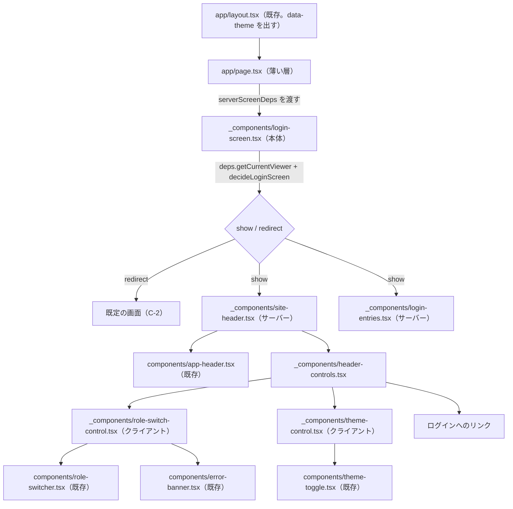
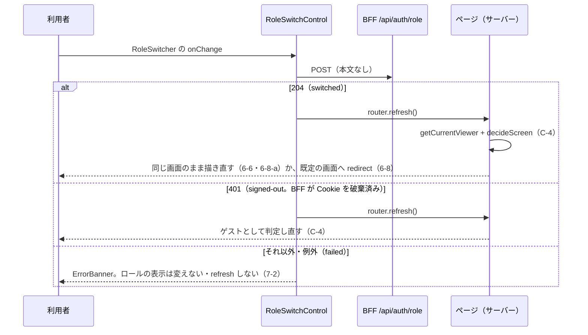
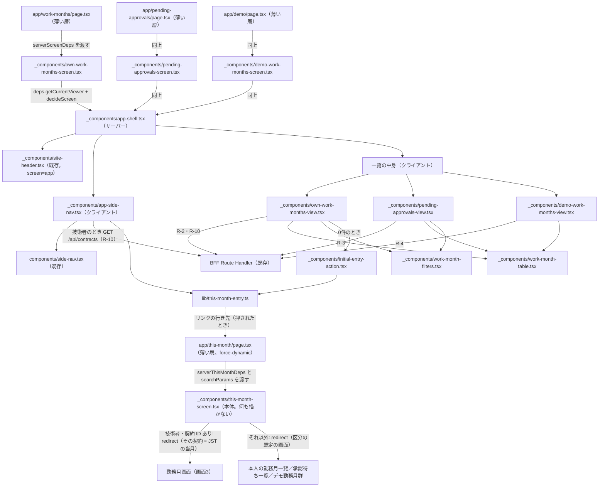
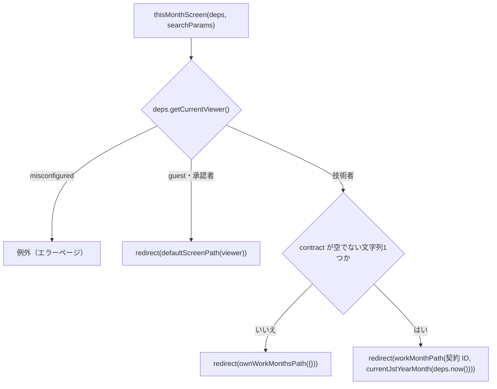

# Web 画面 実装設計 — 仕様

`apps/web` の画面について、**どのルートにどのページを置き、既存のどの部品・lib を使い、どの状態をサーバーとクライアントのどちらが持ち、どの AC をどのテストファイルが担うか**を定める（Issue #55 の完了条件「コンポーネント構成・状態管理の実装設計を `docs/specs/` に残す」）。

**要求（受け入れ条件）はこの仕様へ書き写さない。** 正解は各 UI 仕様（`login-ui.md` ほか）と `design-system.md`・`bff-auth-termination.md` にあり、本仕様は AC 番号で参照するだけである（ADR 0004）。本仕様が決めるのは実装設計に限る。

- **決定者**: 実装設計の各決定は仕様工程（AI 起案。**人間の承認前**）。ただし文言・ログインの入口の行き先・ログイン失敗の担い手・区分の解決が失敗したときの扱い（本仕様の Q-1〜Q-4）と、画面2 の絞り込みの置き場・ハンドオフに無い文言・閲覧系の3画面のパス・「今月の入力」で契約が複数あるときの形（Q-5〜Q-8）、初回入力の部品の置き場（Q-9）、「今月の入力」と初回入力の行き先を年月を含まない経路にすること（Q-10）、テストの差し替えの方針（T-0）は、**2026-10-29 に人間が明示選択で決めた**。今月の入力の経路の置き場と、本人の契約を確かめる場所（Q-11）は、**2026-10-30 に人間が明示選択で決めた**。決定は該当の節の本文に、出所「2026-10-29（または 2026-10-30）人間の明示選択（Q-n = …）」を添えて置く。ここでいう Q-n は**本仕様の論点の番号**であり、P-1 が引く `cognito-auth-infra.md` の Q-1 とは別物である
- **日付**: 2026-10-29（画面1 の節を起こし、同日に Q-1〜Q-4 の決定を反映した。同日、画面2 の節＝W 節を足し、同日に Q-5〜Q-8 とテストの差し替えの方針の決定を反映した。Q-8 に伴い `design-system.md` 6-13 を改定した。同日、Q-9・Q-10 の決定を反映し、月の境目に合わせたタイマーで描き直す設計を取り下げた。Q-10 のうち経路の置き場と本人の契約の確かめ方は Q-11 として残した。2026-10-30、Q-11 = (e) の決定を C-2・W-1・W-7・T-2 へ反映し、W-8（画面2 の関数の形と props）を足し、T-0-3 の是正が済んだことを L-1・C-3・T-0・T-1 へ反映した。W 節のうち出所を書いていない決定は AI 起案で人間の承認前である。画面3 の節は後で追記する）
- **前提の仕様**: `login-ui.md`／`design-system.md`（AC-5・AC-6（6-13 は 2026-10-29 改定後）・AC-8・AC-12）／`bff-auth-termination.md`（AC-5-5・AC-5-11・AC-11-2）／`work-month-listing-ui.md`（AC-1〜AC-10。W 節）／`bff-wiring.md` AC-6 の R-2〜R-4・R-10／`domain-api-http-contract.md` AC-3・AC-10-2・AC-12

---

## スコープ

- **対象**: 画面1（ログイン画面・デモ用ロール切替・ヘッダー）と、画面1 が最初に要する**画面間で共有する土台**（C 節: ルート表のうち既定の画面、利用者の区分の解決、開ける画面の判定、置き場所の規則）。画面2（本人の勤務月一覧・承認待ち一覧・デモ勤務月群と、ログイン画面を除く各画面に共通のサイドバー。W 節）
- **非対象**:
  - 受け入れ条件そのもの（各 UI 仕様が持つ）
  - BFF の Route Handler（`/api/auth/*`・業務の経路）。既存のものを使うだけで、本仕様では変えない（`bff-auth-termination.md`・`bff-wiring.md`）
  - 画面3（勤務月画面）。後で節を足す。ただし勤務月画面のパスは、画面2 のリンクが要するため C-2 で定める。画面3 の節へ申し送る事項は W-7 の「画面3 への申し送り」に置く
  - ヘルプ・契約一覧・稼働の推移の画面。C-4 の判定で画面の識別子として名前が出ることと、C-2 でパスを定めること（サイドバーの項目の行き先として要るため）だけで、ページの設計は持たない
  - ユーザー・ロール管理画面（非スコープ。`docs/rules/scope.md`・`login-ui.md` AC-8-1）
  - サインアウト（要求する仕様が無い。`bff-auth-termination.md` の非対象表）

---

## 前提（P）— 既存の決定と実装（参照のみ）

| # | 前提 | 出典 |
|---|---|---|
| P-1 | 自前のログイン画面は3つの入口の提示に留まり、メール+パスワード・MFA(TOTP)・Google の画面は Cognito のホストされたサインイン画面が持つ（Q-1 = (a)） | `cognito-auth-infra.md` Q-1・11-11 |
| P-2 | サインインの開始は `GET /api/auth/sign-in`、戻りは `GET /api/auth/callback`。戻りが成功すると `/` へ 302 で戻す（`auth-handlers.ts` の `SIGN_IN_LANDING_PATH`） | `bff-auth-termination.md` AC-11-2 (i)(ii) |
| P-3 | ロール切替は `POST /api/auth/role`。要求からロールを読まず、検証した現在のロールを反転させる。成功は 204、未認証は 401（Cookie を破棄）、構成欠落は 5xx、レート制限は 429 | 同 AC-5-5・AC-5-11・AC-11-2 (iii)・AC-11-12 |
| P-4 | テーマは `et_theme` Cookie（`theme-cookie.ts`）。`layout.tsx` が最初の描画から `<html data-theme>` を出す | `design-system.md` AC-12-3・12-6 |
| P-5 | 部品 `AppHeader`・`RoleSwitcher`・`ThemeToggle`・`ErrorBanner` は既存。いずれも保存・通信・ロールの判定をしない | `design-system.md` 6-3・6-7・6-11・6-14 |
| P-6 | `apps/web/src/components/` 直下の `*.tsx` は台帳（`design-system.md` AC-5-1）と過不足なく一致しなければならない。画面固有の合成は台帳に載らない | `design-system.md` AC-5-1〜5-3・`component-inventory.test.ts` |
| P-7 | URL・ルートは UI 仕様で固定されていない | `design-system.md` 8-4・`login-ui.md` 8-6 |
| P-8 | 新しい npm 依存を入れない（状態管理ライブラリを含む） | Issue #55 の前提 |

**デザインのハンドオフとの関係** —— `design/handoff/2026-10-theme-b/` のログイン画面は、自前のメール+パスワードのフォーム・2段階認証の状態・失敗の状態を描いている。これは P-1（Q-1 = (a)）と両立しないため、本設計はフォームを作らず、入口を Cognito のホストされた画面への導線として置く（L-2）。ハンドオフから採るのは入口の文言だけである（L-2。2026-10-29 人間の明示選択（Q-1 = (a)、ただし「・新規登録」を付けない））。2段階認証の状態・失敗の状態はログイン画面に描かない（L-2。2026-10-29 人間の明示選択（Q-3 = (a)））。

---

## C. 画面間で共有する土台

### C-1. 置き場所の規則

| 対象 | 置き場所 | 理由 |
|---|---|---|
| ページ | `apps/web/src/app/` 配下の `page.tsx`（ルートは C-2） | App Router |
| 画面固有の合成（ヘッダーの右側の組み立て・ログインの入口など） | `apps/web/src/app/_components/`（`_` 始まりはルートにならない） | P-6。`src/components/` に置くと台帳と食い違う |
| 純粋な判定・通信の関数 | `apps/web/src/lib/` | 既存の `auth-handlers.ts` 等と同じ。テストから直接呼べる |
| サーバー専用の取得（`next/headers` を読むもの） | `apps/web/src/app/_lib/` | `src/lib/` を Next の実行時に依存させない |

- クライアント部品（`"use client"`）は、`role-cookie.ts`・`viewer.ts`・`auth-config.ts` を**値として**輸入しない（`node:crypto` と署名鍵の読み取りをブラウザへ持ち込まない）。型 `Role` は `import type` に限る（`role-switcher.tsx` と同じ形）
- ページ・`_components` は `lambda-client` を輸入しない（`lambda-client-boundary.test.ts` が検査済み。`login-ui.md` AC-5-1）

### C-2. ルート表（画面1 が定める分）

| 画面 | パス | 置くファイル | 定めた節 |
|---|---|---|---|
| ログイン画面 | `/` | `app/page.tsx` | L-1 |
| 本人の勤務月一覧（技術者の既定の画面。`login-ui.md` 6-7-a） | `/work-months` | 画面2 の節で置く | C-3 の遷移先として本節で決める |
| 承認待ち一覧（承認者の既定の画面） | `/pending-approvals` | 同上 | 同上 |
| デモ勤務月群（ゲストの既定の画面） | `/demo` | 同上 | 同上 |
| 勤務月画面 | `/work-months/[contractId]/[yearMonth]`（`yearMonth` は `YYYY-MM`） | 画面3 の節で置く | W-1（画面2 の行のリンク・直近・今月の入力が行き先として要するため、本節で決める） |
| ヘルプ | `/help` | 本仕様では置かない（ページが入るまで 404） | W-6 のサイドバーの項目の `href` として要るため本節で決める。出所: 2026-10-29 人間の明示選択（Q-7 = (a)） |
| 契約一覧 | `/contracts` | 同上 | 同上 |
| 稼働の推移 | `/work-trends` | 同上 | 同上 |
| 今月の入力の経路（画面ではない。何も表示せず、送り先へ回すだけ） | `/this-month?contract=<契約ID>` | `app/this-month/page.tsx`（`redirect()` するだけのページ。本体は `app/_components/this-month-screen.tsx`） | W-7。経路を置くことは 2026-10-29 人間の明示選択（Q-10）、`redirect()` するだけのページに置くことは 2026-10-30 人間の明示選択（Q-11 = (e)）。**パスとクエリの名前は AI の起案** |

- **勤務月画面のパスを画面3 ではなく本節で決める理由**: 画面2 の4つの導線（行＝`work-month-listing-ui.md` AC-5-1、直近＝AC-6-1、初回入力＝AC-7-1、今月の入力＝AC-10-9）がいずれもこのパスを要し、画面2 のテストの期待値になるため。画面3 の節はページを置くだけで、パスを変えない。形は BFF の R-1 のパス（`/api` を除いたもの）に揃えた。**AI の起案であり、人間の承認前である**（次項と同じ扱い）。`screen-routes.ts` に `workMonthPath(contractId, yearMonth)` として持ち、各セグメントを `encodeURIComponent` で符号化する
- **`/work-months`・`/pending-approvals`・`/demo` のパスの文字列は AI の起案であり、人間の承認前である。** 2026-10-29 の明示選択（Q-1〜Q-8）はこれらのパスと勤務月画面のパスを決めていない（Q-7 が決めたのはヘルプ・契約一覧・稼働の推移の3つだけである）。**レビューで人間が確かめる対象として残す**（パスは UI 仕様で固定されていない＝P-7。変えるときは `screen-routes.ts` の定数と本表を改める）。ログイン画面を `/` に置くことは、P-2 の戻り先からの帰結である（次項）
- **ログイン画面を `/` に置く理由**: サインインの戻りは `/` へ着く（P-2）。`/` をログイン画面にすると、ログイン済みの利用者は 6-10 によりそのロールの既定の画面へ移り、`design-system.md` 8-1-b（ログイン後に本人の勤務月一覧）が `auth-handlers.ts` を変えずに成り立つ。ゲストが `/` を開いたときはログイン画面が出る（6-10-a）
- **ヘルプ・契約一覧・稼働の推移のパス `/help`・`/contracts`・`/work-trends` は、AI の起案ではなく人間の決定である。** 出所: 2026-10-29 人間の明示選択（Q-7 = (a) パスは `/help`・`/contracts`・`/work-trends`。サイドバーには仕様（`work-month-listing-ui.md` 10-2〜10-4）どおり項目を出し、ページが入るまで行き先が 404 になることを受け入れる）。ページは本仕様の対象外であり、各画面の Issue が置く。404 の期間は限界として T-2 に記録する
- **今月の入力の経路のパス `/this-month` とクエリの名前 `contract` は AI の起案であり、人間の承認前である。** 2026-10-29 の明示選択（Q-10）が決めたのは「年月を含まない経路を行き先にし、押された時点でサーバーが JST の当月を計算して、その契約 × 当月の勤務月画面へ 302 で送る」ことであり、2026-10-30 の明示選択（Q-11 = (e)）が決めたのは「`redirect()` するだけのページに置く」ことである。いずれもパスの文字列は決めていない（`/this-month?contract=<契約ID>` は Q-10 を諮った際の例である）。レビューで人間が確かめる対象として残す。`screen-routes.ts` に `thisMonthPath(contractId)` として持ち、契約 ID をクエリの値として符号化する
- パスの文字列は `apps/web/src/lib/screen-routes.ts` に定数として1か所で持ち、ページ・判定・リンクはそれを参照する
- 画面2 が入るまで `/work-months`・`/pending-approvals`・`/demo` はページを持たない（遷移先が 404 になる期間がある）。同じブランチで画面2 が入ることを前提とする

### C-3. 利用者の区分の解決（`apps/web/src/lib/viewer.ts`）

```ts
export type Viewer = { kind: "guest" } | { kind: "signed-in"; role: Role };
export type ResolveViewerResult = Viewer | { kind: "misconfigured" };

export function resolveViewer(params: {
  cookieHeader: string | null;
  now: Date;
  environment?: Environment;
  publicKeyResolver?: PublicKeyResolver;
}): Promise<ResolveViewerResult>;
```

- 判定の順は `work-month-handlers.ts` の `handle()` の順2〜順4 と同じにする —— (1) 認証の構成が欠けていれば `misconfigured`、(2) `resolveVerifiedSession` が成立しなければ `guest`、(3) 成立したのに署名鍵が欠けていれば `misconfigured`、(4) 成立すれば `resolveEffectiveRole` で決めたロールの `signed-in`（`login-ui.md` AC-5-2・`bff-auth-termination.md` AC-5-11）
- ゲストにロールを与えない（`bff-auth-termination.md` 5-11 (v)・`login-ui.md` 6-5）
- **セッション Cookie の検証に失敗したとき**: ページは**ゲストとして描く**（上の順 (2)）。`resolveViewer` もページも Cookie を書き換えない（ページの描画からは Cookie を書けない）。失敗した Cookie の破棄（`bff-auth-termination.md` 5-8 (v)）は、**次に Route Handler を通る要求に任せる**。要求ごとに検証して破棄する `proxy.ts` は**足さない**。出所: 2026-10-29 人間の明示選択（Q-4 (i) = (a)）
- **認証の構成・署名鍵が欠けているとき（`misconfigured`）**: ページは**エラーページにする**。ゲストや既定の画面へ**黙って落とさない**（`bff-auth-termination.md` 7-5 と同じ思想）。実装はページが `misconfigured` を受けたら例外を投げ、Next のエラーの描画に任せる（`decideScreen`・`decideLoginScreen` は `Viewer` だけを受け、`misconfigured` を受けない）。エラーページの文言は本仕様で定めない（決定に無いため。Next の既定の描画のまま）。出所: 2026-10-29 人間の明示選択（Q-4 (ii) = (a)）
- 区分は `app/_lib/current-viewer.ts` の `getCurrentViewer()` で解決する。これは `headers()` の `cookie` と現在時刻で `resolveViewer` を呼ぶだけの薄い層で、React の `cache` で1要求1回にまとめる（ヘッダーとページが別々に解決しない）。画面の本体は `getCurrentViewer()` を直接呼ばず、注入された `deps.getCurrentViewer()` を呼ぶ。本物の依存 `serverScreenDeps`（T-0-2）が `getCurrentViewer` を束ねる（React の `cache` による1要求1回は保たれる）

### C-4. 開ける画面の判定（`apps/web/src/lib/screen-access.ts`）

```ts
export type ScreenId =
  | "own-work-months" | "pending-approvals" | "demo-work-months"
  | "work-month" | "help" | "contracts" | "work-trends";
export type ScreenDecision = { kind: "show" } | { kind: "redirect"; to: string };

export function defaultScreenPath(viewer: Viewer): string;               // 6-7-a
export function decideScreen(screen: ScreenId, viewer: Viewer): ScreenDecision; // 6-7・6-8・6-8-a・6-9・6-9-a
export function decideLoginScreen(viewer: Viewer): ScreenDecision;        // 6-10・6-10-a
```

- `ScreenId` は 6-7 が列挙する画面の識別子である（ログイン画面は 6-7 の外なので含めない）。`help`・`contracts`・`work-trends` は判定の表に現れるだけで、本仕様はそれらのページを設計しない
- 関数は純粋で、Cookie・状態・稼働実績に触れない（6-9-b）
- **どのページも（本体が）、描画の最初に `deps.getCurrentViewer()` と `decideScreen`（ログイン画面は `decideLoginScreen`）を呼び、`redirect` なら `next/navigation` の `redirect()` で移す**。ロールを切り替えたときは L-4 が `router.refresh()` でサーバーの描画をやり直すため、同じ判定が働いて 6-8・6-8-a が成り立つ。URL を直接開いたとき（6-9）も同じ経路である。切替のためだけの別の遷移処理をクライアントに持たない
- 移した後の履歴の扱いは固定しない（`login-ui.md` 8-6）。`redirect()` の既定に従う
- 判定は画面の出し分けであり認可ではない（`login-ui.md` 8-7）。データの取得の可否は BFF とドメイン API が持つ

---

## L. 画面1 — ログイン画面・デモ用ロール切替・ヘッダー

### L-1. 構成



| ファイル | 種別 | 責務 | 主に担う AC |
|---|---|---|---|
| `app/page.tsx` | サーバー（async。薄い層） | `loginScreen(serverScreenDeps)` を返すだけ（T-0-2）。判定も描画の組み立ても持たない | — |
| `app/_components/login-screen.tsx` | サーバー（async 関数。依存を引数で受ける） | `loginScreen(deps: ScreenDeps)`。`deps.getCurrentViewer()` が `misconfigured` なら例外を投げる（C-3。Q-4 (ii) = (a)）。それ以外は `decideLoginScreen` が `redirect` なら移し、`show` なら `SiteHeader`（`screen="login"`）と `LoginEntries` を描く | 6-10・6-10-a・9-1 |
| `app/_components/login-entries.tsx` | サーバー | 3つの入口を出す（L-2） | 1-1・1-2・2-1・2-3・3-1・3-2・4-1・4-3 |
| `app/_components/site-header.tsx` | サーバー（同期。値は props で受ける） | `AppHeader` の `right` に `HeaderControls` を差し込む。props は `viewer: Viewer`・`theme: Theme`・`screen: "login" \| "app"` | 9-1 |
| `app/_components/header-controls.tsx` | サーバー | 右側に何を・どの順に出すかを決めて並べる（L-3） | 6-1・6-5・9-2・9-3・9-4・9-6・9-7 |
| `app/_components/role-switch-control.tsx` | クライアント | ロール切替の通信と画面の更新（L-4） | 6-1・6-2・6-6・6-9-b・7-2・9-5 |
| `app/_components/theme-control.tsx` | クライアント | テーマの保存と `<html>` の属性の付け替え（L-5） | 9-3・9-4・9-5・`design-system.md` 12-3 |
| `lib/role-switch-client.ts` | 純粋（ブラウザで動く） | `POST /api/auth/role` を送り、結果を3つに分ける（L-4） | 6-9-b・7-2 |
| `lib/viewer.ts`・`lib/screen-access.ts`・`lib/screen-routes.ts` | 純粋 | C-3・C-4・C-2 | 5-2・6-5・6-7〜6-10-a |
| `app/_lib/current-viewer.ts`・`app/_lib/screen-deps.ts` | サーバー専用 | C-3 の薄い層と、`ScreenDeps`・`serverScreenDeps`（T-0-2） | — |

`SiteHeader` を async にせず値を props で受けるのは、テストで描画できるようにするためである（async のサーバー部品は Testing Library で直接描けない）。値を取るのは本体の側（`deps.getCurrentViewer()` と `deps.getTheme()`。本物は `getCurrentViewer()` と `cookies()` → `resolveTheme`）。画面2 以降のページ（`screen="app"`）も同じ部品を使う。

### L-2. ログインの入口（`login-entries.tsx`）

| 入口 | 要素 | 文言（アクセシブル名） | 行き先 | 備考 |
|---|---|---|---|---|
| (a) ゲストとして続行 | `next/link` のリンク | 「ゲストとして続行（閲覧のみ）」。リンクに添えて注記「入力・締め・承認はできません。」を出す | `/demo`（C-2） | Route Handler を経由しない・要求を送らない（`bff-auth-termination.md` 11-4・`login-ui.md` 4-1） |
| (b) メール+パスワード | `<a>`（全体の遷移。`next/link` を使わない＝外部へ 302 する経路のため） | 「メールアドレスでログイン」 | `/api/auth/sign-in` | 新規登録はホストされた画面の側が持つ（P-1・2-1）。文言に「・新規登録」を**付けない** |
| (c) Google 連携 | `<a>`（(b) と同じ理由） | 「Google でログイン」 | `/api/auth/sign-in`（(b) と同じ） | ホストされた画面が Google の選択肢を出す。利用者は Google まで2回押す |

- **文言**の出所: 2026-10-29 人間の明示選択（Q-1 = (a) ハンドオフどおり。ただし (b) に「・新規登録」を付けない）。テストはこの文言でアクセシブル名を引く
- **(c) の行き先**の出所: 2026-10-29 人間の明示選択（Q-2 = (a) Google の入口も `/api/auth/sign-in` を通す）。**BFF の仕様と実装は変えない**（`bff-auth-termination.md` AC-11-2 (i)・`cognito-oidc.ts` に `identity_provider` を足さない）。Google まで2回押すことは受け入れた
- **帰結 —— (b) と (c) は行き先で区別できない。** 両者は同じ `href` を持つため、テストは入口を**アクセシブル名で区別する**（「メールアドレスでログイン」と「Google でログイン」がそれぞれちょうど1つあること）。`href` だけを数える・比べる形では、(c) が欠けても (b) が2つあっても見分けられない
- フォーム・`<input type="password">`・資格情報を受ける欄を置かない（P-1・2-3）。クライアント部品を持たない
- **ログイン失敗の表示（7-1）**: 資格情報・MFA の誤りの提示と再試行は、**Cognito のホストされた画面に任せる**。サインインの戻り（`/api/auth/callback`）で失敗したとき（取消・`state` の不一致等）は、BFF が返す今の 401 の素の応答（`bff-auth-termination.md` 3-4 (i)）のままとする。**ログイン画面は失敗を出さない**（`ErrorBanner` も再試行の導線も持たない）。これは T 節の限界に記録する。`bff-auth-termination.md` は変えない。出所: 2026-10-29 人間の明示選択（Q-3 = (a)）
- 通信・サーバーエラー（7-2）のうち、この画面が自分で通信するものは無い（入口はいずれも遷移である）

### L-3. ヘッダーの右側（`header-controls.tsx`）

出すものと並びを、純粋な関数 `headerSlots(viewer, screen)` で決め、その順に描く（並びは 9-7）。

| `viewer` | `screen` | 出すもの（この順） | 根拠 |
|---|---|---|---|
| ゲスト | `login` | テーマ切替 | 9-2・9-3・9-6 |
| ゲスト | `app` | テーマ切替 → ログインへのリンク | 9-3・9-6・9-7 |
| 技術者・承認者 | `login` | テーマ切替 | 9-2・9-6（実際には 6-10 で移るため描かれない） |
| 技術者・承認者 | `app` | ロール切替 → テーマ切替 | 6-1・9-2・9-3・9-7 |

- ログインへのリンクの行き先は `/`（C-2）。文言は「ログイン」（出所: 2026-10-29 人間の明示選択（Q-1 = (a)））
- `headerSlots` は `header-controls.tsx` から輸出し、表をそのままテストの入出力にする

### L-4. ロール切替（`role-switch-control.tsx`・`role-switch-client.ts`）

| 状態 | 持ち主 | 内容 |
|---|---|---|
| 現在のロール | **サーバー**（署名済み Cookie。`resolveViewer` が読む） | props `role` で受け、`RoleSwitcher` の `role` にそのまま渡す。**クライアントでロールを持たない・先回りして書き換えない** |
| 通信中 | クライアント（`useState`） | 通信中は次の `onChange` を無視する。切替は反転なので（P-3）、二重に送ると元へ戻るため |
| 失敗 | クライアント（`useState`） | 失敗したときだけ `ErrorBanner` を出す。理由文は「ロールを切り替えられませんでした。」（出所: 2026-10-29 人間の明示選択（Q-1 = (a)）） |

`requestRoleSwitch(fetchImpl = fetch): Promise<"switched" | "signed-out" | "failed">` は `POST /api/auth/role` を本文なしで送る（ロールを申告しない。`bff-auth-termination.md` 5-5 (ii) と食い違う要求を作らない）。応答の対応は 204 → `switched`、401 → `signed-out`、それ以外の応答・例外 → `failed`。



- `router.refresh()` 以外の遷移（`push`・`replace`）をクライアントから呼ばない（移すかどうかはサーバーの判定だけが決める。C-4）
- テーマの Cookie に触れない（9-5）

### L-5. テーマ切替（`theme-control.tsx`）

| 状態 | 持ち主 | 内容 |
|---|---|---|
| 保存されたテーマ | **サーバーが読む Cookie**（`et_theme`） | ページが `cookies()` → `resolveTheme` で読み、props `initialTheme` で渡す（`layout.tsx` と同じ値になる） |
| 表示中のテーマ | クライアント（`useState`。初期値 `initialTheme`） | `ThemeToggle` の `onChange` で更新する |

`onChange(theme)` で、(1) `document.cookie` に `serializeThemeCookie(theme)` を書き、(2) `document.documentElement` の `data-theme` を `theme` に付け替え、(3) 表示中のテーマを更新する。再読み込みしない・サーバーへ要求を送らない（`design-system.md` 12-3。部品の `ThemeToggle` は副作用を持たないまま＝6-14-v）。ゲストにも同じ部品を出す（9-4）。

---

## W. 画面2 — 勤務月一覧（本人一覧・承認待ち一覧・デモ勤務月群）とサイドバー

本節で AC 番号だけを書いたものは `work-month-listing-ui.md` の AC である。**本節の決定は、出所「2026-10-29（または 2026-10-30）人間の明示選択（Q-n = …）」を添えたものを除き、AI 起案であり人間の承認前である。**文言のうち出所を「ハンドオフ」と書いたものは `design/handoff/2026-10-theme-b/` の該当ファイルの字面をそのまま採ったもので、本節では作っていない。

### W-1. 構成



| ファイル | 種別 | 責務 | 主に担う AC |
|---|---|---|---|
| `app/work-months/page.tsx`・`app/pending-approvals/page.tsx`・`app/demo/page.tsx` | サーバー（async。薄い層） | 対応する画面の本体へ `serverScreenDeps`（T-0-2）と、Next が渡す `searchParams` を待った値を渡し、その戻り値を返すだけ。判定も描画の組み立ても持たない（T-0-2） | — |
| `app/_components/own-work-months-screen.tsx` | サーバー（async 関数。依存を引数で受ける） | `ownWorkMonthsScreen(deps, searchParams)`。`deps.getCurrentViewer()` が `misconfigured` なら例外（C-3）。`decideScreen("own-work-months")` が `redirect` なら移す。`show` なら `AppShell`（選択中＝本人の勤務月一覧）と `OwnWorkMonthsView` を描く。`searchParams` の `contract` が文字列1つのときだけそれを `initialContractId` として渡し、それ以外（無い・配列）は渡さない（W-4） | 2-4・3-3・9-12、`login-ui.md` 6-9 |
| `app/_components/pending-approvals-screen.tsx` | 同上 | `pendingApprovalsScreen(deps)`。同上。画面は `pending-approvals`、中身は `PendingApprovalsView` | 2-4・3-3 |
| `app/_components/demo-work-months-screen.tsx` | 同上 | `demoWorkMonthsScreen(deps)`。同上。画面は `demo-work-months`、中身は `DemoWorkMonthsView` | 3-1・3-3 |
| `app/_lib/screen-deps.ts` | サーバー専用 | 型 `ScreenDeps` と本物の依存 `serverScreenDeps`（T-0-2）。型 `ThisMonthDeps` と本物の依存 `serverThisMonthDeps`（W-7） | — |
| `app/_components/app-shell.tsx` | サーバー（同期。値は props で受ける） | `SiteHeader`（`screen="app"`）・`AppSideNav`・`<main>` を並べる。ログイン画面からは使わない。画面3 も使う | 10-1 |
| `app/_components/app-side-nav.tsx` | クライアント | 技術者のとき自分の契約を取得し、`thisMonthEntry` と `sideNavItems`（W-6）で項目を決めて `SideNav` へ渡す | 10-1〜10-9-g |
| `app/_components/own-work-months-view.tsx` | クライアント | 本人一覧の取得・絞り込み・ページ・表示（W-4） | AC-1・AC-4・AC-5・AC-6・7-1・7-3・AC-9 |
| `app/_components/pending-approvals-view.tsx` | クライアント | 承認待ち一覧（W-5） | AC-2・AC-4・AC-5・7-2・7-3・AC-9 |
| `app/_components/demo-work-months-view.tsx` | クライアント | デモ勤務月群（W-5） | AC-3・5-1・7-3・9-3 |
| `app/_components/work-month-table.tsx` | フックを持たない（どちらからも使える） | 行の表。各行に契約表示名・対象年月・`StatusBadge`・勤務月画面へのリンク | 1-2・2-3・5-1 |
| `app/_components/work-month-filters.tsx` | フックを持たない（値とハンドラを props で受ける） | `SelectField` で条件を出し、条件の解除の操作を出す。出す条件の集合を props で受ける | 9-1・9-2・9-11・9-14 |
| `lib/work-month-list.ts` | 純粋 | 行の型、絞り込み、選択肢、ページ分け、直近、年月の表示、1ページの件数の定数（W-3・W-4） | 4-1・4-2・6-3・9-4〜9-9・9-11 |
| `lib/work-month-list-client.ts` | 純粋（ブラウザで動く） | R-2〜R-4・R-10 を呼び、結果を分類する（W-2・W-3） | 1-1・7-3 |
| `lib/side-nav-items.ts` | 純粋 | サイドバーの項目（W-6） | 10-2〜10-6・10-9-a〜10-9-d |
| `lib/this-month-entry.ts` | 純粋 | `thisMonthEntry(contracts)`。自分の契約の件数で、当月の入力の導線を `hidden` / `link` / `choice` に分ける（W-6）。行き先は年月を含まない `thisMonthPath(contractId)`（W-7）で、年月を受け取らない。サイドバーの「今月の入力」と、本人一覧の0件の初回入力（W-4）が同じものを使う。出所: 2026-10-29 人間の明示選択（Q-9 = (a) 共有するのは出し分けの関数と開いたときの見え方だけ）・（Q-10 = 年月を含まない経路を行き先にする） | 6-2・7-1・10-9-a〜10-9-d |
| `app/_components/initial-entry-action.tsx` | クライアント | 本人一覧の0件の `EmptyState` の `action`。`thisMonthEntry` の結果で、何も出さない／リンク／選択肢を開く操作を出す（W-4）。画面固有の部品であり、`design-system.md` の台帳（AC-5-1）に載せない。出所: 2026-10-29 人間の明示選択（Q-9 = (a) 初回入力の部品は画面固有の `app/_components/initial-entry-action.tsx` に置く。台帳は変えない） | 6-2・7-1 |
| `lib/jst-month.ts` | 純粋 | `currentJstYearMonth(now: Date): string`。与えた時刻の JST の年月（`YYYY-MM`）を返す。W-7 の経路が当月を決めるのと、R-10 の `yearMonth`（W-3）に使う | 10-9 |
| `app/this-month/page.tsx` | サーバー（async。薄い層） | `export const dynamic = "force-dynamic"` を持ち、`thisMonthScreen(serverThisMonthDeps, await searchParams)` を呼ぶだけ（W-7・T-0-2）。出所: 2026-10-30 人間の明示選択（Q-11 = (e)）。`force-dynamic` は AI 起案（W-7 の先読み） | — |
| `app/_components/this-month-screen.tsx` | サーバー（async 関数。依存を引数で受ける） | `thisMonthScreen(deps, searchParams)`。区分と押された時点の JST の当月から送り先を決め、`redirect()` するだけで何も描かない（W-7）。ドメイン API も `lambda-client` も BFF も呼ばない | 10-9・10-9-a・10-9-c・10-9-e・10-9-g |
| `lib/screen-routes.ts`（既存へ追加） | 純粋 | `workMonthPath(contractId, yearMonth)`（C-2）、`thisMonthPath(contractId)`（C-2・W-7）、`ownWorkMonthsPath({ contractId? })`（9-12 の受け口のクエリを組み立てる） | 5-1・9-12・10-9 |

- 表の各ファイルが輸出する関数の形と props は W-8 に置く（今月の入力の経路は W-7）
- `_components` に置くのは P-6 のため（`src/components/` の台帳を増やさない）。既存部品で使うのは `SideNav`・`Card`・`StatusBadge`・`SelectField`・`Button`・`Pagination`・`EmptyState`・`ErrorBanner`・`AppHeader`（`SiteHeader` 経由）で、**部品の props を変えない**。例外は `SideNav` で、`design-system.md` 6-13 の 2026-10-29 改定（選択肢を開く項目。6-13-v）に従って `components/side-nav.tsx` の `SideNavItem` に形を1つ足す（props のキーは変えない）。出所: 2026-10-29 人間の明示選択（Q-8）
- 遷移はいずれも `next/link` のリンクで行う（行・直近・初回入力・サイドバーの項目と、それらが開く契約の選択肢）。初回入力と「今月の入力」のリンクは勤務月画面を直接指さず、W-7 の経路を指す（Q-10）。遷移は GET だけで、勤務月の状態を変えない（5-2・9-13・10-7）

### W-2. データを取る側と状態を持つ側

**一覧のデータはブラウザ（クライアント部品）が BFF の Route Handler から取る。** サーバーのページでは取らない。理由:

1. ページ・`_components` は `lambda-client` を輸入しない（C-1。`docs/rules/architecture.md` の「Route Handler 以外から Lambda を呼ばない」）
2. サーバーのページから自分の Route Handler を HTTP で呼ぶと、オリジンの解決と Cookie の転送が要るうえ、レート制限の鍵（`rate-limit.ts` は閲覧者のアドレスのヘッダで数える）が閲覧者のものでなくなり、全員が1つの鍵を共有する
3. 絞り込みの選択肢と直近は一覧の全体を要し、絞り込みはブラウザで行う（W-3。2026-10-29 人間の明示選択（Q-5 = (a)））

| 状態 | 持ち主 | 内容 |
|---|---|---|
| 利用者の区分・ロール | **サーバー**（C-3） | ページが解決し、props で渡す。クライアントで持たない |
| 取得の結果 | クライアント（`useState`） | `loading` / `failed` / `loaded`（行の配列。本人一覧は自分の契約の配列も持つ） |
| 絞り込みの条件 | クライアント（`useState`） | `{ contractId, yearMonth, state }`。空文字が「すべて」（9-4） |
| ページ | クライアント（`useState`） | 1 始まり。条件を変えたら 1 へ戻す（9-9） |

- **条件とページを URL に書き戻さない**（`router.push`・`replace` を呼ばない）。再読み込みすると既定へ戻る。例外は 9-12 の受け口のクエリ `contract` で、ページが読んで初期値として渡す（W-4）
- 取得中は一覧の領域に `aria-busy="true"` を付け、文言を出さない（取得中の文言を定める仕様が無いため）
- 応答の分類（`work-month-list-client.ts`）: 200 → `ok`、401 と 403 → `refresh`、それ以外の応答（429 を含む）・例外 → `failed`。`refresh` は L-4 と同じく `router.refresh()` を呼び、区分の判定をサーバーに任せる（C-4。別タブでのロール切替やセッションの失効のあと、開けない画面から既定の画面へ移る）。`failed` は `ErrorBanner` に `onRetry` を付けて出し、再試行は同じ GET をやり直すだけである（7-3）

### W-3. 取得と絞り込みの置き場

**事実**: ドメイン API の E-2 が受けるクエリは `engineerId`・`state`・`limit`・`offset` だけで（`domain-api-http-contract.md` AC-3）、BFF の R-2・R-3 が渡すのも `state`・`limit`・`offset` だけである（`bff-wiring.md` AC-6 の R-2・R-3 の行、`work-month-handlers.ts` の `listParameters`）。**契約・対象年月で絞る条件は、BFF にもドメイン API にも無い。** R-4 は要求から何も取らない（`demo-data-reset.md` AC-7-6）。絞り込みの置き場は 8-6 が実装工程に委ねている。

**絞り込みはブラウザで行い、一覧は全件を取得する。BFF とドメイン API は変えない。** 出所: 2026-10-29 人間の明示選択（Q-5 = (a)）。以下はその設計である（全件の取り方・並び・選択肢・ページの分け方は AI 起案）。

- **全件の取得**: `fetchAllWorkMonths(path, fetchImpl)` は `path?offset=N` を GET し、`limit` を送らない（上限はドメイン API の実装の値であり契約で固定されていない＝同 AC-3-5。既定の件数で返った分を受け取る）。次の `offset` は「今の `offset` ＋ 受け取った `items` の件数」とし、`offset` が `total` 以上になるか `items` が空になったら止める。行は `(contractId, yearMonth)` で重複を除き、先に来たものを残す
- **並び**: 応答の並び（対象年月の降順、同じ年月は契約識別子の昇順。同 AC-3-4）を保ち、ブラウザで並べ替えない。絞り込みは並びを保つ（4-1・9-8）
- **絞り込み**: 状態を含むすべての条件をブラウザで当てる（R-2 に `state` を送らない。選択肢と直近が絞る前の全体を要するため）
- **選択肢**: 本人一覧の契約は R-10（`GET /api/contracts?yearMonth=<JST の当月>`）の `items`。E-8 は `yearMonth` を必須とするが、返す契約の集合は `yearMonth` によらない（`domain-api-http-contract.md` 12-3・12-16）。承認待ち一覧の契約と、両一覧の対象年月は取得した行から作る（9-6・9-6-a）
- **ページ**: 絞った後の行を `WORK_MONTH_LIST_PAGE_SIZE` 件ずつに分ける。値は `lib/work-month-list.ts` の定数で持ち、仕様の値ではない（4-2・8-4 が実装工程に委ねた）。テストは定数を輸入して使い、数値を書かない
- **デモ勤務月群**: R-4 を1回呼ぶだけで、ページを送らない（R-4 はクエリを読まない）。絞り込みもページも置かない（9-3。AC-4 は本人一覧と承認待ち一覧が対象）

### W-4. 本人一覧（`own-work-months-view.tsx`）

並びはハンドオフ `My Months (Engineer).dc.html` に倣う —— 見出し → (取得エラー | 0件 | 通常: 直近 → 絞り込み → (絞り込みの結果が0件 | 表と `Pagination`))。

| 要素 | 部品 | 文言・内容 | 出所 | AC |
|---|---|---|---|---|
| 見出し | `<h1>` と説明 | 「自分の勤務月」／「担当しているすべての契約の勤務月です。」 | ハンドオフ 25・26 行 | — |
| 取得エラー | `ErrorBanner`（`onRetry` 付き） | 「勤務月を読み込めませんでした。通信状態を確認して、もう一度お試しください。」 | ハンドオフ 31 行 | 7-3 |
| 0件 | `EmptyState` | title「勤務月がまだありません」、description「稼働実績を入力すると、その月の勤務月がここに表示されます。」、action は `initial-entry-action.tsx`（下の「初回入力の導線」） | ハンドオフ 36・158 行 | 6-2・7-1 |
| 直近 | `Card` | 「直近の勤務月」の見出しに、直近の行の対象年月・契約表示名・`StatusBadge` を添え、リンク「直近の勤務月を開く」→ `workMonthPath`。直近は絞る前の全体の先頭（`latestRow`）。ハンドオフの状態ごとの補足文（122 行）は採らない（要求が無い） | ハンドオフ 46・54 行 | 6-1・6-3 |
| 絞り込み | `role="search"` の領域と `work-month-filters.tsx` | 領域の名「勤務月の絞り込み」。`SelectField` 3つ（ラベル「契約」「対象年月」「状態」、`placeholder`「すべて」＝値は空文字）。状態の選択肢の表示は `StatusBadge` と同じ語。条件が1つ以上あるときだけ `Button`「条件をクリア」 | ハンドオフ 60・63・69・75・81・160 行 | 9-1・9-4・9-6・9-6-a・9-6-b・9-11・9-14 |
| 絞り込みの結果が0件 | `EmptyState` | title「条件に合う勤務月はありません」、description「絞り込みの条件を変えるか、クリアしてください。」、action は `Button`「条件をクリア」。初回入力のリンクを出さない | ハンドオフ 88・184 行 | 9-10 |
| 表 | `Card` と `work-month-table.tsx` | 名「すべての勤務月」の `<table>`。列見出し「契約」「対象年月」「状態」と、視覚的に隠した「操作」。各行のリンク「開く」のアクセシブル名は「`<契約表示名>` × `<対象年月>`を開く」→ `workMonthPath` | ハンドオフ 94・96・103・171 行 | 1-2・5-1 |
| 対象年月の表示 | `formatYearMonth` | `2026-07` → 「2026年7月」 | ハンドオフ 155 行 | 1-2・9-6-a |
| ページ | `Pagination` | 表があるときに出す。`pageCount` は `max(1, ceil(件数 / WORK_MONTH_LIST_PAGE_SIZE))` | — | 4-2・9-9 |

- **初回入力の導線**（`initial-entry-action.tsx`）: サイドバーの「今月の入力」と同じ `thisMonthEntry(自分の契約)`（W-6）の結果で出し分ける。出所: 2026-10-29 人間の明示選択（Q-8 = 初回入力のリンクにも同じ選択の部品を使い回す。契約が0件の技術者には初回入力のリンクを出さない）
  - **共有するもの**: 出し分けの関数 `thisMonthEntry` と、開いたときの見え方（`design-system.md` 6-13-v と同じ観測可能な形）だけである。部品は `SideNav` と共有せず、画面固有の `app/_components/initial-entry-action.tsx` に置く（`SideNav` は `<nav>` を出すため `EmptyState` の中に置けない）。`design-system.md` の部品台帳（AC-5-1）と AC-6 の表は変えない。出所: 2026-10-29 人間の明示選択（Q-9 = (a)）
  - `hidden`（自分の契約が0件）: action を**出さない**。`EmptyState` の title と description だけを示し、押すと行き止まりになる導線を作らない
  - `link`（1件）: リンク「稼働実績を入力する」→ その契約の `thisMonthPath`（W-7）
  - `choice`（2件以上）: `button`「稼働実績を入力する」（`aria-expanded`）を押すと、自分の契約の選択肢（契約表示名のリンク。それぞれ その契約の `thisMonthPath`）を開く。選ぶ前に勤務月画面を開かない（10-9-b と同じ）。開いたときの見え方は `design-system.md` 6-13-v と同じ（描画した直後は閉じていて選択肢のリンクが文書に無い、押すと `aria-expanded="true"` になり選択肢が `options` の順で `button` より後に現れる、再び押すと閉じる）。出所: 2026-10-29 人間の明示選択（Q-9 = (a)）。**6-13-v の観測可能な形そのものは AI の起案である**（`design-system.md` 6-13-v）
  - 当月は描画の時点で決めない。リンクが押された時点で W-7 の経路が決める（Q-10）
- 件数の表示（ハンドオフ 183 行の「全 N 件」）は出さない（8-7 が要求しない）
- **9-12 の受け口**: クエリ `contract`（`ownWorkMonthsPath({ contractId })` が組み立てる）。自分の契約の取得が済んでから、値が契約の選択肢にあれば契約の条件の初期値とし、**無ければ無視して「すべて」とする**（`SelectField` が選択肢の外の値を表せないため。AI 起案）。クエリの名前は 9-12 が固定しない（`design-system.md` 8-4）
- 自分の契約（R-10）の取得に失敗したときも、取得エラーとして扱う（行だけを出して契約の選択肢を欠いた状態にしない）

### W-5. 承認待ち一覧・デモ勤務月群

**承認待ち一覧（`pending-approvals-view.tsx`）** —— 本人一覧から直近を除き、条件を契約・対象年月の2つにしたもの。

| 要素 | 文言・内容 | 出所 | AC |
|---|---|---|---|
| 見出し | 「承認待ちの勤務月」／「勤務月を開いて内容を確認し、承認または差し戻しをしてください。」 | ハンドオフ `Pending Approvals (Approver).dc.html` 25・26 行 | — |
| 取得エラー | `ErrorBanner`（`onRetry` 付き）。本人一覧と同じ「勤務月を読み込めませんでした。通信状態を確認して、もう一度お試しください。」 | 2026-10-29 人間の明示選択（Q-6 = (a) 本人一覧の文言を流用） | 7-3 |
| 0件 | `EmptyState` title「承認待ちの勤務月はありません」、description「技術者が勤務月を締めると、ここに表示されます。」。action を持たない | 同 31 行 | 7-2 |
| 絞り込み | 領域の名「勤務月の絞り込み」、`SelectField`「契約」「対象年月」、「条件をクリア」。状態の条件を出さない | 同 37・40・46・52 行 | 9-2・9-6・9-6-a・9-11・9-14 |
| 絞り込みの結果が0件 | 本人一覧と同じ文言 | 同 59 行 | 9-10 |
| 表 | 名「承認待ちの勤務月」。列と行のリンクは本人一覧と同じ。状態の列に `StatusBadge`（`PendingApproval`） | 同 65・67・74 行 | 2-3・5-1 |

- R-3 が返した行をそのまま載せ、自分が技術者である勤務月を除かない（2-5）。行に技術者の識別子は無い（`domain-api-http-contract.md` AC-10-2）
- `PendingApproval` 以外を載せないことは R-3 が `state` を固定することで担保される（`bff-wiring.md` 6-c）。画面は状態で行を除かない

**デモ勤務月群（`demo-work-months-view.tsx`）**

| 要素 | 文言・内容 | 出所 | AC |
|---|---|---|---|
| 注記 | `role="note"` に「デモ用のサンプルです（閲覧のみ・毎日リセットされます）」「ゲストとして閲覧しています。入力・締め・承認はできません。」 | ハンドオフ `Guest Demo List.dc.html` 25〜27 行 | 3-2・3-5 |
| 見出し・表の名 | 「サンプル勤務月」 | 同 31・35 行 | — |
| 表 | 列は本人一覧と同じ。各行のリンクは勤務月画面へ。リンクの文言は本人一覧と同じ「開く」で、アクセシブル名は「`<契約表示名>` × `<対象年月>`を開く」（ハンドオフの「表示する」は採らない） | 2026-10-29 人間の明示選択（Q-6 = (a) 行のリンクは「開く」） | 3-1・3-2・5-1 |
| 取得エラー | `ErrorBanner`（`onRetry` 付き）。本人一覧と同じ「勤務月を読み込めませんでした。通信状態を確認して、もう一度お試しください。」 | 2026-10-29 人間の明示選択（Q-6 = (a) 本人一覧の文言を流用） | 7-3 |
| 0件 | `EmptyState` の title「サンプル勤務月はありません」。description と action を持たない | 2026-10-29 人間の明示選択（Q-6 = (a) デモ0件は「サンプル勤務月はありません」） | — |

- 絞り込み・ページ・直近を置かない（9-3）

### W-6. サイドバー（`side-nav-items.ts`・`app-side-nav.tsx`）

`sideNavItems({ viewer, current, thisMonth })` が `SideNav` の `items` と `footerItems` を返す純粋な関数である。

- `current` は開いている画面のキー（`this-month` / `own-work-months` / `contracts` / `work-trends` / `pending-approvals` / `demo-work-months` / `help`）。一覧の3画面はそれぞれのキーを渡す。勤務月画面での選び方（10-5 の後半）は画面3 の節が決め、同じ関数へキーを渡す
- 項目の集合・文言・並びは 10-2〜10-4・10-6 をそのまま表にする（最下部の「ヘルプ」は `footerItems`）。承認担当者一覧の項目を作らない（10-4-a）
- `href`: 本人の勤務月一覧・承認待ち一覧・デモ勤務月群・ヘルプ・契約一覧・稼働の推移は C-2。ヘルプ・契約一覧・稼働の推移はページが入るまで行き先が 404 になるが、項目は 10-2〜10-4 どおり出す。出所: 2026-10-29 人間の明示選択（Q-7 = (a)）
- **今月の入力**（技術者だけ）: `thisMonth` は `thisMonthEntry(自分の契約)` の結果で、`{ kind: "hidden" }`・`{ kind: "link"; href }`・`{ kind: "choice"; options: { label; href }[] }` のいずれか。`app-side-nav.tsx` が R-10 で自分の契約を取り、0件なら `hidden`（10-9-d）、1件ならその契約の `thisMonthPath`（W-7）の `link`（10-9-a）、2件以上なら `choice`（10-9-b）。`choice` の `options` は R-10 の `items` の全部を応答の順のまま並べ、`label` は契約表示名、`href` はその契約の `thisMonthPath` とする（10-9-c。契約期間で絞らない）。取得中と取得の失敗のときは `hidden` とする（AI 起案）。行き先に年月を含めないのは、当月を押された時点でサーバーが決めるためである。出所: 2026-10-29 人間の明示選択（Q-10 = 「今月の入力」と初回入力のリンクは年月を含まない経路を行き先にする。`SideNav` はリンク（`href`）のまま。`design-system.md` 6-13 は再改定しない）
  - `sideNavItems` は `link` を `SideNavItem` の `{ label: "今月の入力", href, current }` に、`choice` を選択肢を開く項目 `{ label: "今月の入力", options, current }` に写す。`SideNav` が「今月の入力」の下に契約の選択肢を開く（`design-system.md` 6-13-v）。**選択の画面は挟まない**。出所: 2026-10-29 人間の明示選択（Q-8 = 契約が複数あるときは SideNav の「今月の入力」の下に契約の選択肢を開く。選択の画面を挟まないため `docs/rules/scope.md`「列挙に無い画面は加えない」に当たらない）
  - **契約が0件の技術者には「今月の入力」を出さない**（10-9-d。押すと行き止まりになる導線を作らない）。出所: 2026-10-29 人間の明示選択（Q-8 付随）
- **当月の決め方**: サイドバーと初回入力は当月を持たない。当月は W-7 の経路が、押された時点で決める。**月の境目に合わせたタイマーで描き直す設計は取り下げた**。出所: 2026-10-29 人間の明示選択（Q-10）
- 選択中は `current` に対応する項目だけ（10-5）
- ロール切替の後（10-8）は、L-4 の `router.refresh()` でページが新しい区分を props で渡し直すため、項目も描き直される。サイドバー自身はロールを持たない

### W-7. 今月の入力の経路（`/this-month`）

出所: 2026-10-29 人間の明示選択（Q-10 = 「今月の入力」と初回入力のリンクは、年月を含まない経路を行き先にする。押された時点でサーバーが JST（`Asia/Tokyo`）の当月を計算し、その契約 × 当月の勤務月画面へ 302 で送る。この経路は何も表示せず、送り先へ回すだけで画面を増やさない。「302」の扱いは下記「転送の状態コード」）と、2026-10-30 人間の明示選択（Q-11 = (e) 送るだけのページ。下記「置き場」「送り先」（`misconfigured` の行を含む）「本人の契約を確かめる場所」）。パスとクエリの名前は C-2 のとおり AI の起案である。

**Q-10 の出所のうち「契約 ID はクエリで受け取るが、それが本人の契約かをサーバー側で確かめずに送らない（他人の契約・ゲスト・未認証には送らない）」は、2026-10-30 の Q-11 = (e) により次の形に置き換わった** —— ゲスト・承認者・未認証は勤務月画面へ送らない（区分の既定の画面へ送る）。技術者については、本人の契約かを `/this-month` では確かめず、送り先の勤務月画面（画面3）とドメイン API が確かめる。

- **画面ではない**: 何も表示せず、`ScreenId`（C-4）に加えない。`login-ui.md` 6-7 の画面の集合を増やさない（`docs/rules/scope.md`「列挙に無い画面は加えない」に当たらない）
- **置き場**: `redirect()` するだけのページ `app/this-month/page.tsx` に置く。**ドメイン API も `lambda-client` も BFF の Route Handler も呼ばない**。`bff-wiring.md` と `docs/rules/architecture.md` は変えない。出所: 2026-10-30 人間の明示選択（Q-11 = (e)）。ページを薄い層と本体に分けること（T-0-2 の形）と、下記の関数の形は AI 起案
- **送り先**: 区分は画面1 の区分の解決（C-3。Cookie から）で決める。出所: 2026-10-30 人間の明示選択（Q-11 = (e)）。表の「契約 ID」の読み方（空文字・配列を「無い」とみなす）は AI 起案

| `deps.getCurrentViewer()` の結果 | クエリ `contract` | 本体がすること | 根拠 |
|---|---|---|---|
| `misconfigured` | 問わない | 例外を投げる。`redirect()` を呼ばない（ほかの画面と同じくエラーページ） | C-3。Q-4 (ii) = (a)。Q-11 = (e) |
| `guest`（未認証・セッションの検証に失敗したものを含む。C-3 の順 (2)） | 問わない | `redirect(defaultScreenPath(viewer))`（デモ勤務月群） | `login-ui.md` 6-7-a。Q-11 = (e) |
| 承認者 | 問わない | `redirect(defaultScreenPath(viewer))`（承認待ち一覧） | 同上 |
| 技術者 | 空でない文字列が1つ | `redirect(workMonthPath(契約 ID, currentJstYearMonth(deps.now())))` | 10-9・10-9-a・10-9-c。Q-10・Q-11 = (e) |
| 技術者 | 無い・空文字・配列 | `redirect(ownWorkMonthsPath({}))`（本人の勤務月一覧） | Q-11 = (e)（契約 ID が無いとき）。空文字・配列を含めるのは AI 起案 |



- **本人の契約を確かめる場所**: `/this-month` では確かめない。送り先の勤務月画面（画面3）とドメイン API が確かめる。**URL を直接入力して勤務月画面を開いたときと同じ扱い**である。理由: 送り先は URL を直接入力しても開けるので、途中で確かめても守りは増えない。出所: 2026-10-30 人間の明示選択（Q-11 = (e)）
- **当月**: 本体が `deps.now()` を1回呼び、その時刻で `currentJstYearMonth` を呼ぶ。`/this-month` は動的に描くページなので（下記「先読み」）、`deps.now()` は要求を受けた時点＝押された時点の時刻になる。`currentJstYearMonth(now)` は `now` に 9 時間を足した UTC の年月を返す（JST は夏時間を持たない。AI 起案）。これにより、当月の判定が「選んだ時点の JST の日付による」（10-9）
- **未生成の当月**: 当月の勤務月が未生成でも送る（10-9-e。生成は勤務月画面でもしない）
- **状態を変えない**: 本体は `redirect()` を呼ぶほかに何もしない。`fetch` を呼ばず、勤務月の状態・稼働実績を変えない（10-9-g）
- **転送の状態コード**: Q-10 の「302 で送る」は、Q-11 = (e) により `redirect()` で送る形になった。`redirect()` が URL を直接開いた要求に返すのは 307（一時的な転送）である（`apps/web/node_modules/next/dist/docs/01-app/03-api-reference/04-functions/redirect.md` 12 行・215 行）。`next/link` で遷移したときの送り方は Next に任せる。本仕様もテストも状態コードを固定せず、`redirect()` に渡した送り先を読む（302 と 307 の違いは「人間の決定を待っている論点」の末尾に、確かめる対象として残す）

**関数の形（AI 起案）**

```ts
// app/_lib/screen-deps.ts（サーバー専用。既存の ScreenDeps・serverScreenDeps は変えない）
export type ThisMonthDeps = {
  getCurrentViewer: () => Promise<ResolveViewerResult>;
  now: () => Date;
};
export const serverThisMonthDeps: ThisMonthDeps; // getCurrentViewer は serverScreenDeps と同じもの、now は () => new Date()

// app/_components/this-month-screen.tsx（本体。screen-deps.ts は import type に限る）
export type ThisMonthSearchParams = { [key: string]: string | string[] | undefined };
export function thisMonthScreen(deps: ThisMonthDeps, searchParams: ThisMonthSearchParams): Promise<never>;

// app/this-month/page.tsx（薄い層）
export const dynamic = "force-dynamic";
export default async function ThisMonthPage(props: { searchParams: Promise<ThisMonthSearchParams> }): Promise<never>;
```

- 時刻の注入は `ScreenDeps` に足さず、別の型 `ThisMonthDeps` で行う。`ScreenDeps` に `now` を足すと、時刻を使わないほかの画面の本体とテストの Fake（`login-screen.test.tsx`・画面2 の `*-screen.test.tsx`）まで形が変わるため。`ThisMonthDeps` はテーマを持たない（何も描かないため）
- 本体はどの行でも `redirect()` を**ちょうど1回**呼ぶか例外を投げて終わり、JSX を返さない（戻り値の型 `Promise<never>`）

**先読み（AI 起案。人間が「先読みを止めるか、動的な描画であることを確かめ、テストか設計で担保する」ことを求めた）**

`next/link` の先読みが `/this-month` の本体を走らせると、先読みした時点の月で送り先が決まり、「押された時点」（10-9）から外れるおそれがある。`SideNav`（`components/side-nav.tsx`。`next/link` を使う）の props を変えて先読みを止めると `design-system.md` 6-13 の再改定になり、Q-10 の「6-13 は再改定しない」とぶつかる。そこで、**`/this-month` を先読みされない動的なページに保つ**:

- 根拠: Cache Components を使わない構成では、動的なページは `loading.js` の境界が無い限り先読みされない（`apps/web/node_modules/next/dist/docs/01-app/02-guides/prefetching.md` 31〜35 行）。`<Link>` の `prefetch` が既定（`"auto"`／`null`）のとき、動的なルートは最も近い `loading.js` の境界までの一部だけが先読みされる。`prefetch` が `true` なら動的なルートも全体が先読みされる。Partial Prefetching を有効にすると既定が変わる（`apps/web/node_modules/next/dist/docs/01-app/03-api-reference/02-components/link.md` 302〜306 行）。`partialPrefetching` は `cacheComponents` を要する（`.../05-config/01-next-config-js/partialPrefetching.md` 36 行）
- 担保の形:
  1. `app/this-month/page.tsx` は `export const dynamic = "force-dynamic"` を持つ
  2. `app/this-month/` とその上（`app/`）に `loading.*` を置かない
  3. `next.config.ts` で `cacheComponents`・`partialPrefetching` を有効にしない
  4. `/this-month` を指すリンクを描く部品（`components/side-nav.tsx`・`app/_components/initial-entry-action.tsx`）は `next/link` に `prefetch` を渡さない（既定のまま）
- これらを静的に読むテストで担保する（T-2）。Next が実際に先読みしないことは本番の構成でしか起きず（先読みは本番だけで働く。同 `link.md` 298 行）、テストでは読まない（T-2 の限界）

**画面3 への申し送り**: `/this-month` は本人の契約かを確かめずに勤務月画面へ送る（上記）。したがって画面3 の設計とテストは、**技術者が他人の契約の勤務月を開いたとき（URL の直接入力と `/this-month` 経由の両方が同じ経路になる）の扱いを、必ず条文とテストに入れる**。出所: 2026-10-30 人間の明示選択（Q-11 = (e)）。扱いの中身は画面3 の節で決める（本節では決めない）

### W-8. 画面2 の関数の形と props（AI 起案）

T-2 の表が求めるテストを書ける粒度で、輸出する名前と型を定める。**本節はすべて AI 起案であり、人間の承認前である。** 行・契約の形は `domain-api-http-contract.md` AC-10-2（E-2 の行。R-2〜R-4 が中継する）・AC-10-4（E-8 の行。R-10 が中継する）のキー名に従い、画面2 が読むキーだけを持つ。

```ts
// lib/work-month-list.ts（純粋）
export type WorkMonthState = "Draft" | "PendingApproval" | "Approved";
export interface WorkMonthRow {          // AC-10-2 の items[] の1行
  contractId: string;
  contractDisplayName: string;
  yearMonth: string;                     // YYYY-MM
  state: WorkMonthState;
}
export interface ContractSummary {       // AC-10-4 の items[] のうち画面2 が読むキー
  contractId: string;
  contractDisplayName: string;
}
export interface WorkMonthFilter {       // 空文字が「すべて」（9-4）
  contractId: string;
  yearMonth: string;
  state: "" | WorkMonthState;
}
export interface FilterOption { value: string; label: string } // SelectField の options の1つ
export const EMPTY_WORK_MONTH_FILTER: WorkMonthFilter;          // 3つとも空文字
export const WORK_MONTH_LIST_PAGE_SIZE: number;                 // 1 以上の整数（W-3）

export function filterWorkMonths(rows: readonly WorkMonthRow[], filter: WorkMonthFilter): WorkMonthRow[]; // 9-4・9-5・9-8
export function hasActiveFilter(filter: WorkMonthFilter): boolean;               // 9-11（1つ以上が空文字でない）
export function contractOptionsFromContracts(contracts: readonly ContractSummary[]): FilterOption[]; // 本人一覧（9-6）。入力の順
export function contractOptionsFromRows(rows: readonly WorkMonthRow[]): FilterOption[];             // 承認待ち一覧（9-6）。重複なし・最初に現れた順
export function yearMonthOptions(rows: readonly WorkMonthRow[]): FilterOption[];                    // 9-6-a。重複なし・降順。label は formatYearMonth
export function stateOptions(): FilterOption[];  // 9-6-b。Draft・PendingApproval・Approved の3つ。label は StatusBadge の描く語と同じ
export function pageCount(rowCount: number): number;                              // max(1, ceil(rowCount / WORK_MONTH_LIST_PAGE_SIZE))
export function pageRows<T>(rows: readonly T[], page: number): T[];               // 1 始まり。page 番目の WORK_MONTH_LIST_PAGE_SIZE 件
export function latestRow(rows: readonly WorkMonthRow[]): WorkMonthRow | undefined; // 6-3。先頭の行（同じ参照）。0件は undefined
export function formatYearMonth(yearMonth: string): string;                       // "2026-07" → "2026年7月"
```

- `FilterOption` の `value` は、契約は `contractId`、対象年月は `YYYY-MM`、状態は状態の値。`label` は契約表示名、`formatYearMonth` の結果、状態の表示の語
- `stateOptions` の `label` は lib が持つ（`StatusBadge` の表示の語は輸出されておらず、部品を変えないため）。一致はテストが `StatusBadge` を描いて比べる（T-2）
- 入力の配列を書き換えない（いずれの関数も新しい配列を返す。`latestRow` は要素の参照を返す）

```ts
// lib/work-month-list-client.ts（純粋。ブラウザで動く）
export type FetchResult<T> = { kind: "ok"; value: T } | { kind: "refresh" } | { kind: "failed" };

export function fetchAllWorkMonths(path: string, fetchImpl?: typeof fetch): Promise<FetchResult<WorkMonthRow[]>>;
export function fetchOwnWorkMonths(fetchImpl?: typeof fetch): Promise<FetchResult<WorkMonthRow[]>>;              // R-2 のパスで fetchAllWorkMonths
export function fetchPendingApprovalWorkMonths(fetchImpl?: typeof fetch): Promise<FetchResult<WorkMonthRow[]>>; // R-3 のパスで fetchAllWorkMonths
export function fetchDemoWorkMonths(fetchImpl?: typeof fetch): Promise<FetchResult<WorkMonthRow[]>>;            // R-4 を1回だけ。クエリを付けない
export function fetchOwnContracts(now: Date, fetchImpl?: typeof fetch): Promise<FetchResult<ContractSummary[]>>; // R-10。yearMonth = currentJstYearMonth(now)
```

- パスは `bff-wiring.md` AC-6 の R-2・R-3・R-4・R-10 の行のとおり（本仕様に書き写さない）。要求はいずれも GET で、本文を持たない
- `fetchImpl` を省いたときは、**呼び出しの時点の**大域の `fetch` を使う（モジュールの読み込み時に束ねない。テストが `globalThis.fetch` を差し替えるため＝T-0-1）
- 分類（W-2）: 200 → `ok`、401・403 → `refresh`、それ以外の応答（429 を含む）・例外・本文が JSON として読めない／`items` が配列でない → `failed`
- `fetchAllWorkMonths` は W-3 の「全件の取得」のとおり `offset=0` から送る。途中の要求が `ok` でなければ、そこで止めてその分類を返す（受け取った行は捨てる）
- `fetchOwnContracts` の `now` は、呼ぶ側が取得の時点で `new Date()` を渡す。`OwnWorkMonthsView` と `AppSideNav` はそれぞれ R-10 を呼ぶ（結果を共有しない）

```ts
// lib/this-month-entry.ts（純粋）
export type ThisMonthEntry =
  | { kind: "hidden" }
  | { kind: "link"; href: string }
  | { kind: "choice"; options: { label: string; href: string }[] };
export function thisMonthEntry(contracts: readonly ContractSummary[]): ThisMonthEntry; // 引数は1つ（年月を受けない。Q-10）

// lib/side-nav-items.ts（純粋）
export type SideNavCurrent =
  | "this-month" | "own-work-months" | "contracts" | "work-trends"
  | "pending-approvals" | "demo-work-months" | "help";
export function sideNavItems(params: {
  viewer: Viewer;
  current: SideNavCurrent;
  thisMonth: ThisMonthEntry;
}): { items: SideNavItem[]; footerItems: SideNavItem[] }; // SideNavItem は components/side-nav.tsx（design-system.md 6-13 の2つの形）
```

```ts
// app/_components の props
export function AppShell(props: { viewer: Viewer; theme: Theme; current: SideNavCurrent; children: ReactNode }): JSX.Element;
export function AppSideNav(props: { viewer: Viewer; current: SideNavCurrent }): JSX.Element; // "use client"。技術者のときだけ fetchOwnContracts
export function OwnWorkMonthsView(props: { initialContractId?: string }): JSX.Element;       // "use client"
export function PendingApprovalsView(): JSX.Element;                                          // "use client"
export function DemoWorkMonthsView(): JSX.Element;                                            // "use client"
export function WorkMonthTable(props: { label: string; rows: readonly WorkMonthRow[] }): JSX.Element; // label は <table> のアクセシブル名
export function WorkMonthFilters(props: {
  filter: WorkMonthFilter;
  contractOptions: readonly FilterOption[];
  yearMonthOptions: readonly FilterOption[];
  stateOptions?: readonly FilterOption[];  // 省くと状態の条件を出さない（承認待ち一覧。9-2）
  onChange: (filter: WorkMonthFilter) => void;
  onClear: () => void;
}): JSX.Element;
export function InitialEntryAction(props: { entry: ThisMonthEntry }): JSX.Element | null;  // "use client"。hidden で null
```

- `AppSideNav` の `viewer` はサーバーが解決した `Viewer`（`misconfigured` を含まない）。クライアント部品なので `Viewer` は `import type` に限る（C-1）
- 3つの一覧の中身は、BFF の応答を `fetch` で取るため、データの props を受けない（W-2）。`router.refresh()` は `next/navigation` の `useRouter` から取る
- 本体（`*-screen.tsx`）の形は W-1 の表のとおり（`ownWorkMonthsScreen(deps: ScreenDeps, searchParams: { [key: string]: string | string[] | undefined })`、`pendingApprovalsScreen(deps: ScreenDeps)`、`demoWorkMonthsScreen(deps: ScreenDeps)`）

---

## T. テストの置き場

### T-0. 差し替えの方針（全画面）

出所: 2026-10-29 人間の明示選択（テストの差し替えの方針）。画面1〜画面3 のすべてのテストに掛かる。

- **T-0-1. `vi.mock` は Next のランタイムのモジュール（`next/headers`・`next/navigation` など）の差し替えに限って使ってよい。** 自前のモジュール（`@/lib/*`・`./_lib/*`・`./_components/*` など）を `vi.mock` で差し替えない。自前のモジュールは、手書きの Fake を引数・props で注入して差し替える（`docs/rules/development-process.md` の「テストダブルは手書きのインメモリ Fake」と同じ考え方）。ブラウザの大域（`fetch`・時計）はモジュールではないため `vi.mock` の対象にならない。手書きの Fake を `globalThis.fetch` に代入して後で戻す・`vi.useFakeTimers` で時計を進める形で差し替える（この1文は方針からの帰結として AI が書いた）。画面1 のテストのうち T-0-1 に反していたもの（旧 `apps/web/src/app/page.test.tsx`）は、T-0-3 の是正で改めた
- **T-0-2. 注入の形** —— App Router の `page.tsx` の default export は、Next が渡す `params`・`searchParams` 以外の props を受け取れない。また `page.tsx` は default export と Next が定める名前（`metadata` 等）以外を輸出できない。そこで、ページを**薄い層**と**本体**に分ける:
  - `app/_lib/screen-deps.ts`（サーバー専用）に型 `ScreenDeps = { getCurrentViewer: () => Promise<ResolveViewerResult>; getTheme: () => Promise<Theme> }` と、本物の依存 `serverScreenDeps`（`getCurrentViewer` は `current-viewer.ts` のもの、`getTheme` は `cookies()` → `resolveTheme`）を置く
  - 本体は `app/_components/<画面>-screen.tsx` に置く async 関数で、`ScreenDeps`（と、要る画面は `searchParams` を待った値）を引数で受け、判定（C-3・C-4）と描画の組み立てを持つ。本体は `screen-deps.ts` も `current-viewer.ts` も値として輸入しない（輸入すると `next/headers` がテストへ入る）。型 `ScreenDeps` 等は `import type` に限って輸入してよい（型の輸入は実行時に消える）。時刻を要する本体（W-7 の `thisMonthScreen`）は、`ScreenDeps` の代わりに `ThisMonthDeps`（W-7）を受ける
  - `page.tsx` は `serverScreenDeps` を本体へ渡して戻り値を返すだけにする。テストは本体を輸入し、手書きの Fake の `ScreenDeps` を渡して呼ぶ。`redirect` は `next/navigation` なので `vi.mock` してよい（T-0-1）
  - 薄い層（`page.tsx`・`screen-deps.ts`・`current-viewer.ts`）はテストしない。分岐を持たない配線であり、限界として記録する。ただし `app/this-month/page.tsx` の `dynamic` の輸出は、先読みの担保（W-7）として字面を静的に読む（T-2）
- **T-0-3. 画面1 の是正（済み）** —— 画面1 のテスト（旧 `apps/web/src/app/page.test.tsx`）は自前のモジュール `./_lib/current-viewer` を `vi.mock` しており、T-0-1 に反していた。是正は T-0-2 の形で、コミット 734807c（`test:`）と 77f09e9（`refactor:`）で行った。結果は次のとおりで、L-1・C-3・T-1 の本文はこの形で書いている:
  - **L-1**: ログイン画面の判定と描画は本体 `app/_components/login-screen.tsx` の `loginScreen(deps: ScreenDeps)` が持ち、`app/page.tsx` は `loginScreen(serverScreenDeps)` を返すだけの薄い層である。テストは `app/_components/login-screen.test.tsx` に置き、Fake の `ScreenDeps` を渡す。`vi.mock` するのは `next/navigation` だけである。担う AC（6-10・6-10-a・9-1）は変えていない
  - **C-3**: `getCurrentViewer()` は `current-viewer.ts` のまま変えていない。本体は `deps.getCurrentViewer()` を呼び、`serverScreenDeps` が `getCurrentViewer` を束ねる（React の `cache` による1要求1回は保たれる）

### T-1. 画面1

| テストファイル | 担う AC | 備考 |
|---|---|---|
| `apps/web/src/lib/screen-access.test.ts` | `login-ui.md` 6-7・6-7-a・6-8・6-8-a・6-9・6-9-a・6-9-b・6-10・6-10-a | `ScreenId` 7種 × 区分3種の全組と、ログイン画面 × 区分3種を表で持つ |
| `apps/web/src/lib/viewer.test.ts` | 5-2・6-5、`bff-auth-termination.md` 5-11 (i)(ii)(v) | Cookie なし／検証失敗（→ `guest`。Q-4 (i) = (a)）／ロール Cookie なし・改竄・正当（`Approver`）／構成欠落・鍵欠落（→ `misconfigured`。`guest` にならない。Q-4 (ii) = (a)）。公開鍵の解決は既存のテストと同じく差し替える |
| `apps/web/src/lib/role-switch-client.test.ts` | 6-9-b・7-2 | 送る要求（メソッド・パス・本文なし）と、204・401・429・500・例外の分類 |
| `apps/web/src/app/_components/header-controls.test.tsx` | 6-1・6-5・9-2・9-3・9-4・9-6・9-7 | L-3 の表を `headerSlots` の入出力にし、描画した DOM の並びも読む。ログインへのリンクはアクセシブル名「ログイン」・行き先 `/` で引く |
| `apps/web/src/app/_components/site-header.test.tsx` | 9-1 | ログイン画面・`app` の両方で `<header>` が出る |
| `apps/web/src/app/_components/role-switch-control.test.tsx` | 6-1・6-2・6-6・7-2・9-5 | 204 で `refresh` がちょうど1回・`push`/`replace` は0回、失敗で `role="alert"` が「ロールを切り替えられませんでした。」を持って出て `refresh` 0回、通信中の再入を無視、`et_theme` を変えない。`next/navigation` は差し替える |
| `apps/web/src/app/_components/theme-control.test.tsx` | 9-4、`design-system.md` 12-3 | 選択後に `data-theme` と保存の文字列が変わる。jsdom は既定の http の URL で `Secure` 付き Cookie を保存しないことがあるため、`document.cookie` を読むなら https の URL で動かすか、書き込みを差し替えて観測する（手段は tester が選ぶ） |
| `apps/web/src/app/_components/login-entries.test.tsx` | 1-1・1-2・2-3・3-1・4-1・4-3 | 入口がちょうど3つ、SMS を出さない、パスワード欄・フォームが無い、各入口の行き先、注記「入力・締め・承認はできません。」が出る。**入口はアクセシブル名で引いて区別する**（L-2。(b)(c) は同じ `href` のため行き先では区別できない）—— 「ゲストとして続行（閲覧のみ）」→ `/demo`、「メールアドレスでログイン」→ `/api/auth/sign-in`、「Google でログイン」→ `/api/auth/sign-in` がそれぞれちょうど1つ |
| `apps/web/src/app/_components/login-screen.test.tsx` | 6-10・6-10-a・9-1 | T-0-2 の形。本体 `loginScreen` へ手書きの Fake の `ScreenDeps` を渡し、`next/navigation` の `redirect` だけを `vi.mock` する（T-0-3）。技術者・承認者で既定の画面へ `redirect`、ゲスト（検証に失敗したセッションを含む＝`resolveViewer` が `guest` を返した場合）で描画されること、`misconfigured` で例外を投げ `redirect` も描画もしないこと（C-3。Q-4 (ii) = (a)）を読む |
| `apps/web/src/lib/session-cookie.test.ts`（既存へ追加、無ければ新規） | 9-5 | `expiredAuthCookies()` に `et_theme` が含まれない |

テストで担保しないもの（限界）: ホストされたサインイン画面の中身（2-1 の新規登録・2-2 の TOTP・3-2 のシークレット。`cognito-auth-infra.md` 11-11）、実ブラウザでの Cookie の保存と送信（`design-system.md` 11-43）、`router.refresh()` の後に Next がサーバーの `redirect()` を実際の遷移にすること（Next の振る舞い）。6-2・6-4・6-6 のうち操作要素の出し分けは画面2・3 の節が担う。

選んだ方式から生じる限界（2026-10-29 人間の明示選択に由来する。決定の時点で受け入れた帰結であり、テストで埋める対象ではない）:

- **ログイン画面はログインの失敗を出さない（7-1 の一部）。** 資格情報・MFA の誤りの提示と再試行はホストされた画面が持ち、本リポジトリのテストは見ない。サインインの戻りで失敗したとき（取消・`state` の不一致等）は BFF の 401 の素の応答が出るだけで、ログイン画面の `ErrorBanner` も再試行の導線も出ない。出所: 2026-10-29 人間の明示選択（Q-3 = (a)）
- **Google の入口は Google へ直接は届かない（3-1 の経路）。** (c) は (b) と同じ `/api/auth/sign-in` へ遷移し、Google の選択肢はホストされた画面が出す。`login-entries.test.tsx` が確かめるのは (c) が文言で区別されて存在し `/api/auth/sign-in` を指すことまでで、その先で Google が選べることは見ない。出所: 2026-10-29 人間の明示選択（Q-2 = (a)）
- **検証に失敗したセッション Cookie は、ページを開いただけでは消えない。** ページはゲストとして描くが Cookie を書けず、破棄は次に Route Handler を通る要求まで遅れる。出所: 2026-10-29 人間の明示選択（Q-4 (i) = (a)）

### T-2. 画面2

AC 番号は、ことわりの無いものは `work-month-listing-ui.md` のもの。差し替えは T-0 に従う（`vi.mock` は `next/navigation` 等の Next のランタイムのモジュールに限る。`fetch` は手書きの Fake を `globalThis.fetch` に代入し、時刻は引数で注入するか `vi.useFakeTimers` で固める）。関数の名前と型は W-7・W-8 のとおり。

| テストファイル | 担う AC | 備考 |
|---|---|---|
| `apps/web/src/lib/work-month-list.test.ts` | 4-1・4-2・6-3・9-4・9-5・9-6・9-6-a・9-6-b・9-7・9-8・9-11 | 純粋関数（W-8）を表で読む。絞り込み（`filterWorkMonths`）は `EMPTY_WORK_MONTH_FILTER` で入力と同じ行を同じ順で返す（9-4）、条件の積（9-5）、絞った後も入力の順を保つ（4-1・9-8）。対象年月の選択肢は重複なし・降順（9-6-a）、承認待ちの契約の選択肢は重複なし（9-6）。状態の選択肢は3つで、表示が `StatusBadge` の描く語と一致する（9-6-b。期待値を字面で書かず、`StatusBadge` を描いて比べる）。ページ分けは `WORK_MONTH_LIST_PAGE_SIZE` を輸入し、境界（ちょうど1ページ・1件超え・0件で `pageCount` が 1）を読む。直近は条件を指定しても絞る前の先頭（6-3）。`formatYearMonth`（`2026-07` → 「2026年7月」） |
| `apps/web/src/lib/work-month-list-client.test.ts` | 1-1・7-3 | W-8 の取得関数に手書きの Fake の `fetchImpl` を渡して読む。本人一覧のパスに `engineerId` を付けない、`limit` も `state` も送らない（W-3）、`offset` を `0` から `total` まで送る（2ページ・`items` が空で止まる・重複の除去で先に来た行を残す）、2ページ目が `ok` でなければその分類を返す、承認待ち・デモのパス（デモは1回だけ送る）、`fetchOwnContracts(now)` が R-10 に `currentJstYearMonth(now)` の `yearMonth` を付ける。200・401・403・429・500・例外・JSON でない本文の分類（`ok`／`refresh`／`failed`）。`fetchImpl` を省くと呼び出しの時点の `globalThis.fetch` を使う |
| `apps/web/src/lib/jst-month.test.ts` | 10-9 | `currentJstYearMonth` の境界: `2026-10-31T14:59:59Z` → `2026-10`、`2026-10-31T15:00:00Z` → `2026-11`、年をまたぐ `2026-12-31T14:59:59Z` → `2026-12`、`2026-12-31T15:00:00Z` → `2027-01` |
| `apps/web/src/lib/screen-routes.test.ts` | 5-1・9-12・10-9 | `workMonthPath` が各セグメントを符号化する、`ownWorkMonthsPath({ contractId })` がクエリ `contract` を持つ・指定が無ければクエリを持たない。`thisMonthPath("c-001")` が `/this-month?contract=c-001` と一致する（パス `/this-month` とクエリ `contract` だけを持ち、年月を含まない）。契約 ID に `&`・`=`・`/` を含めても、クエリ `contract` の値1つとして復号でき、別のパラメータを生じない（C-2。パスとクエリの名前は AI 起案）。ヘルプ・契約一覧・稼働の推移のパスが `/help`・`/contracts`・`/work-trends`（C-2。Q-7 = (a)） |
| `apps/web/src/lib/this-month-entry.test.ts` | 6-2・7-1・10-9-a・10-9-b・10-9-c・10-9-d | 契約0件 → `hidden`、1件 → `link`（その契約の `thisMonthPath`）、2件と3件 → `choice`（`options` の数が契約の数と同じ、並びが入力の順、`label` が契約表示名、`href` がそれぞれの契約の `thisMonthPath`）。入力の契約を除かない（10-9-c。契約期間で絞らない）。`thisMonthEntry` は年月を引数に取らない（Q-10） |
| `apps/web/src/lib/side-nav-items.test.ts` | 10-2・10-3・10-4・10-4-a・10-5（一覧の3画面）・10-6・10-9-a〜10-9-d | 区分3種 × 開いている画面のキーの表で、項目の文言・並び・`footerItems`・`current` がちょうど1つ真であることを読む。`href` は C-2 の6つ（ヘルプ・契約一覧・稼働の推移を含む）。承認者・ゲストに「今月の入力」が無い。技術者で `thisMonth` が `hidden` のとき「今月の入力」が無く、`link` のとき `href` を持つ項目、`choice` のとき `href` を持たず `options` を持つ項目になる |
| `apps/web/src/app/_components/app-side-nav.test.tsx` | 10-1・10-7・10-9-a・10-9-b・10-9-c・10-9-d・10-9-g | 技術者で契約1件 → 「今月の入力」がリンクで、行き先がその契約の `thisMonthPath`（W-7）。契約2件 → 「今月の入力」が `button` のロールで `aria-expanded="false"`、押す前に「今月の入力」の選択肢のリンク（`thisMonthPath` を指すもの）も勤務月画面へのリンクも文書に無い（10-9-b）、押すと契約表示名の `link` が契約の数だけ R-10 の順で現れ、それぞれがその契約の `thisMonthPath` を指す（10-9-c）。0件・取得の失敗 → 「今月の入力」が無い（10-9-d）。承認者・ゲストは契約を取得しない（`fetch` が呼ばれない）。開閉と描画で GET 以外を送らない（10-7・10-9-g）。描画したまま時計を JST の月の境目（`2026-10-31T15:00:00Z`）の前後へ進めても、行き先の文字列が変わらない（行き先は年月を含まない。Q-10） |
| `apps/web/src/components/side-nav.test.tsx`（既存へ追加） | `design-system.md` 6-13-iii・6-13-v（10-6-q） | 10-6-q の追記どおり。`href` を持つ項目と `options` を持つ項目を混ぜた描画で、閉じた並び・`button` の名・`aria-expanded`・開いた後の選択肢の `link` の数・順・名・`href`・位置・再び押して閉じること、`current` が真のとき `button` に `aria-current="page"` |
| `apps/web/src/components/side-nav-marker-color.test.tsx`（既存へ追加） | `design-system.md` 6-13-iv（10-3-p） | 10-3-p の追記どおり。`options` を持つ項目を1つ加えた閉じた描画で、その `button` の丸印を読み、(iii) を `link` と `button` の数の和で読む。改定前の2通りの描画は変えない |
| `apps/web/src/app/_components/work-month-table.test.tsx` | 1-2・2-3・5-1 | 各行に契約表示名・「YYYY年M月」・状態バッジ、リンクの文言「開く」とアクセシブル名「`<契約表示名>` × `<対象年月>`を開く」と行き先（`workMonthPath`） |
| `apps/web/src/app/_components/initial-entry-action.test.tsx` | 6-2・7-1・10-9-b・10-9-c | 契約0件で何も出さない（`container.innerHTML` が空）、1件でリンク「稼働実績を入力する」がその契約の `thisMonthPath` を指す。2件以上で、`button`「稼働実績を入力する」が `aria-expanded="false"` で出て、押す前に選択肢のリンクが文書に無い（`link` のロールで問い合わせられない）、押すと `aria-expanded="true"` になり、契約表示名の `link` が契約の数だけ入力の順で、文書の順で `button` より後に現れ、それぞれがその契約の `thisMonthPath` を指す、再び押すと `aria-expanded="false"` に戻り選択肢のリンクが文書から消える（W-4。Q-9 = (a)。見え方は `design-system.md` 6-13-v と同じ）。開閉で `fetch` を呼ばない |
| `apps/web/src/app/_components/this-month-screen.test.tsx` | 10-9・10-9-a・10-9-c・10-9-g、`login-ui.md` 6-7-a | T-0-2 の形。本体 `thisMonthScreen` へ手書きの Fake の `ThisMonthDeps`（`getCurrentViewer` と `now`）を渡し、`next/navigation` の `redirect` だけを `vi.mock` する（送り先を記録して例外を投げる形。画面2 の `*-screen.test.tsx` と同じ）。W-7 の送り先の表の各行を読む —— **技術者・`contract=c-001`**: `now` が `2026-10-31T14:59:59Z` → `workMonthPath("c-001", "2026-10")`、`2026-10-31T15:00:00Z` → `workMonthPath("c-001", "2026-11")`、`2026-12-31T15:00:00Z` → `workMonthPath("c-001", "2027-01")`（JST の境目で当月が切り替わる。Q-10）。**承認者・ゲスト**（`contract=c-001` を付けても）→ それぞれ `defaultScreenPath` の値（承認待ち一覧・デモ勤務月群）で、勤務月画面へ送らない。**技術者で `contract` が無い・空文字・配列（`["c-001", "c-002"]`）** → `ownWorkMonthsPath({})`。**`misconfigured`** → 例外を投げ、`redirect` を呼ばない。どの行も `redirect` はちょうど1回（`misconfigured` は0回）で、本体は JSX を返さない。どの行でも `fetch` を呼ばない（`globalThis.fetch` に呼ばれたら記録する Fake を置き、0回を読む。10-9-g）。他人の契約の ID を区別しないこと（技術者・`contract=c-other` でも `workMonthPath("c-other", 当月)` へ送る＝W-7 の「本人の契約を確かめる場所」）も1行で読む |
| `apps/web/src/app/_components/this-month-prefetch.test.ts` | 10-9（「選んだ時点」） | W-7 の先読みの担保を、ファイルを読んで静的に確かめる（Next を動かさない）—— (1) `app/this-month/page.tsx` の字面が `export const dynamic = "force-dynamic"` を持つ（ページを輸入すると `next/headers` が入るため、字面で読む）、(2) `src/app/loading.*` と `src/app/this-month/loading.*` が無い（拡張子 `tsx`・`ts`・`jsx`・`js`）、(3) `next.config.ts` の既定の輸出の `cacheComponents` と `partialPrefetching` がいずれも `true` でない、(4) `components/side-nav.tsx` と `app/_components/initial-entry-action.tsx` の字面に `prefetch` が現れない。各検査には陽性対照を添える（検査の述語へ違反の字面を与えると落ちること） |
| `apps/web/src/app/_components/own-work-months-view.test.tsx` | 1-2・1-3・4-1・4-2・5-1・6-1・6-2・7-1・7-3・9-1・9-4・9-9・9-10・9-11・9-12・9-13・9-14 | 3つの状態の行がすべて載る（1-3）、直近のリンクが絞り込みに関わらず先頭の勤務月を指す、勤務月0件で `EmptyState` が出て、契約1件なら初回入力のリンクがあり、契約0件なら初回入力の導線が無い（6-2・7-1。Q-8 付随）、絞り込みの結果0件のときは初回入力の導線が無い（9-10）、条件を変えると1ページ目へ戻る（9-9）、条件の解除の出し分け（9-11）、クエリ `contract` の初期値（選択肢にある値・無い値）、R-2 と R-10 のどちらの失敗でも `role="alert"` が「勤務月を読み込めませんでした。通信状態を確認して、もう一度お試しください。」を持って出て、再試行で再び GET する（7-3）、401 で `refresh` がちょうど1回、どの操作でも GET 以外を送らない（9-13） |
| `apps/web/src/app/_components/pending-approvals-view.test.tsx` | 2-1・2-3・2-5・4-1・4-2・5-1・7-2・7-3・9-2・9-6・9-9・9-10・9-11 | 返った行をすべて載せる（2-5）、状態の条件が無い（9-2）、0件の文言と action が無い（7-2）、失敗で `role="alert"` が本人一覧と同じ文言を持って出て再試行で再び GET する（7-3。Q-6 = (a)） |
| `apps/web/src/app/_components/demo-work-months-view.test.tsx` | 3-1・3-2・5-1・7-3・9-3 | 3状態の行が載る、各行のリンクが「開く」でアクセシブル名に契約表示名を含み勤務月画面を指す（Q-6 = (a)）、`role="search"` も `Pagination` も無い（9-3）、注記が出る、0件で title「サンプル勤務月はありません」だけの `EmptyState`（description・action が無い）、失敗で `role="alert"` が本人一覧と同じ文言を持って出て再試行で再び GET する（7-3。Q-6 = (a)） |
| `apps/web/src/app/_components/own-work-months-screen.test.tsx`・`pending-approvals-screen.test.tsx`・`demo-work-months-screen.test.tsx` | 2-4・3-3・9-12、`login-ui.md` 6-9 | T-0-2 の形。本体へ手書きの Fake の `ScreenDeps` を渡し、`next/navigation` だけを `vi.mock` する（自前のモジュールを `vi.mock` しない）。開けない区分で既定の画面へ `redirect`、開ける区分で描く、`misconfigured` で例外を投げ `redirect` も描画もしない。本人一覧は `searchParams` の `contract` が文字列1つのときだけ `initialContractId` として渡し、無いとき・配列のときは渡さない |

テストで担保しないもの（限界）:

- 本人一覧に他の技術者の勤務月が載らないこと（1-1）と、承認待ち一覧に `PendingApproval` 以外が載らないこと（2-1・2-2・9-7）は、BFF とドメイン API が担保する（`bff-wiring.md` 6-b・6-c、`domain-api-http-contract.md` AC-3）。画面のテストが読むのは、要求に `engineerId` を付けないことまでである
- 全件の取得の途中で一覧が変わると、行の抜け・重複が起こりうる（重複は除くが、抜けは検出しない）。取得の要求は件数に比例して増え、BFF のレート制限を他の要求と分け合う。出所: 2026-10-29 人間の明示選択（Q-5 = (a)）から生じる帰結
- R-4 は要求を読まないため、デモ勤務月群はドメイン API の既定の件数までしか出ない。デモデータの勤務月はそれより少ない（`demo-data-reset.md`「デモデータの値」節）が、件数の比較はテストしない
- 条件とページを URL に残さないため、再読み込みで既定へ戻る（W-2）
- **ヘルプ・契約一覧・稼働の推移の項目は、各画面のページが入るまで 404 へ遷移する。** テストは `href` の文字列までを読み、遷移先のページの有無は読まない。出所: 2026-10-29 人間の明示選択（Q-7 = (a)。404 を受け入れた）
- `SideNav` の選択肢を開く項目（6-13-v）を、外側を押したときや `Esc` で閉じるか、ページを移った後に開閉を保つかは定めておらず、読まない（`design-system.md` 6-13-v）
- **`/this-month` が実際に先読みされないこと**は読まない。先読みは本番の構成でだけ働く Next の振る舞いであり（W-7 の「先読み」）、テストが読むのは先読みされない条件（`force-dynamic`・`loading.*` の不在・設定・`prefetch` の不在）の字面までである。Next の版を上げて先読みの規則が変わったときは、W-7 の根拠の資料を読み直す
- **`/this-month` は本人の契約かを確かめない**（W-7。2026-10-30 人間の明示選択（Q-11 = (e)））。他人の契約の勤務月が開けないことは、画面3 とドメイン API が担保し、画面2 のテストは読まない（W-7 の「画面3 への申し送り」）
- `/this-month` の転送の状態コードは読まない（W-7。`redirect()` に渡した送り先だけを読む）

---

## 人間の決定を待っている論点

Q-1〜Q-4 は 2026-10-29 に人間が明示選択で決め、各節へ反映した（Q-1 → L-2・L-3・L-4、Q-2 → L-2・T 節、Q-3 → L-2・T 節の限界、Q-4 → C-3・L-1・T 節）。

Q-5〜Q-8 とテストの差し替えの方針も 2026-10-29 に人間が明示選択で決め、各節へ反映した（Q-5 → W-2・W-3・T-2 の限界、Q-6 → W-5・T-2、Q-7 → C-2・W-6・T-2、Q-8 → W-1・W-4・W-6・T-2 と `design-system.md` 6-13 の改定（6-13 の行・6-13-ii〜6-13-v・10-3-p・10-6・10-6-q・11-7）、差し替えの方針 → T-0）。

Q-9・Q-10 も 2026-10-29 に人間が明示選択で決め、各節へ反映した（Q-9 = (a) → W-1・W-4・T-2、Q-10 → C-2・W-1・W-4・W-6・W-7・T-2。Q-10 により、月の境目に合わせたタイマーで描き直す設計を W-6・T-2 の限界から取り下げた。`design-system.md` 6-13 は再改定していない）。

Q-11（今月の入力の経路の置き場と、本人の契約を確かめる場所）は 2026-10-30 に人間が明示選択で決め、各節へ反映した（Q-11 = (e) 送るだけのページ → C-2・W-1・W-7・T-2）。(e) は、Q-10 の「本人の契約かをサーバー側で確かめずに送らない」を既存の条文のまま満たす置き場が無かったこと（ページは `lambda-client` を輸入できない＝`bff-wiring.md` 1-2・13-6、Route Handler に置くと `bff-wiring.md` の改定が要る）を受けて、確かめる場所を送り先の勤務月画面とドメイン API に移した決定である。`bff-wiring.md` と `docs/rules/architecture.md` は変えていない。決定の内容は W-7 が持つ。

C-2 の `/work-months`・`/pending-approvals`・`/demo`・`/work-months/[contractId]/[yearMonth]`・`/this-month?contract=<契約ID>` のパスと、W 節のうち出所を書いていない決定（W-7 の関数の形・先読みの担保・契約 ID の読み方、W-8 の全体を含む）は AI の起案のまま人間の承認前であり、レビューで人間が確かめる対象として残る。`design-system.md` 6-13-v の観測可能な形（`button` のロール・`aria-expanded`・現れる位置・閉じると消えること）も AI の起案である。

レビューで人間が確かめる対象として、次も残る（未決の論点ではない。推測で埋めた箇所は無い）:

- **転送の状態コード**: Q-10 は「302 で送る」と述べたが、Q-11 = (e) で選んだ `redirect()` は、URL を直接開いた要求に 307 を返す（W-7）。どちらも一時的な転送で送り先は同じであり、本仕様は状態コードを固定していない。302 そのものを要するなら、`redirect()` では満たせないため置き場を改める判断になる
